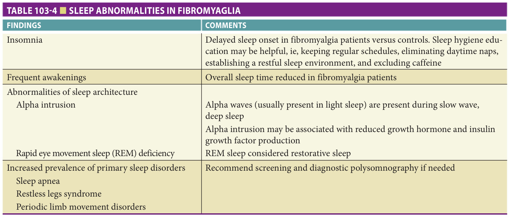

Study summary of Chapter 103; the book and the full chapter are the reference.

# Chapter 103 Study: Fibromyalgia and Myofascial Pain Syndromes

## Summary

**Definition & assessment**
- Fibromyalgia is a widespread pain syndrome involving central sensitization; myofascial pain is commonly regional and associated with active trigger points in taut muscle bands (p1644, p1654).
- They can coexist. Myofascial pain may cause burning or paresthesias and mimic radiculopathy (p1643).
- Investigate other causes of widespread pain with history, examination and medication review; a positive fibromyalgia screen is not sufficient for diagnosis (p1643–1644).
- Examine for synovial and extrasynovial findings suggesting rheumatic disease rather than attributing all pain to fibromyalgia (p1646).

**Management**
- The chapter identifies no single first-line fibromyalgia treatment: begin with education and combine individualized pharmacologic and nonpharmacologic approaches (p1647).
- Aerobic exercise is a key fibromyalgia intervention; interdisciplinary education, cognitive behavioral therapy and exercise may benefit both syndromes (p1664).
- For myofascial pain, stretching, local modalities and addressing perpetuating factors are first-line approaches; medication alone usually does not improve function (p1664).

**Drugs & cautions**
- The authors say practitioners may favor SNRIs over TCAs for fibromyalgia because SNRIs have fewer adverse effects. For duloxetine, the authors start **20 mg daily**, titrating slowly to **60 mg** over at least several weeks; monitor blood pressure and orthostatic symptoms (p1647, p1649).
- Taper duloxetine slowly if stopping: decrease by no more than **50%** at **1–2-week** intervals to avoid withdrawal (p1649).
- Pregabalin: studies used **300–450 mg/day** (p1649). Table 103-6 lists **150–300 mg/day** with a maximum of **450 mg/day** (p1653); sedation and dizziness may contribute to falls. Start low at bedtime and titrate slowly in older adults (p1649).
- Gabapentin: the authors report clinical benefit at **100–600 mg/day** despite inconclusive fibromyalgia evidence; sedation and dizziness also limit use (p1649).
- Milnacipran has approved fibromyalgia efficacy, but these authors do not prescribe it in older adults because of insufficient age-specific data (pp1647, 1649).

### Sorting widespread pain, sleep disturbance and focal muscle pain

- Ask what else accompanies widespread pain. Fatigue, waking unrefreshed and cognitive complaints help characterize fibromyalgia. Review changes in drugs, sleep, mood and activity, and examine for synovitis, weakness or other findings that need a different workup. Rheumatic disease and fibromyalgia can coexist (p1643–1646).
- Figure 103-2 uses the older screening rule of a widespread pain index **at least 7** with a symptom-severity score **at least 5**, or an index of **3–6** with a severity score **at least 9**, with symptoms at a similar level for **at least 3 months**. The later revision adds a generalized pain requirement and explicitly permits another diagnosis. Neither survey substitutes for the clinical assessment (p1643–1644, p1652).
- Table 103-4 describes shorter total sleep, frequent waking, alpha activity intruding into slow-wave sleep and deficient REM sleep. The patient may describe exhaustion despite a long time in bed. Ask about apnea, restless legs and periodic limb movements and pursue sleep testing when indicated (p1649).
- Distinguish the authors' initial drug choice from the overall treatment plan. Severe widespread pain may justify a trial of duloxetine alongside activity and education. The narrative starts at **20 mg/day** and increases gradually to **60 mg/day**. This starting dose for older patients differs from the **30–60 mg/day** range in the medication table. Review orthostatic symptoms and tolerability before increasing (p1649, p1653).
- Palpate for a taut band and ask whether pressure reproduces the patient's usual pain, locally or at a referred site. A brief local twitch may be elicited. Look for biomechanical factors such as restricted hip motion or leg-length discrepancy that can perpetuate symptoms after temporary relief of a trigger point (p1654, p1656–1658).

### Distribution, mechanism and the examination that changes the diagnosis

Ask a patient with “arthritis everywhere” to shade the regions that hurt. A symmetrical map involving the trunk and limbs, above and below the waist, is a clue to fibromyalgia. A patient who shades the shoulder and lateral arm may instead have referred pain from a focal myofascial source. Neither drawing makes a diagnosis. The next step in the first patient is to characterize the accompanying fatigue, sleep and cognitive symptoms and examine for a second disorder; in the second it is to find out whether palpating a particular muscle reproduces the pain that brought the patient in (p1643–1645, p1656).

The distinction changes what the examiner is looking for. In fibromyalgia, altered central pain processing helps explain widespread sensitivity even without visible inflammation at each painful site. In myofascial pain syndrome, a muscle and its surrounding fascia can generate pain locally and in a recognizable distribution elsewhere. Persistent regional pain and widespread sensitivity can coexist. The patient with fibromyalgia and an especially disabling unilateral hip pain therefore deserves an examination of the hip and adjacent muscles. More medication for diffuse pain may do little for a mechanical perpetuating factor (p1643–1644, p1654–1657).

The chapter regards the pathogenesis of fibromyalgia as multifactorial. Table 103-3 organizes evidence for altered pain regulation and other proposed processes. A history of stress, trauma, infection or a family history of pain or mood disorders may contribute to understanding the patient, but is neither necessary nor sufficient for the diagnosis. Central sensitization is a way to explain why pain can become widespread and persistent. It is not a conclusion that every new painful symptom arises from the same process or that the patient should stop reporting new symptoms (p1644, p1648).

### What the diagnostic criteria actually measure

Figure 103-1 shows how the historical self-report survey was scored. Count painful sites during the preceding **7 days** for the **0–19** pain index. Rate fatigue, cognitive trouble and waking unrefreshed from **0 to 3** each for that week; the survey also asks about lower abdominal pain, depression and headache over the preceding **6 months**, scoring each yes or no. The figure gives **0–31 total points**. Symptom duration and another possible explanation are separate questions, not extra points (p1645).

The criteria have changed because tender points, pain distribution and symptom burden measure different things. Earlier classification emphasized widespread pain and tenderness at specified points. Later surveys use a pain-region count together with severity of fatigue, waking unrefreshed and difficulty thinking, and allow screening without performing the old tender-point examination. A count of tender points describes elicited tenderness; it is not the same as counting discrete regions of spontaneous pain or eliciting a patient's characteristic referred pain from a trigger point (Table 103-1, p1643–1646).

As a worked example, the older algorithm in Figure 103-2 allows substantial symptom severity to matter even when fewer painful sites are endorsed. A patient with an index in its lower qualifying range needs a higher symptom-severity score than someone with widespread pain at more sites. Both must have the requisite persistence of symptoms. The later generalized-pain requirement helps avoid classifying a severe but regional pain syndrome as fibromyalgia merely because fatigue and sleep symptoms are prominent. The AAPT screen described in the chapter requires pain in **6 of 9 regions** with at least moderate fatigue or sleep disturbance. Do not combine the cutoff from one system with the symptom list from another (p1644, p1646, p1652).

A positive result prompts clinical assessment. Ask how the symptoms vary over time, how often the person sleeps poorly, whether a medication change preceded their onset and what daily task is affected. A patient with high symptom severity and new joint swelling still needs a joint examination. The revised survey's allowance for another diagnosis is particularly important in geriatrics: coexisting osteoarthritis or inflammatory disease can contribute to some pain without explaining all the fatigue, sleep disruption and widespread sensitivity (p1643–1647).

### Sleep, mood and alternative explanations for widespread symptoms

The historical sleep question is answered by distinguishing waking from specific abnormalities of sleep architecture. Table 103-4 describes frequent awakenings, reduced overall sleep, intrusions of alpha activity into normally slow-wave deep sleep, and REM deficiency. A patient can spend a long time in bed yet wake feeling unrested. Reduced REM duration is the tested direction; an increase in the proportion of REM sleep is not the point of the table. Ask about unrefreshing sleep in terms the patient can recognize without expecting them to describe their own stages of sleep (p1649).

Sleep apnea, restless legs and periodic limb movements occur with increased frequency and have their own clinical implications. Ask about observed interruptions in breathing, distressing leg symptoms and sleep interruption. Use sleep testing when indicated instead of assigning all nocturnal symptoms to fibromyalgia. Education about a regular sleep schedule, a restful environment and caffeine use is relevant, but cannot substitute for evaluation of a suspected primary sleep disorder. Better sleep may make activity and participation easier even when pain intensity changes relatively little (p1649).

Table 103-2 includes other pain disorders that overlap with fibromyalgia, among them irritable bowel syndrome, painful bladder syndrome, temporomandibular pain and chronic headache. Ask about distress, depression or anxiety because these can add substantially to the disability and can be treated. Their presence does not establish that pain is a manifestation of a mood disorder alone. Conversely, improvement in mood during antidepressant treatment does not prove that none of the original pain was musculoskeletal. Assess these domains separately when judging response (p1644, p1647).

The differential in Table 103-5 is useful when symptoms are being attributed too readily to fibromyalgia. Look for objective inflammatory swelling or a pattern of synovitis; ask about the distribution and duration of morning stiffness, proximal weakness and systemic features. Severe pain around the shoulder or hip girdles with a compatible history raises polymyalgia rheumatica. Symptoms that begin after a new drug warrant a medication review. Weakness demonstrable during the examination deserves a different evaluation from reluctance to move because movement hurts. Direct laboratory testing toward the findings that raise a particular alternative (p1646, p1650–1651).

### Choose treatment according to the symptom and the patient's reserve

Education should make the reason for treatment understandable. A drug may reduce pain enough to permit activity, while exercise itself helps conditioning, function and well-being. Set a goal the patient can evaluate: completing a shopping trip, sleeping well enough to walk the next morning, or returning to a regular activity. Figure 103-3 illustrates the Fibromyalgia Impact Questionnaire, which tracks more than a pain rating. At follow-up, check whether a lower pain score is accompanied by a useful gain or instead by dizziness, daytime somnolence or a fall (p1647–1649, p1652–1655).

The chapter's preference for an SNRI over a tricyclic in many older patients is an argument about adverse effects, not an instruction to prescribe one for every newly diagnosed patient. Duloxetine may help pain and mood. Increase it slowly enough to identify intolerance, and consider blood pressure, postural symptoms and hepatic disease. Table 103-7 includes nausea and diarrhea among its adverse effects. If the patient with severe generalized pain in the exam vignette needs a drug, these features help explain why duloxetine is a reasonable choice. Education and a graded activity plan remain part of the same treatment decision (p1647, p1649, p1653).

Pregabalin may improve pain and sleep, but sedation and dizziness can erase a gain in function. Kidney function affects gabapentinoid dosing. The chapter distinguishes trial doses, the medication table's suggested range and the authors' practice of cautious bedtime initiation. Gabapentin is discussed with less certain fibromyalgia evidence; reported clinical benefit at a low dose is not evidence that the population-level effect is as well established as for pregabalin. If a patient cannot walk safely the morning after titration, review the drug before prescribing an additional treatment for the fall risk (p1649, p1653).

Tricyclics can produce sedation and confusion. Table 103-6 also flags narrow-angle glaucoma and conduction concerns. Tramadol can cause sedation or confusion and may precipitate serotonin toxicity with other serotonergic agents. A patient already taking an antidepressant for mood or fibromyalgia therefore needs a reconciliation of the whole regimen before an analgesic is added. For each drug, ask which symptom it is intended to improve, whether the person can tolerate it, and how the trial will be judged. A long list of partially effective agents is especially problematic when several impair balance (p1647–1649, p1653).

Build exercise gradually enough that the patient returns for the next session. Aquatic exercise can be an option when conventional exercise or physical therapy is difficult. The chapter discusses evidence for aerobic activity, tai chi, cognitive behavioral approaches and mindfulness, with varying effects on pain, sleep, stress and function. Frame the aim as recovering usable activity rather than demanding immediate disappearance of symptoms. A patient who can resume a valued activity with tolerable pain has achieved a meaningful outcome even when the questionnaire still records pain at multiple sites (p1652–1654).

### Drug doses in the printed table and the authors' practice

The following are the book's fibromyalgia table doses. Separate a study dose, a maintenance range and a cautious initial dose in an older person; they answer different questions.

- **Gabapentin:** **100–600 mg daily**, with a table maximum of **1,800 mg daily** (p1653). The authors' reported benefit at lower doses is clinical experience. **Pregabalin:** **150–300 mg daily**, maximum **450 mg daily** (p1653); the prose discusses **300–450 mg daily** in the fibromyalgia evidence (p1649). Both require slow titration and renal-dose review; dizziness and sedation can impair balance.
- **Nortriptyline:** **10–50 mg nightly** (p1653). The table flags sedation, confusion and narrow-angle glaucoma, and advises a baseline ECG to assess QT prolongation. **Fluoxetine:** **20–80 mg daily**; **citalopram:** **20–40 mg daily** in the printed SSRI row (p1653). The authors distinguish treating depression from the less certain benefit of SSRIs for chronic pain (p1647).
- **Venlafaxine:** **75–100 mg daily**; **duloxetine:** **30–60 mg daily**; **milnacipran:** **100–200 mg daily** (p1653). For duloxetine, the authors start at **20 mg daily** and increase slowly toward **60 mg daily**. They describe a standard milnacipran start of **12.5 mg daily**, titrated toward **50 mg twice daily**, but do not use it in older patients because age-specific data are lacking (p1649). Review blood pressure and the chapter's cautions regarding hepatic disease and narrow-angle glaucoma (p1653).
- **Tramadol:** **50–100 mg every 6 hours as needed** in the table (p1653). Renal function matters; seizures, confusion and serotonergic combinations are important concerns. **Cyclobenzaprine:** **5–10 mg nightly** (p1653), with sedation and tricyclic-like effects. In a separate discussion of *neuropathic myofascial pain*, the authors report some success using **gabapentin 300 mg twice daily** for paracervical symptoms with cervical spondylosis; this is a clinical observation (p1664).

> Current practice (not the book): The US citalopram label limits patients older than 60 to 20 mg once daily because higher exposure increases the risk of QT prolongation. - [FDA Celexa prescribing information, 2024](https://www.accessdata.fda.gov/drugsatfda_docs/label/2024/020822s055lbl.pdf).

> Current practice (not the book): The AGS Beers Criteria recommend avoiding nortriptyline and cyclobenzaprine in most older adults. Anticholinergic effects and sedation are important for both; orthostasis with nortriptyline and fracture risk with muscle relaxants matter in a patient with falls. - [American Geriatrics Society Beers Criteria, 2023](https://doi.org/10.1111/jgs.18372).

> Current practice (not the book): The US immediate-release tramadol label caps the total at 300 mg/day over age 75. With creatinine clearance below 30 mL/min, extend the dosing interval to 12 hours and limit the total to 200 mg/day. - [US tramadol prescribing information, 2023](https://dailymed.nlm.nih.gov/dailymed/drugInfo.cfm?setid=1279bffe-3494-4016-803c-abbf8fd8f023).

### Find a myofascial trigger point and its perpetuating factor

Figure 103-4 shows a taut band extending from a central trigger point toward its attachments. The integrated hypothesis describes local muscle injury or sustained overuse leading to a self-perpetuating local problem. Other hypotheses in Table 103-8 address why low-level repetitive loading can be important even without memorable trauma. These are explanatory models. The diagnosis in the consulting room still rests on a fitting history, a palpable abnormal band, focal tenderness and reproduction of symptoms. A tender spot that elicits only a new discomfort is less persuasive than one that recreates the familiar complaint (p1654–1657).

Use the examination sequence in Table 103-9. Position the limb so the relevant muscle is accessible and relaxed. Palpate across its fibers to identify a taut band, then locate the most tender nodule within that band. Ask the patient to describe what they feel and *where* they feel it rather than suggesting the expected referral pattern. A brief involuntary twitch may occur. Test whether full stretch is painful or limited. Figure 103-5 illustrates that the referral field can extend beyond the muscle itself, so palpating only the point on the body map where pain is greatest can miss the source (p1656–1658).

A common diagnostic problem is buttock and leg discomfort called “sciatica.” Piriformis dysfunction can produce buttock pain and sciatic-type symptoms; the position and rotation of the hip may provide clues. Gluteus minimus trigger points can cause lateral hip or leg pain during ambulation, a limp or difficulty getting out of a chair. Examine range of motion and look for a neurologic deficit as well as palpating the muscle. Reproducing typical pain is helpful, but it does not exclude hip osteoarthritis, lumbar disease or another contributor that changes treatment (p1658–1660).

For upper-body symptoms, identify the exact distribution and the loading pattern. An upper trapezius trigger point can refer discomfort toward the temple, jaw or behind the eye. Other portions can produce pain around the cervical or upper thoracic spine or the shoulder. Levator scapulae involvement can accompany difficulty turning the neck and pain around the neck–shoulder junction. Ask how the patient sits or works, what happens with prolonged postures and which movement eases the problem. Repeated local treatment without changing a sustained provocative posture leaves an important source of recurrence intact (p1659–1661).

Table 103-10 broadens the examination beyond a trigger-point search in a patient with low-back and leg pain. Look for pelvic asymmetry on standing, limitation of joint range, deformity, weakness, and functional or anatomical leg-length difference. An altered gait can chronically load one side. Joint pathology may perpetuate the muscle problem even when the patient is most aware of referred pain at a distant site. Link the finding to a practical intervention such as an assistive device, a targeted exercise or attention to the underlying joint condition (p1657, p1660–1662).

### When symptoms point in more than one direction

An older patient who reports waking stiff and sore could have several different problems. Ask when the stiffness is worst, how long it persists, where it is felt, and whether the apparent weakness is due to pain on movement or loss of strength during testing. In polymyalgia rheumatica the distribution around shoulder and hip girdles and the inflammatory history warrant a targeted evaluation. In osteoarthritis the distribution in load-bearing joints and the pattern of stiffness can be informative. Visible synovitis, tophaceous deposits or markedly inflamed joints should redirect the evaluation toward a specific articular disorder. Widespread sensitivity elsewhere can still be assessed in the same patient (Table 103-5, p1650–1651).

Consider a different presentation: someone with chronic axial pain can point to a single reproducible tender band but also describes poor concentration, exhaustion, disturbed sleep and multiple other painful regions. A local treatment trial can be appropriate for the focal component without making improvement there the test of the whole diagnosis. Record a task that depends particularly on the affected muscle alongside a broader outcome covering sleep or activity. If the focal intervention allows head rotation but the patient's waking exhaustion persists, an evaluation for sleep disturbance remains appropriate. If duloxetine reduces diffuse pain but focal leg referral is unchanged, revisit hip, spine and muscle mechanics before increasing the drug dose (p1644–1647, p1649, p1656–1658).

The response to exercise also needs interpretation. A flare after unfamiliar activity may lead the patient to abandon all activity. Review the specific movement, its intensity and its relation to the referred pain, then modify the exercise or posture rather than losing the conditioning program altogether. For a patient learning self-stretching, ask them to demonstrate the technique and identify a realistic place for it in their routine. The chapter's emphasis on activity pacing, home exercise and prevention of recurrence makes follow-up an opportunity to adjust the plan as function improves (p1662–1664).

### Follow response without treating the same trigger indefinitely

Table 103-11 and Figure 103-6 put local treatment in a wider plan. Begin with education, stretching or self-massage, activity pacing and correction of perpetuating factors. Consider local heat or ice and an appropriate walking aid or other adaptation. A therapist can teach technique or add manual release when self-management alone is insufficient. The decision point in the algorithm is **at least 30% less pain plus meaningful functional improvement**. Less pain without better use of the affected region should lead to a review of the diagnosis, treatment burden and remaining obstacles (p1662–1663).

When conservative measures have not restored function, the chapter describes dry needling and trigger-point injection by experienced clinicians. The treatment is directed at a clinically active trigger point and accompanied by a home program. The chapter does not find an added benefit of local anesthetic over dry needling in the comparison summarized in Table 103-11. Evidence for adding corticosteroid is uncertain, and it introduces local and systemic risk. Botulinum toxin can cause weakness and is expensive. These are reasons to reassess after a trial rather than move automatically through increasingly invasive procedures (p1662–1664).

The two syndromes meet again during follow-up. Someone with predominantly regional pain may gain substantially from changing muscle load and treating a reproducible trigger point. Someone with diffuse pain, sleep disturbance and fatigue needs a plan that addresses more than the most tender muscle. If local pain improves but generalized function does not, reconsider concurrent fibromyalgia, mood, sleep or another pain generator. If widespread pain becomes controlled but one movement remains severely limited, return to the local mechanical examination. The chapter's distinction is most valuable when it changes this next clinical action (p1643–1644, p1656–1658, p1664).

## Exam traps

- A tender-point examination is not required by newer screening methods; clinical evaluation for alternative causes remains necessary (p1643–1644).
- Oral NSAIDs, benzodiazepines and tricyclics used for myofascial pain generally should be avoided in older adults because of their risk profiles (p1664).

## Exam-cited book images

Book images cited by past exams. Tap an image to zoom.

## Table 103-4 — book image

[2025-Jun Q24](?chapter=bank&q=mcq-70ad7b8acd5368cde6d6a062)

## Past exam questions

- [2026-Jun Q86](?chapter=bank&q=mcq-a84c59a354c18de39d822ccd) — Printed pages 1647, 1648, 1649, 1650.
- [2025-Jun Q24](?chapter=bank&q=mcq-70ad7b8acd5368cde6d6a062) — Related bank item. Its bibliography does not give a printed Hazzard page for this chapter.

## Recall drill

**1. How does the typical distribution of myofascial pain differ from fibromyalgia?**

Answer
Myofascial pain is often regional, with a trigger point in a taut band. Fibromyalgia produces widespread pain. The disorders can coexist. (p1643–1644, p1654)

**2. What symptoms should accompany the pain history in suspected fibromyalgia?**

Answer
Ask about fatigue, unrefreshing sleep, cognitive symptoms, mood and the effect of symptoms on function. (p1643–1645)

**3. Does a positive fibromyalgia screening score establish the diagnosis?**

Answer
No. Interpret it alongside a history, examination and assessment for other treatable explanations or comorbid disease. (p1643–1646)

**4. Which alteration in sleep architecture occurs in fibromyalgia?**

Answer
The book describes REM deficiency and alpha-wave intrusion into slow-wave sleep, with frequent awakenings and less total sleep. (p1649)

**5. What treatable sleep disorders deserve consideration?**

Answer
Sleep apnea, restless legs syndrome and periodic limb movement disorder. Use diagnostic polysomnography where indicated. (p1649)

**6. Why examine the joints and soft tissues even when the pain is widespread?**

Answer
Synovitis or extrasynovial signs can point to rheumatic disease that warrants evaluation and may coexist with fibromyalgia. (p1646)

**7. What accompanies a medication trial in fibromyalgia?**

Answer
Education, individualized activity and aerobic exercise. Psychological or interdisciplinary approaches may also improve pain and function. (p1647, p1653–1654)

**8. How do the authors start duloxetine in an older adult?**

Answer
Start at 20 mg daily and increase slowly toward 60 mg over at least several weeks if tolerated. Monitor blood pressure and orthostatic symptoms. (p1649)

**9. Why might an SNRI be chosen before a tricyclic antidepressant?**

Answer
The authors cite a lower burden of adverse effects. This preference when choosing a drug does not define a universal first treatment for fibromyalgia. (p1647)

**10. How should duloxetine be stopped according to the chapter?**

Answer
Taper gradually, reducing by no more than 50% at intervals of one to two weeks to reduce withdrawal symptoms. (p1649)

**11. Why start a gabapentinoid cautiously?**

Answer
Sedation and dizziness can impair balance. Titrate gradually and consider renal function. (p1649, p1653)

**12. What finding supports a myofascial trigger point?**

Answer
A palpable nodule in a taut muscle band that reproduces the usual local or referred pain. Pressure may also elicit a local twitch. (p1654, p1656–1658)

**13. Why might myofascial pain resemble radiculopathy?**

Answer
It can refer pain outside the muscle and produce burning or paresthesias. Examine for a reproducible trigger point and neurologic findings. (p1643, p1656–1658)

**14. What perpetuating factors should be sought before repeating local treatment?**

Answer
Consider abnormal mechanics, limited joint motion, postural strain, muscle weakness or a leg-length discrepancy. (p1657–1659)

**15. Which approach does the chapter emphasize for myofascial functional recovery?**

Answer
Stretching, local treatment and correction of perpetuating factors, alongside education and activity. Medication alone usually does not restore function. (p1664)

