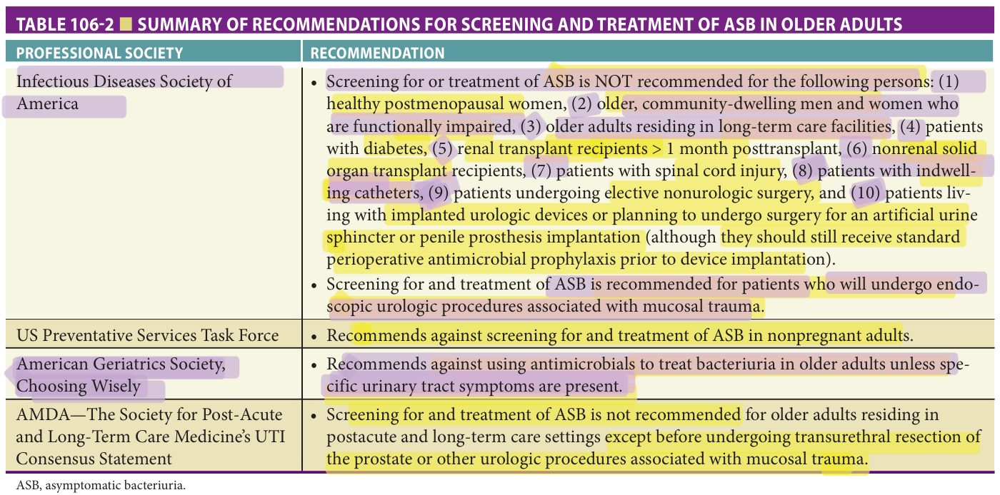

Study summary of Chapter 106; the book and the full chapter are the reference.

# Chapter 106 Study: Urinary Tract Infections

**Full chapter available: [Read Chapter 106](?chapter=106).**

## Summary

## Definition & epidemiology
- ASB is bacteriuria, with or without pyuria, without localizing genitourinary symptoms; bacteriuria in older adults is usually asymptomatic colonization. (p. 1699)

- Simple cystitis stays within the bladder; complicated UTI extends beyond it and includes pyelonephritis. Recurrent UTI: **≥3 in 12 months** or **≥2 in 6 months**, after clinical resolution of each treated episode. (p. 1700)
- CAUTI requires compatible symptoms with an indwelling urethral, suprapubic or intermittent catheter, or genitourinary symptoms within 48 hours of removal with no other infection source. In the comparison extending onto p1708, **IDSA clinical criteria use ≥10³ cfu/mL** of at least one bacterial species in a catheter specimen or a midstream specimen after removal. **AMDA uses ≥10⁵ cfu/mL**, and **SHEA surveillance uses ≥10⁵ cfu/mL** in a catheter specimen. The overview on p1700 gives ≥10⁵ and notes counts as low as ≥10² in some symptomatic patients. Bacteriuria and pyuria are common with chronic catheters (p1700, p1707–1708).
- UTI may be hematogenous rather than ascending, secondary to bacteremia from a nonurinary source; this is particularly a consideration when *Staphylococcus aureus* is isolated in a patient without an indwelling catheter. An indwelling catheter is consistently a strong risk factor for symptomatic UTI; the most common risk factor is a history of UTI (p. 1702)

## Diagnosis & management

- Do not screen/treat ASB routinely; the exception discussed for older adults is endoscopic urologic procedures associated with mucosal trauma. (p. 1703)

- In PALTC residents without specific urinary signs or symptoms, behavioral change (exclusive of delirium), functional decline, falls or anorexia should NOT prompt evaluation for UTI; a change in the character of the urine may reflect mild dehydration, diet or medication (p. 1705)
- Urine-character changes alone do not establish UTI. McGeer criteria serve surveillance; Loeb criteria guide antibiotic decisions. (p. 1705)
- With nonspecific symptoms but no UTI criteria or warning signs, use active monitoring, hydration and alternative-diagnosis assessment. Fever, rigors, unstable vitals or clear-cut delirium require evaluation. (p. 1712)

## Microbiology

- *E coli* causes **75% to 95%** of infections in ambulatory older women, asymptomatic or symptomatic; other Enterobacteriaceae and *Enterococcus* are occasional, *Pseudomonas* and group B and D streptococci rare. In uncomplicated UTI, over **95%** are due to a single organism; skin flora usually signify contamination (p. 1707)
- In LTCF residents *E coli* is still most frequent, followed by *Proteus*, *Klebsiella*, *Enterococcus*, *Staphylococcus* and *Pseudomonas*; *Acinetobacter*, *Candida* and MRSA are less common. With MRSA in the urine, consider staphylococcal bacteremia as a potential source. Polymicrobial bacteriuria is more likely in LTC residents, especially with a chronic catheter: more than one organism in **10% to 25%** of bacteriuric subjects (p. 1707)
- Risk factors for non-*E coli* UTI in community-dwelling older adults: male gender, severe presentation (symptoms more than 7 days, fever, nausea or vomiting, flank pain), UTI in the past 12 months, diabetes, previous TMP/SMX failure, functional or anatomical abnormalities (p. 1707)

## Drugs — acute simple cystitis
- Nitrofurantoin monohydrate/macrocrystals **100 mg twice daily for 5 days**; avoid with CrCl **<30 mL/min** or long-term suppression. (p. 1708)
- TMP/SMX **160/800 mg twice daily for 3 days**; avoid empiric use when local uropathogen resistance exceeds **20%**. (p. 1708)

- TMP/SMX interacts with warfarin and sulfonylureas; monitor increased INR/hypoglycemia risk. (p. 1709)
- Fosfomycin **3 g once orally**: generally reserved for resistant pathogens or inability to use other first-line drugs; not for complicated UTI. (p. 1709)

- Most older men with simple cystitis: **7 days** if response is prompt, within **72 hours**; assess for extension beyond the bladder. (p. 1711)

### Deciding when a positive culture should change care

- In someone with no compatible symptoms, diabetes, residence in long-term care, chronic catheterization and planned elective nonurologic surgery are among the settings in which Table 106-2 advises against screening or treating bacteriuria. Endoscopic urologic procedures that injure mucosa are the important exception. The book advises a preprocedure culture, targeted treatment for one or two doses, and starting **30 to 60 minutes** before the procedure (p1703, p1707–1708).
- A positive dipstick in a resident who has fallen does not locate the cause of the fall. Look for a new urinary complaint or a systemic warning sign, assess hydration, review other explanations and arrange reassessment. Acute delirium warrants evaluation for infection and noninfectious causes. Chronic colonization makes the urine a poor discriminator by itself (p1704–1705, p1712).
- Ask whether the catheter remains necessary. If it has been in place for **over 2 weeks**, discontinue it if possible or replace it before collecting the specimen. A recently removed catheter still matters when a patient develops urinary symptoms within **48 hours**. In the catheterized patient, pelvic discomfort, fever or rigors without another source can support infection (p1700, p1704, p1707–1708).
- Distinguish drugs for bladder infection from therapy for a patient with systemic illness. Vomiting may preclude oral treatment. Pyelonephritis requires an agent that reaches renal tissue, and the book includes parenteral ceftriaxone among initial options. A stable patient with isolated dysuria and a patient with vomiting and fever therefore need different assessments (p1709–1711).

### What the specimen can and cannot establish

A culture has two separate components: what grew and why the sample was sent. A carefully collected sample from someone without urinary symptoms can demonstrate genuine bladder bacteriuria and still supply no reason to give antibiotics. Pyuria indicates inflammation. Leukocyte esterase detects an enzyme associated with white cells; nitrites indicate that bacteria capable of producing them may be present. Neither marker establishes that the patient's present illness originates in the urinary tract. Ask whether dysuria, suprapubic pain, new urgency, frequency, visible blood or new incontinence preceded the urine test. Ask separately about flank pain, rigors, vomiting or systemic illness, which change the suspected anatomic extent and the urgency of management (p1699–1701, p1704).

For voided specimens, the definition of asymptomatic bacteriuria in the prose calls for the same uropathogen at **at least 10⁵ CFU/mL in two consecutive specimens** in women; one appropriately collected voided specimen suffices in men. For an asymptomatic person of either sex, one catheter specimen growing a uropathogen at **at least 10² CFU/mL** can meet the microbiological definition. Table 106-1 summarizes sampling by sex and collection method. These are definitions for interpreting specimens that have been obtained, not an invitation to obtain serial samples from an asymptomatic resident. Do not borrow a count from one collection method and apply it uncritically to another (p1699–1701).

In healthy older women, the chapter gives an approximate ASB prevalence of **5% to 20% at ages 65 to 90**, rising to nearly **45% after 90**. In community-dwelling men the estimate is about **5%**, rising to **20% after 80**. In long-term care the estimates across men and women are roughly **15% to 50%**. These figures explain why the same positive result can be particularly unhelpful in a nursing-home resident with a nonspecific change. Incontinence and advanced cognitive impairment also make proper sampling difficult and may exclude some of the people with the highest likelihood of bacteriuria from prevalence studies (p1700–1701).

### Why prior infection, host factors and setting matter

Incomplete emptying provides a plausible mechanism for infection, but the relationship is not a simple residual-volume cutoff. A postmenopausal case-control study linked recurrent UTI to incontinence, cystocele and residual urine. A prospective ambulatory cohort did not find a significant difference in UTI risk comparing residuals over **200 mL** with those below **50 mL**. A nursing-home surveillance study likewise failed to associate a residual of **100 mL or more** with increased risk. An individual with poor emptying may need an assessment of obstruction or bladder function; the presence of residual urine alone does not diagnose the cause of new weakness or justify antibiotics (p1702).

A history of earlier UTI carries information about recurrence. In one postmenopausal study, a history before menopause was associated with higher subsequent risk than no prior infection. Declining estrogen can change vaginal flora, with fewer lactobacilli and more colonization by potential urinary pathogens. This provides a rationale for local estrogen prevention in selected women, while studies of individual factors such as sexual activity or incontinence do not all produce the same estimates. Diabetes is associated with more UTI and can change the mix of organisms or the likelihood of upper-tract involvement. It still does not justify treatment of asymptomatic bacteriuria. Instrumentation or a catheter changes both the probability of colonization and the interpretation of symptoms (p1702–1703).

June 2023 basic-track Q126 asks which microbiological inference is defensible. In a person without a catheter, urinary *S. aureus*, including MRSA, can reflect bloodstream infection arising elsewhere. This possibility changes the clinical evaluation. It does not imply that every patient with a staphylococcal isolate has bacteremia. The other choices misrepresent the usual distribution of organisms: *E. coli* remains the leading isolate even in facilities, mixed growth is unusual in uncomplicated infection, and polymicrobial bacteriuria is more frequent with catheterization without describing most infections in every catheter user (p1702, p1707).

### Deciding whom to investigate

Start with the distribution and timing of the symptoms in an ambulatory patient. Acute painful urination carries a different meaning from longstanding frequency on a diuretic. A new increase in urgency, suprapubic pain or gross hematuria can support a bladder source. Flank or costovertebral angle pain, fever, rigors or vomiting shifts the concern beyond the bladder. A patient with pyelonephritis can lack cystitis symptoms. Conversely, a positive culture obtained for chronic nocturia can reflect colonization. Ask about genital irritation and other explanations for burning; establish what is new relative to the patient's usual urinary function (p1700, p1703–1704).

June 2023 Q55 asks about **screening before an invasive urologic procedure**. Identify whether the planned intervention is expected to breach mucosa. In this setting the consequences of proceeding in the presence of bacteriuria differ from the consequences of leaving an asymptomatic resident untreated. Obtain the culture beforehand to select active perioperative therapy, rather than making culture screening routine for every resident with an indwelling catheter or spinal cord injury. The kidney-transplant option describes a recipient a year after transplantation; the book's exception concerns the procedure, not remote transplantation in itself. Routine elective nonurologic surgery is another explicit contrast in Table 106-2 (p1703, p1707–1708).

June 2026 Q84 asks what to do after a culture has already been sent for weakness and loss of function. The patient has no new dysuria, frequency or urgency and no fever or inflammatory response in the vignette. The isolate and susceptibility results offer a choice of active drugs, but no finding ties the change in function to urinary infection. Treat the function change as a real clinical problem: look for dehydration, medication effects, another infection or a noninfectious illness, and specify what deterioration should prompt reassessment. Repeating the culture solely to see whether the same organism persists will not supply the missing clinical link (p1704–1706, p1712).

### Knowing which nursing-home criteria the question uses

For **surveillance** in a resident without a catheter, Table 106-3 combines a clinical pathway with a microbiological criterion. Acute dysuria or acute testicular, epididymal or prostatic pain, swelling or tenderness can satisfy the clinical part. A different route is fever or leukocytosis plus at least one local feature, including new costovertebral or suprapubic pain, gross hematuria, or a marked change in continence, urgency or frequency. Without fever or leukocytosis, the table requires at least two of its listed lower-tract features. The culture criterion differs for voided and in-and-out catheter specimens. Do not count baseline incontinence twice as both a new symptom and a reason for collecting the specimen (p1705).

In Table 106-4, for **minimum criteria to start antibiotics**, Loeb uses acute dysuria alone, or fever with a new or worsening local symptom in someone without a catheter. With a catheter the minimum clinical criteria include fever, rigors, new delirium or costovertebral angle tenderness. Other tools differ in precisely what triggers action. The AHRQ algorithm can use a combination of new local symptoms even without fever. The IOU consensus for uncomplicated cystitis emphasizes dysuria with hematuria, suprapubic pain or frequency/urgency, or the particular combination of hematuria and suprapubic pain. The Delphi approach distinguishes local from systemic symptoms, taking account of severity, a competing explanation and the presence of a catheter. State which function the rule serves before interpreting the patient's findings (p1705–1706).

Figure 106-1 separates a stable nonspecific change from clinical features localizing the illness. For the stable resident, start active observation, assess medication and fluid intake, and look for another cause. A negative dipstick for both leukocyte esterase and nitrite in the assessment pathway makes UTI unlikely. A positive dipstick can justify further testing in the appropriate clinical context; it does not cancel the need to reassess symptoms. If they disappear without therapy while the specimen is pending, a later positive result should not automatically trigger a prescription. After successful treatment, clinical resolution is the endpoint; a routine test of cure may merely document the return of asymptomatic bacteriuria (p1704–1705).

### Catheter-associated symptoms and collection

The May 2024 Q19 alternatives test three separate requirements. A Penrose drain does not establish urinary catheter exposure. A catheter removed a week earlier falls outside the chapter's **48-hour** attribution window. A patient with a catheter and heavy *E. coli* growth but no compatible symptoms illustrates bacteriuria. The keyed patient has a catheter, delirium and suprapubic tenderness. Purulent-looking urine alone would not make this diagnosis; evaluate for other sources, obtain an appropriate specimen and interpret the result using the intended clinical criteria. Clear-cut delirium with no other explanation differs from a nonspecific report that a resident was less social on one shift (p1700, p1705–1708).

A catheter can prevent a patient from reporting the usual frequency or urgency of spontaneous voiding. Ask about the time of catheter insertion or removal, obstruction, localized pelvic or perineal discomfort, flank tenderness, rigors, and new instability. Where discontinuation is feasible, address the device rather than leaving it indefinitely because a culture is positive. When replacement of a longstanding catheter is indicated and drainage must continue, culture from the new catheter. Table 106-5 contrasts the IDSA clinical culture threshold of at least 10³ CFU/mL with the SHEA surveillance threshold of at least 10⁵ CFU/mL, each requiring its own clinical criteria (p1708). The surveillance threshold is intentionally more specific for counting events; it should not be presented as the exclusive threshold for every symptomatic individual (p1704, p1707–1708, p1714).

### Oral agents, tissue penetration and the decision to admit

Table 106-6 gives standard adult oral doses for **creatinine clearance above 60 mL/min**. Interpret each regimen with its syndrome. For bladder-limited illness, the chapter's alternatives include amoxicillin–clavulanate **500/125 mg twice daily for 5–7 days**, cefpodoxime **100 mg twice daily for 5–7 days**, or cefixime **400 mg orally for 5–7 days**. Resistance limits initial use of beta-lactams in some settings, and prior urine susceptibilities may alter the choice. Gastrointestinal intolerance and rash matter. Nitrofurantoin's uncommon pulmonary toxicity is particularly relevant to an older patient with a gradual new respiratory syndrome during suppressive therapy; its useful urinary concentration does not make it suitable for a kidney infection (p1708–1709).

Keep the component order straight when reading the double-strength TMP/SMX tablet: **160 mg trimethoprim with 800 mg sulfamethoxazole**. The table presents the amounts in the reverse numerical order from the treatment prose. Assess renal function, other medicines and the likely susceptibility. A rise in serum creatinine can occur; interactions with warfarin and sulfonylureas can be consequential in a patient already at risk of bleeding or hypoglycemia. Fosfomycin supplies a single-dose option for selected lower-tract infections but is an inadequate choice when systemic illness or renal involvement calls for tissue penetration. When a person has substantially impaired renal function, do not extrapolate the table's standard dosing schedule unchanged (p1708–1711).

For complicated infection, Table 106-6 gives **160 mg trimethoprim plus 800 mg sulfamethoxazole twice daily for up to 14 days**. The chapter favors confirming susceptibility; if TMP/SMX is started empirically, the table calls for an initial long-acting parenteral dose. It lists **amoxicillin–clavulanate 875 mg twice daily for 10–14 days** after suitable parenteral therapy if this less-favored oral option is used. The printed entry specifies only the 875-mg amount, not a separate clavulanate amount, and assumes creatinine clearance above 60 mL/min. Neither entry is the short bladder-only regimen. For fosfomycin the same table notes intervals of **2–3 days** between doses in extended courses, while its uncomplicated-cystitis row is a single dose and it excludes complicated UTI. Ciprofloxacin absorption can be reduced by concomitant antacids or mineral-containing supplements (p1709–1711).

> Current practice (not the book): For complicated UTI improving on effective therapy, IDSA suggests 5–7 days of a fluoroquinolone or 7 days of a non-fluoroquinolone, counted from the first effective dose. Evidence for short oral beta-lactam courses is limited, and some excluded groups, including patients with obstruction, suspected prostatitis or abscess, require individualization. - [IDSA complicated UTI guideline, 2025](https://www.idsociety.org/practice-guideline/complicated-urinary-tract-infections/).

The book lists ciprofloxacin **250 mg orally twice daily for 3 days** for acute simple cystitis as an alternative constrained by resistance and adverse effects. For complicated UTI its comparison table lists **500 mg orally twice daily for 5–7 days** (Table 106-6, p1709). Toxicities include tendon injury, peripheral neuropathy, dysglycemia and *C. difficile* colitis. A drug that penetrates kidney tissue is not automatically appropriate for empirical use when local resistance, a previous resistant isolate or an individual risk makes success unlikely. The chapter describes longer courses for selected patients with delayed response or an extended focus. Table 106-7 distinguishes *ongoing* obstruction from a remote obstruction that has resolved. It also asks about instrumentation, impaired voiding, renal or metabolic disease and immunosuppression; persistent obstruction requires source control (p1710). Reevaluate at the bedside rather than carrying over the duration from a previous cystitis episode (p1709–1712).

June 2025 Q12 links dysuria to fever, vomiting, tachycardia and renal dysfunction. Here the clinical syndrome must drive selection before narrowing to a drug suggested by a positive dipstick. Vomiting makes oral absorption unreliable; the low estimated clearance further weakens the case for nitrofurantoin. An oral lower-tract dose of fosfomycin would leave potential renal-parenchymal infection inadequately treated. Of the options, **intravenous ceftriaxone** addresses a systemic urinary infection. Consider sepsis, obstruction, need for admission and fluids as appropriate, send cultures, and review susceptibility and response before choosing a narrower or oral regimen (p1709–1712).

### Prevention, stewardship and care near the end of life

In Figure 106-2, a resident with warning signs needs prompt assessment for a systemic infection, with cultures and empirical treatment when the syndrome supports UTI; reconsider the source and adjust therapy when results return. Without warning signs, meeting symptom criteria prompts testing and treatment guided by prior susceptibility. Without either, start active monitoring and avoid antibiotics if the symptoms resolve or another cause is found (p1712).

Prevention starts by choosing the outcome that matters. A reduction in bacteria or white cells in urine is not necessarily a reduction in symptomatic infections. The cranberry trials differ in preparation, population and endpoint. One pooled estimate suggested a benefit in healthy women at risk, while the PALTC consensus did not support cranberry as a routine prevention strategy for facility residents. Volume and sugar load can make juice unsuitable; cost and the size of capsules can limit adherence. The prevention section does not recommend cranberry as treatment for an established symptomatic infection (p1713).

The cranberry capsule study in long-term care used **36–108 mg of proanthocyanidins (PAC)**. Its finding was a trend toward less bacteriuria plus pyuria; it did not establish a preventive dose for symptomatic infection. The separate pooled estimate in healthy women at risk of UTI was a relative risk of **0.74** (95% CI **0.55–0.98**). The population and endpoint are both different, so that estimate cannot be used as a symptomatic-UTI effect for the long-term-care capsule trial (p1713).

Local estrogen can restore a more favorable vaginal environment after menopause. Two trials studied vaginal cream containing **0.5 mg estriol** and a ring containing **2 mg estradiol**. Both reported benefit individually, but the pooled risk estimate crossed the null. In one estriol study the rates were **0.5 versus 5.9 episodes per patient-year**. Irritation, burning and itching were generally mild in that report. Consider vaginal estrogen for recurrent infection and coordinate with oncology when there is a personal history or high risk of estrogen-dependent malignancy. It does not infer that systemic estrogen has the same preventive effect (p1713).

Before prophylactic antibiotics, document that the recurrences were symptomatic, resolved between episodes and are burdensome enough to justify prolonged exposure. An uncorrectable structural problem, infected stone or repeatedly symptomatic prostatic source is a different situation from persistently positive routine cultures. Balance possible prevention against resistant organisms, adverse reactions and *C. difficile*. The chapter describes uncertain evidence for methenamine salts, probiotics, vitamin C and D-mannose at the time of writing. The presence of these options in the prevention section is not evidence of equivalent effectiveness in frail residents (p1713–1714).

Preventing CAUTI means avoiding the device when possible, inserting it aseptically when needed, maintaining closed drainage and flow, and reviewing its ongoing indication. Keep the collection bag below bladder level. Routine irrigation or fixed-interval changes can disrupt the system; consider replacement for obstruction, infection or a break in the system. A facility's culture ordering, device days and antibiotic prescribing can reveal different causes of overuse. A facility ordering cultures for every fall needs a different intervention from one obtaining appropriate cultures but continuing broad therapy despite results. Figure 106-3 pairs practical tools such as symptom-based order sets, a culture follow-up process and prescribing feedback with the specific failure being addressed (p1714–1716).

Near the end of life, ask whether evaluation or treatment can relieve a symptom the person is experiencing and whether the burdens fit their goals. A patient in hospice can still benefit from treatment of distressing dysuria. Conversely, obtaining invasive specimens or intravenous access in advanced dementia can impose burdens without clear benefit when symptoms cannot be attributed to UTI. Discuss adverse effects, the monitoring required and alternative comfort measures with the patient or surrogate. A decision to focus on comfort is an active care plan with reassessment of distress, not a positive culture left unattended (p1716–1717).

## Exam traps & prevention
- Male sex alone does not make every UTI complicated. (p. 1710)

- Nitrofurantoin/fosfomycin lack adequate renal penetration for complicated UTI. (p. 1711)
- Complicated UTI with severe symptoms (eg, persistent vomiting), suspected sepsis, uncertain diagnosis, obstruction or significant frailty should be hospitalized. The book limits empiric oral therapy for complicated UTI to fluoroquinolones, but not empirically where local resistance exceeds **10%**; then give an initial dose of a long-acting parenteral agent (eg, ceftriaxone, ertapenem) first (p1711)
> Current practice (not the book): Empiric therapy depends on illness severity, prior cultures and antibiotic exposure, and patient-specific risks. In sepsis, consult a relevant local antibiogram. Selected patients can receive other oral agents, and definitive therapy should follow susceptibility results. - [IDSA complicated UTI guideline, 2025](https://www.idsociety.org/practice-guideline/complicated-urinary-tract-infections/).

- Avoid unnecessary catheters and remove promptly when no longer indicated; routine fixed-interval replacement is not recommended. (p. 1714)

## Past exam questions

- [June 2026 Q84](?chapter=bank&q=mcq-f7b82a0ad50cab63832650a2) — Printed page 1705.
- [June 2025 Q12](?chapter=bank&q=mcq-60d358f39722f9df5a3990cc) — Printed pages 1709, 1710, 1711.
- [May 2024 Q19](?chapter=bank&q=mcq-81abf0ac32298245ce5a44eb) — Printed page 1700.
- [June 2023 Q55](?chapter=bank&q=mcq-526291ef04bcef123eab45db) — Printed pages 1702, 1703.
- [June 2023 Basic Q126](?chapter=bank&q=mcq-d4b7c6cbda3fa63a7b531e1f) — Printed page 1707.

[Earlier sittings, chapter-level mapping](?chapter=106#asked-chapter) — 2022-Jun Q69, 2021-Dec Q16, 2021-Dec Q88, 2020 Q24, 2020 Q46.

## Table 106-2 — book image

[June 2023 Q55](?chapter=bank&q=mcq-526291ef04bcef123eab45db)

## Recall

**1. Does pyuria convert asymptomatic bacteriuria into symptomatic UTI?**

Answer
No. ASB can occur with or without pyuria in the absence of localizing genitourinary symptoms. (p1699)

**2. What distinguishes simple cystitis from complicated UTI in this chapter?**

Answer
Simple cystitis is confined to the bladder; complicated infection extends beyond it, including renal-parenchymal infection in pyelonephritis. (p1700)

**3. How is recurrent UTI defined?**

Answer
At least <strong>3 symptomatic UTIs in 12 months</strong> or <strong>2 in 6 months</strong>, following clinical resolution of each episode with treatment. (p. 1700)

**4. Does a high postvoid residual consistently predict symptomatic UTI?**

Answer
No. Study findings conflict; high residuals were not consistently associated with symptomatic infection in ambulatory women or long-term-care residents. (p1702)

**5. What ASB-treatment exception is specified for older adults?**

Answer
Screening and treatment before endoscopic urologic procedures associated with mucosal trauma. (p1703)

**6. Should a urine color or odor change alone establish UTI?**

Answer
No. A change in urine character is insufficient and may reflect mild dehydration, diet or medications. (p1705)

**7. What are the different purposes of McGeer and Loeb criteria?**

Answer
Original/revised McGeer criteria support nursing-home surveillance; Loeb minimum criteria support clinical antibiotic decisions. (p. 1705)

**8. What belongs in active monitoring for nonspecific symptoms?**

Answer
Frequent vital-sign, hydration and symptom checks; hydration support; alternative-diagnosis assessment; and explicit criteria for notifying the physician about deterioration or persistence. (p. 1705)

**9. What nitrofurantoin regimen and renal limit does the chapter give for simple cystitis?**

Answer
Monohydrate/macrocrystals <strong>100 mg twice daily for 5 days</strong>; avoid if CrCl is <strong>&lt;30 mL/min</strong>, and avoid long-term suppression. (p. 1708)

**10. What TMP/SMX regimen and local-resistance cutoff are given?**

Answer
<strong>160/800 mg twice daily for 3 days</strong> for simple cystitis; avoid empiric use if local uropathogen resistance exceeds <strong>20%</strong>. (p. 1708)

**11. Which important TMP/SMX interactions should be recognized?**

Answer
Warfarin, with increased INR, and sulfonylureas, with increased hypoglycemia risk. (p. 1709)

**12. What is the fosfomycin dose and its usual place in simple-cystitis treatment?**

Answer
<strong>3 g as a single oral dose</strong>; generally reserved for highly resistant pathogens or inability to use other first-line agents. It is not recommended for complicated UTI. (p. 1709)

**13. Can an older man have simple cystitis?**

Answer
Yes. Men should not automatically be classified as having complicated UTI, but require careful assessment for infection extending beyond the bladder. (p1710)

**14. When may a week of antibiotics suffice for an older man with simple cystitis?**

Answer
For most, <strong>7 days</strong> is adequate if the response is prompt, within <strong>72 hours</strong>. (p1711)

**15. What warning signs prevent a nonspecific presentation from being treated as routine observation alone?**

Answer
Fever, rigors/chills, unstable vital signs or new clear-cut delirium warrant evaluation for infection and noninfectious causes; assess whether the presentation is consistent with UTI. (p. 1712)

