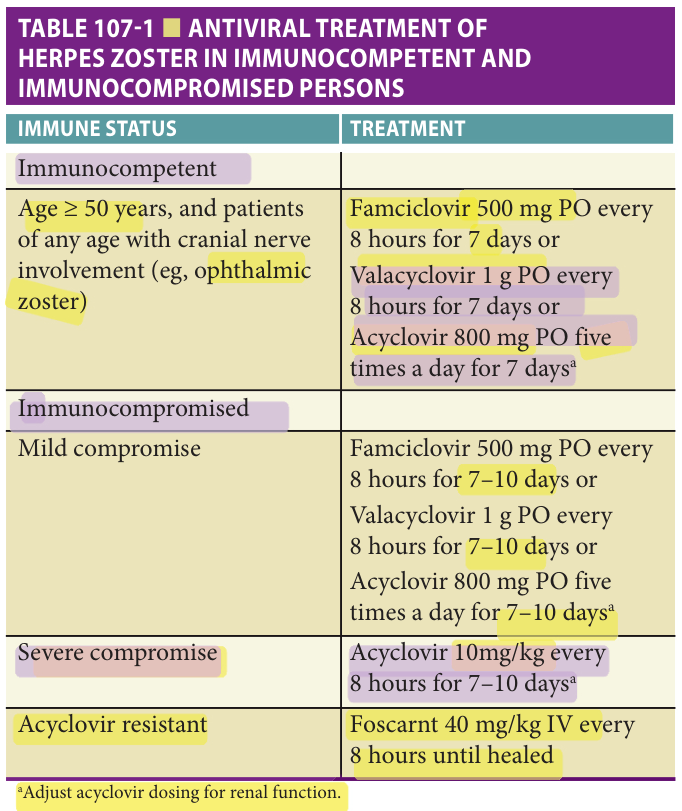

Study summary of Chapter 107; the book and the full chapter are the reference.

# Chapter 107 Study: Other Viruses: Human Immunodeficiency Virus Infection and Herpes Zoster

## Summary

**HIV in older adults**
- More than **50%** of people living with HIV in the United States are at least **50**; treatment has transformed HIV into a chronic disease of aging (p1719).
- Consider HIV with unexplained anemia, fatigue, weight loss or pneumonia; nonspecific symptoms and assumptions about age can delay diagnosis (p1719–1720).
- Link newly diagnosed patients rapidly to HIV care. ART is recommended regardless of CD4 count, with greatest long-term benefit when counts remain above **500 cells/μL** (p1720).
- Viral suppression reduces transmission, but does not generally eradicate HIV. Multimorbidity, polypharmacy and functional decline remain concerns even with controlled infection (p1719).

**Zoster: diagnosis**
- Reactivation of latent varicella-zoster virus causes unilateral dermatomal pain and rash; postherpetic neuralgia is pain at least **90 days** after rash onset (p1725). Zoster risk increases with age and immunocompromise, including HIV, hematologic malignancy, transplant, **systemic lupus erythematosus** and immunosuppressive drugs; the chapter also lists female sex, White race, psychological stress and physical trauma (pp1725–1726).
- Pain, burning or hyperesthesia can precede rash by days and mimic visceral or neurologic disease. Zoster sine herpete can cause dermatomal neuralgia without rash (p1726).
- Typical dermatomal vesicles with pain support the clinical diagnosis; recurrent localized lesions also raise herpes simplex in the differential (p1727).

**Antiviral treatment**
- Acyclovir **800 mg five times daily for 7 days**, famciclovir **500 mg every 8 hours for 7 days**, or valacyclovir **1 g three times daily for 7 days** reduced pain in trials treating within **72 hours** (p1727).
- Common adverse effects include nausea, vomiting, diarrhea and headache. Famciclovir and valacyclovir allow less frequent dosing than acyclovir (p1727).
- The chapter makes exceptions to the **72-hour** treatment threshold for ophthalmic zoster or continuing new vesicle formation; topical antivirals are ineffective (p1727).

**Pain, prevention & exam traps**
- Keep lesions clean and dry; treatment aims to shorten the acute attack and relieve pain (p1727).
- Corticosteroids do not prevent postherpetic neuralgia and are not for routine use; selected patients may obtain acute pain benefit, but steroids must accompany antivirals (p1728).
- Recombinant zoster vaccine combines viral glycoprotein antigen with an adjuvant and helps prevent zoster and postherpetic neuralgia (p1728).
- Do not equate absence of rash with absence of zoster, or viral suppression with cure of HIV (p1719, p1726).

### Earlier recognition of HIV and ongoing geriatric care

- Take a sexual and exposure history without assuming age or partnership excludes HIV. Recurrent pneumonia, oral candidiasis, zoster, peripheral neuropathy or unexplained cytopenias can justify diagnostic testing. Ask explicitly about previous testing, since patients may assume routine blood work included it (p1720).
- Link a newly diagnosed patient promptly to treatment. Older adults can achieve effective viral suppression but may recover CD4 cells more slowly. Consider kidney and other organ function, drug interactions, cost and patient preference when choosing therapy. Continued suppression reduces incident non-AIDS conditions as well as opportunistic disease (p1720–1721).
- Distinguish a complication that occurs earlier from one that is simply more prevalent. Falls, frailty, bone health and cardiovascular risk warrant attention during ordinary follow-up even when the viral load remains suppressed (p1721–1722).

### A painful facial eruption or visual change

- Age and impaired cellular immunity increase zoster incidence. In North American and European population studies the estimated incidence after age **65** was about **10–14 per 1,000 per year**. SLE, leukemia, lymphoma, transplant and immunosuppressive treatment are among the conditions named. The pain can precede the rash and misdirect the initial evaluation (p1725–1726).
- Eye pain or visual blurring with a facial zoster rash needs systemic antiviral treatment and ophthalmology assessment. The **72-hour** trial window does not preclude treatment for ophthalmic disease or continuing new vesicles. Corneal and uveal injury can threaten sight. Topical ocular anti-inflammatory treatment belongs under ophthalmologic supervision (p1726–1728).
- Table 107-1 gives its oral regimens for immunocompetent older adults and cranial nerve involvement. Adjust acyclovir for renal function. For mild immune compromise its treatment duration is **7–10 days**. Severe compromise changes the regimen and requires assessment for parenteral therapy (p1727–1728).
- In the United States the book describes recombinant zoster vaccine for immunocompetent adults **50 or older** and reports that at the time ACIP had no recommendation for immunocompromised people (p1729–1730).

> Current practice (not the book): ACIP recommends two doses for adults aged 19 or older who are or will be immunocompromised. The usual interval is 2–6 months. It can be shortened to 1–2 months when completing the series earlier would be beneficial. - [CDC clinical considerations, 2024](https://www.cdc.gov/shingles/hcp/vaccine-considerations/immunocompromised-adults.html).

## Exam traps

- Pain can precede the zoster eruption or occur without the expected rash. The history and distribution still matter (p1726).
- The trial enrollment window is not a reason to withhold treatment from a patient with ophthalmic zoster or continuing new vesicles (p1726–1728).
- Acute pain relief with a corticosteroid does not establish prevention of postherpetic neuralgia (p1728).

## Exam-cited book images

Book images cited by past exams. Tap an image to zoom.

## Table 107-1 — book image

[2023-Jun Q12](?chapter=bank&q=mcq-ac1abd6998b64fa59be16762)

## Past exam questions

- [2026-Jun Q22](?chapter=bank&q=mcq-20ec42c28a8afefb8a0ba9b1) — Printed page 1725.
- [2023-Jun Q12](?chapter=bank&q=mcq-ac1abd6998b64fa59be16762) — Printed pages 1727, 1728.

[Earlier sittings, chapter-level mapping](?chapter=107#asked-chapter) — 2022-Jun Q93, 2021-Dec Q69, 2020 Q2.

## Recall drill

**1. Why might HIV diagnosis be delayed in an older person?**

Answer
Symptoms such as fatigue, weight loss or anemia can be attributed to other illnesses, and clinicians or patients may underestimate exposure risk. (p1719–1720)

**2. What findings can prompt diagnostic HIV testing independent of routine screening age?**

Answer
Examples include unexplained cytopenias, oral candidiasis, neuropathy, recurrent pneumonia or another HIV-associated illness. (p1720)

**3. Should treatment wait for CD4 decline in newly diagnosed HIV?**

Answer
The book recommends ART regardless of count and prompt linkage to care. Older adults may have slower CD4 recovery despite virologic suppression. (p1720–1721)

**4. What factors influence ART selection in an older adult?**

Answer
Consider comorbidities, existing organ injury, concomitant medications, likely resistance, patient preference and cost. (p1721)

**5. How do accelerated and accentuated comorbidity differ?**

Answer
Accelerated describes earlier onset. Accentuated describes higher prevalence compared with peers. Both influence screening and follow-up. (p1721)

**6. What causes shingles decades after chickenpox?**

Answer
Reactivation of a person's latent varicella-zoster virus. Aging and impaired cellular immunity increase risk. (p1725)

**7. Which autoimmune disease is explicitly listed among zoster risk conditions?**

Answer
Systemic lupus erythematosus. Transplant, hematologic malignancy, HIV and immunosuppressive medicines are additional settings. (p1725)

**8. How can zoster mimic a noncutaneous disease?**

Answer
Dermatomal pain or hypersensitivity can precede visible lesions and mimic visceral, cardiac or neurologic pain. Zoster sine herpete can occur without rash. (p1726)

**9. When might the clinical appearance alone be insufficient?**

Answer
An atypical eruption, suspected organ involvement or a need to distinguish recurrent HSV from zoster can justify confirmatory testing. (p1727)

**10. What defines postherpetic neuralgia in this chapter?**

Answer
Pain persisting at least 90 days after onset of the rash. (p1725)

**11. What should prompt ophthalmology involvement?**

Answer
Ophthalmic zoster with ocular symptoms or findings, including painful visual change, because corneal and intraocular inflammation can threaten sight. (p1726–1728)

**12. Can ocular involvement still warrant antiviral treatment after three days?**

Answer
Yes. Ophthalmic zoster and continuing new vesicles are exceptions to the trial-based 72-hour window. (p1727–1728)

**13. What acyclovir regimen is listed for immunocompetent adults with cranial nerve involvement?**

Answer
Oral acyclovir 800 mg five times a day for seven days, with renal adjustment. Oral valacyclovir or famciclovir are less frequent alternatives. (p1727)

**14. Why avoid routine corticosteroids for zoster?**

Answer
They have not prevented postherpetic neuralgia in trials and may cause harm. If used for selected acute indications, they accompany antiviral therapy. (p1728)

**15. What should patients expect after recombinant vaccination?**

Answer
Local pain and systemic symptoms may occur. Serious adverse events were similar between vaccine and placebo groups in the cited trials. (p1728–1729)

