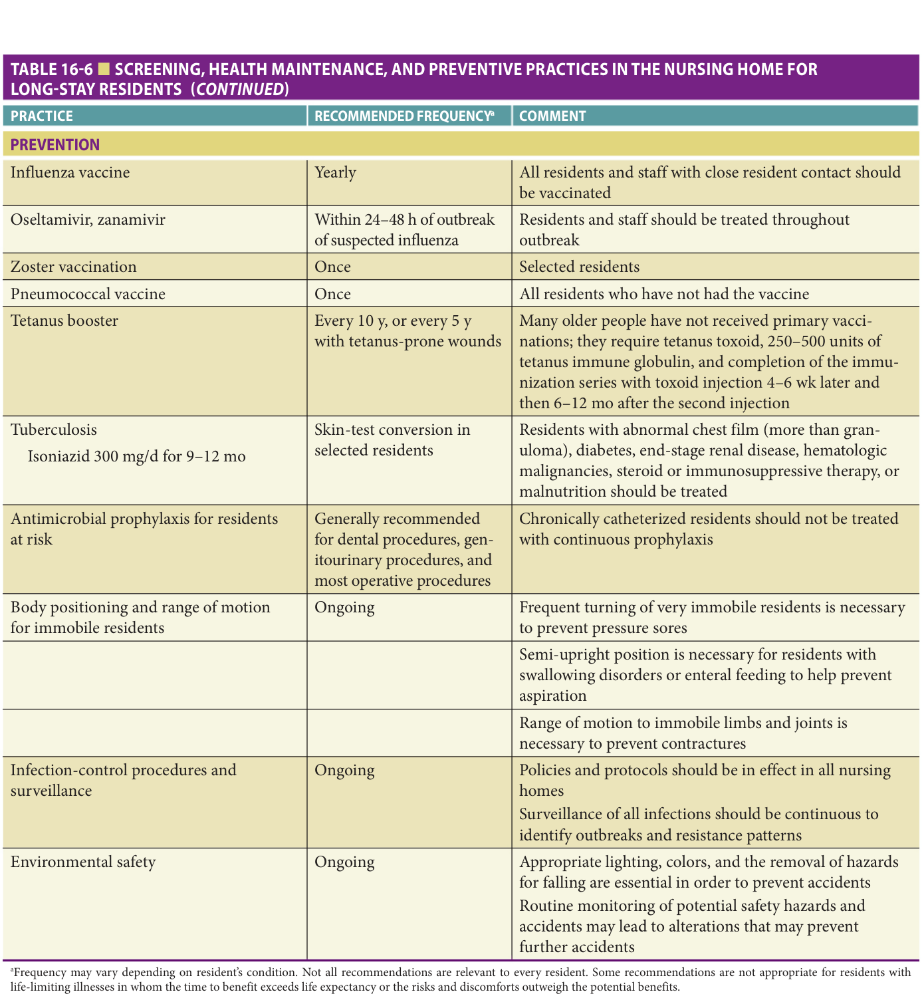

Study summary of Chapter 16; the book and the full chapter are the reference.

# Chapter 16 Study: Institutional Long-Term and Post-Acute Care

## Summary

**Goals & setting**
- Nursing-home care integrates disease treatment with function, autonomy, comfort, dignity and quality of life; social determinants are part of the care plan (p221–222).
- Distinguish short-term rehabilitation or stabilization aimed at returning home, long-term support and palliative/hospice goals (p224).
- Residents, proxies, clinicians, nurses, therapists and direct-care staff all contribute; certified nursing assistants provide crucial observations (p221, p223).

**Assessment & planning**
- Integrate medical diagnoses with functional, cognitive, behavioral and nutritional status to build an individualized plan (p223).
- In the US framework described here, the Resident Assessment Instrument and Minimum Data Set support systematic assessment and care planning (p224).
- Establish decision-making capacity, preferences, advance directives and an appropriate proxy when needed (p221, p234).
- Screening and prevention can help many residents, but may offer little benefit near the end of life (p221).

**Management & transitions**
- Improve documentation, systematic health maintenance, collaborative clinician practice and quality improvement to reduce exacerbations and adverse events (p225).
- About one in five hospital-to-nursing-home admissions are readmitted within **30 days**; transitions deserve active attention (p230).
- Hospital transfers can expose residents to delirium, immobility, deconditioning, infections, incontinence, catheter use and pressure injuries (p230).
- Medication adverse effects and polypharmacy are important transition hazards; medical treatment must fit the resident's broader goals (p222, p230).
- Collaborative physician/nurse-practitioner or physician-assistant care and appropriate information technology can improve care delivery (p221, p225).

### From admission findings to a plan the team can use

A short-stay resident recovering from a fracture and a resident receiving continuing assistance may share a ward but need different goals. Record the person's usual function and preferences, what changed around hospitalization, and what help would make returning home possible. A care plan names the specific problem, the resident's goal, who will act, and when the team will review progress. Maintenance of existing abilities can itself be a rehabilitation goal (p224–227).

At admission, nursing observations establish a baseline against which the next shift can judge a change. In the US scheme described, the comprehensive MDS is updated after a major change and annually, with selected items reviewed quarterly. The pharmacist checks medication indications, interactions, monitoring and stop dates. The dietitian assesses intake and preferences, including whether an unappealing restrictive diet is contributing to weight loss (p226–227).

### Infection prevention and a change in condition

For a resident with paraplegia who cannot empty the bladder, the exam asks how to drain it while limiting infection risk. The relevant comparison is intermittent straight catheterization, when feasible, versus leaving a catheter in place. Chronic indwelling drainage increases bacteriuria and other complications. A standing antibiotic prescription, routine surveillance cultures and automatic monthly changes do not address that exposure. Table 16-6 specifically advises against continuous prophylaxis in chronically catheterized residents; the companion catheter-care pages explain the drainage choice (p232; Chapter 47, p715–716).

A new cough or less alert behavior should prompt an examination, vital signs, and comparison with the resident's baseline. The INTERACT pathway helps staff decide whether on-site treatment and monitoring are feasible or acute transfer is needed. Weigh severity, resources, advance care preferences and hazards of hospitalization. At a transfer, communicate the change and what has already been done (p230, p232–233).

### Who lives here, and what outcome is the team trying to achieve?

The term “rehab” may describe the building rather than a resident's prognosis. In the US setting described, approximately **15,500 facilities** provided about **1.5 million beds**, and roughly **90%** were certified skilled nursing facilities providing both short- and long-term care. Figure 16-1 describes overlapping groups: some need intensive treatment or rehabilitation after a hospitalization, some need continuing assistance with multiple problems, and some chiefly need end-of-life support. People can move from one group to another without changing facilities. Start by asking what led to admission and what would make the next living arrangement possible (p221–222).

Two residents who need help transferring may therefore need very different plans. One was walking before a recent acute illness and hopes to regain enough independence to return to a home with stairs. The other has progressive disability and wants to transfer safely to a chair for family visits. For the first, rehabilitation and discharge preparation are closely linked. For the second, safe assistance, discomfort during transfers, seating and preserving the person's choices may matter more than achieving a higher test score. Table 16-1 puts restoration and maintenance of function alongside autonomy, social support, safety, dignity and timely treatment of illness (p222).

The feasibility of discharge is partly social. A resident can make the expected rehabilitation gains yet lack anyone at home able to help with essential tasks. Available home services, financial coverage, accessible housing and caregiver support can determine whether a medically ready person becomes a long-stay resident. Ask the person and care partner what help is actually available, rather than labeling failure to return home a failure of therapy. Conversely, a long-stay resident can still benefit from treatment of a reversible mobility problem or an acute illness; “long term” does not imply that recovery is no longer a goal (p222–224).

The living environment also changes the meaning of treatment burden. A resident anticipating a short admission may accept interruptions and restrictions similar to a hospital ward in exchange for monitoring and rehabilitation. Someone who lives there indefinitely may find the same routines erode autonomy: inflexible meal times, sleep interruptions and restrictions on preferred activities affect everyday life. Comfort-focused care should be flexible enough to support the person's remaining interests, and disease-focused care should still respect choices about ordinary routines. Ask the resident, rather than assuming outsiders can reliably judge quality of life (p222, p234).

### Assessment in a setting with intermittent clinician contact

Table 16-2 contrasts facility care with an office visit or inpatient round. The physician may visit intermittently; the people present at the onset of a change are often nursing assistants and licensed nurses. Diagnostic services and the speed at which results return differ from those in hospital. Residents commonly have impaired cognition, sensory loss, mobility limitations and several simultaneous disorders. An apparent new diagnosis reported on the telephone may initially consist of a behavior observed during a meal or a transfer. The clinician needs a system that brings those observations forward and gives the staff an actionable response (p223–225).

Begin admission assessment by reconstructing a trajectory. What could the person do before the acute illness, on the hospital ward and on arrival? What did the hospital diagnose, which treatments were started for a time-limited indication and what result is still pending? Record mental status, daily activity, continence, nutrition, skin integrity, mobility and symptoms as well as the active medical problems. Table 16-3 includes illnesses and syndromes common in this population. A problem that receives little attention on a hospital discharge summary, such as hearing loss or painful feet, may determine whether the patient can participate in rehabilitation (p223–225).

A fall illustrates why this process cannot be replaced by a disease list. A diagnosis of dementia or arthritis may explain some baseline risk, but not the timing of today's event. Staff may report that the resident became sleepy after a new medication, tried to reach the toilet without assistance, or could no longer see a familiar cue. Ask about injury, acute illness, changes in function, medications and circumstances of the fall. Then make the intervention specific enough for daily care: improve the transfer arrangement, review the new prescription, reassess pain or address the environment as appropriate (p223–227).

The process described for the US facility combines repeated bedside assessments with a standardized instrument. The book describes an initial physician assessment within **72 hours**, monthly visits during the next **90 days**, and more frequent review when the clinical situation requires it. Nurses assess the resident on admission and daily and summarize status weekly. The chapter gives **14 days** for completion of the admission MDS, with a new comprehensive evaluation after a major change and selected sections updated quarterly. These are the chapter's US timing examples, not a reason to wait for the next scheduled assessment when a resident deteriorates (p225–227).

The MDS is used for identifying problems, directing care planning, calculating aspects of skilled-care reimbursement and deriving quality measures. Distinguish those purposes. A checked item about impaired mobility flags a problem; it does not tell an aide how to transfer the person, explain why mobility declined or settle whether treatment is working. Combine standardized data with the patient's priorities and observations from those providing care. If a resident has a new problem after the assessment, document and address it when it occurs rather than leaving it invisible until the next reporting cycle (p224–227).

### Give each discipline a question it can answer

Table 16-4 can be read as a sequence of different perspectives on one resident. The nurse assesses day-to-day function and new symptoms. The nursing assistant notices whether the resident ate, drank, transferred or interacted differently during ordinary care. The physician or advanced practitioner integrates these observations, examines the resident and decides which investigations or treatments could alter the outcome. Therapy staff evaluate a task directly, including assistance, aids and training. The social worker identifies available support and obstacles to discharge. The resident and care partner supply the history and determine whether the proposed goal has meaning (p225–227).

The pharmacist can ask whether each medicine still has an indication, whether its dose suits the resident, which interaction threatens safety, and what laboratory or symptom monitoring is needed. The dietitian can ask why weight or intake changed: swallowing difficulty, dentition, access to the meal, an overly restrictive diet or dislike of what is offered can require different responses. Document a stop or review date for an intervention intended to be temporary. A transfer order carried forward indefinitely may expose a person to adverse effects long after its original purpose has disappeared (p226–228).

A useful plan for poor intake identifies a cause to investigate, a resident-centered goal, an intervention and who will review it. Changing the menu will not solve painful swallowing; prescribing a supplement may not solve the inability to open its container. Ask someone to observe a meal and report what helped. Involve the resident in choosing acceptable foods and consider the consequences of a restrictive diet. In advanced illness, the goal may be enjoyment and comfort with eating. Framing every nutritional problem as a requirement to gain weight can drive care away from that goal (p223, p226–227, p234).

The chapter's face sheet in Figure 16-2 and progress-note structure in Table 16-5 serve different needs. A compact face sheet makes stable essentials accessible when the regular clinician is absent: important diagnoses, contacts, the decision maker and relevant care preferences. A problem-oriented progress note shows what changed today. In a SOAP note, distinguish the resident's or staff member's report from objective findings, state the working assessment and specify tests, treatment, surveillance and reassessment. Copying an old problem list into every note makes it difficult for the next shift to tell a new threat from a chronic finding (p228–230).

### Prevention that fits the resident

Prevention includes actions with immediate functional benefits as well as screening whose benefit may be delayed. An immobile resident needs positioning, skin observation and range of motion; a resident with impaired swallowing may need semi-upright positioning during feeding. Reviewing vision, hearing, mouth and foot problems can improve comfort and participation. Table 16-6 groups preventive practices, possible frequency and the residents for whom they are relevant. Before ordering a test, ask what would follow an abnormal result and whether that course aligns with the person's prognosis and wishes (p231–232).

For infection prevention, distinguish exposure reduction from treatment. In the mapped question a patient with paraplegia needs bladder emptying. Intermittent catheterization, if feasible, limits the exposure imposed by a continuously indwelling catheter. The comparison is between drainage strategies for a patient who actually needs drainage. It is not an instruction to catheterize a continent resident for staff convenience. Continuous suppressive antibiotics do not remove the device or its associated colonization and add drug exposure. A positive culture alone cannot demonstrate that a new nonspecific change is caused by the urinary tract (p232; Chapter 47, p715–716).

The chapter's preventive table also illustrates why vaccination and prophylactic regimens need a date as well as an indication. It lists zoster vaccination as a one-time intervention for selected residents and isoniazid **300 mg/day for 9–12 months** for selected tuberculin converters. These are statements from the printed table. Assess previous vaccination, the resident's exposure and risk, concomitant treatment and the ability to monitor for toxicity when translating a prevention decision into an order (p232).

> Current practice (not the book): In the United States, CDC recommends two doses of recombinant zoster vaccine for adults aged 50 or older and for immunocompromised adults aged 19 or older. - [CDC shingles vaccine recommendations, 2024](https://www.cdc.gov/shingles/hcp/vaccine-considerations/index.html).

> Current practice (not the book): Exclude active tuberculosis before treating latent infection. CDC and the National Tuberculosis Coalition of America preferentially recommend short rifamycin-based regimens when suitable. Interactions with other medicines may affect the choice. - [CDC latent tuberculosis treatment guidance, 2025](https://www.cdc.gov/tb/hcp/treatment/latent-tuberculosis-infection.html).

### Detecting a change, monitoring on site and arranging transfer

The hospital–nursing home interface works in both directions. A recently hospitalized patient can reach the facility before all information or pending results do. A resident sent back to hospital may arrive without a reliable baseline, the medication list or the actual reason staff were worried. The chapter reports that about **one in five** patients admitted from hospital are readmitted within **30 days**. Some transfers are necessary and lifesaving. Others follow a delayed response to a change that could have been assessed earlier, or a misunderstanding of what the facility can offer and what the resident wants (p230–233).

Take the report “she seems off today.” Ask who saw the change, when she was last at her usual baseline, whether she is eating and drinking, whether there are new localizing symptoms, and what the vital signs and focused examination show. Obtain the medication and recent illness history. If evaluating remotely, identify who can perform the required examination and how quickly results can be obtained. A decision to observe on site is a treatment decision only if it includes a monitoring plan, triggers for contacting the practitioner again and a named person responsible for reassessment (p225, p230–233).

Figure 16-3 illustrates an INTERACT pathway for a resident with possible lower respiratory infection. New or worsening cough, sputum, dyspnea, pleuritic discomfort or new lung findings initiate focused assessment. The example's notification criteria include oxygen saturation below **90%**, respiratory rate above **28/min** or below **10/min**, and inability to eat or drink. The figure also asks about mental-status change and other signs. These are prompts to communicate with the practitioner and decide what level of care is needed. Meeting a threshold does not, in isolation, define pneumonia or obligate the same disposition for everyone (p233).

When on-site management fits the findings, available resources and goals, the illustrated plan includes assessment of hydration, oxygen when indicated, consideration of antimicrobial treatment and monitoring of vital signs every **4–8 hours**. The pathway directs staff back to assessment when the resident worsens or meets notification criteria. A portable chest film or blood tests help only if someone will review the result and act. A patient whose needs exceed what the facility can deliver requires timely transfer, with the relevant findings and treatment already provided communicated to the receiving team (p230–233).

Hospital itself has risks. An unfamiliar environment, medication changes, immobility, invasive devices, disrupted sleep and deconditioning can produce new disability or delirium. Weigh these risks against the benefit of urgent imaging, oxygen support or other interventions unavailable at the facility. Discuss options before a crisis when possible. At transfer, communicate the decision maker and goals, baseline cognition and function, the new abnormality and its timing, medication exposures, test results, and what response the resident has shown. On return, reconcile hospital changes against the prior plan and decide which new orders need follow-up or discontinuation (p230–234).

### Quality improvement, ethics and outbreak response

A recurrent problem calls for analysis of the care process, not simply another instruction to “be careful.” In the US report cited, about **one in three** residents experienced an adverse event in the first **1–2 months** after admission. Examples included medication effects, infection, falls and electrolyte disturbances. For repeated post-admission events, examine what was known at transfer, whether orders were reconciled, how an early change was reported and who reviewed the response. Quality indicators can identify a pattern; direct-care staff help explain the steps that produced it (p221, p230).

QAPI combines quality assurance with performance improvement. The chapter describes following outcomes such as falls, incontinence, adverse drug reactions or skin problems and testing changes to the process responsible. For example, if several medication-related problems occur shortly after hospital transfer, inspect when the medication record reaches the unit and when a pharmacist or clinician can review it. Follow subsequent residents to see whether the revised process actually reduces harm. Leadership must make staff time and support available if a change is to survive beyond an initial improvement project (p228–230).

Table 16-7 distinguishes everyday autonomy, decisional capacity, surrogate decisions, judgments about quality of life and the intensity of treatment. A resident who cannot independently manage transfers may still understand and decide about a proposed hospital evaluation. Conversely, someone who can express a preference may need support to understand a complex choice. Establish decision-making ability for the question at hand, involve the resident to the extent possible and identify the appropriate proxy when required. An instruction about resuscitation alone does not answer whether the resident would accept antibiotics, hospitalization, enteral feeding or a comfort-focused plan (p234).

The pandemic section shows how an institutional threat reaches beyond infection rates. Facilities had to protect vulnerable residents and staff while restrictions on visits and activities affected contact with family and normal daily life. Staffing pressures, communication with hospitals and access to protective equipment affected what could be delivered on site. The underlying clinical questions persist during an outbreak: how to identify illness promptly, preserve skilled hands-on care, communicate with decision makers and maintain comfort and dignity when an established source of social support is interrupted (p234–235).

## Exam traps
- Long-term care is not simply hospital medicine delivered in another building: assessment and daily support are inherently interdisciplinary (p222–224).
- Autonomy issues also affect residents who retain capacity; advocate for everyday preferences and quality of life, not only formal end-of-life decisions (p234).

## Exam-cited book images

Book images cited by past exams. Tap an image to zoom.

## Table 16-6 — book image

## Table 16-6 — book image

[2025-Jun Q87](?chapter=bank&q=mcq-911d970243b87dbe2fe1c675)

## Past exam questions

- [2025-Jun Q87](?chapter=bank&q=mcq-911d970243b87dbe2fe1c675) — Printed page 232.

## Recall drill

**1. What distinguishes short-stay from long-stay goals?**

Answer
After an acute illness, stabilization and recovery of sufficient function to return home may be realistic. Long-stay care often emphasizes maintaining abilities, comfort and quality of life (p224, p227).

**2. Who may detect an important change before the clinician sees the resident?**

Answer
Direct-care staff who know the resident's usual mobility, intake and behavior. Include their observations in the assessment (p221, p223).

**3. What makes an interdisciplinary plan actionable?**

Answer
Specify the problem, the goal agreed with the resident, the intervention, the responsible team members and a review date (p225).

**4. Why document function on entry as well as diagnoses?**

Answer
A baseline allows the team to distinguish established impairments from relocation effects or a new and potentially reversible decline (p226).

**5. When does the US assessment schedule described here require a new comprehensive MDS?**

Answer
At admission, after a major change and annually, with selected sections updated quarterly (p226).

**6. What should a pharmacist check in the transferred medication list?**

Answer
Reconcile the list and check indications, interactions with other drugs or diseases, stop dates and the planned monitoring (p227).

**7. Which nutrition intervention may be missed when weight falls?**

Answer
Review intake, food preferences and whether a restrictive diet is both unnecessary and unappetizing (p227).

**8. What is a reasonable therapy goal when further gains are unlikely?**

Answer
Preserve current abilities. Environmental changes may support function or allow discharge even when recovery is limited (p227).

**9. What proportion of people admitted from hospital are readmitted within a month in the chapter's figures?**

Answer
About one in five within <strong>30 days</strong> (p230).

**10. Why can a hospital transfer permanently alter baseline function?**

Answer
Bed rest can cause deconditioning and loss of transfer or walking ability. Delirium, devices, infection and pressure injuries can compound the decline (p230).

**11. What does INTERACT add when an acute illness develops?**

Answer
Early recognition and a structured on-site assessment, timely treatment when feasible, and prompt transfer when the resident needs hospital resources (p230, p233).

**12. What drainage method did the exam select for a neurogenic bladder after paraplegia?**

Answer
Intermittent catheterization when practical. It avoids continuous exposure to an indwelling catheter (Chapter 47, p715–716; see p232).

**13. Should chronic catheter use itself trigger continuous antibiotic prophylaxis?**

Answer
No. The prophylaxis row specifically advises against continuous antibiotics in chronically catheterized residents (p232).

**14. Why discuss goals before an acute illness?**

Answer
Advance planning allows the resident or proxy to consider whether treatment on site, hospitalization or comfort care fits the resident's preferences and likely benefit (p232–234).

**15. Where does autonomy enter routine long-term care?**

Answer
Residents with capacity may choose daily routines and voice preferences about care. When capacity is impaired, involve the appropriate surrogate and continue to attend to the resident's wishes (p234).

