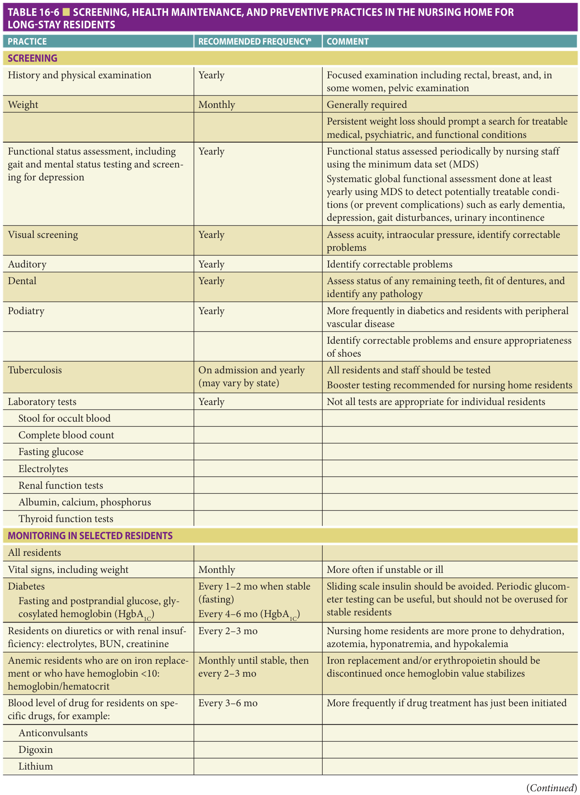

Study summary of Chapter 16; the book and the full chapter are the reference.

# Chapter 16 Study: Institutional Long-Term and Post-Acute Care

## Summary

**Goals & setting**
- Nursing-home care integrates disease treatment with function, autonomy, comfort, dignity and quality of life; social determinants are part of the care plan (p221–222).
- Distinguish short-term rehabilitation or stabilization aimed at returning home, long-term support and palliative/hospice goals (p224).
- Residents, proxies, clinicians, nurses, therapists and direct-care staff all contribute; certified nursing assistants provide crucial observations (p221, p223).

**Assessment & planning**
- Integrate medical diagnoses with functional, cognitive, behavioral and nutritional status to build an individualized plan (p223).
- In the US framework described here, the Resident Assessment Instrument and Minimum Data Set support systematic assessment and care planning (p224).
- Establish decision-making capacity, preferences, advance directives and an appropriate proxy when needed (p221, p234).
- Screening and prevention can help many residents, but may offer little benefit near the end of life (p221).

**Management & transitions**
- Improve documentation, systematic health maintenance, collaborative clinician practice and quality improvement to reduce exacerbations and adverse events (p225).
- About one in five hospital-to-nursing-home admissions are readmitted within **30 days**; transitions deserve active attention (p230).
- Hospital transfers can expose residents to delirium, immobility, deconditioning, infections, incontinence, catheter use and pressure injuries (p230).
- Medication adverse effects and polypharmacy are important transition hazards; medical treatment must fit the resident's broader goals (p222, p230).
- Collaborative physician/nurse-practitioner or physician-assistant care and appropriate information technology can improve care delivery (p221, p225).

### From admission findings to a plan the team can use

A short-stay resident recovering from a fracture and a resident receiving continuing assistance may share a ward but need different goals. Record the person's usual function and preferences, what changed around hospitalization, and what help would make returning home possible. A care plan names the specific problem, the resident's goal, who will act, and when the team will review progress. Maintenance of existing abilities can itself be a rehabilitation goal (p224–227).

At admission, nursing observations establish a baseline against which the next shift can judge a change. In the US scheme described, the comprehensive MDS is updated after a major change and annually, with selected items reviewed quarterly. The pharmacist checks medication indications, interactions, monitoring and stop dates. The dietitian assesses intake and preferences, including whether an unappealing restrictive diet is contributing to weight loss (p226–227).

### Infection prevention and a change in condition

For a resident with paraplegia who cannot empty the bladder, the exam asks how to drain it while limiting infection risk. The relevant comparison is intermittent straight catheterization, when feasible, versus leaving a catheter in place. Chronic indwelling drainage increases bacteriuria and other complications. A standing antibiotic prescription, routine surveillance cultures and automatic monthly changes do not address that exposure. Table 16-6 specifically advises against continuous prophylaxis in chronically catheterized residents; the companion catheter-care pages explain the drainage choice (p232; Chapter 47, p715–716).

A new cough or less alert behavior should prompt an examination, vital signs, and comparison with the resident's baseline. The INTERACT pathway helps staff decide whether on-site treatment and monitoring are feasible or acute transfer is needed. Weigh severity, resources, advance care preferences and hazards of hospitalization. At a transfer, communicate the change and what has already been done (p230, p232–233).

## Exam traps
- Long-term care is not simply hospital medicine delivered in another building: assessment and daily support are inherently interdisciplinary (p222–224).
- Autonomy issues also affect residents who retain capacity; advocate for everyday preferences and quality of life, not only formal end-of-life decisions (p234).

## Exam-cited book images

Book images cited by past exams. Tap an image to zoom.

## Table 16-6 — book image

## Table 16-6 — book image

[2025-Jun Q87](?chapter=bank&q=mcq-911d970243b87dbe2fe1c675)

## Past exam questions

- [2025-Jun Q87](?chapter=bank&q=mcq-911d970243b87dbe2fe1c675) — Printed page 232.

## Recall drill

**1. What distinguishes short-stay from long-stay goals?**

Answer
After an acute illness, stabilization and recovery of sufficient function to return home may be realistic. Long-stay care often emphasizes maintaining abilities, comfort and quality of life (p224, p227).

**2. Who may detect an important change before the clinician sees the resident?**

Answer
Direct-care staff who know the resident's usual mobility, intake and behavior. Include their observations in the assessment (p221, p223).

**3. What makes an interdisciplinary plan actionable?**

Answer
Specify the problem, the goal agreed with the resident, the intervention, the responsible team members and a review date (p225).

**4. Why document function on entry as well as diagnoses?**

Answer
A baseline allows the team to distinguish established impairments from relocation effects or a new and potentially reversible decline (p226).

**5. When does the US assessment schedule described here require a new comprehensive MDS?**

Answer
At admission, after a major change and annually, with selected sections updated quarterly (p226).

**6. What should a pharmacist check in the transferred medication list?**

Answer
Reconcile the list and check indications, interactions with other drugs or diseases, stop dates and the planned monitoring (p227).

**7. Which nutrition intervention may be missed when weight falls?**

Answer
Review intake, food preferences and whether a restrictive diet is both unnecessary and unappetizing (p227).

**8. What is a reasonable therapy goal when further gains are unlikely?**

Answer
Preserve current abilities. Environmental changes may support function or allow discharge even when recovery is limited (p227).

**9. What proportion of people admitted from hospital are readmitted within a month in the chapter's figures?**

Answer
About one in five within <strong>30 days</strong> (p230).

**10. Why can a hospital transfer permanently alter baseline function?**

Answer
Bed rest can cause deconditioning and loss of transfer or walking ability. Delirium, devices, infection and pressure injuries can compound the decline (p230).

**11. What does INTERACT add when an acute illness develops?**

Answer
Early recognition and a structured on-site assessment, timely treatment when feasible, and prompt transfer when the resident needs hospital resources (p230, p233).

**12. What drainage method did the exam select for a neurogenic bladder after paraplegia?**

Answer
Intermittent catheterization when practical. It avoids continuous exposure to an indwelling catheter (Chapter 47, p715–716; see p232).

**13. Should chronic catheter use itself trigger continuous antibiotic prophylaxis?**

Answer
No. The prophylaxis row specifically advises against continuous antibiotics in chronically catheterized residents (p232).

**14. Why discuss goals before an acute illness?**

Answer
Advance planning allows the resident or proxy to consider whether treatment on site, hospitalization or comfort care fits the resident's preferences and likely benefit (p232–234).

**15. Where does autonomy enter routine long-term care?**

Answer
Residents with capacity may choose daily routines and voice preferences about care. When capacity is impaired, involve the appropriate surrogate and continue to attend to the resident's wishes (p234).

