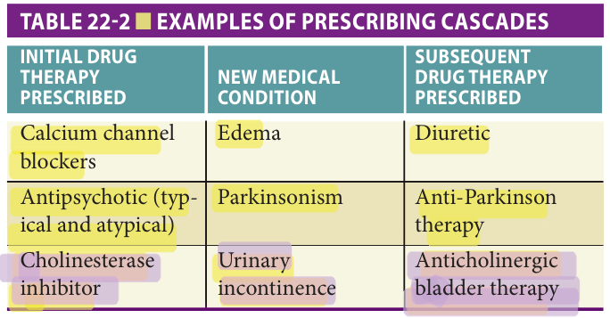

Study summary of Chapter 22 - Medication Prescribing and De-Prescribing; the book and the full chapter are the reference.

# Chapter 22 Study: Medication Prescribing and De-Prescribing

## What the exams asked

- New urinary urgency during rivastigmine treatment and the pairs of drugs that signal a prescribing cascade — [June 2023 Q79 and Q98](?chapter=22#exam-mcq-6e143cb30a2a136307230c2d).
- Reassessing digoxin when renal function or hydration changes — [June 2026 Q80](?chapter=22#exam-mcq-6394b74a1a69f2de3bcda7b2).
- Choosing a drug to deprescribe when an older patient takes several psychoactive agents — [June 2026 Q10](?chapter=22#exam-mcq-a542a3a627e208dabd1e6265). The official list names Beers and cites [Hazzard p169](?chapter=11#p169) and [p319](?chapter=23#p319). Its chapter number for p319 differs from the book.
- Initial anticoagulant choice in nonvalvular atrial fibrillation or venous thromboembolism — [June 2025 Q84](?chapter=22#exam-mcq-2d928ababba95770cc9cd5c7). The exam cites AGS Beers 2023, Table 2.
- Dizziness and near-syncope during antihypertensive treatment — [June 2026 Q76](?chapter=22#exam-mcq-1003c2e78dcf195a31c9d5a2). The exam cites Beers.
- Absorption with aging and distribution of a lipid-soluble benzodiazepine — [2020 Q18 and December 2021 Q50](?chapter=22#asked-chapter).
- Recognizing a cascade when a drug follows a new symptom — [June 2022 Q20](?chapter=22#asked-chapter).
- Exceptions to antipsychotic avoidance and the indication for prolonged acid suppression — [2020 Q19 and June 2022 Q21](?chapter=22#asked-chapter). Both cite the 2019 Beers criteria.
- Fever and neutropenia after clozapine, arthritis after hydralazine, and adverse effects associated with long-term proton-pump inhibitors — [December 2021 Q83 and June 2022 Q37 and Q81](?chapter=22#asked-chapter). Q83 cites the seventh-edition white-cell disorders table. Q37 and Q81 cite the Geriatrics Review Syllabus.

## A new symptom after a new prescription

A **prescribing cascade** begins when an adverse effect is interpreted as a new disease. The clinician then treats the apparent disease with a second drug. Establish the order of events, look for a plausible adverse effect and reassess the first medicine before treating the symptom. Stopping or reducing the responsible drug interrupts this sequence (p304–306, Figure 22-1 and Table 22-2).

**Rivastigmine and new urgency.** Cholinesterase inhibitors can precipitate urge incontinence through autonomic effects. Dementia can also cause incontinence, so the timing matters. June 2023 Q79 asked what to reconsider first. Starting an antimuscarinic exposes the patient to additional adverse effects and can oppose the cognitive effect of the original treatment. Mirabegron avoids that particular antagonism but still treats the symptom before establishing its cause (p305–306).

**Which pair represents a cascade?** Antidopaminergic treatment can produce parkinsonism, prompting anti-Parkinson therapy. A calcium-channel blocker can produce dependent edema, prompting a loop diuretic. A cholinesterase inhibitor can prompt a bladder antimuscarinic. June 2023 Q98 asked for the exception. Levodopa/carbidopa and furosemide are not one of the causal pairs in Table 22-2 (p305).

**Changing the culprit versus adding another drug.** Reducing the dose of an antipsychotic after drug-induced rigidity addresses the cause. Adding levodopa under a new diagnosis of Parkinson disease exposes the patient to additional risks such as orthostatic hypotension or delirium. The June 2022 after-appeal key also accepts the etodolac, gout and allopurinol sequence. The book documents gout after a thiazide and a different cascade for NSAIDs, without establishing etodolac as the trigger of gout in that question (p304–306).

## Reassessing benefit when health changes

**Digoxin and renal function.** Dehydration or declining kidney function can increase toxicity on a dose the patient once tolerated. First establish why digoxin was started. The chapter describes selected nursing-home residents with normal sinus rhythm, normal ejection fraction and no clinical evidence of heart failure who remained clinically stable after withdrawal. Impaired systolic function changes that decision because withdrawal can be detrimental (p312–313).

In June 2026 Q80, sinus rhythm at review did not establish that the indication had disappeared. Review the indication and ventricular function, weigh toxicity against ongoing benefit and consider supervised withdrawal. Automatically continuing a lower dose, substituting another drug or waiting for toxicity each skips the indication review (p312–313).

## Choosing the drug to review

**Clonazepam.** Lipid-soluble benzodiazepines have a larger volume of distribution in older adults, who may also be more sensitive to their effects (Ch 22, pp302–303). June 2026 Q10 selected clonazepam for review. Check the original indication and duration: chronic sedative-hypnotic use may cause physical dependence and withdrawal on discontinuation (Ch 11, p169). Ch 23, p319, gives **13%** as the estimated prevalence of benzodiazepine **use** in older adults.

> Current practice (not the book): benzodiazepines increase cognitive and fall risks in older adults; assess the indication and applicable exceptions — AGS Beers Criteria 2023, Table 2.

**Anticoagulant initiation versus continuation.** The 2023 Beers criteria generally favor starting a direct oral anticoagulant for eligible older adults with nonvalvular atrial fibrillation or venous thromboembolism. Warfarin brings greater major bleeding risk and generally comparable or lower effectiveness. Alternatives can be contraindicated or inaccessible. An older patient already doing well on warfarin raises a separate continuation decision (AGS Beers 2023, Table 2, p2057).

**Clonidine during hypertension treatment.** Central alpha agonists may cause bradycardia, orthostatic hypotension and adverse CNS effects. Dizziness and near-syncope in June 2026 Q76 make that profile relevant. The Beers recommendation is to avoid clonidine as first-line treatment for hypertension. The comparison does not imply identical risks for all antihypertensives (AGS Beers 2023, Table 2, p2058).

**Absorption versus clearance.** Drug absorption is largely preserved with aging. Changes in lean body mass and fat affect distribution, while hepatic metabolism and renal excretion may reduce clearance. December 2021 asked how more body fat affects a lipid-soluble drug. This mechanism does not determine a precise duration of clonazepam action. Assess other medications, organ function, sensitivity and clinical response when choosing a dose. Shorter-acting benzodiazepines and Z-drugs can still carry substantial fall risk (p302–303).

**Risk depends on the indication.** For nursing-home residents with dementia, reserve antipsychotics for situations in which the benefit clearly outweighs the risk, such as behavior posing a **risk to the resident or others**. Reassess the need and consider dose reduction or discontinuation (p308). Review the reason for prolonged acid suppression, including exceptions such as erosive esophagitis (pp303–304, 312).

> Current practice (not the book): the 2019 Beers criteria make an explicit exception for bipolar disorder in their antipsychotic warning. The 2023 AGS Beers Criteria reserve antipsychotics for dementia-related behavior when nonpharmacologic measures fail or cannot be used and the person threatens substantial harm to self or others — [AGS Beers Criteria 2019, Table 2](https://doi.org/10.1111/jgs.15767) and [AGS Beers Criteria 2023, Table 2](https://doi.org/10.1111/jgs.18372).

**Consider the specific adverse effect.** The older exam questions pair fever and neutropenia with clozapine, new joint symptoms and suspected pericardial inflammation with hydralazine, and prolonged PPI use with fractures, enteric infection or interstitial nephritis. Identifying an exposure focuses the examination and laboratory investigation. The description alone does not prove drug causation (Hazzard p928, p1287, p1322–1323, p1624–1625).

## Completing the medication review

**What is actually taken?** Include prescribed drugs, over-the-counter products, supplements, actual doses and what has been stopped or never dispensed. For example, ask about ginkgo when reviewing warfarin because the combination can increase bleeding risk. A list transferred from hospital cannot reveal omitted purchases or cost-related underuse unless someone asks (p301–302, p311, p313).

**Overuse, omission and misuse can coexist.** START highlights potentially beneficial therapies that may have been omitted. STOPP and Beers prompt review of potentially inappropriate exposure. Ask whether the trial population resembles the patient, whether the benefit can accrue within the patient’s expected lifespan and whether that outcome matters to the patient. A drug count alone cannot distinguish beneficial polypharmacy from excessive treatment (p303–304, p306–309).

**Monitoring is part of the prescription.** In the nursing-home study described in the chapter, preventable adverse events often arose during ordering or monitoring. Check kidney function when choosing a renally cleared drug, assess for bleeding with anticoagulation and ask about new confusion or oversedation with psychoactive treatment. Care transitions and changes in preferences are reasons to repeat the review (p308–313).

**Plan a feasible regimen.** Align dosing times where possible, use the minimum effective dose and agree on what to monitor after a drug is reduced or stopped. For limited life expectancy, distinguish symptom relief now from prevention whose benefit may arrive later. Tight glucose control may expose a frail older adult to hypoglycemia, so treatment goals include health status and remaining life expectancy (p313–315).

## Israeli context — סקירת תרופות וזכאות בקהילה בישראל

<strong>מה בודקים בסקירת תרופות?</strong> בחולה עם מחלות כרוניות מבררים אילו תרופות הוא נוטל בפועל, לרבות מרשמים ממטפלים אחרים, תכשירים ללא מרשם ותוספי תזונה. משווים את דבריו לרשומה ולמידע על הניפוק בבית המרקחת, ובודקים אם תסמין חדש עשוי להיות קשור לטיפול. מתעדים את מטרת כל תרופה, השינוי הנדרש והמעקב. <a href="https://www.gov.il/BlobFolder/policy/mr03-2013/he/files_circulars_mr_mr03_2013.pdf">חוזר מינהל הרפואה 3/2013, סעיפים ד(1), ה(2.1–2.4), ה(3.1.6) ונספח א׳</a>.

<strong>מתי חוזרים על הבדיקה?</strong> החוזר מחייב בדיקה בעת מתן מרשם חדש או חידוש מרשם כרוני ובמחלקת האשפוז סמוך לשחרור. הוא ממליץ גם על בדיקה ייעודית אחת לשנה, ומורה לבצע בדיקה בקהילה לאחר השחרור אם ניתן. המטופל מקבל רשימה מעודכנת והוראות נטילה. <a href="https://www.gov.il/BlobFolder/policy/mr03-2013/he/files_circulars_mr_mr03_2013.pdf">חוזר 3/2013, סעיפים ה(4.1–4.3), ה(5.1–5.3) ונספח ב׳</a>.

<strong>למי מתאימה הערכה גריאטרית?</strong> משרד הבריאות מונה בין המועמדים מי שנוטלים שש תרופות לפחות בקביעות, וכן מי שסובלים מנפילות חוזרות או מירידה חדשה בתפקוד ללא הסבר. הצוות בוחן את מכלול התרופות והתוספים ואת הקשר האפשרי לתסמינים. את המלצותיו, ובהן התחלה או הפסקה של תרופה לפי הצורך, הוא מעביר גם לרופא המשפחה. הייעוץ וההערכה כלולים בסל הבריאות באחריות קופת החולים, ורופא המשפחה יכול להפנות אליהם. <a href="https://me.health.gov.il/older-adult/keep-me-healthy/common-conditions/geriatric-consultation/">משרד הבריאות, ״ייעוץ רפואי גריאטרי״, 18.12.2023, בפרק ״הערכה גריאטרית מקיפה״ ובפסקה על מימון השירות</a>.

<strong>איך מבררים עלות וזכאות?</strong> במאגר התרופות של משרד הבריאות ניתן לברר אם התכשיר רשום, אם הוא כלול בסל, מה מחירו ואילו חלופות קיימות. באתר ״כל הבריאות״ אפשר לבדוק את ההשתתפות העצמית לפי הקופה ואת תנאי ההנחה או הפטור. משרד הבריאות מונה בין קבוצות הזכאות להנחה אזרחים ותיקים מגיל 72 ומקבלי קצבת זקנה עם השלמת הכנסה. <a href="https://me.health.gov.il/older-adult/services-rights/living-with-a-condition/medicines/copayment/">משרד הבריאות, ״תרופות והשתתפות עצמית״, 16.11.2026, בסעיפים ״מאגר התרופות״, ״כל הבריאות״ ו״הנחות בקניית תרופות״</a>.

## Summary

**Prescribing risk**
- Older adults have greater drug exposure and vulnerability to adverse drug events; female sex, frailty, cognitive impairment and increased drug utilization add risk (p301–302).
- Include an adverse drug effect in the differential for a new symptom. Reconcile medications, allergies, doses, interactions and renal adjustment (p301–302).

**Assessment & drug handling**
- Pharmacokinetics describes drug handling; renal clearance and hepatic metabolism can change with aging. Pay particular attention to lipid-soluble, CYP-metabolized and renally excreted drugs (p302–303).
- Pharmacodynamic sensitivity may increase independently: benzodiazepines, opioids and warfarin are examples. Age and sex both matter (p303).
- Use weight- and renal-based dosing where appropriate, particularly with narrow therapeutic indices; estimated filtration and prescribing decision support can help (p303).
- Beers and STOPP/START support decisions alongside patient preferences, pharmacy review and other clinical tools (p303).

**Management & deprescribing**
- DRUGS: Discuss goals, Review medications, Use tools/frameworks, apply a Geriatric approach, and Stop medications where appropriate (p313).
- A prescribing cascade starts when a drug adverse effect is mistaken for a new illness and another drug is added. Recognize and manage the original cause (p304).
- Balance overuse, underuse and misuse; goals, organ function and expected benefit can change over time (p306, p315).
- Aim for the simplest effective regimen and minimum effective doses. A medication grid can help reduce complexity (p313–315).
- For dementia-related behavioral symptoms, nonpharmacologic approaches are usually recommended first: caregiver education, problem solving and interventions directed at specific triggers (p312).
- Review cost and actual adherence, not only the prescription list; a prescribed medication may never be dispensed or taken regularly (p311).

**Drug cautions & exam traps**
- NSAIDs can cause gastrointestinal bleeding and renal impairment; for osteoarthritis consider exercise/weight reduction, and acetaminophen before NSAIDs when medication is needed (p312).
- Tolerating a drug does not prove ongoing benefit. Long-term digoxin with normal systolic function illustrates potential risk without benefit (p312).
- Trial participants may poorly represent frail, multimorbid older adults and older women. Inappropriate prescribing includes omission of beneficial therapy, not only excessive medication (p309, p315).

## Exam-cited book images

Book images cited by past exams. Tap an image to zoom.

## Table 22-2 — book image

[2023-Jun Q98](?chapter=bank&q=mcq-6e143cb30a2a136307230c2d)

## Exam questions

The three links below are the original page-linked list. The opening section includes the additional chapter-level and externally sourced topics.

Past-exam questions linked to this chapter (3):

- [2023-Jun Q79](?chapter=bank&q=mcq-95f642a729895dc17239d748)
- [2023-Jun Q98](?chapter=bank&q=mcq-6e143cb30a2a136307230c2d)
- [2026-Jun Q80](?chapter=bank&q=mcq-6394b74a1a69f2de3bcda7b2)
