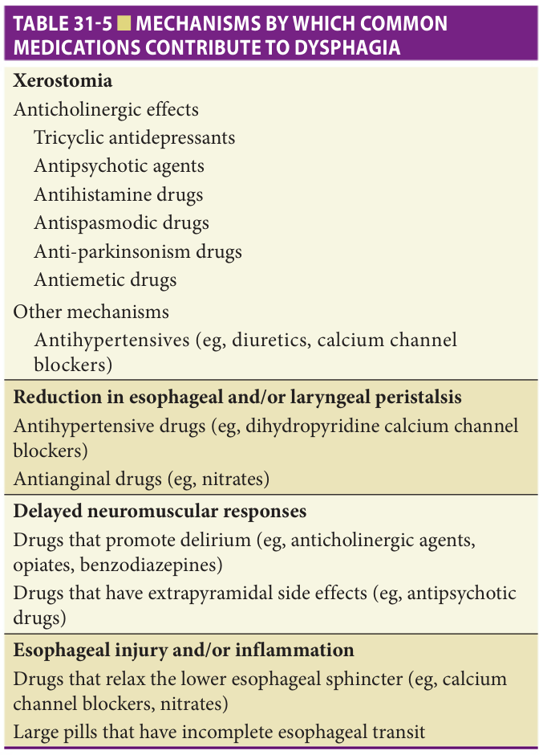

Study summary of Chapter 31 - Disorders of Swallowing; the book and the full chapter are the reference.

# Chapter 31 Study: Disorders of Swallowing

## What the exams asked

- A patient with dysphagia, poor oral hygiene and previous stroke has pneumonia. Which intervention may lower recurrence risk? [June 2025 Q71 · medication risks, Table 31-5](?chapter=31#exam-p446-mcq-4c3fda6b97055d09bfccf60c) · [Oral care in the cited pneumonia chapter](?chapter=105#exam-p1690-mcq-4c3fda6b97055d09bfccf60c).
- In advanced dementia, how do the burdens of tube feeding compare with careful hand feeding? [2020 Q42 · chapter-level association, AGS Choosing Wisely](?chapter=31#asked-chapter) · [Feeding decisions on p. 451](?chapter=31#ch31-feeding).
- **Related Harrison questions.** Dysphagia with fatigable ptosis or diplopia points to a neuromuscular cause. The antibody test belongs to Harrison. The swallowing chapter lists myasthenia gravis in its differential. [June 2023 Q27 · Table 31-3](?chapter=31#ch31-neuromuscular) · [June 2025 Q78 · Table 31-3](?chapter=31#ch31-neuromuscular).

## Aspiration pneumonia and oral care

**What reaches the lung matters.** Aspiration means that material passes below the true vocal folds. Saliva carrying oral bacteria can cause infection even when the patient eats only puréed food or receives tube feeding. A weak cough or diminished sensation may hide the event. Poor oral hygiene in the June 2025 vignette identifies a modifiable risk alongside persistent airway vulnerability after stroke (pp. 438, 445–446, 451).

**A practical prevention plan.** Help the patient clean the teeth and oral mucosa and clean dentures separately. Hazzard’s pneumonia chapter describes mechanical cleaning twice daily and assessment of the mouth weekly. Oral care may reduce pneumonia, although a randomized trial in high-risk nursing home residents did not show a clear benefit. Watch the patient’s level of alertness at meals. An antipsychotic given before feeding can impair attention or swallowing movements. A PEG leaves aspiration of saliva and reflux possible. Preventive amoxicillin does not address either mechanism (Table 31-5, p. 446, and ch. 105, pp. 1690–1691). [Swallowing chapter’s oral hygiene discussion](?chapter=31#ch31-oral-care).

## Choosing a feeding route in advanced dementia

**Start with what feeding is meant to achieve.** Ask what the person values, whether assistance allows comfortable intake, and how much nutrition and fluid they actually receive. A swallowing study can identify a safer consistency. It cannot determine whether placing a tube fits the person’s goals. Nasogastric tubes may cause agitation or nasal injury. Gastrostomy carries local infection risk. Either route can bring diarrhea or pressure injuries, and a tube cannot prevent aspiration of secretions (p. 451).

**The comparison in 2020 Q42.** A distressed patient may pull at a tube, leading to sedating medication or physical restraint. In advanced dementia, tube feeding has not shown reliable improvement in nutritional status, aspiration pneumonia, survival or pressure-injury healing. Offer careful hand feeding and adjust positioning, pace and assistance to preserve comfort. The American Geriatrics Society’s recommendation addresses advanced dementia. Other causes of transient dysphagia call for their own assessment (p. 451). [AGS Choosing Wisely, recommendation 1](https://doi.org/10.1111/jgs.12226).

## Fatigable chewing and diplopia

**Localize the weakness.** Table 31-3 includes myasthenia gravis among the neurologic causes of dysphagia (p. 445). Harrison describes fatigable jaw weakness that becomes apparent with prolonged chewing, especially meat. Ask about ptosis or double vision, fluctuation over the day and improvement with rest. June 2023 Q27 adds proximal weakness and dysarthria. In June 2025 Q78, weight loss first draws attention to the patient, but the combination of chewing difficulty and diplopia directs the examination to the neuromuscular junction.

**What the related Harrison questions test.** Order serum acetylcholine receptor antibodies. Antibodies are found in roughly 85% of generalized myasthenia and about half of purely ocular presentations. A positive result in this setting strongly supports the diagnosis. A negative result leaves room for further antibody testing or electrodiagnostic confirmation (Harrison 21e, ch. 448, pp. 3510–3511, Table 448-1, and 22e, ch. 459, pp. 3626–3627, Table 459-1).

## Swallowing mechanics, localization and assessment

**Physiology and reserve.** The tongue gathers a lubricated bolus and propels it posteriorly. Pharyngeal propulsion, airway closure and opening of the upper esophageal sphincter must then be coordinated with a brief pause in breathing. Healthy aging can slow closure and reduce maximum tongue pressure while sufficient pressure for an ordinary swallow is preserved. Acute stroke, frailty, delirium or a drying medication may use up that reserve. Functional warning signs include longer meals, retained food, dehydration, weight loss and recurrent chest infections (pp. 437–445).

**Ask where the failure occurs.** Trouble starting a swallow, nasal regurgitation, pocketing or a wet voice points toward an oral or pharyngeal problem. Food hanging up behind the sternum suggests an esophageal cause. Intermittent solid-food symptoms can reflect a ring. Progressive difficulty with solids raises concern for stricture or malignancy. Trouble with both solids and liquids raises a motility disorder. Review oral health, dentures, alertness and medication effects, particularly anticholinergic dry mouth and antipsychotic motor effects (pp. 444–447).

**Choose the test that answers the clinical question.** A trained clinician can assess history, speech and voice, oral movement and selected trial swallows. The absence of coughing during a bedside trial cannot exclude silent aspiration. Videofluoroscopy shows the timing, direction and clearance of a barium bolus and lets the team test posture or texture. FEES can be repeated at the bedside with real food and can show secretions and residue, although pharyngeal constriction briefly obscures the swallow itself. Include nutritional intake, respiratory events and the patient’s quality of life when judging success (pp. 438–439, 447–449).

## Compensation, exercise and drinking water

**Match the adjustment to the deficit.** With unilateral pharyngeal weakness, turning the head toward the weaker side directs the bolus through the stronger side. A chin-down posture may help selected patients with delayed protection. Check the effect of the maneuver for that individual. A change in posture, bolus size or viscosity can work during the meal. A strengthening program aims to change underlying function over repeated sessions (pp. 449–450).

**A safer test swallow is one outcome.** In Parkinson disease or dementia, honey-thick liquid reduced aspiration during testing more often than nectar-thick liquid or chin-down posture. The three-month comparison of chin-down posture with thickened liquids did not show a significant difference in pneumonia incidence. Ask whether a patient likes and drinks enough of the prescribed liquid. Free-water protocols couple intensive oral hygiene with plain water between meals while retaining thickened liquids during meals. Early studies involved selected ambulatory rehabilitation patients with intact cognition (p. 450).

## Israeli context · הפרעות בליעה במערכת הבריאות בישראל

**איך מעבירים הנחיית מרקם?** משרד הבריאות אימץ מינוח אחיד של IDDSI. קלינאי התקשורת והדיאטנית מסווגים את המזונות והמשקאות המוגשים במוסד לפי מאפייניהם ושיטות המדידה. קובעים בנפרד מה מתאים למטופל ומתעדים את רמת המרקם ברשומה ובמכתב השחרור. לדוגמה, רמה 0 מציינת משקה דליל ורמה 6 מציינת מזון רך וחתוך. ציון הרמה מאפשר גם למטבח וגם לצוות הממשיך להבין איזו מנה נדרשת. [משרד הבריאות, 09.05.2021, סעיפים 4–8 ונספח 1](https://www.gov.il/BlobFolder/policy/guidelines-terminology-uniformity-food-beverage-textures/he/files_regulation_guidelines-terminology-uniformity-food-beverage-textures.pdf).

**מה בודקים ליד המיטה?** אחות שמזהה קושי באכילה, קול רטוב או שאריות בפה מפנה להערכה רב־מקצועית. לפני חלוקת המנה מוודאים את ההנחיות למזון ולשתייה. מאכילים כשהמטופל ערני, בישיבה זקופה ככל האפשר, בכמויות קטנות, וממתינים לבליעה לפני הכפית הבאה. בסוף הארוחה בודקים אם נותר מזון בפה. התקדמות למרקם אחר מצריכה הערכה חוזרת. [משרד הבריאות, ״מניעת אספירציה במוסדות הרפואיים״, עמ׳ 1–3, המלצות 1 ו־4–9](https://www.gov.il/BlobFolder/dynamiccollectorresultitem/safety-igeret-prevention-of-aspiration/he/files_databases_Quality_Patient_safety_patient-safty-risks_safety-Igeret_Prevention_of_Aspiration.pdf).

**דמנציה בחולה שהוגדר על פי החוק כנוטה למות.** כאשר המטופל יכול לקבל די מזון ונוזלים בבטחה דרך הפה, המותב מעדיף דרך זו. דיאטנית מעריכה את הצרכים, קלינאית תקשורת מעריכה את הבליעה, ומתאימים את המזון ואת קצב ההאכלה למטופל. הרופא האחראי מתעד את ההחלטה ונימוקיה. אם האכלה פומית אינה מספקת, המותב מונה עירוי, זונדה זמנית או PEG. כשדרך חלופית נדרשת ואפשרית מבחינה רפואית, המותב מעדיף PEG על פני זונדה קבועה. עם זאת, אין להתקין PEG בחולה עם קיהיון הנוטה למות בזמן מחלה חריפה או בחולה בשלב סופי כהגדרתו בחוק. לעניין חולה בשלב סופי שאינו בעל כשרות יש להתחשב גם בתנאי סעיף 17 לחוק, ובכלל זה בהוראה הנפרדת בדבר נוזלים. [המלצות המותב הארצי, החלטות ד–ט, עמ׳ 5–6](https://www.gov.il/BlobFolder/reports/peg-dementia/he/files_publications_MISC_PEG_Dementia.pdf).

## Summary

**Definition & risk**
- Dysphagia is difficulty with oral preparation or movement from mouth through esophagus. Presbyphagia describes healthy age-associated changes, not inherently impaired swallowing (p437).
- Prevalence is near **15%** in community-dwelling/independent groups and upward of **40%** in institutional populations (p437).
- Reduced reserve becomes clinically important with illness, frailty, altered cognition, medications, tubes or prolonged intubation (p442, p446).

**Assessment**
- Ask about liquid, solid and pill difficulty, pocketing, prolonged meals and weight loss; distinguish primary swallowing dysfunction from other causes of slow eating (p446).
- Absence of cough does not exclude silent aspiration. Bedside findings may raise suspicion, but instrumental assessment is often needed (p448).
- Modified barium swallow shows dynamic anatomy, physiology and bolus flow and permits trials of posture and food/fluid adaptations (p448).
- FEES is portable and repeatable and permits real food assessment; the swallow itself is briefly obscured by “white-out” (p449).
- Combine speech-language pathology, dietary, medical and psychosocial input; align recommendations with the patient's goals (p447, p449).

**Management**
- Compensatory strategies alter bolus flow or environment; rehabilitation targets muscle or neural function. The approaches may be combined (p449).
- In Parkinson disease/dementia trials, honey-thick fluids reduced immediate aspiration more than nectar-thick or chin-down strategies, but the trial found no significant difference in pneumonia incidence between chin-down and thickened fluids over **3 months** (p450; Robbins et al., PMID 18378947).
- Free-water protocols require oral care and careful selection; small studies in ambulatory, cognitively intact rehabilitation patients cannot establish safety for all older adults (p450).
- Promote oral hygiene and review medication formulations and dysphagia-provoking drugs. Pills taken lying down or with too little fluid can damage the esophagus (p451).

**Exam traps**
- A swallowing test is only one part of a feeding decision; autonomy, dignity, quality of life and tube-related harms matter (p451).
- The chapter finds no evidence that feeding tubes prolong survival in dementia with dysphagia, and favors approaches such as hand feeding in that population (p451).

## Exam-cited book images

Book images cited by past exams. Tap an image to zoom.

## Table 31-5 — book image

[2025-Jun Q71](?chapter=bank&q=mcq-4c3fda6b97055d09bfccf60c)

## Exam questions

Question citing Table 31-5

- [2025-Jun Q71](?chapter=bank&q=mcq-4c3fda6b97055d09bfccf60c)
