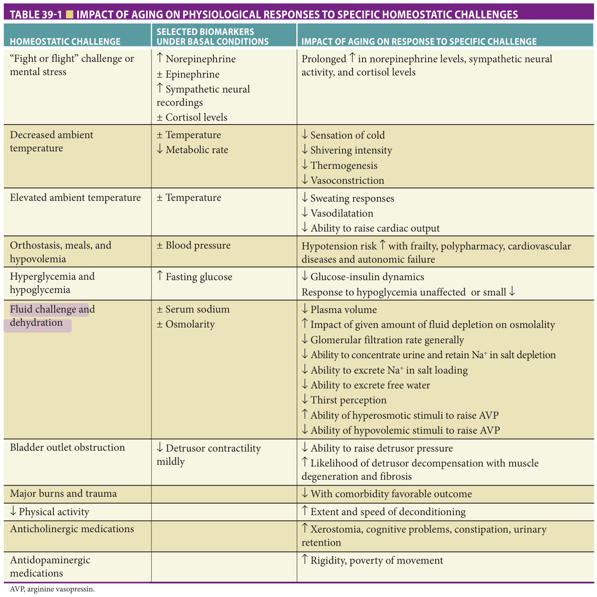

Study summary of Chapter 39; the book and the full chapter are the reference.

# Chapter 39 Study: Systems Physiology of Aging and Selected Disorders of Homeostasis

## Summary

**Core concepts**
- Homeostenosis means diminished ability to maintain homeostasis under challenge; normal function at rest may conceal low physiological reserve (p575–576, p580).
- Aging changes vary across people and organs: reduced complexity, resilience, end-organ responsiveness and negative feedback interact with accumulated allostatic load (p575–576).

**Temperature disorders**
- Hypothermia may occur without extreme cold, shivering or a complaint of feeling cold. With aging, basal temperature is unchanged but shivering intensity declines (p582). Use a low-reading thermometer; investigate infection, hypoglycemia and hypothyroidism (p583–584).
- Mild hypothermia at **32–35°C** generally responds to insulation and a warm environment; active external heating may cause vasodilation and hypovolemic shock (p584).
- Below **32°C**, the book calls for **active core rewarming**. It describes rapid instillation and removal of **40°C potassium-free peritoneal dialysate** as a core rewarming method (p584).

> Current practice (not the book): For moderate or severe hypothermia with vital signs, use active external and minimally invasive rewarming as appropriate. Hemodynamic instability or risk of arrest warrants transport to a center capable of extracorporeal life support. [European Resuscitation Council, 2025, Figure 5](https://www.erc.edu/media/wwufbysp/gl2025-06-spec-circ-e.pdf).

- Insulin is ineffective below **30°C**; drug metabolism and responsiveness change during hypothermia and rewarming, allowing accumulation and subsequent toxicity (p584).
- Heatstroke needs rapid cooling and supportive care. Remove clothing, cool skin and monitor temperature, fluid balance and cardiovascular status to avoid hypothermic overshoot (p585).

**Sodium & volume assessment**
- Hyponatremia symptoms depend on severity and speed of onset; chronic cases can appear less symptomatic. Evaluate osmolality, baseline cognition and volume status (p586–587).
- Severe symptomatic hyponatremia is an emergency: generally aim for no more than **8 mEq/L** increase in the first **24 hours**, with frequent sodium checks (p587).
- Treatment depends on physiology: hypertonic saline with or without a loop diuretic for SIADH with concentrated urine; **0.9% saline** for hypovolemia; water restriction plus loop diuretic for hypervolemia (p587).

> Current practice (not the book): Seizures, coma or other severe neurologic symptoms from hyponatremia require urgent hypertonic saline regardless of volume status. The European emergency regimen starts with 150 mL of 3% saline over 20 minutes, with immediate reassessment and sodium measurement. Aim initially for a rise of about 5 mmol/L. Monitor closely and limit subsequent correction, particularly in patients at risk for osmotic demyelination. [Society for Endocrinology, emergency guidance, 2022](https://www.endocrinology.org/media/xhrhxhxm/emergency-management-of-severe-and-moderately-severely-symptomatic-hyponatraemia-in-adult-patients-2022.pdf).
- Hypernatremia requires treatment of water loss/deprivation and water replacement. In hypotension with compromised circulation, start **0.9% saline** to restore intravascular volume, then switch to a more hypotonic fluid; the chapter advises a sodium fall of approximately **8–10 mEq/L/24 h** (p588).

### Which compensatory response is lost?

- An older adult can maintain a normal resting measurement but tolerate a smaller disturbance. With cold exposure, perception of cold, shivering intensity, heat production and vasoconstriction can all diminish. After a fall with prolonged immobility, impaired shivering explains failure to generate heat even in the absence of extreme outdoor temperatures (p581–583).
- The direction of the hormonal response depends on the stimulus. Hyperosmolality can evoke a greater vasopressin response, whereas the response to volume depletion can be impaired. A smaller plasma volume, reduced thirst and limited renal concentration make a given water loss more consequential. Reduced free-water excretion can also predispose to hyponatremia when intake is excessive (p581, p586).
- In a hypotensive patient with infection, poor intake and marked hypernatremia, compromised circulation is the immediate threat. Restore perfusion with isotonic saline before replacing the residual free-water deficit with more hypotonic fluid. Reassess sodium during correction because the appropriate fluid changes as intravascular volume recovers (p588).
- Bladder filling may produce less warning and the detrusor may generate lower pressure. Outlet obstruction increases the chance of decompensation. In this setting an anticholinergic may precipitate retention even when its intended effect was relief of urgency (p581, p589–590).

**Drugs & exam traps**
- Recurrent volume depletion can reflect mineralocorticoid deficiency even without frank hyperkalemia.
- A BUN/creatinine ratio above **20:1** may reflect low muscle mass rather than volume depletion; low protein intake can instead mask the expected rise (p589).
- Older adults may have reduced sensation of bladder filling (p589). Anticholinergic drugs may provoke cognitive change, constipation, dry mouth and urinary retention; disease and aging-related susceptibility both contribute (p590).

### Reading Figure 39-1 as a response to a challenge

A stable laboratory value is the end result of regulation. It tells little about how much effort was required to maintain it, how quickly a deviation would be detected or how much capacity remains to respond to a second disturbance. For June 2026 Q57, homeostenosis means a narrowing in the range of challenges a person can tolerate while maintaining or recovering internal balance. Resting values can look ordinary. A fever, cold room, interruption to water access or new medication can unmask the reduced reserve. The exam distinction is between the level observed before the disturbance and the ability of the system to adjust afterward (p575–576, p580).

Figure 39-1 emphasizes several different trajectories. The average of a measurement may shift with age while the spread among individuals also increases. An individual patient's response cannot be inferred from that average. A physiological signal can retain an apparently normal mean yet lose its healthy variation over time. A change in the number and coordination of regulatory elements can reduce flexibility before a conventional resting test becomes abnormal. Physiological complexity refers to coordinated variation across multiple time scales; more erratic behavior is not automatically a sign of a healthier, more complex system (p576–578).

Consider three components of a feedback loop separately. A sensor may detect less of a change, the regulatory center may generate a weaker or more prolonged signal, and the target tissue may respond less to the same circulating mediator. The measured concentration of a hormone or neurotransmitter therefore need not mirror the capacity of the end organ. Increased sympathetic activity and norepinephrine may coexist with inadequate reserve in response to standing or heat. The shape of the recovery curve also matters. A response that takes longer to subside may add to the effect of a later stressor even if the peak appears appropriate (p576–578, p581).

Allostasis describes adjustment to changing demands, whereas allostatic load describes the accumulated cost of repeated or persistent challenges. A person who encounters another disturbance before recovering may respond from a new starting point. The chapter uses changes in stress mediators to illustrate how repeated exposures may leave the person more vulnerable to decompensation. Resilience concerns recovery after a disturbance; frailty reflects increased susceptibility to adverse outcomes. These concepts overlap, but an abnormal measurement in one system does not establish global frailty or predict which function will fail first (p575–580).

### Which comparison is appropriate for an older patient?

Studies that recruit only older people without detectable chronic disease may describe exceptional aging. Studies that group all older people together may instead attribute the effects of illness, medication or inactivity to chronology. The appropriate comparison depends on the question. To understand how aging affects a healthy feedback loop, select subjects with attention to the diseases that alter that loop. To plan care for a patient with several chronic illnesses, seek evidence that includes people with comparable burden and functional status. The chapter cautions against treating findings in unusually healthy volunteers as the expected response of every patient of the same age (p578–579).

An organ-specific recommendation may oppose what another system needs. For example, diuresis to relieve congestive symptoms can jeopardize renal perfusion in a person with limited volume reserve. Liberal fluid intake to improve renal perfusion can worsen congestion. Neither plan is adequate without identifying the clinical objective, the competing vulnerability and the response to the intervention. A fall in blood pressure, deterioration in renal measures or worsening breathlessness can be reason to reassess the balance. Integrated assessment asks what each system can still compensate for and which observed change is likely to alter the patient's function (p579–580).

### Reading Table 39-1 by stimulus, baseline and response

June 2025 Q19 asks about the direction of selected physiological changes. First identify the stimulus. A hyperosmotic signal may evoke more arginine vasopressin, whereas hypovolemia may evoke less. A fall in effective circulating volume and a rise in serum osmolality are not interchangeable stimuli even when they occur together. Thirst perception declines, as do renal concentrating capacity, free-water excretion and the ability to retain sodium promptly during depletion. Plasma volume is smaller, so a given external fluid loss can create a greater osmotic disturbance. Serum sodium measured in an unstressed person may remain within its usual range (p581, p586).

Next distinguish production of a mediator from the compensatory action. With mental stress the rise or persistence of sympathetic neural activity, norepinephrine and cortisol can be greater. During cold exposure, however, the integrated response includes less cold sensation, shivering, thermogenesis and peripheral vasoconstriction. During heat exposure, sweating, vasodilatation and the ability to raise cardiac output can be impaired. For orthostasis, the basal blood pressure may be similar while frailty, medications, cardiovascular disease and autonomic failure make a challenge less tolerable. The table does not claim that every older adult is hypotensive, unable to sweat, or hypothermic at rest (p581–582).

With glucose challenge, the table reports higher fasting glucose and reduced glucose–insulin dynamics. The counter-response to hypoglycemia may be little changed or modestly decreased; glucose responses do not all shift in one direction. With bladder outlet obstruction, resting detrusor contractility can be only mildly reduced yet the bladder is less able to increase pressure against resistance. With inactivity, older muscle deconditions more rapidly. The common feature is loss of reserve under stress. A normal starting value, a smaller response and a more prolonged recovery are separable observations, and different organs in the same person can show different patterns (p581, p586, p589–590).

### Cold exposure after a fall

The older person who has lain immobile on the floor may not complain about the temperature. Impaired perception delays behavioral responses such as seeking shelter or adding clothing. Reduced shivering intensity limits muscle heat generation; a diminished vasoconstrictor response permits greater heat loss from the periphery. Reduced metabolic heat production and limited muscle reserves can add to the exposure. For June 2025 Q46, loss of shivering intensity is the relevant distinction from resting temperature. The vignette does not require an arctic environment or an illness that has permanently reset basal temperature (p581–583).

Table 39-2 on p583 groups potentially reversible contributors, including sedating drugs, impaired judgment, restricted resources for heating, neurologic injury and systemic illness. A person can cool because illness has impaired activity and intake, or because exposure occurred after a fall that itself had a medical cause. Ask about access to heat, ability to summon help, time on the floor, and medication or alcohol exposure. Investigate infection, hypoglycemia and hypothyroidism as appropriate. Use a thermometer capable of detecting a low core value. A routine device that stops at a convenient reporting limit can miss the severity of the problem (p582–584).

Table 39-3 describes early hypothermia at **32–35°C** with fatigue, slowed gait, slurred speech, confusion and cool skin. At **28–32°C**, mental status and reflexes deteriorate, breathing slows, and atrial or ventricular arrhythmias can develop. Cold diuresis can leave the patient intravascularly depleted. Below **28°C**, absent reflexes, fixed pupils or apnea can resemble death. Table 39-4 calls attention to a J wave following the QRS complex; bradycardia, prolongation of conduction intervals and atrial or ventricular arrhythmias can also occur. These changes can resemble myocardial ischemia, so interpret the tracing in the context of the measured core temperature (p583).

Rewarming changes both vascular tone and drug handling. A cold, vasoconstricted patient may be volume depleted even when this is not obvious initially. The circulation can deteriorate as the periphery warms, and a drug given repeatedly during impaired clearance can have a delayed effect as temperature rises. The book emphasizes support of oxygenation and volume, rhythm surveillance and correction of underlying disease. Read its historical peritoneal rewarming description beside the current-practice note above. A temperature category alone does not describe whether the patient has a stable circulation, which is crucial to the choice of modern rewarming support (p583–584).

### Heat stress and a drop in pressure after standing or eating

Heat dissipation requires sweat production, flow to skin and enough cardiac output to support that redistribution. Aging can delay sweating until core temperature is higher and limit the magnitude of the response. Cardiac disease, low fitness, limited mobility, impaired judgment and inadequate access to a cooler environment can compound the problem. Physiological conditioning influences responses: the chapter describes better exercise-related sweating and skin flow in fitter individuals. A cool indoor environment matters most if the person can get there or someone can assist. During a heat wave, ask who actually checks on a person living alone (p581, p584–585).

In Table 39-5, the book's classic heatstroke presentation includes a core temperature **above 40°C** with central nervous system dysfunction and often hot, dry skin. Confusion, seizures or coma distinguish a dangerous systemic illness from a complaint of feeling warm. Heart failure, arrhythmias, shock, hepatic injury and metabolic disturbance can accompany central dysfunction. Cooling is urgent because heat production or retention exceeds heat loss. Remove excess clothing, move the patient to a cooler setting, cool the skin and support circulation. Monitor core temperature to avoid overshoot and consider aspiration risk when selecting a hydration route in someone whose alertness is impaired (p585).

Standing reduces venous return. A compensatory increase in heart rate, vascular tone and effective cardiac performance ordinarily protects pressure and cerebral perfusion. An older patient with impaired baroreceptor sensitivity or reduced ventricular compliance has less room for a further challenge such as a meal, volume loss or a vasodilating drug. Frailty, aortic stenosis, diabetes, Parkinson disease and autonomic neuropathy appear in Table 39-6. Significant symptomatic orthostatic hypotension is uncommon in healthy older adults under ordinary conditions. A postural drop should therefore prompt a search for volume depletion, drug effects or disease rather than an attribution to age alone (p581, p585–586).

### Low sodium: measure tonicity, then assess the kidney's response

Start by establishing whether the serum is hypotonic. Hyperglycemia shifts water into extracellular fluid, lowering measured sodium while increasing measured osmolality. The chapter estimates corrected sodium by adding **1.5 mEq/L for every 100 mg/dL of glucose above 100 mg/dL** to the measured sodium. It also describes apparent hyponatremia with marked hyperlipidemia or a high protein concentration; measured osmolality can be normal in that setting. These mechanisms are different. The immediate treatment should address the actual disturbance rather than reflexively raising a laboratory sodium value (p586).

With hypotonic hyponatremia, ask whether the kidneys have appropriately produced dilute urine. Concentrated urine signals continuing antidiuretic activity, which can be appropriate during effective volume depletion or inappropriate in SIADH. Review intake, recent fluid administration, thiazides, symptoms of systemic illness and medications associated with SIADH. Look for orthostatic hypotension or weight loss as evidence of depletion; edema and pulmonary congestion point toward total-body volume excess. A low urine sodium can reflect renal conservation in volume depletion, while recent diuretic exposure or renal salt losses complicate interpretation. A normal creatinine alone cannot establish euvolemia (p586–587).

Table 39-7 sorts gastrointestinal losses, sweating, thiazides and salt-losing renal disorders under hypovolemia. The euvolemic differential includes inappropriate antidiuresis with lung disease, CNS disorders, malignancy, drugs or postoperative hypotonic fluids, as well as endocrine causes. Heart failure, cirrhosis and nephrotic syndrome belong to the hypervolemic column. For the earlier exam vignette with a very dilute urine, consider excess water relative to solute before labeling the presentation as SSRI-induced SIADH on the strength of the drug list. The urine's response is part of the causal argument. Diuretic exposure, dietary intake and the clinical volume examination refine that interpretation (p586–587).

Neurologic symptoms depend on how fast sodium changed as well as the absolute value. Chronic mild hyponatremia may initially look clinically quiet; severe symptomatic hyponatremia requires urgent treatment. The text's daily correction limit is a ceiling rather than a requirement to reach that increase in someone who has already improved. Hypovolemic patients may start to excrete dilute urine once circulation improves, so the measured sodium can rise faster than the administered saline alone would predict. Frequent measurement matters during treatment and while the underlying cause is resolving. Differentiate urgent relief of dangerous symptoms from the slower management of chronic SIADH or edematous states (p586–587).

### Hypernatremia: separate restoration of circulation from replacement of water

Identify how water was lost or why the person could not replace it. Reduced thirst, poor access to drinks, cognitive impairment and dependency may all impair intake. Fever, gastrointestinal losses or renal loss can increase requirements. Measure intake and urine output, assess blood pressure and perfusion, and examine the urine concentration in relation to the hyperosmolar serum. Inappropriately dilute or high-volume urine suggests a renal process; appropriately concentrated urine suggests preserved renal conservation and points attention to limited intake or extrarenal loss. Acute hypernatremia can cause marked neurologic symptoms; a slower rise may present more subtly (p587–588).

The book estimates water deficit in liters as **0.45 × weight in kilograms × (measured sodium / 140 − 1)**. The estimate assumes a body-water fraction and does not include continued losses. The chapter allows oral replacement when the person can swallow safely and the estimated deficit is **under 3 L**. Otherwise IV water can be provided as dextrose in water. In circulatory compromise, however, restore intravascular volume with isotonic saline first. Reassess perfusion, then change to a more hypotonic solution according to the remaining deficit. Determine subsequent replacement from serial measurements, ongoing output and changes in clinical status (p588).

June 2025 basic-track Q143 combines pneumonia and reduced intake with hypotension, tachycardia, renal dysfunction and marked hypernatremia. The high sodium identifies a water deficit; the blood pressure identifies which deficit must be addressed first. Isotonic saline expands the extracellular compartment during shock. Giving only free water initially would not sustain the same intravascular expansion, while giving isotonic fluid indefinitely would fail to address the remaining water deficit. The exam asks for the initial intervention; the full plan changes after stabilization. Antimicrobial treatment of pneumonia also addresses the illness that impaired intake and increased losses (p588).

### Volume, mobility and medication stress outside the sodium number

Serum sodium describes water balance relative to solute. Total-body sodium more closely reflects extracellular volume, so edema or depletion can occur at different serum sodium concentrations. In a patient losing volume repeatedly, review intake, gastrointestinal losses, bleeding and diuretics. Consider adrenal or mineralocorticoid deficiency if salt wasting and hypotension persist. The book describes **fludrocortisone 0.1 mg daily** for established isolated mineralocorticoid deficiency; primary adrenal insufficiency requires both glucocorticoid and mineralocorticoid replacement. For leg edema, distinguish venous insufficiency from systemic cardiac, renal or hepatic disease. Local compression and treatment of systemic fluid overload address different mechanisms (p588–589).

Bladder outlet obstruction illustrates compensation that may later fail. Initially hypertrophy permits greater pressure to overcome resistance. With decompensation, muscle loss, fibrosis and axonal degeneration reduce the ability to empty the bladder. Similarly, when muscle is unloaded during bed rest, a seemingly small loss of reserve can have large functional effects. The chapter reports loss of muscle mass of **up to 5% per week** with immobilization and loss of strength that may approach **40% by 6 weeks**. Mobilization, nutrition, treatment of illness and attention to medications can limit the consequences. Severe burns and trauma likewise challenge several systems at once; the same injury burden can have different outcomes as reserve and comorbidity vary (p589–590).

An anticholinergic challenge can cause dry mouth, constipation, impaired cognition and retention in a person with limited cognitive or bladder reserve. In experimental observations, healthy older adults also showed a more sustained reduction in stimulated salivary flow after glycopyrrolate. Antidopaminergic drugs more often produce rigidity, reduced movement and tardive dyskinesia in older patients; acute dystonia is relatively uncommon. New motor slowing may reflect medication effects superimposed on reduced dopaminergic reserve or early Parkinson disease. Review exposure and its timing before concluding that new cognitive, urinary or motor symptoms represent an irreversible change (p590).

## Exam traps

- Hyperosmolality and volume depletion are different stimuli for vasopressin. The response may be increased to the former and impaired to the latter (p581, p586).
- When severe hypernatremia is accompanied by hypotension and compromised circulation, restore perfusion before concentrating on the free-water deficit (p588).

## Exam-cited book images

Book images cited by past exams. Tap an image to zoom.

## Table 39-1 — book image

[June 2025 Q19](?chapter=bank&q=mcq-e3d703443b76b9de6cb9b9b3)

## Past exam questions

- [June 2026 Q57](?chapter=bank&q=mcq-4c7f1796411e5742b15b4aea) — Printed page 575.
- [June 2025 Q19](?chapter=bank&q=mcq-e3d703443b76b9de6cb9b9b3) — Printed page 581.
- [June 2025 Q46](?chapter=bank&q=mcq-28f16301f638acf0121222dd) — Printed page 582.
- [June 2025 Basic Q143](?chapter=bank&q=mcq-8d25a66a3df7ec66e248a685) — Printed page 588.

[Earlier sittings, chapter-level mapping](?chapter=39#asked-chapter) — 2021-Dec Q87.

## Recall drill

**1. How can an older patient appear normal at rest despite poor physiological reserve?**

Answer
Homeostenosis narrows the range within which a physiological system can compensate for stress. A disturbance may reveal a deficit hidden at baseline. (p575–576, p580)

**2. Which cold responses can be impaired after prolonged immobilization?**

Answer
Cold perception, shivering intensity, thermogenesis and peripheral vasoconstriction can all decline with aging. (p581–582)

**3. How does the book define hypothermia for clinical purposes?**

Answer
Core temperature below 35°C, measured with a suitable tympanic, rectal or esophageal probe. (p582)

**4. Why can indoor settings still pose a hypothermia risk?**

Answer
An immobile or frail patient may not notice cold or generate enough heat, even in an air-conditioned facility. (p582–583)

**5. Which reversible causes should be considered in unexplained hypothermia?**

Answer
Assess for infection, hypoglycemia, hypothyroidism, malnutrition, sedating drugs and prolonged immobility. (p583)

**6. Which ECG feature can support hypothermia?**

Answer
J or Osborne waves after the QRS are relatively specific and can disappear as temperature returns toward normal. (p583)

**7. What makes severe hypothermia a cardiac emergency?**

Answer
Bradycardia and ventricular dysrhythmias can occur, and even minor stimulation may precipitate arrhythmia. Cardiac monitoring is important. (p583)

**8. Which responses to heat may be impaired?**

Answer
Sweating, cutaneous vasodilatation and the ability to raise cardiac output can diminish, limiting heat loss. (p581, p584–585)

**9. Why does an absence of thirst fail to exclude significant dehydration?**

Answer
Thirst perception diminishes with age, and the kidney may be less able to conserve water and sodium during depletion. (p581, p586)

**10. How does vasopressin respond to osmotic versus volume stress?**

Answer
The response to hyperosmotic stimuli can increase, while the response to hypovolemia may be impaired. (p581, p586)

**11. What determines how symptomatic hyponatremia appears?**

Answer
Both the magnitude and speed of the sodium fall matter. Interpret mental-status change against the patient's usual cognition. (p586–587)

**12. Which fluid does the book use first for hypernatremia with shock?**

Answer
Start 0.9% saline to restore effective circulation, then address the water deficit with more hypotonic fluid. (p588)

**13. Why can a high BUN-to-creatinine ratio mislead?**

Answer
Low muscle mass can lower creatinine and raise the ratio. Low protein intake can also obscure the expected BUN rise. (p589)

**14. What endocrine disorder can present as repeated saline-responsive hypotension?**

Answer
Consider adrenal or isolated mineralocorticoid deficiency. The absence of frank hyperkalemia does not exclude it. (p589)

**15. Why can medication for urgency precipitate urinary retention?**

Answer
Aging or obstruction may reduce detrusor contractile reserve. An anticholinergic can push an underactive bladder into retention. (p589–590)

