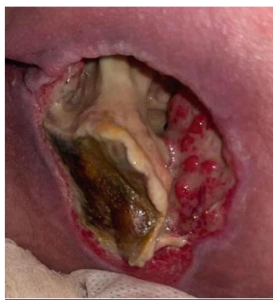

Study summary of Chapter 46 — Pressure Injuries; the book and the full chapter are the reference.

# Chapter 46 Study: Pressure Injuries

## What the exams asked

- Identify deep injury beneath intact purple skin — [2020 Q14](?chapter=46#asked-chapter).
- Choose a preventive plan from the Norton assessment, the ability to turn and heel loading — [2020 Q80](?chapter=46#asked-chapter), [June 2022 Q92](?chapter=46#asked-chapter), [September 2024 Q46](?chapter=46#exam-mcq-dc7ff82449b55e43a32f82c6).
- Redistribute pressure to help an established stage 3 wound heal — [June 2025 Q21](?chapter=46#exam-mcq-bda874582d05d3ff86418724).
- Choose routine cleansing and a cover for a lightly draining wound — [December 2021 Q40](?chapter=46#asked-chapter), [June 2022 Q25](?chapter=46#asked-chapter), [September 2024 Q53](?chapter=46#exam-mcq-38a0f8377b35636e2cfe5319).
- Recognize periwound maceration and match absorptive dressings to a wet cavity — [June 2023 Q32](?chapter=46#exam-mcq-d62027de720f4bc81315d771), [May 2024 Q21](?chapter=46#exam-mcq-86d32add6a699a7f5fa6ff43), [June 2025 Q47](?chapter=46#exam-mcq-c42934955cd7ee9c0f7b5a69).
- Choose a local antimicrobial dressing after debridement of an infected, draining ankle — [September 2024 Q67](?chapter=46#exam-mcq-90d840a5077cb2840fbdba04).
- Select autolysis for limited necrosis or urgent sharp removal for an infected wound — [June 2023 Q63](?chapter=46#exam-mcq-db33e5272b5446975d8f55e1), [September 2024 Q80](?chapter=46#exam-mcq-ea02383bbc4243f1efda6af0), [June 2026 Q7](?chapter=46#exam-mcq-4bd44c1b63181235607f0841).
- Protect dry ischemic eschar and assess perfusion before debridement — [May 2024 Q97](?chapter=46#exam-mcq-5e44f7b9b75a76f17420c999), [September 2024 Q31](?chapter=46#exam-mcq-92095288eae48f2eb7420b46).
- Recognize spreading infection, interpret wound cultures and diagnose osteomyelitis — [2020 Q4](?chapter=46#asked-chapter), [December 2021 Q82](?chapter=46#asked-chapter), [May 2024 Q8](?chapter=46#exam-mcq-3e85381471c86c4427c12e34).
- Use oral energy and protein, calculate the daily target and interpret the evidence for zinc — [2020 Q67](?chapter=46#asked-chapter), [June 2022 Q61](?chapter=46#asked-chapter), [May 2024 Q90](?chapter=46#exam-mcq-06bc1c4a093014e7bcb4f943), [June 2025 Q75](?chapter=46#exam-mcq-62e56f371adcced9c24300a2).
- Recognize complications of tube feeding — [June 2025 Q97](?chapter=46#exam-mcq-57e9758f76f4b86d937420c0).
- Relieve wound odor toward the end of life and reduce painful dressing changes — [May 2024 Q42](?chapter=46#exam-mcq-beb6eeb9a6b97998b481179e), [June 2026 Q67](?chapter=46#exam-mcq-f2767b550997768d287f7738).
- Distinguish complex nursing care from routine nursing, rehabilitation and long-term ventilation in Israel — [June 2022 Q98](?chapter=46#asked-chapter).

## Read the skin and remove the load

A purple buttock lesion can represent extensive damage before the skin opens. Intense pressure transfers force through the soft tissue to the bone–muscle interface. Ischemic muscle is especially vulnerable to deformation. Persistent maroon, purple or deep red color, a dark wound bed after epidermal separation, or a blood-filled blister suggests **deep tissue pressure injury**. Stage 1 is intact, nonblanchable erythema. Stage 2 exposes moist viable dermis or forms a serum-filled blister. Skin color can obscure erythema, so compare temperature, firmness and tenderness with adjacent tissue. Stage 3 exposes fat, while stage 4 exposes or allows direct palpation of a deep structure such as tendon or bone. When slough or eschar prevents assessment of the depth of full-thickness loss, record the wound as unstageable. Do not assign a shallower new stage as granulation fills a healing wound (pp. 681, 685–688, Figure 46-1).

**Who needs assistance?** Ask whether the patient can change position enough to unload the affected site. The Norton scale rates physical condition, mental condition, activity, mobility and incontinence. Activity concerns getting up or walking, whereas mobility concerns the ability to change body position. Lower scores indicate greater vulnerability. Braden evaluates six risk domains. Both approaches should lead to action such as offloading, help with mobility or moisture protection. Hazzard describes risk assessment on admission, with reassessment each shift in acute care or when the clinical condition changes (pp. 682–683). [Norton scale, AHRQ Tool 3E](https://www.ahrq.gov/patient-safety/settings/hospital/resource/pressureulcer/tool/pu7b.html)

**Prevent heel and sacral injury after stroke or sepsis.** Support the calf so the heel floats, and confirm that it stays clear of the mattress. A pillow can work for prevention if it stays in place. For an established heel wound the chapter favors a heel-offloading device because pillows collapse or move. A thin padded heel protector reduces rubbing but may leave pressure unchanged. In bed, a 30-degree side tilt unloads the sacrum. Keep head elevation as low as the patient's condition allows to reduce sliding and shear. In the chair, address posture and foot support, help dependent patients change position hourly and encourage those who can to shift weight every 15 minutes (pp. 683–685, 690).

**Which surface helps?** A foam or similar reactive surface redistributes weight by allowing the body to sink in and by supporting its contours. An active alternating-air surface cycles support between air cells, useful at high risk when frequent movement is difficult. A support surface complements assisted turning. The usual interval in bed is two to three hours, adjusted to mobility, clinical condition and surface. In 942 nursing-home residents on high-density foam, injury rates were similar across two-, three- and four-hour schedules. That result cannot prescribe a single interval for a patient in septic shock. For an established stage 3 wound, consider a specialty surface and keep weight off the wound. A retrospective comparison found faster area reduction on air-fluidized beds than on the two comparison surfaces. June 2025 cited p. 698 for pressure redistribution, while the treatment comparison appears on p. 692 (pp. 683–684, 689–692, 698).

## Match cleansing and dressings to the wound

**Start with the bed, the edges and the old dressing.** A clean granulating wound can be gently irrigated with physiologic saline. Avoid hydrogen peroxide and routine povidone-iodine on clean healing tissue because these agents can injure fibroblasts. Heavy debris or clinical infection calls for reassessment of cleansing, debridement and infection treatment. A hydrocolloid holds moisture and handles low to moderate drainage. A hydrogel hydrates, promotes autolysis, cools and lifts off with little trauma. The photograph in September 2024 Q53 could fit either, depending on actual drainage. In June 2022 Q25 the stem specified scant exudate. The named Flaminal Hydro formulation suits slight to moderate drainage. A standard PolyMem polymeric membrane contains both a moisturizer and absorbent material, unlike a simple dry absorbent pad (pp. 692–694, 697, Table 46-2). [Flaminal formulations](https://www.flenhealth.com/faq/flaminal-faq) · [PolyMem instructions, initial application](https://polymem.com/wp-content/uploads/2025/06/IFU-5930-PolyMem-Pad-or-Roll-Dressing-NLDEGKPLSLPTHEITARTHKOZHSKFRESEN.pdf)

**A white, waterlogged edge calls for more absorption.** Wound fluid supports epithelial migration when confined to the bed. When it pools on surrounding skin it produces maceration, as in June 2023 Q32 after autolysis. Increasing absorptive capacity can protect the margins while maintaining a moist bed. Alginate ropes or pads fit draining cavities and undermined areas. They handle moderate to heavy exudate and need a secondary cover. They can dry out when drainage is scant. Hydrofibers also absorb moderate to heavy drainage and are available in ribbon form. For a heavily draining infected full-thickness wound, a silver-containing alginate or hydrofiber adds local antimicrobial activity to fluid control (pp. 693–695, 697, Table 46-2).

**The ankle wound after debridement.** September 2024 Q67 described persistent purulence and exposed bone while systemic antibiotics were already being given. Silver alginate addresses the continuing local drainage and microbial burden. Continue the evaluation for bone infection. Negative pressure can reduce wound volume after debridement and selected infected wounds can receive instillation therapy. The official p. 696 discusses this specialized use. The alginate and silver indications appear on pp. 694 and 697.

## Remove necrosis safely and recognize deep infection

**What determines the pace of debridement?** A large necrotic buttock wound with spreading redness, a purulent collection or sepsis needs prompt source control. Surgical or sharp debridement can rapidly expose the bed, drain a pocket and define concealed tracts. Check perfusion and bleeding risk, including anticoagulants. A stable wound with limited necrosis may instead undergo autolysis, with macrophages and endogenous enzymes working under a moist occlusive dressing. Autolysis is slow and is unsuitable with untreated infection, extensive necrosis, large undermined or tunneled wounds, impaired immunity or severe malnutrition. Topical collagenase is faster than autolysis and may follow sharp debridement. Iodine inhibits collagenase. Wet-to-dry gauze is nonselective and can remove new granulation as well as dead tissue (pp. 695–696).

**Stable eschar on an ischemic heel is an exception.** Dry, adherent, intact eschar without erythema or fluctuance can protect tissue that would not heal after excision. Offload, assess arterial supply and follow for new drainage, bogginess, spreading inflammation or systemic illness. A photograph cannot establish perfusion. September 2024 Q31 awarded credit to all four responses. The clinical plan supported by the dry eschar and peripheral arterial disease is offloading and vascular assessment. Antibiotics, debridement and compression each require their own indication (pp. 688–689, 696, Figures 46-1 and 46-2).

**Colonization, cellulitis and osteomyelitis require different actions.** Chronic wounds can carry bacteria without invasive infection. A routine swab of drainage samples these organisms. If deep infection is suspected, obtain tissue after cleansing or debridement when feasible. Spreading cellulitis, systemic illness or bone infection calls for systemic treatment. An afebrile patient can still have cellulitis and marked inflammatory abnormalities. When bacteremia is suspected, empiric therapy covers aerobic gram-negative rods, gram-positive cocci and anaerobes while reliable cultures are obtained. Narrow therapy when the causative pathogens are identified (pp. 693–695, 697).

A nonhealing heel, new severe pain, warmth and elevated CRP merit investigation even with a normal leukocyte count. Visible or palpable rough bone increases suspicion of osteomyelitis. Imaging can show its extent, and bone biopsy for culture and histology can confirm the diagnosis and direct treatment. Assess the need to remove infected bone. For serial follow-up, document area, drainage, tissue and the surrounding skin. Reconsider the plan if there are no signs of improvement in two weeks, and assess a deteriorating wound immediately (pp. 688–689, 695). [WHS pressure ulcer guidelines, 3.7–3.8](https://pmc.ncbi.nlm.nih.gov/articles/PMC11403384/)

## Feed for healing and anticipate complications

**Calculate what the patient needs, then check what reaches the patient.** Hazzard gives 30–35 kcal/kg and 1.3–1.5 g protein/kg per day for healing. A 60-kg patient losing weight therefore needs about 1,800–2,100 kcal and 78–90 g of protein daily at those targets. June 2022 used a slightly wider protein target of 1.25–1.5 g/kg/day, also given in WHS guideline 2.4. Address restricted diets, poor dentition, appetite, eating assistance and fluid losses. Use oral energy- and protein-rich food or supplements when feasible. Weight change and actual intake are more informative than using serum albumin alone, which also responds to inflammation (pp. 685, 692). [WHS pressure ulcer guidelines, 2.4–2.5](https://pmc.ncbi.nlm.nih.gov/articles/PMC11403384/)

**What does zinc evidence mean?** Enriched high-energy, high-protein formulas containing arginine, zinc, antioxidants and micronutrients have shown benefit when given for more than four weeks. That does not isolate the effect of zinc. June 2025 Q75 credits zinc in a patient without a deficiency. Hazzard's evidence concerns the combined supplement. Replace micronutrients for a suspected or confirmed deficiency, and avoid substituting isolated vitamins or minerals for calories and protein (p. 692).

**Tube feeding has no guaranteed wound-healing benefit.** A tube can dislodge, aspiration pneumonia can occur, and weight may continue to fall. Death has been reported in the frail populations studied. Tube formulas can also cause diarrhea, increasing wound contamination. Constipation is another recognized gastrointestinal complication of enteral nutrition. June 2025 Q97 accepts every answer to the question asking for an exception. Each outcome listed can occur, which makes a single clinical exception untenable (p. 692). [ESPEN guideline on home enteral nutrition, monitoring and complications](https://www.clinicalnutritionjournal.com/article/S0261-5614%2819%2930198-0/fulltext)

## Reduce pain and odor

Keeping the wound covered and moist reduces adherence and trauma during a dressing change. Hydrogel can also cool a painful wound. Excess drainage may instead call for an absorbent nonadherent dressing. Assess pain at rest, with dressing removal and during turns. Severe procedural pain may require analgesia beforehand (pp. 680, 694, 697–698).

When a patient is dying, the aim may be freedom from distress even if closure is unattainable. Topical metronidazole on the bed can reduce offensive odor. An absorbent dressing permits fewer changes, and analgesia 30–40 minutes before repositioning can ease movement. Adjust turns to the patient's tolerance. Consider debridement when it relieves a symptom or drains pus, taking account of the burden and the patient's wishes (pp. 696–698).

## Israeli context — מניעה, רצף טיפול וסיעוד מורכב

**אומדן בקבלה ובקהילה.** באשפוז האחות המוסמכת מעריכה סיכון סמוך לקבלה ועד 12 שעות ממנה. בקהילה ההערכה נערכת במפגש הטיפולי הראשון אצל מי שמוגבל בניידות, מרותק למיטה או לכיסא גלגלים, או נעזר באביזר רפואי. האומדן כולל לפחות ניידות, הכרה, שליטה בסוגרים ועצמאות בפעולות היום־יום. אצל מטופל בסיכון מבצעים גם בדיקת עור וסיקור תזונתי. [משרד הבריאות, חוזר מינהל הסיעוד 153/2019, עמ׳ 2, סעיפים 3–4](https://www.gov.il/BlobFolder/policy/nd153-2019/he/files_circulars_nd_ND153_2019.pdf)

**מה עובר עם המטופל.** מתאימים תוכנית ניידות, שינויי תנוחה ואביזרי תמיכה. בודקים גם נקודות לחץ מזונדה או מצנתר, מדריכים את המשפחה ומתייחסים לירידה במשקל. במצב רפואי או תפקודי משתנה מעריכים מחדש את הסיכון. במכתב השחרור או ההעברה הסיעודי מתעדים את גורמי הסיכון, תוכנית ההתערבות וההדרכה. כשמתפתח פצע לחץ חדש באשפוז יש ליידע את האחות בקהילה. [חוזר 153/2019, עמ׳ 3, סעיפים 5–10](https://www.gov.il/BlobFolder/policy/nd153-2019/he/files_circulars_nd_ND153_2019.pdf)

**בבית חולים גריאטרי.** אצל מטופל בסיכון נבדק מצב העור מדי יום. בפצע קיים מתעדים לפחות אחת לשבוע את הקוטר, דרגת החומרה, תיאור הפצע והטיפול. על התפתחות פצע מעל דרגה 2 יש ליידע את לשכת הבריאות הנפתית. יחד עם הלשכה מחליטים אם אפשר להמשיך במוסד או שיש צורך בהעברה לסיעוד מורכב. [האגף לגריאטריה, נוהל 2.3.13, מהדורה 2 מיום 01.11.2019, עמ׳ 2–3, סעיפים 6.1–6.5](https://www.gov.il/BlobFolder/dynamiccollectorresultitem/ng-2-3-13/he/files_circulars_ng_2_3_13.pdf)

**בחירת מסגרת.** סיעוד מורכב מתאים בשילוב של פגיעה קשה וקבועה בתפקודי היום־יום, אי־יציבות רפואית וצורך בטיפול ובניטור קבועים. פצע לחץ עמוק הוא דוגמה. בשאלת יוני 2022 תואר מטופל עם פרפלגיה ופצע סקרלי שעומקו מוסתר. חשוב לתעד את התלות ואת צורכי הטיפול בפצע. ירידה זמנית לאחר ניתוח עשויה להתאים לשיקום, והנשמה ממושכת מצריכה מסגרת מתאימה להנשמה. ועדת הסיווג בלשכת הבריאות שוקלת את המצב הרפואי והתפקודי. [משרד הבריאות, איך לבחור מוסד אשפוז סיעודי, סעיף התאמת מוסד אשפוז וטבלת רמת התפקוד](https://me.health.gov.il/older-adult/services-rights/hospitalization/nursing-hospitalization/choosing-a-facility/)

## Summary

**Definition & epidemiology**
- PI = localized skin/soft-tissue damage over a bony prominence or device; sacrum and heels are the most common sites (p679).
- **~70%** of PI occur in people **>65y**; prevalence **9–22%** in nursing-home (NH) residents, **5–32%** in hospitalized patients (p679).
- Joint Commission estimate: **2.5 million** US acute-care patients treated for PI/year (p680); separate annual cost estimate **~$27 billion** (2016) (p680).
- Pain: of people with PI who are able to report pain, **87%** report pain with dressing changes; only **6%** of those reporting PI pain receive any pain medication (p680).
- When PI is the source of bacteremia, mortality is **48%** (p680).
- Hospital-acquired PI: **11%** in-hospital mortality, **15%** mortality at 30 days post-discharge (p680).
- NH residents: PI unhealed at 6 months → **64%** mortality vs **11%** if healed (p680).

**Pathophysiology**
- 4 mechanisms: direct high-magnitude deformation, capillary-occlusion ischemia, shear-induced ischemia, and reduced tissue tolerance (malnutrition, arterial disease, neuropathy, moisture, prior scar) (p682).
- Muscle cell membranes rupture at **>80%** deformation; **2 h** of strain **>50%** causes irreversible muscle damage (p681).
- Inflammatory/edema changes can occur **2–7 days** before visible skin breakdown (preclinical stage) (p681).
- Healed scar tissue retains only **40%** of native tissue tensile strength → higher future PI risk at old sites (p682).

**Risk screening & assessment**
- In one monitored geriatric study, none developed PI with **>50** spontaneous body movements/night vs **90%** PI with **≤20** movements/night (p682).
- High-risk flags: age **>75y**, age >65 with scheduled surgery **≥3h**, hospital transport time **>1h** (p682); ICU surgery **≥8h** (p683).
- Braden scale scores **six** risk domains (p683).
- Reassessment cadence: acute care every shift; home health weekly ×**4** weeks then every other week; NH weekly ×**4** weeks then quarterly (p683).

**Prevention — repositioning & support surfaces**
- General turning interval **q2–3h** (p683); RCT of **942** NH residents on high-density foam mattresses randomized to q2h/q3h/q4h turning (p683) found no significant difference in PI incidence: **2.5%** vs **0.6%** vs **3.1%** (p684).
- Position at **30°** side-lying; chairbound patients repositioned **hourly** (shift weight **q15min**), hip flexion **90°** (p684).
- Standard mattress **4-inch** viscoelastic foam; OR risk = surgery **>3h**, ASA **≥3**, or prone position (p684).
- Prophylactic silicone foam dressings (critical care patients) cut heel PI (**3%** vs **12%**) and sacral PI (**1%** vs **5%**), NNT **10** (p685).
- **Table 46-1** risk-factor–specific interventions: incontinence/moisture → scheduled toileting/prompted voiding if responsive, check-and-change programs otherwise, plus protective creams; friction/shearing → cornstarch/lubricants between surfaces plus footboards; dry skin → gentle cleansers, moisturize, inspect daily, avoid massaging reddened areas (p683).

**Nutrition**
- Malnutrition/weight loss → **fourfold** higher PI risk; oral nutritional supplements → **25%** relative reduction in incidence (modest evidence) (p685).
- Healing targets: **30–35 kcal/kg** calories, **1.3–1.5 g/kg** protein/day; high-energy, high-protein supplements are beneficial, especially with arginine/zinc/antioxidants/micronutrients, when given **>4 weeks** (p692).
- Megestrol acetate (Megace): never shown effective as an appetite stimulant in older/NH patients; has steroidal side effects (p692).

**Staging (NPIAP six-category system)**
- **Stage 1**: intact skin, nonblanchable erythema; reversible in **1–3 weeks** (p686).
- **Stage 2**: partial-thickness, open dermis; should heal in **2–4 weeks** if properly treated (p686).
- **Stage 3**: full-thickness, fat visible, no bone/muscle/tendon exposed (p686-687, Figure 46-1).
- **Stage 4**: full-thickness with bone/muscle/tendon/cartilage exposed (p686).
- **Deep tissue PI (DTPI)**: purple/maroon intact skin, appears **~48h** after intense pressure (p686).
- **Unstageable**: full-thickness, depth obscured by slough/eschar (p687).
- Blanchable erythema = discoloration **>1cm** (p686).

**Early (nonvisual) detection**
- Early work suggests ultrasound may detect damage before clinical signs: **~80%** with abnormal images had no documented erythema (p686).
- Thermography: in one NH study, areas of blanchable erythema with cooler skin temperatures were more likely to develop necrotic ulcers within **7 days**; capacitance devices read in **3–8 seconds** (p686).

**Healing benchmarks & assessment tools**
- Reconsider the treatment plan if no healing signs in **2 weeks** (p689).
- **75%** of stage 2 PI heal within **60 days**; only **17%** of stage 3/4 PI do (p689).
- PUSH tool: **10** wound-size categories, exudate **0–3**, tissue type **0–4** (p689).
- BWAT: **13** characteristics, each scored **1–5**, total range **13–65** (p689).

**Local treatment**
- Saline/water lack antiseptic properties and should seldom be used on (colonized) PI — antiseptic options: Dakin's **0.25%** or povidone-iodine (**10%**/**1%** free iodine) on colonized PI, applied **10–15 min** before redressing; lavage **4–15 psi** (p692). For clean wounds, less force and physiologic solutions such as normal saline can be used (p693); avoid povidone-iodine, iodophor, sodium hypochlorite, hydrogen peroxide, and acetic acid on clean and healing PI (p697).
- Moist dressings re-epithelialize up to **40% faster** than wounds left open to air; hydrocolloid/foam changed **q3–5 days**; PI are typically colonized with **≥10⁵** organisms/mL and may carry this load for long periods without clinical signs of infection (p693-694).
- One retrospective study: air-fluidized beds healed fastest: **5.2 cm²/wk** vs **1.5 cm²/wk** (pressure-reduction) vs **1.8 cm²/wk** (low-air-loss) (p692).
- **Table 46-2**: pain-reducing dressing categories are hydrocolloids (p693), plus hydrogels (cooling effect), alginates, and hydrofibers (p694) — composite, transparent-film, wound-filler, and foam dressings list no pain-relief use in the table.

**Debridement**
- **Five** methods: surgical/sharp, mechanical, autolytic, enzymatic, bio-surgical (p695).
- Maggot (bio-surgical) density **5–8/cm²**; complete debridement **80%** vs **48%** with standard care (p696).
- Collagenase (enzymatic): iodine inhibits its activity; as printed, nanocrystalline silver "can be inhibited when used in combination with collagenase" (p696).

**Infection & biofilm**
- **60%** of chronic wounds contain a biofilm (p695).
- Osteomyelitis in **32%** of stage 4 PI; antibiotic course may be **<6 weeks** if infection is limited to cortical bone (p695).
- Surgical repair: complication rate up to **50%**, but **70–80%** healed at discharge; same-site recurrence lower in older patients (**40%**) than younger paraplegics (**>70%**); mortality in older patients ranges from nearly **50% to 68%** (long-term outcomes; p695).

**Drugs (name — scenario — caution)**
- Oral MSSA/strep: cephalexin, cefadroxil, dicloxacillin, clindamycin. Oral MRSA: clindamycin, amoxicillin+doxycycline, or TMP-SMX (p697).
- Parenteral empiric: cefazolin, ceftriaxone, clindamycin; vancomycin may be required for MRSA; metronidazole/carbapenem/beta-lactamase inhibitor for anaerobes (p697).
- Ground metronidazole on the wound bed for odor when debridement isn't possible; antiseptics in full-thickness PI — cadexomer iodine/silver/honey/PHMB dressings reduce bioburden; mupirocin is effective against MRSA (p697).
- Avoid on clean/healing PI (fibroblast-toxic in vitro): povidone-iodine, iodophor, sodium hypochlorite, hydrogen peroxide, acetic acid (p697).
- EMLA cream (lidocaine **2.5%** + prilocaine **2.5%**) or opioids/NSAIDs **30 min** pre-procedure for severe wound pain (p697); EMLA cut venous-wound pain scores by **21 mm** (p698).

**Palliative care**
- Goal = comfort, not healing; treat odor with topical metronidazole; give analgesia **30–40 min** before repositioning (p698).

**Exam traps / book notes**
- **Currency — declared gap.** The chapter states the NPIAP staging system "was updated in 2016"; later revisions to staging or treatment guidelines are not verified in this chapter (p686).
- **As printed.** Table 46-1's column header reads "PREVENTION INTERVENTONS" (sic, typo in the original) (p683).

## Recall

**1. What are the two most common anatomic sites for a pressure injury?**

Answer

Sacrum and heels (p679).

**8. In the RCT of 942 nursing home residents on high-density foam mattresses, did turning every 2, 3, or 4 hours change PI incidence significantly?**

Answer

No — among residents on high-density foam mattresses, 2.5% (q2h) vs 0.6% (q3h) vs 3.1% (q4h), not significantly different (p684).

**11. What is the key difference between Stage 3 and Stage 4 pressure injury?**

Answer

Stage 3: full-thickness with fat visible, no exposed bone/muscle/tendon (p686-687, Figure 46-1). Stage 4: full-thickness with exposed bone, muscle, tendon, ligament, or cartilage (p686).

**12. What percentage of Stage 2 pressure injuries heal within 60 days, compared to Stage 3/4?**

Answer

75% of Stage 2 vs only 17% of Stage 3/4 (p689).

**13. Why should plain saline or water rarely be used alone to clean an established pressure injury?**

Answer

They have no antiseptic properties, and PI wounds are colonized with bacteria — antiseptic cleansers (e.g., dilute Dakin's or povidone-iodine) are the options (p692). Exception: for clean wounds, less force and physiologic solutions such as normal saline can be used (p693), and povidone-iodine, iodophor, sodium hypochlorite, hydrogen peroxide, and acetic acid are avoided on clean and healing PI (p697).

**15. What oral antibiotic options are recommended for a pressure injury with suspected MRSA infection?**

Answer

Clindamycin, amoxicillin with doxycycline, or trimethoprim-sulfamethoxazole (p697).

### 2026 exam questions for this chapter

The actual exam questions and answer keys as printed in the chapter, reproduced verbatim.

> Question wording is an English rendering of the IMA paper as read from its page image (the Hebrew original is the authority). Keys are from key 899478 (after appeals). The support line is the book's own text, with its printed page; it supports an answer, it is not the key.

**Q7** — sourced to [p. 695–696](?chapter=46#p695). A 75-year-old woman was admitted to a complex nursing-care ward after a prolonged hospitalization for pneumonia, ventilation and a stay in intensive care. On admission to the ward she had a pressure ulcer involving the buttock, 10x9 cm, with abundant necrotic tissue and redness visible around it; see picture no. 1. Laboratory tests show elevated inflammatory markers. Which debridement approach is most recommended for her?

> Description by the builder, not from the paper (checked against the image). Picture no. 1 (IMA image album 885645, published separately from the question paper): a deep open wound with a large band of cream to pale-yellow slough through the middle, brown to olive-green necrotic tissue in the lower left, and red granulation tissue along the right edge and lower rim; the surrounding skin is dusky pink-purple. The photograph cannot settle what the pale central structure is, and the description implies no stage.

- א. Mechanical
- ב. Enzymatic
- ג. Autolytic
- ד. Surgical  ← **key**

> Book: p695: "Clinical practice guidelines on PI treatment recommend wound debridement with surgical or sharp debridement for extensive necrosis or when obtaining a clean wound bed quickly is important". p696: "A PI should be surgically debrided when there is a clinical need for extensive debridement; the degree of undermining and sinus tract or tunneling cannot be determined; there is advancing cellulitis; bone and infected hardware must be removed; and/or the individual is septic from the PI." The stem's abundant necrosis, surrounding redness and raised inflammatory markers match "extensive debridement" and "advancing cellulitis". p696: "Autolytic debridement is contraindicated in the presence of untreated infection or extensive necrotic tissue".

**Q67** — sourced to [p. 697](?chapter=46#p697). An 85-year-old woman is hospitalized in a complex nursing-care ward because of a stage 3 pressure ulcer. Which of the following dressings can relieve pain?

- א. (VAC) NEGATIVE PRESSURE WOUND THERAPY
- ב. A moisture-retaining dressing such as Hydrogel  ← **key**
- ג. A dressing with Povidone Iodine (Polydine)
- ד. A charcoal dressing

> Book: p697: "PI-related pain can be minimized by keeping the wound bed moist and covered." "Use of hydrogels, hydrocolloids, alginates, polymeric membrane foams, and soft silicone dressings allows for less frequent dressing changes, and less trauma and pain on removal as they are nonadherent to the wound bed." Table 46-2 (p694), hydrogels: "Cooling effect can help relieve wound pain". Hydrogels, hydrocolloids, alginates and hydrofibers each list "Reduces pain" among their uses. Charcoal (option 4) appears in Table 46-2 only as a foam variant ("available with surfactant impregnated or charcoal layer"), and the Foams row lists no pain relief among its uses.
