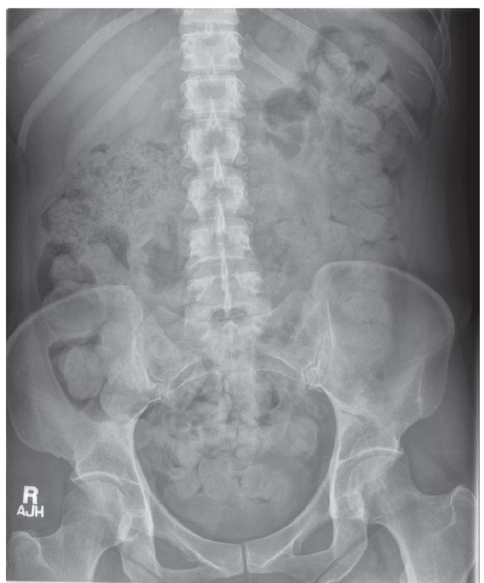
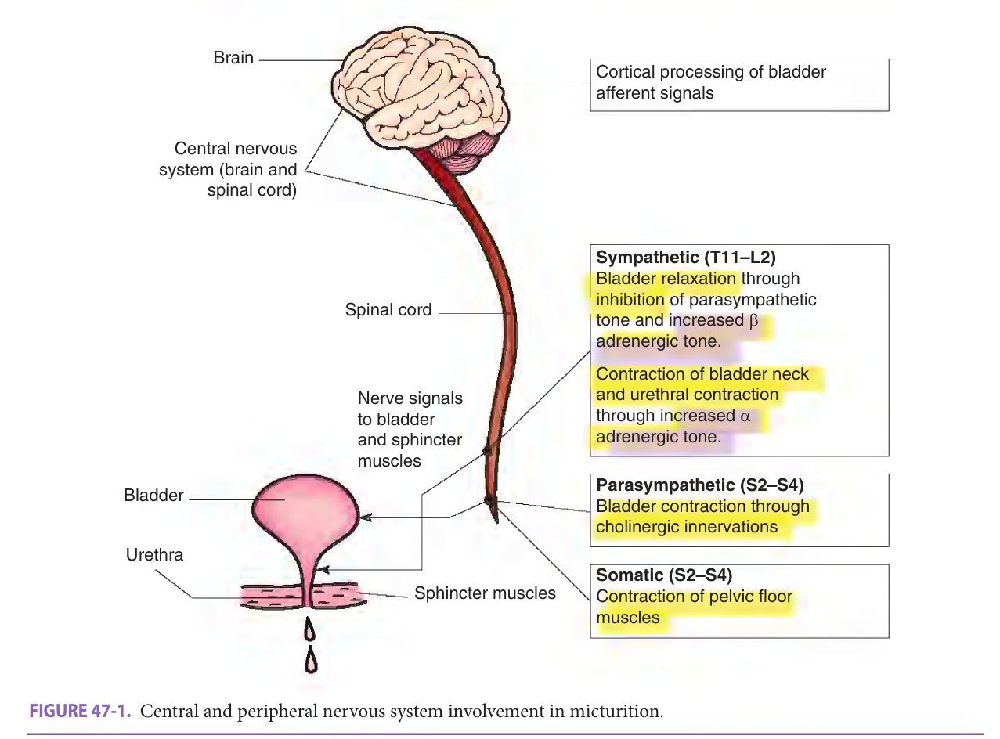

Study summary of Chapter 47 — Incontinence; the book and the full chapter are the reference.

# Chapter 47 Study: Incontinence

## What the exams asked

- Who keeps the outlet closed while the bladder fills, and what makes it contract for voiding? [June 2023 Q2](?chapter=47#exam-p700-mcq-a77459f28aa5bea68b87e0b9) · [June 2025 Q66](?chapter=47#exam-p700-mcq-30f0309dc8329f9569c19e59).
- How do normal capacity, first urge and postvoid residual differ from age-associated involuntary contractions? [June 2025 Q88](?chapter=47#exam-p707-mcq-44ea7b7d5de2b617e3e9bfed) · [June 2022 Q70](?chapter=47#asked-chapter) · [Read the eighth-edition discussion](?chapter=47#ch47-aging-contractions).
- What does a weak stream with continuous dribbling suggest, and which tests come first? [June 2023 Q36](?chapter=47#exam-p707-mcq-7b5f1873a64c120ce3892039) · [2020 Q93](?chapter=47#asked-chapter) · [Read the retention mechanism](?chapter=47#ch47-retained-urine).
- When can urgency and weak emptying coexist in a neurologically impaired man considering prostate surgery? [May 2024 Q68](?chapter=47#exam-p701-mcq-e2d127b4b2b341b7154a9425) · [Read the surgical decision in Chapter 38](?chapter=38#exam-p562-mcq-e2d127b4b2b341b7154a9425).
- Which medicines can cause cough-associated leakage, urgency or retention? [June 2026 Q17](?chapter=47#exam-p703-mcq-9dcabfcf87a03b3d498fce3d) · [June 2025 Q54](?chapter=47#exam-p703-mcq-2e7dd4430690d60bc89b80f4) · [June 2026 Q44](?chapter=47#exam-p703-mcq-c6b6b0376463f87b97f47931) · [December 2021 Q44](?chapter=47#asked-chapter) · [Read about drug-induced residual urine](?chapter=47#ch47-drug-retention).
- Which metabolic or bowel disorders can precipitate acute leakage? [May 2024 Q92](?chapter=47#exam-p702-mcq-c2ee36b048f810572296abfe) · [June 2025 Q98](?chapter=47#exam-p702-mcq-b0830837aa5b57c0f1e2f3e2) · [June 2026 Q64](?chapter=47#exam-p701-mcq-ec5cbb9f7b28b3e7733522d9).
- What does incidental pyuria mean in a clinically well long-term-care resident? [June 2025 Q81](?chapter=47#exam-p705-mcq-d3016371143763c986f9973c).
- When do a voiding diary, assisted toileting and a nearby commode address the cause? [June 2023 Q62](?chapter=47#exam-p707-mcq-93174381fd654b82b0cca672) · [June 2025 Q30](?chapter=47#exam-p709-mcq-08d1f5a8c0d9c28af969b1a0) · [2020 Q15](?chapter=47#asked-chapter) · [Read the scheduled-toileting paragraph](?chapter=47#ch47-scheduled-toileting).
- Which first treatment fits cough leakage, and which medication fits urgency in an independent woman? [December 2021 Q43](?chapter=47#asked-chapter) · [Read about pelvic-floor exercise](?chapter=47#ch47-pelvic-exercises) · [December 2021 Q45](?chapter=47#asked-chapter) · [Read about bladder relaxants](?chapter=47#ch47-bladder-relaxants).
- Which obstruction needs assessment for an intervention despite an alpha blocker? [September 2024 Q12](?chapter=47#exam-p709-mcq-f29bfd95e2f83369c82a4b34).
- Which enzyme does finasteride inhibit, and which adverse effects point to it? [September 2024 Q50](?chapter=47#exam-p713-mcq-3452f8f6cfd764cc9e8162f6) · [September 2024 Q22](?chapter=47#exam-p713-mcq-01cdc59c55369cf2a42ea5c5) · [June 2022 Q30](?chapter=47#asked-chapter) · [Read the finasteride mechanism on p. 713](?chapter=47#exam-p713-mcq-3452f8f6cfd764cc9e8162f6).
- How can a person with a neurogenic bladder avoid the infection risks of a continuously indwelling catheter? [June 2025 Q87](?chapter=47#exam-p715-mcq-911d970243b87dbe2fe1c675).

## Storage, voiding and the residual

**Storage is a coordinated action.** A sympathetic response relaxes the detrusor and tightens the bladder neck. Sacral somatic nerves maintain striated pelvic-floor and external sphincter tone. When a person chooses to void, outlet tone falls and parasympathetic cholinergic activity contracts the detrusor. A stroke can release the sacral reflex from descending inhibition and cause urgency. A sacral or peripheral lesion may instead leave a poorly contracting bladder (pp. 699–701, Figure 47-1).

**Ask which volume is being measured.** First urge generally occurs at 150 to 350 mL. A bladder may hold 300 to 600 mL and usually empties in under two minutes. Scan within a few minutes of spontaneous voiding. Below 100 mL generally indicates adequate emptying without straining. Above 200 mL is abnormal. Between these values, symptoms, repeat measurements and circumstances matter. A nursing-home resident can have frequent small voids while retaining a large residual (pp. 701, 705–708).

**Aging changes the likelihood of a finding.** Involuntary contractions occur in 40% to 75% of older incontinent patients and also occur in some continent adults. The combination of a sudden contraction and slow transfer to the toilet often produces the actual leak. Residual volume tends to rise, functional capacity can fall, and the association of childbirth with incontinence weakens in older women (p. 701).

**An almost permanently wet man with hesitancy needs an emptying assessment.** Prostatic obstruction, weak detrusor contraction and medication effects can all leave urine behind. Check symptoms, medications, examination and urinalysis. Culture selectively when infection is suspected. Measure the residual promptly by ultrasound. June 2023 Q36 accepted both urinalysis with culture and a bladder scan. Cystoscopy or urodynamics is reserved for an indication such as hematuria, unresolved mechanism or planning an intervention. The sitting cites pp. 703, 705 and 707 and names Table 47-5, which is printed on p. 704 (pp. 703–708).

**Urgency plus weak emptying can mimic prostatic obstruction.** The detrusor contracts involuntarily during filling but generates insufficient force during emptying. A low flow rate alone cannot distinguish weak contraction from a narrowed outlet. In frail men with neurologic disease considering prostate surgery, filling cystometry and a pressure-flow study can clarify what surgery could correct. Parkinson disease and spinal cord injury are examples in Chapter 38 (Ch. 47, pp. 701, 703–704, and Ch. 38, p. 562).

## Abrupt leakage and medication review

**Distinguish three drug mechanisms by the story.** A new dry cough followed immediately by leakage suggests ACE-inhibitor–precipitated stress incontinence. Review enalapril and select an appropriate replacement. A person taking donepezil may instead develop frequency and irresistible urgency through increased cholinergic activity. Oxybutynin reduces detrusor contraction. New constipation, fullness and 380 mL remaining after a void point to retention, especially in a man with BPH. Stop the antimuscarinic and assess drainage. Reducing a necessary diuretic would not restore contraction (pp. 702–705, Tables 47-4 and 47-5).

**Identify increased production as well as a weak bladder.** Hyperglycemia can cause osmotic diuresis. Hypercalcemia, loop diuretics and nighttime mobilization of dependent edema may also produce more urine than the person can manage. Hypocalcemia was the exception in May 2024. Peripheral arterial disease was the exception in June 2025, which distinguished it from venous edema or fluid overload. Atrophic vaginitis produces local irritation, while a new access barrier or delirium can cause acute leakage despite previously effective continence (pp. 701–703, Tables 47-3 and 47-4).

**Watery stool with a distended abdomen can signal impaction.** A retained stool mass can irritate the rectum and cause liquid to escape around it. It can also impede bladder emptying or trigger reflex contractions. Examine for impaction and retention and clear the stool when confirmed. Treating the liquid as primary diarrhea with loperamide can worsen retention of stool. Address subsequent toileting, mobility and constipation (pp. 701–702, 716–717).

**Interpret urine testing in context.** Urinalysis can identify blood, glucose or evidence of inflammation during the evaluation of new symptoms. A clinically well resident with long-standing stable incontinence and leukocytes discovered on a routine test gains no benefit from antibiotics merely for pyuria or bacteriuria. Reassess for new localizing or systemic features if the clinical situation changes (p. 705).

## Choose treatment by the mechanism and the person’s abilities

**A diary can guide the caregiver as well as the patient.** Record voids, wet episodes, fluids and circumstances to find a workable toileting pattern. Someone who can transfer but cannot initiate toileting may benefit from assistance at fixed daytime intervals. Habit training tailors the schedule to an individual’s usual voids. Prompted voiding adds wet/dry checks, offers to toilet and praise. A three-day trial can identify responders. After knee surgery, moving the commode closer and facilitating transfers can address the barrier immediately (pp. 707–711, Tables 47-9 and 47-10).

**For patients able to learn, match the exercise to the event.** With stress leakage, teach a pelvic-floor squeeze before a cough or lift. Leakage during a standing cough with the bladder about half full supports stress incontinence. Delayed leakage can follow a cough-triggered bladder contraction. With urgency, rapid pelvic contractions, urge suppression and a diary form part of bladder training. In mixed incontinence, begin with the symptoms that bother the patient most. Local vaginal estrogen can help when atrophic symptoms are present and may take months to have an effect (pp. 705, 709–710, 714).

**Persistent retention needs an emptying plan.** An alpha blocker can reduce smooth-muscle tone at the prostatic outlet in BPH without correcting fixed obstruction or weak contractility. Document the residual, assess renal or infectious consequences and discuss drainage and possible removal of a confirmed obstruction. A bladder relaxant can worsen high-residual leakage. Among patients who do not need ongoing drainage, a retrial after temporary catheterization is often possible (pp. 707–709, 711, 714–715).

**Separate storage drugs from prostate drugs.** Mirabegron stimulates beta-3 receptors during filling and can raise blood pressure or pulse. Antimuscarinics reduce bladder contractions but can cause dry mouth, constipation, delirium or retention. Finasteride instead inhibits type II 5-alpha reductase, reducing conversion of testosterone to dihydrotestosterone. Sexual dysfunction with gynecomastia points to finasteride. Tadalafil acts on phosphodiesterase type 5. The September 2024 Q50 bibliography lists p. 712, where Table 47-12 begins. The finasteride mechanism and adverse effects are on its continuation on p. 713 (pp. 711–714).

**Drain a neurogenic bladder without continuous catheter exposure when practical.** Clean intermittent catheterization at home can be performed by a trained patient or caregiver. Adjust frequency to measured volumes. When a catheter must remain, keep the system closed and urine flowing freely. Avoid routine irrigation or changing the catheter on an arbitrary schedule. New leakage around it, pain or falling output calls for examination for obstruction or displacement (Ch. 47, pp. 715–716, Tables 47-13 and 47-14, and Ch. 16, p. 232, Table 16-6).

## Israeli context

**מתי אומדים שליטה על הסוגרים?** חוזר מינהל האחיות 248/2025 עוסק באי־שליטה תפקודית. באשפוז אקוטי מבצעים אומדן בקבלה, בשינוי מצב ובשחרור. באשפוז תת־אקוטי או ממושך יש להשלים את אומדן הקבלה בתוך 72 שעות. לבני 65 ומעלה בקהילה מומלץ אומדן שנתי בביקור תקופתי. אחרי שחרור עם צנתר שתן חדש יש לבצע אומדן בקהילה תוך עשרה ימים. החריגים מפורטים מתחת לטבלה. [משרד הבריאות, 02.11.2025, עמ׳ 3, טבלת ״אומדן אי שליטה״](https://www.gov.il/BlobFolder/policy/nd248-2025/he/files_circulars_nd_nd248-2025.pdf#page=3).

**כשהקושי הוא להגיע לשירותים.** האחות מתאימה עם המטופל תכנית מעשית. אפשר לקרב את אמצעי ההתרוקנות, לשפר תאורה וגישה, להציע ליווי יזום, לתזמן התרוקנות ולנהל יומן. כשיש חשד לאצירת שתן עוקבים אחר השארית. לפי הצורך מפנים להערכת רצפת האגן או לצוות נוסף. האומדן, ההתערבות וההמלצות להמשך מתועדים ברשומה ובמכתב השחרור. [משרד הבריאות, חוזר 248/2025, עמ׳ 2–4, ״אחריות וסמכות״, ״תוכנית התערבות״ ו״תיעוד״](https://www.gov.il/BlobFolder/policy/nd248-2025/he/files_circulars_nd_nd248-2025.pdf#page=2).

## Summary

**Definition & epidemiology**
- UI = any involuntary leakage of urine (p699).
- Any UI in community-dwelling older adults: **~35%** of women, **~22%** of men (p699).
- Daily UI: **~12%** of women, **~5%** of men (p699).
- Nursing home residents: UI prevalence approaches **~60%** (p699).

**Normal continence physiology (know for "what's normal" questions)**
- Bladder pressure stays **≤ 15 cm H₂O** during filling (p701).
- First urge to void: **150–350 mL**; normal bladder capacity: **300–600 mL** (p701).
- Involuntary bladder contractions occur in **40%–75%** of older incontinent patients (also in some continent elders) (p701).

**Reversible/acute causes — screen first in new-onset UI**
- Framework: symptomatic infection (not asymptomatic bacteriuria), atrophic vaginitis/urethritis, stool impaction, polyuria (hyperglycemia, hypercalcemia, volume overload), drugs, delirium/immobility (Table 47-3, p702).
- Postprostatectomy incontinence often resolves during the **first year** — avoid further surgery during the first year until it is clear it will not resolve (Table 47-3, p702).
- Meds that worsen continence (Table 47-4, p703): diuretics (polyuria), anticholinergics (retention/overflow), sedatives, narcotics, alpha-agonists (retention), alpha-blockers (urethral relaxation), cholinesterase inhibitors (frequency/urgency), **ACE inhibitors (cough → stress leakage)**, calcium channel blockers (may contribute to retention; edema → nocturia), gabapentin/pregabalin/glitazones (edema → nocturia).

**Persistent types** (Table 47-5, p704)
- Stress: leak with ↑ intra-abdominal pressure (cough/laugh/exercise); urethral/pelvic-floor weakness.
- Urgency: sudden urge → leak; usually detrusor overactivity; CNS disease or local GU pathology (tumor, stone, diverticulum, outflow obstruction) are common drivers.
- Mixed: stress + urgency, common in older women.
- Functional: cognitive/mobility barrier; these patients may also have lower GU tract abnormalities, most commonly detrusor overactivity (p704).
- High PVR ("overflow"): obstruction, acontractile bladder, or drug effect.

**Evaluation**
- Basic work-up for all: history ± bladder diary, exam, urinalysis, PVR when at risk (Table 47-6, p705).
- Gross bladder distention (**≥ 500 mL**) is detectable on abdominal exam (p705).
- Cough stress test: bladder filled to about half-capacity (**~200 mL**), standing position most sensitive (p705).
- PVR interpretation: **PVR < 100 mL** without straining generally reflects adequate emptying; **PVR > 200 mL** abnormal; 100–200 mL is equivocal (p707).
- Refer for urologic/gynecologic/urodynamic evaluation if: PVR **≥ 200 mL**, difficulty passing a 14-French catheter, recurrent symptomatic UTI (**≥ 2** episodes/12 mo), hematuria, marked prolapse, marked prostatic enlargement/suspected cancer, recent (6–12 mo) pelvic/urinary-tract surgery or irradiation, or failed behavioral/drug trial (Table 47-7, p708).

**Management — behavioral (first-line)**
- Weight loss of **5%–10%** of body weight reduces UI episodes in women (p708).
- Pelvic floor (Kegel) exercises: for example, **3 sets/day of 15 contractions**, building hold from **3 to 10 seconds** (p709).
- Prompted voiding: offer toileting every **2 hours** in the day; **25%–40%** of nursing home residents respond, identified with a **3-day trial** (p710).
- Bladder-retraining protocol after catheter removal — *if the patient is having difficulty voiding* (complete retention or very low output, eg, **≤ 240 mL in 8 h** with adequate fluid intake): recheck PVR by scan/in-and-out cath every 6–8 h until **≤ 200 mL**; place a Foley if PVR **> 300–400 mL** (Table 47-11, p711).

**Drugs** (condensed from Table 47-12, p712–713)
- Oxybutynin (antimuscarinic) 2.5–5 mg tid — dry mouth, blurry vision, ↑ intraocular pressure, delirium, constipation (p712); patients with dementia must be followed for drug-induced delirium (p713).
  > Current practice (not the book): offer an antimuscarinic or beta-3 agonist for OAB (Strong recommendation, Grade A); counsel on side effects and potential dementia/cognitive risk with antimuscarinics (Clinical Principles), using shared decision-making and patient preferences; when pharmacotherapy is indicated, consider a beta-3 agonist trial first, as typically preferred in the guideline discussion - AUA/SUFU 2024, statements 16-18 and discussion, p24-27
- **Mirabegron:** Table 47-12 gives **25–50 mg once daily**, with a **maximum of 25 mg/day** for CrCl **15–20 mL/min** or reduced hepatic function (p712). Beta-3 agonists can elevate blood pressure; p714 advises against their use with **uncontrolled hypertension**.
  > Current practice (not the book): US mirabegron labeling advises against use in **severe uncontrolled hypertension**, defined as systolic pressure **≥180** or diastolic pressure **≥110 mm Hg**; monitor BP periodically — [FDA prescribing information](https://www.accessdata.fda.gov/drugsatfda_docs/label/2021/202611Orig1s017lbl.pdf).
- Vaginal estrogen ring — 1 ring every 3 months, for atrophic-vaginitis-related urgency UI; Table 47-12 (p712) lists a history of gynecologic cancer as a contraindication and breast cancer as a relative contraindication.
  > Current practice (not the book): cancer type and treatment matter. After inadequate relief with nonhormonal treatment, selected breast-cancer survivors may choose low-dose vaginal estrogen after a risk–benefit discussion. For patients taking an aromatase inhibitor, involve the oncologist in that decision. [ACOG clinical consensus, 2021](https://www.acog.org/clinical/clinical-guidance/clinical-consensus/articles/2021/12/treatment-of-urogenital-symptoms-in-individuals-with-a-history-of-estrogen-dependent-breast-cancer). See [AGS Beers 2023 required-article card](?chapter=laws&lawCard=ima-article-beers-2023#law-card-ima-article-beers-2023) for systemic versus low-dose vaginal estrogen and the breast-cancer discussion qualification (Table 2, p2061)
- Tamsulosin (alpha blocker, for men) 0.4–0.8 mg qd — less effect on blood pressure (greater blood pressure effects at the 0.8 mg dose) (Table 47-12, p713).
- Duloxetine 30–60 mg daily — nausea, xerostomia, headache (p713); no drug is FDA-approved for stress UI; recommended in other countries only as second-line for those who prefer medication to surgery (p714).
- Drug therapy overall: most studies suggest a **60%–70%** reduction in episode frequency in selected older adults; give a **2–4 week** trial before switching (p711).
- Class safety signal: antimuscarinic bladder drugs are associated with a **~50%** relative increase in the odds of dementia in epidemiologic studies — this does not preclude a treatment trial with shared decision-making (p713–714).

**Procedures / devices / catheters**
- Percutaneous tibial nerve stimulation: weekly **30-minute** sessions for up to **12 weeks** (p714).
- Botulinum toxin A (cystoscopic): early trial results suggest the effect lasts about **6 months** (p715).
- Chronic indwelling catheter: reserve for urinary retention causing overflow incontinence/infections/renal dysfunction that can't be corrected or managed with intermittent catheterization, poorly healing wounds/pressure sores where urine adds moisture, terminally ill or severely impaired patients for whom bed/clothing changes are uncomfortable, or patient preference (Table 47-13, p715).

**Fecal incontinence**
- **30%–50%** of institutionalized patients with frequent UI also have fecal incontinence — this coexistence suggests common pathophysiologic mechanisms (p716).
- Hazzard technically defines constipation as **fewer than three bowel movements per week**; patients also use the term for difficult passage of hard stools or incomplete evacuation (p717). Common contributors to fecal incontinence include constipation/impaction, laxative use, and neurologic or colorectal disorders (p716). Relieving impaction can improve both urinary and fecal incontinence (p701).
- Causes listed (Table 47-15): fecal impaction, constipation, laxative overuse/abuse, neurologic disorders (dementia, stroke, spinal cord disease), colorectal disorders (diarrheal illness, diabetic autonomic neuropathy, rectal sphincter damage); hyperosmotic enteral feedings — diluting or slow continuous infusion is sometimes helpful (p716).

**Exam traps**
- 2026 Q17 trap (p703): new cough + stress leakage on an ACE inhibitor → stop/switch the ACE inhibitor, not start an antimuscarinic.
- 2026 Q44 trap (p703–704): "overactive bladder" started on an antimuscarinic that then worsens with high PVR → stop the anticholinergic (drug-induced overflow), don't add another agent.
- 2026 Q64 trap (p701–702): diarrhea with abdominal distension/reduced output in a demented elder → think fecal impaction (laxatives), not infection.
- As printed (p712–713): the drug table spells "Solifenancin" (sic) for solifenacin; left as printed.
- Table 47-12 lists drug names and doses for the US market at publication (p712–713); local availability may differ.

## Recall

**2. Roughly what proportion of community-dwelling older women vs. men report any urinary incontinence?**

Answer

About 35% of women and 22% of men (p699).

**5. What PVR value is considered abnormal, and what value is reassuring?**

Answer

PVR > 200 mL is abnormal; PVR < 100 mL (without straining) generally reflects adequate emptying (p707).

**6. An older patient develops sudden new incontinence during a hospitalization — what should be worked up first?**

Answer

Reversible/acute causes: symptomatic infection (not asymptomatic bacteriuria), atrophic vaginitis/urethritis, stool impaction, polyuria (hyperglycemia, hypercalcemia, volume overload), medications, delirium/immobility (Table 47-3, p702).

**8. A patient started on an anticholinergic bladder drug develops worsening incontinence with suprapubic fullness — what's happening and what do you do?**

Answer

Anticholinergic-induced high-PVR (overflow) incontinence; stop the anticholinergic and check PVR (p703–704).

**9. How do stress and urgency incontinence differ clinically?**

Answer

Stress: leakage coincident with increased intra-abdominal pressure (cough/laugh/exercise). Urgency: sudden strong urge followed by leakage, usually from detrusor overactivity (Table 47-5, p704).

**11. What is an example of a pelvic floor (Kegel) exercise regimen?**

Answer

For example, three sets daily of 15 contractions, building hold time from 3 to 10 seconds (p709).

**12. What proportion of nursing home residents respond to daytime prompted voiding, and how are responders identified?**

Answer

25%–40% respond well; identified with a 3-day trial of the intervention (p710).

**13. What reduction in incontinence episode frequency is typical with bladder-relaxant drug therapy, and how long should a trial run before judging it a failure?**

Answer

Roughly 60%–70% reduction; a 2- to 4-week trial is needed before concluding a drug has failed (p711).

**15. In an institutionalized patient with frequent urinary incontinence, what other condition should be assessed for, and how commonly does it co-occur?**

Answer

Fecal incontinence; it co-occurs in about 30%–50% of such patients (p716).

### 2026 exam questions for this chapter

English renderings of the 2026 questions and their post-appeal answers follow.

> The IMA administered the exam in Hebrew. The official answers follow the post-appeal key 899478. The cited pages explain the answers.

**Q17** — sourced to [p. 703](?chapter=47#p703). A 77-year-old woman with a background of hypertension and heart failure reports new urinary leakage over the past two months. Over the same period she has developed a dry, persistent cough that worsens at night. The leakage occurs mainly when coughing, laughing or getting up from a chair. She denies urgency, burning on urination, suprapubic pain or fever. Regular medications: Enalapril, Furosemide, Alprazolam (as needed at night). On examination there is no evidence of pelvic organ prolapse. A cough stress test is positive with slight leakage. Urinalysis is normal. What is the next therapeutic step?

- א. Start Codeine to allow uninterrupted sleep at night
- ב. Start antibiotic treatment on the assumption of an occult urinary tract infection
- ג. Add Oxybutynin (Novitropan) as treatment for suspected detrusor overactivity
- ד. Stop Enalapril and switch to another antihypertensive ← **key**

> Book: Table 47-4 (p703), "Angiotensin-converting enzyme inhibitors": "Cough precipitating stress incontinence". p703: "The symptoms of stress incontinence are very specific: leakage coincident with increases in intra-abdominal pressure caused by coughing, sneezing, laughing, or exercising." Outside the pages the examiners cited, p702: "When feasible, stopping the medication, switching to an alternative, or modifying the dosage schedule can be beneficial and may be the only necessary treatment for incontinence."

**Q44** — sourced to [p. 703–704](?chapter=47#p703). A 79-year-old man with a background of heart failure with reduced ejection fraction, dementia, benign prostatic enlargement and neuropathic pain presents with loss of urinary control. He reports frequency and urgency, wetting at night, a sensation of incomplete emptying and new constipation. Regular treatment: Furosemide, Tamsulosin, Donepezil and Gabapentin. The treating physician diagnosed overactive bladder and decided to start Oxybutynin. A month later his condition has worsened: complete loss of control, and he needs to use pads. On examination there is suprapubic fullness, and a postvoid residual of 380 mL. Urine dipstick is normal. What is the recommended next therapeutic step?

- א. Reduce the Furosemide dose
- ב. Stop Tamsulosin
- ג. Stop Oxybutynin ← **key**
- ד. Stop Donepezil

> Book: Table 47-4 (p703), "Anticholinergics": "Urinary retention, overflow incontinence, stool impaction". Table 47-5 (p704), "High postvoid residual", common causes include "Anatomic obstruction by prostate, urethral stricture, severe cystocele" and "Medication effect (see Table 47-4)". Outside the pages the examiners cited, p707: "PVR values of less than 100 mL in the absence of straining to void generally reflect adequate bladder emptying in geriatric patients, whereas PVR values greater than 200 mL are abnormal." pp701–702: "causes of incontinence with a high PVR in an older patient include immobility; anticholinergic, narcotic, calcium channel blocking, and beta-adrenergic medications"

**Q64** — sourced to [p. 701–702](?chapter=47#p701). An 86-year-old woman with a background of dementia lives at home with a live-in caregiver. She is admitted with diarrhea and reduced urine output. On examination there is diffuse abdominal tenderness and a distended abdomen. Blood tests (patient value; normal range): creatinine 3 mg/dL (0.67–1.17); BUN 25 mg/dL (6–24); Na 140 mEq/L (135–145); K 4.1 mM/L (3.5–5); WBC 9.5 µL (4.5–11); CRP 0.3 mg/dL (< 0.5). Plain abdominal X-ray: picture no. 3. What is the recommended next therapeutic step?

> Description by the builder, not from the paper (wording checked against the image). Picture no. 3 (IMA image album 885645, published separately from the question paper): frontal plain radiograph of the abdomen and pelvis, marked R. Mottled, bubbly material lies along the right flank, in the left upper abdomen and down the left flank, and fills the lower pelvis. The description implies no diagnosis.

- א. Laxatives ← **key**
- ב. Insertion of a rectal tube
- ג. Start LOPERAMIDE
- ד. Start antibiotic treatment

> Book: p701: "Constipation and resultant fecal impaction are common in both acutely and chronically ill older patients." "Relief of a fecal impaction and effective treatment of constipation can lead to resolution of urinary, as well as fecal, incontinence". Table 47-3 (p702), "Stool impaction": "Disimpaction; appropriate use of bulk-forming agents and laxatives if necessary; implement high fiber intake, adequate mobility, and fluid intake". Outside the pages the examiners cited, pp716–717: "Hard stool in a fecal impaction irritates the rectum and results in the production of mucus and fluid." "This fluid leaks around the mass of impacted stool and precipitates incontinence."

## Figure 47-1

Hazzard 8e, p.700 · [Read source](?chapter=47#p700)

> **Sympathetic (T11–L2)**
>
> Bladder relaxation through inhibition of parasympathetic tone and increased β adrenergic tone.
>
> Contraction of bladder neck and urethral contraction through increased α adrenergic tone.
>
> **Parasympathetic (S2–S4)**
>
> Bladder contraction through cholinergic innervations
>
> **Somatic (S2–S4)**
>
> Contraction of pelvic floor muscles

[2025-Jun Q66](?chapter=bank&q=mcq-30f0309dc8329f9569c19e59)
