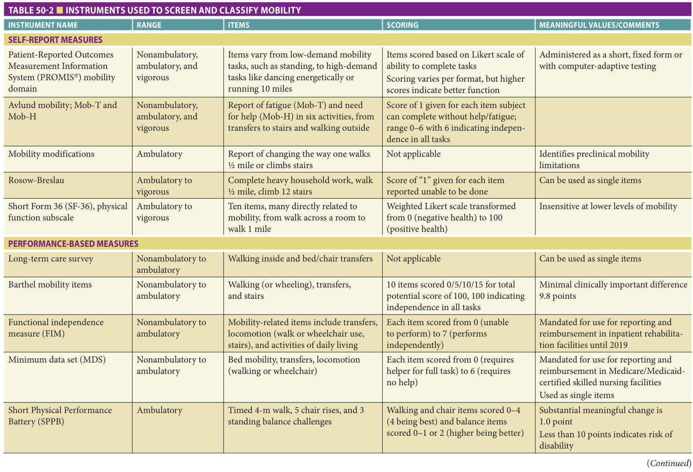
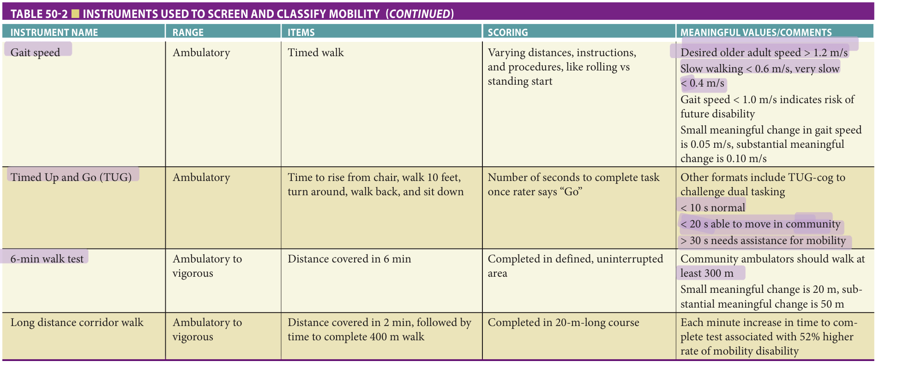

Study summary of Chapter 50; the book and the full chapter are the reference.

# Chapter 50 Study: Mobility Assessment and Management

## Summary

**Definition & consequences**
- Mobility is moving the body through space, from bed movement and transfers to walking and stairs. Its limitations threaten independence and predict adverse outcomes (p741).
- Disability depends on the person and environment, not simply an isolated impairment; biomechanical, biomedical and psychosocial perspectives are complementary (p741, p746).

**Assessment**
- Evaluate cardiopulmonary, musculoskeletal, neurologic and psychological contributors; use gait speed, the short physical performance battery or Timed Up and Go as appropriate (p741).
- Triage into nonambulatory, ambulatory or vigorous mobility. Nonambulatory assessment emphasizes bed movement/transfers; more able patients need progressively challenging walking tasks (p751–752).
- Usual walking speed should generally be at least **1 m/s**; the chapter illustrates a **4-m** walk in under **4 seconds** (p750).
- Gait aid use, speed below **1 m/s**, short steps or asymmetry indicate a need for closer assessment (p751).
- For apparently normal walkers, higher-level tests include a **30-second** single-foot stand, tandem walking or over **450–500 m** in **6 minutes** (p751).
- Performance tests measure capacity under test conditions, not actual daily activity; standardize instructions and consider cooperation and fluctuating performance (p745).

**Management**
- Address impairments while practicing mobility tasks; combine strength, balance, endurance and flexibility training as needed (p755).
- Use assistive/orthotic devices, environmental adaptations and caregiver training to improve stability, participation and weight-bearing pain (p741, p755).
- Deconditioning is almost always present as a consequence of reduced mobility and inactivity and is treatable in many sick or frail older adults. General conditioning and progressively complex walking practice may help (p755).

### Matching the mobility test to the clinical question

- The Short Physical Performance Battery combines a timed **4-m** walk, **5** chair rises and **3** standing balance challenges. A total below **10 points** signals risk of disability. A change of **1 point** is substantial. Performance measures can help characterize sarcopenia, whereas Barthel mobility items describe transfers, walking or wheeling, and stairs (Table 50-2, p743).
- In the Timed Up and Go, start in a chair, stand, walk **10 feet**, turn, return and sit. Table 50-2 gives **under 10 seconds** as normal, **under 20 seconds** for community mobility and **over 30 seconds** for needing assistance. A result between the community and assistance thresholds warrants assessment without automatically assigning dependence (p744).
- The six-minute walk measures distance on an uninterrupted course. The table gives **at least 300 m** for community ambulators and changes of **20 m** and **50 m** as small and substantial. The long-distance corridor walk instead records distance over **2 minutes** followed by time for **400 m**. Each extra minute to finish was associated with a **52%** higher rate of mobility disability (p744).
- Compare like with like when following gait speed. A standing versus rolling start and instructions can change the result. Table 50-2 calls speeds below **0.6 m/s** slow and below **0.4 m/s** very slow. A change of **0.05 m/s** is small but meaningful and **0.10 m/s** is substantial (p744).
- Watch each foot through stance and swing. Double support means that both feet touch the ground at the same time. It occupies a larger fraction of the cycle with age as speed slows and steps shorten. A patient can take shorter steps without necessarily widening the lateral distance between footprints (p747–748).

## Exam traps

- Gait speed is an integrative functional marker, not a diagnosis of the responsible impairment; assessment scales help choose tasks and monitor treatment (p750, p752).
- In a pooled community cohort, each **0.1 m/s** faster speed was associated with **13%** lower mortality risk; this is an association, not a guaranteed treatment effect (p746).
- With aging, step length and speed decline and double-support time increases; step length and stride length describe different distances (p747).

## Exam-cited book images

Book images cited by past exams. Tap an image to zoom.

[2024-Sep Q28](?chapter=bank&q=mcq-e04066f84a3a95a8b9aab699) · [2025-Jun Q51](?chapter=bank&q=mcq-0e7c860e8f2e9076d408c9f1)

## Past exam questions

- [2025-Jun Q51](?chapter=bank&q=mcq-0e7c860e8f2e9076d408c9f1) — Printed pages 743, 744.
- [2024-Sep Q28](?chapter=bank&q=mcq-e04066f84a3a95a8b9aab699) — Printed pages 743, 744.
- [2023-Jun Q51](?chapter=bank&q=mcq-7025f4162f1dd6a89f317d36) — Printed page 747.

## Recall drill

**1. What question can reveal preclinical mobility limitation in an independent patient?**

Answer
Ask whether the patient has changed how they walk longer distances or climb stairs, even if they still complete those activities. (p743)

**2. Which tasks make up the SPPB?**

Answer
Timed four-meter walk, five chair rises and three standing balance challenges. (p743)

**3. How do you interpret an SPPB score below ten?**

Answer
It identifies risk of disability. A one-point change is considered substantial in the table. (p743)

**4. What does the Timed Up and Go include besides walking?**

Answer
Rising from the chair, turning after walking ten feet, returning to the chair and sitting down. (p744)

**5. What does a TUG between twenty and thirty seconds suggest?**

Answer
The time is slower than the book's community-mobility benchmark but does not reach its greater-than-thirty-second assistance benchmark. Assess the tasks that were difficult. (p744)

**6. Which distance changes are meaningful on the six-minute walk?**

Answer
The table describes 20 m as a small meaningful change and 50 m as substantial. (p744)

**7. How is the long-distance corridor walk scored?**

Answer
Record distance in the first two minutes and then the time to complete 400 m. Slower completion is associated with later disability. (p744)

**8. Why record walking instructions and starting method?**

Answer
Standing and rolling starts and different instructions can affect measured speed. Repeat the same protocol when following change. (p744–745)

**9. How does a stride differ from a step?**

Answer
A step runs between consecutive opposite-foot contacts. A stride spans successive contacts of the same foot. (p747–748)

**10. How does double support change with age?**

Answer
A greater proportion of the gait cycle is spent with both feet on the ground. Gait speed and step length tend to decrease. (p747)

**11. Why can an adequate clinic walk coexist with restricted activity at home?**

Answer
The test measures performance under defined conditions. The home environment, available support and daily behavior influence actual mobility. (p745, p749–750)

**12. What should be observed first when the patient arrives in a wheelchair?**

Answer
Assess bed and chair movement and whether standing or walking is possible with assistance. Select subsequent tasks accordingly. (p751–752)

**13. What can reveal difficulty when usual walking appears normal?**

Answer
Single-leg stance, tandem walking, longer distances or complex tasks such as obstacles, turns and walking while doing another task. (p751–752)

**14. Why can too much help worsen mobility?**

Answer
Assistance that replaces a task the patient can perform reduces practice. Repeated disuse can contribute to weakness and loss of function. (p750)

**15. What should accompany treatment of an identified gait impairment?**

Answer
Practice the relevant task and address strength, balance, endurance and flexibility. Adapt the environment or walking aid to the patient's goals and limitations. (p755)

