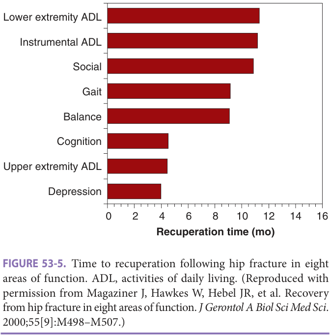

Study summary of Chapter 53; the book is the reference.

# Chapter 53 Study: Hip Fractures

**Full chapter available: [Read Chapter 53](?chapter=53).**

Hazzard 8e, Chapter 53, printed pages 793–804.

## What the exams asked

- Identify an intracapsular femoral-neck fracture from its arthroplasty film and distinguish it from a trochanteric fracture stabilized with a nail — [2020 Q25](?chapter=53#asked-chapter), [December 2021 Q60](?chapter=53#asked-chapter), [June 2023 Q47](?chapter=53#exam-p794-mcq-78b3359272a717f584c23b2c), [May 2024 Q35](?chapter=53#exam-p794-mcq-d59bcda0cc381a35cc3134db).
- Recognize a subtrochanteric fracture on the preoperative image and select fixation — [2020 Q57](?chapter=53#asked-chapter).
- Compare total with hemiarthroplasty for a displaced femoral-neck fracture — [December 2021 Q58](?chapter=53#asked-chapter).
- Interpret the survival data on early surgery and orthogeriatric co-management — [December 2021 Q7](?chapter=53#asked-chapter), [June 2022 Q82](?chapter=53#asked-chapter).
- Counsel about one-year survival, walking and the different recovery times for mood, cognition, balance and lower-body tasks — [2020 Q33](?chapter=53#asked-chapter), [June 2022 Q87](?chapter=53#asked-chapter), [May 2024 Q17](?chapter=53#exam-p800-mcq-72e468cf141dda15964157c9).
- Set the duration of thromboprophylaxis after a hip fracture, including after transfer to rehabilitation — [May 2024 Q11](?chapter=53#exam-p801-mcq-a6c338a57828b765465f7cbf).
- Decide what anesthesia studies can tell a patient taking apixaban. The examination lists an unrelated dementia page — [June 2025 Q60](?chapter=53#exam-p797-mcq-10163f2b99f5abe875d7d917).

## Read the film before choosing the implant

**Is the native head present?** In June 2023 Q47 the postoperative film shows a prosthetic head and stem. In a displaced intracapsular fracture, the fine retinacular vessels along the neck are vulnerable. Even fragments held in good alignment can go on to nonunion or osteonecrosis. Arthroplasty avoids relying on the head's viability. A nondisplaced or impacted neck fracture retains alignment and may be stabilized in situ. A person who previously walked with a frame still has mobility to preserve (pp. 794–795, Figure 53-2).

**Follow the screw.** In May 2024 Q35 a screw passes through the neck into the native head and joins a short nail in the proximal femur. This construct points to an intertrochanteric fracture. The trochanteric region has enough collateral circulation to heal once stable. A stable pattern can receive a sliding hip screw. A subtrochanteric break lies **within 5 cm below the lesser trochanter**, and the displaced fragments in 2020 Q57 require a nail spanning the break (p794 and the [2017 hip-fracture review](https://doi.org/10.1056/NEJMcp1611090), Figures 2–3 and pp. 2059–2060).

**Total versus hemiarthroplasty.** Both replace the femoral head. A total replacement also resurfaces the socket. Hazzard says total replacement is thought to give **better long-term results and less pain for active patients** (p794).
> Current practice (not the book): In the later HEALTH trial of previously ambulatory patients with displaced neck fractures, the average functional advantage at two years was clinically small. Secondary procedures occurred with similar frequency, and instability or dislocation was more common after total replacement. Consider the person's usual activity and preferences when discussing this trade-off. [HEALTH trial, 2019](https://doi.org/10.1056/NEJMoa1906190).

## Operative timing, team care and anesthesia

The man who used a walker before fracturing his hip can still benefit from repair and early mobilization. The article tested in 2020 and 2022 advised surgery within 48 hours when medically feasible. Surgery within 24 hours of admission was associated with lower mortality in observational cohorts. People ill enough to require stabilization also waited longer, so the association does not give an individual causal estimate. Prolonged bed rest carries risks even when surgery is inappropriate. [Management of Acute Hip Fracture, pp. 2057, 2059–2060](https://doi.org/10.1056/NEJMcp1611090).

Start geriatric assessment on admission. Confirm baseline walking and cognition with someone who knows the patient, reconcile medicines and identify active conditions that can be stabilized promptly. In pooled studies, shared orthogeriatric care was associated with lower in-hospital and long-term mortality and shorter stays. In one randomized ward trial, mobility at four months improved without a reduction in in-hospital delirium. Recovery of walking, delirium and survival are distinct outcomes (pp. 795–797).

**Apixaban and the anesthetic plan.** June 2025 Q60 gave credit for all four choices. Hazzard found no mortality difference between spinal and general anesthesia and describes peripheral nerve block for pain. The printed exam locator p869 concerns dementia; hip-fracture anesthesia is on [p797](?chapter=53#exam-p797-mcq-10163f2b99f5abe875d7d917).
> Current practice (not the book): Spinal anesthesia did not improve survival or walking recovery in REGAIN and delirium rates were similar. ASRA bases neuraxial timing on apixaban dose and elapsed time; one fixed two-day interval does not cover every patient. [REGAIN](https://doi.org/10.1056/NEJMoa2113514) · [ASRA fifth edition, apixaban recommendations](https://doi.org/10.1136/rapm-2024-105766).

## What recovery looks like over a year

When a previously independent patient asks whether he will walk as before, separate survival from specific tasks. The mortality estimates are highest in those with poor health and particularly during the early months. Of those who survive, many regain meaningful mobility but need a cane, assistance on stairs or help with shopping. In the cohort shown on p799, some people who once dressed independently still needed help putting on trousers one year later (pp. 793–794, 799, 801).

Figure 53-5 times the best observed recovery in each domain. Mood, cognition and upper-extremity activities generally reach their peak near four months. Balance and gait reach a plateau near nine months. Lower-extremity activities and instrumental tasks can continue to improve to about a year. These are typical trajectories. They do not imply that a patient with ongoing early limitation will remain at that level (p800).

May 2024 Q17 accepted lower-limb improvement by one year and improvement in depression within about half a year. The figure places the typical depression plateau near four months. The preceding page describes symptom reports through six months. Even transient depressive symptoms can accompany poorer functional recovery. Ask about mood, delirium, medications, poor intake and isolation when function stalls (pp. 799–801).

## Prevent complications through the handoff

**Count from the operation.** May 2024 Q11 concerns fragility fracture, not elective arthroplasty. A patient making short assisted walks may remain immobile most of the day. Document the prophylactic agent, planned stop date and bleeding assessment at transfer. The chapter specifies 21–31 days after surgery (p801). Reassess skin, bowel function, pain, weight, cognition and other active illnesses in the rehabilitation setting. Stage II or worse pressure injuries developed in about 5% within 21 days in the report cited by the chapter (p801).
> Current practice (not the book): NICE advises one month of prophylaxis after fragility hip/proximal femur fracture when thrombotic risk outweighs bleeding risk. [NICE NG89, recommendation 1.11.2](https://www.nice.org.uk/guidance/ng89/chapter/Recommendations#fragility-fractures-of-the-pelvis-hip-and-proximal-femur).

**Protect the next hip.** Pain and poor appetite can reduce intake just as bed rest accelerates muscle loss. Women lost about 3–6% of muscle mass in the first two months in the studies reviewed. The opposite hip can also lose bone density rapidly. Evaluate nutrition, vitamin D, osteoporosis treatment and the circumstances of the fall. Once formal therapy ends, resistance exercises can extend functional gains. Recheck gait, balance, visual impairment, orthostatic pressure, home hazards and medicines that increase falls (pp. 796, 798, 801–802).

## Discharge destination and continuity

Match the day's needed activities to the patient's actual performance and home layout. A person who can walk on level ground but cannot climb stairs needs sleeping, toileting and washing facilities on an accessible floor, or reliable help and a different plan. Occupational or physical therapy can assess the home. The receiving team needs the current plan for mobility, chronic conditions, pain, prophylaxis and secondary fracture prevention (pp. 798, 800–802).

The chapter describes a US bundled payment spanning 90 postoperative days. Postacute care and readmissions often account for more cost than the initial hospitalization, which gives hospitals an incentive to coordinate transitions and support safe return home. During the COVID-19 pandemic, active respiratory symptoms were associated with poor outcomes and telemedicine helped maintain contact during isolation (pp. 793, 798–799).

## Israeli context — שיקום לאחר שבר במפרק הירך

**כשהמנתח מורה להימנע מדריכה.** בחוזר משרד הבריאות, ירידה בניידות ובעצמאות אחרי שבר במפרק הירך היא התוויה להערכת שיקום אורתופדי. הגבלת דריכה זמנית אינה מצדיקה דחיית הפניה. למטופל שמתאים לשיקום ואסור לו עדיין לדרוך, החוזר מייעד מסגרת אשפוזית, למעט מצב שבו המטופל או מיופה כוחו מסכימים לשיקום בקהילה והקהילה יכולה לספק מענה מיטבי. [חוזר מינהל רפואה 4/2009, סעיפים 5.1.1, 5.3(ב), 7.5, עמ׳ 3–6](https://www.gov.il/BlobFolder/policy/mr04-2009/he/files_circulars_mr_mr04_2009.pdf#page=3).

**לפני השחרור מאורתופדיה.** מומחה בגריאטריה או בשיקום קובע את יעדי השיקום בהתייעצות עם נציג הצוות הרב־מקצועי. ההמלצה מתועדת במכתב השחרור. קופת החולים המבטחת מתאמת ומממנת את השיקום. בחירת המסגרת מתחשבת בצורך הרפואי והתפקודי, בהעדפות ובתנאי הבית. כאשר הקופה סוטה מהמלצת בית החולים, עליה לתעד נימוק ותוכנית חלופית. [חוזר 4/2009, סעיפים 4.1, 6.2–6.6, עמ׳ 3, 5](https://www.gov.il/BlobFolder/policy/mr04-2009/he/files_circulars_mr_mr04_2009.pdf#page=5), [משרד הבריאות, שיקום גריאטרי, ״ייעוץ רפואי גריאטרי לפני השיקום״ ו״תהליך השיקום הגריאטרי״](https://me.health.gov.il/older-adult/keep-me-healthy/rehabilitation/geriatric-rehabilitation/).

**משך השיקום והערכת התקדמות.** החוזר מציין לפחות 14 יום לשיקום אורתופדי באשפוז. קיצור מחייב נימוק המבוסס על הערכה תפקודית כוללנית, ברשומה ובמכתב השחרור. את התפקוד מעריכים בקבלה ולקראת השחרור בכלים שמאפשרים להשוות בין המדידות. [חוזר 4/2009, סעיפים 8.3–8.4, 9.2.1, 9.2.3, עמ׳ 6–7](https://www.gov.il/BlobFolder/policy/mr04-2009/he/files_circulars_mr_mr04_2009.pdf#page=7).

## Summary

### Definition & epidemiology
- Osteoporosis and propensity to fall are prominent risks. Average age is **82**; approximately **18%** of women and **36%** of men die within the first postfracture year. (p. 793)

### Diagnosis & repair

- Painful, shortened, externally rotated leg is typical; nondisplaced fractures may still permit walking. Persistent suspicion with negative radiographs → MRI, more sensitive than CT. (p. 794)
- Displaced femoral-neck fractures threaten the head's blood supply and are usually treated with arthroplasty; intertrochanteric fractures have better blood supply and generally heal with internal fixation. (p. 794)

### Management & recovery

- Reconcile medications and individualize surgical decisions using prior function, cognition, comorbidities and goals. Nonsurgical care may suit selected patients with very high operative risk or very short life expectancy. (p. 797)
- Mobilize on the day of surgery if possible, certainly by postoperative day **1**; remove an inserted catheter the following morning. Monitor delirium, pulmonary complications and heart failure. (p. 797)

- Match rehabilitation to functional loss, endurance, ability to participate and home support. Hazzard requires the ability to participate in **at least 3 hours of therapy per day** and input from **at least two rehabilitation disciplines**, such as PT and OT (p800).
  > Current practice (not the book): CMS generally requires intensive therapy 3 hours/day on at least 5 days/week or, in documented cases, 15 hours within 7 consecutive days, with multiple disciplines including PT or OT. [CMS inpatient rehabilitation criteria](https://www.cms.gov/training-education/medicare-learning-networkr-mln/compliance/medicare-provider-compliance-tips/inpatient-rehabilitation-hospitals).

- Hazzard gives **21–31 days** of postoperative thromboprophylaxis. Up to **50%** of previously independent older adults may need walking aids at **one year** (p801).
  > Current practice (not the book): NICE recommends one month after fragility hip/proximal femur fracture when VTE risk outweighs bleeding risk. [NICE NG89, recommendation 1.11.2](https://www.nice.org.uk/guidance/ng89/chapter/Recommendations#fragility-fractures-of-the-pelvis-hip-and-proximal-femur).

### Drugs & prevention
- Individualize analgesia for sustained relief and therapy-related pain while minimizing sedation; the optimal regimen is not established here. A preoperative nerve block can reduce pain. (p. 797)
- Replete vitamin D before starting a bisphosphonate; check the level during admission if not measured recently. (p. 798)

### Exam traps
- Walking does not exclude a nondisplaced fracture. (p. 794)
- General versus spinal anesthesia: no mortality difference was found. (p. 797)
- Slow recovery warrants assessment for persistent delirium, depression, medication burden, nutritional deficiencies and isolation. (p. 800)

## Recall

**1. Which two underlying risks are emphasized for hip fracture?**

Answer
Osteoporosis and propensity to fall. (p. 793)

**2. How do the approximate first-year mortality estimates differ by sex?**

Answer
Approximately <strong>18%</strong> of women and <strong>36%</strong> of men are expected to die during the first year. (p. 793)

**7. Is nonsurgical care excluded for every hip fracture?**

Answer
No. It may be considered for selected patients, including those with very high surgical risk, very short life expectancy, or advanced dementia with contractures; prior function and goals matter. (p. 797)

**9. When should mobilization and catheter removal occur?**

Answer
Mobilize on the day of surgery if possible, certainly by postoperative day <strong>1</strong>; remove an inserted catheter the morning after surgery. (p. 797)

**12. What nonmedical factors can determine safe discharge home?**

Answer
Home layout, social support, caregiver availability and resources, alongside mobility and self-care ability; a home assessment by therapy staff supplies essential information. (p. 798)

**13. What participation requirements distinguish acute inpatient rehabilitation?**

Answer
Hazzard requires the ability to participate in <strong>at least 3 hours of therapy per day</strong> and input from <strong>at least two rehabilitation disciplines</strong>, such as PT and OT (p800).

**14. What should be investigated when recovery is slower than expected?**

Answer
Persistent delirium, depression, polypharmacy, vitamin D or other nutritional deficiencies, and social isolation. (p. 800)

## Past-paper questions on this chapter

- [2020 Q25](?chapter=bank&q=mcq-85ecd5f34b95bd4208559b25)
- [2020 Q33](?chapter=bank&q=mcq-aef3c629ece2ab30b9a741de)
- [2020 Q57](?chapter=bank&q=mcq-75d3bab7b0cbdfbc7293b06a)
- [December 2021 Q7](?chapter=bank&q=mcq-863c990591ff2eedbfe5e922)
- [December 2021 Q58](?chapter=bank&q=mcq-5b3939c33f45491551d8ea87)
- [December 2021 Q60](?chapter=bank&q=mcq-03f2d251e63e4dd9a8c4925b)
- [June 2022 Q82](?chapter=bank&q=mcq-5b0c5d8693a2a6b69ff477c9)
- [June 2022 Q87](?chapter=bank&q=mcq-6c76daed1c0fae0916954643)
- [2023-Jun Q47 — mcq-78b3359272a717f584c23b2c](?chapter=bank&q=mcq-78b3359272a717f584c23b2c)
- [2024-May Q11 — mcq-a6c338a57828b765465f7cbf](?chapter=bank&q=mcq-a6c338a57828b765465f7cbf)
- [2024-May Q17 — mcq-72e468cf141dda15964157c9](?chapter=bank&q=mcq-72e468cf141dda15964157c9)
- [2024-May Q35 — mcq-d59bcda0cc381a35cc3134db](?chapter=bank&q=mcq-d59bcda0cc381a35cc3134db)
- [2025-Jun Q60 — mcq-10163f2b99f5abe875d7d917](?chapter=bank&q=mcq-10163f2b99f5abe875d7d917)

## Figure 53-5 — book image

[2024-May Q17](?chapter=bank&q=mcq-72e468cf141dda15964157c9)
