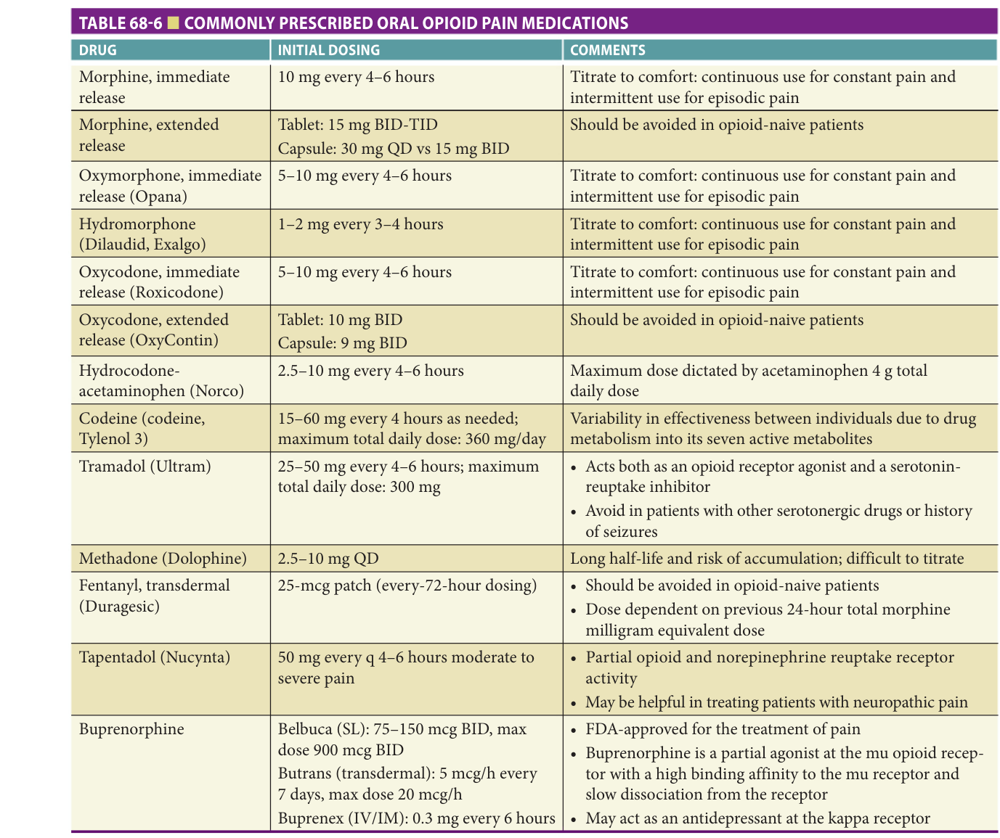

Study summary of Chapter 68 — Pain Management; the book and the full chapter are the reference.

# Chapter 68 Study: Pain Management

## What the exams asked

- Choosing a pain measure when the patient can select a color, and when severe dementia prevents self-rating — [June 2023 Q23](?chapter=68#exam-p1059-mcq-795f2687afa4d5918ddb65de) and [June 2026 Q91](?chapter=68#exam-p1059-mcq-dd8d86a52ab0a199b770a4f2). PAINAD itself is on [the other cited page](?chapter=67#exam-p1048-mcq-795f2687afa4d5918ddb65de).
- Telling ischemic, inflammatory and neuropathic pain apart — [June 2026 Q26](?chapter=68#exam-p1056-mcq-dd85189b9b4331793e4d5fdc).
- Selecting an immediate-release opioid for metastatic bone pain when acetaminophen is already prescribed — [June 2023 Q38](?chapter=68#exam-p1061-mcq-d4597da4db93e15793da0f6a). Counting IV and oral acetaminophen together after a rib fracture — [June 2025 Q50](?chapter=68#exam-p1062-mcq-372ee0c239b0866b869ae17a).
- Anticipating nausea, persistent constipation and withdrawal when starting or stopping opioids — [2020 Q11](?chapter=68#asked-chapter) and [June 2022 Q78](?chapter=68#asked-chapter). Recognizing opioid-induced hyperalgesia when pain increases as the dose rises — [June 2025 Q14](?chapter=68#exam-p1061-mcq-899b765d3570c519f87c4cd6).
- Treating painful diabetic neuropathy at a creatinine clearance of 25 mL/min — [2020 Q100](?chapter=68#asked-chapter). Choosing duloxetine for function-limiting back pain and depressed mood — [September 2024 Q13](?chapter=68#exam-p1063-mcq-3e123a9bd8bb77dc77805cf5).
- Matching neuropathic-pain drugs to sodium or blood pressure monitoring and recognizing anticholinergic toxicity — [September 2024 Q17](?chapter=68#exam-p1065-mcq-7e4990226f4077abd0308485), [June 2026 Q55](?chapter=68#exam-p1064-mcq-1a35ec921b0a54fb337bf6ae), [June 2025 Q4](?chapter=68#exam-p1064-mcq-c6d5d418c0657e5ffa7923f3) and [June 2025 Q79](?chapter=68#exam-p1064-mcq-17e66840ae11bd49e4b668cf).
- Distinguishing elbow bursitis from arthritis on active and passive movement — [May 2024 Q23](?chapter=68#ch68-joint-exam). The exam cites Harrison 21e, ch. 370, p. 2844.
- Feeding tubes, pressure injuries and the trade-off between survival and comfort in aspiration pneumonia — [June 2025 Q38](?chapter=67#exam-p1048-mcq-caa086c8705cdeb3606c5536) and [June 2025 Q63](?chapter=67#exam-p1048-mcq-8b2cfa55422f88f802142d29). Both reference rows name Chapter 68, but the cited passages are in Chapter 67.

## Matching pain assessment to communication

Self-report remains the preferred way to measure pain. Ask “Does this hurt?” before assuming that a person with dementia cannot answer. Ask about the range over the last week, the location, onset, quality and triggers. A patient who reports little pain at rest may stop dressing, walking or sleeping because of pain with activity. Examine the painful area for inflammation, tenderness and restricted movement, and look for sensory loss, weakness or gait change. Review sleep, mood, recent falls, previous treatment, day-to-day function and what improvement would matter to the patient (p1058).

**A self-rating scale still requires a response.** A vertical numeric scale may be easier to use than a horizontal one, but converting a sensation into a number can be difficult. The colored analog scale progresses from white to increasingly intense red and can work with or without cognitive impairment if the patient sees the colors, understands what they mean and can make a choice. A faces scale also requires visual acuity. A visual analog line is relatively abstract, with high failure rates and low reliability in older adults. The Iowa Pain Thermometer pairs verbal descriptors and numbers with a visual scale (p1059, Table 68-3).

**When self-report fails, observe at rest and during care.** June 2023 Q23 describes agitation during care of a deep pressure injury in severe dementia. PAINAD uses breathing, vocalization, facial expression, body language and consolability. Compare the patient's behavior before and after an intervention. A caregiver can describe the person's baseline and a change during transfers. A number chosen by a relative cannot stand in for a patient's self-rating. Table 68-3 describes the self-report alternatives; Chapter 67 explicitly names PAINAD (p1048, 1058–1059).

For chronic pain, track interference as well as intensity. The PEG asks about pain, enjoyment and general activity. The brief pain inventory includes location and functional interference. The geriatric pain measure asks about walking, social activity, tasks and sleep. WOMAC focuses on arthritis and the McGill questionnaire explores pain qualities, although both take more effort than a single rating (p1059, Table 68-4).

## Classifying the pain and examining a painful joint

Ischemic myocardium, inflamed skin and a mechanically stressed joint stimulate nociceptors. June 2026 Q26 therefore pairs angina with nociceptive pain. Neuropathic pain requires disease or a lesion of the somatosensory pathways. Diabetic neuropathy, postherpetic neuralgia and phantom limb pain offer different examples. Burning pain with sensory loss or pain from bedsheets touching the skin should prompt a focused neurologic examination. Mixed mechanisms can coexist and lead to different treatment choices (p1056–1058).

**Where the movement reproduces pain matters.** With elbow bursitis, tenderness is usually focal over the periarticular structure. Active movement often hurts while passive movement is comparatively preserved. Intra-articular disease more often produces deep or diffuse pain with restriction on both active and passive movement. This is the distinction in May 2024 Q23. Its printed reference is Harrison 21e, ch. 370, p. 2844, “Articular versus nonarticular.” Hazzard's examination paragraph covers range of motion and local tenderness more generally (p1058).

## Choosing analgesia for bone pain, fracture and postoperative recovery

After nonopioid treatment fails, discuss the expected functional benefit and choose a formulation that can be titrated to the pain pattern. For an opioid-naive older patient with severe metastatic bone pain already taking 3 g/day of acetaminophen, immediate-release **single-agent oral oxycodone** allows small dose adjustments without adding acetaminophen. Pregabalin targets a neuropathic component. Percocet adds an acetaminophen dose each time the oxycodone is increased. Continuous pain may require regular dosing, with reassessment as the illness or injury improves (p1060–1062, Table 68-6).

**A fentanyl patch is for established opioid tolerance.** Verify the actual drug, dose and duration before conversion. The product label defines tolerance as at least one week at an adequate daily opioid dose, for example 60 mg oral morphine or 30 mg oral oxycodone daily, or an equianalgesic regimen. A few rescue doses, previous nonopioids, dysphagia or cancer pain alone do not meet that criterion. The patch has prolonged effects and can produce fatal respiratory depression when started in an opioid-naive patient (p1061, Table 68-6). [Fentanyl transdermal prescribing information, sections 1 and 4](https://dailymed.nlm.nih.gov/dailymed/drugInfo.cfm?setid=242759ef-cb6d-4e3e-9f8d-5e31efa1f289).

Choose the specific opioid and interval for prior exposure, frailty, renal function and the urgency of relief. The chapter suggests starting at about **25–50% of a younger adult's dose**. Renal impairment can prolong exposure to the drug or its active metabolites, and sedating co-medication or COPD further narrows the margin of safety. Follow pain, movement, alertness, respiratory rate and bowel function together. Discuss safe administration with the patient or caregiver (p1059–1062).

**Count acetaminophen from every route and combination product.** June 2025 Q50 gives 1 g IV four times daily. The patient has already received the book's 4 g/day maximum. The chapter lists 500–1000 mg every six hours and a lower **2–3 g/day** maximum with hepatic impairment or a history of alcohol use. Supplemental oxygen may keep the pulse oximeter reading acceptable during hypoventilation. Consider continuous end-tidal CO₂ monitoring in high-risk perioperative patients, especially in the first 24 hours. COPD calls for caution and observation when severe rib pain needs relief (p1062).

Enhanced recovery protocols use complementary mechanisms: acetaminophen, NSAIDs when appropriate and selected peripheral or neuraxial techniques can reduce opioid requirements. Poorly controlled postoperative pain delays mobility and can contribute to persistent pain. Nonselective NSAIDs can cause ulceration, bleeding, renal injury and cardiovascular events. Anticoagulation increases bleeding risk. COX-2 selectivity reduces some GI and platelet effects but retains renal and cardiovascular risk. Topical diclofenac on intact skin limits systemic exposure for localized OA. Table 68-7 specifically advises avoiding indomethacin and ketorolac and warns against prolonged systemic treatment with several other NSAIDs (p1061–1063).

## Opioid counseling, tolerance and increasing pain

**Nausea often improves after the first few days. Constipation commonly persists.** Offer a regular bowel regimen when starting a strong opioid, review bowel frequency and reassess persistent nausea. Advise patients that initiation or a dose increase can impair concentration and driving. Reassess when stable. Physical dependence can produce withdrawal after abrupt cessation. A request for more medication warrants assessment of analgesia, function and misuse risk. Pure agonists have no universal analgesic ceiling, but escalating toxicity or diminishing benefit requires a change in plan. Combination products also carry their nonopioid ingredient's limit (p1060–1062). [NICE CG140, managing side effects of strong opioids](https://www.nice.org.uk/guidance/cg140/chapter/Recommendations).

With **tolerance**, the same dose gives less relief. With **opioid-induced hyperalgesia**, pain may worsen when the opioid is increased or spread beyond the original painful region, even without disease progression. Chronic exposure, particularly at high doses of potent opioids, increases suspicion. Reassess the diagnosis, consider a gradual reduction and follow the response. Distinguish diffuse allodynia during escalation from aches that begin after abrupt withdrawal (p1061).

In its account of the 2016 CDC guidance, Hazzard advises evaluating benefits and risks above **50 MME/day** and avoiding doses **above 90 MME/day**. It recommends review within one to four weeks of starting opioids and at least every three months thereafter (p1060).

> Current practice (not the book): CDC 2022 advises reassessment before increasing to **≥50 MME/day**, closer follow-up and offering naloxone at or above that level. It treats dosage thresholds as guideposts for individual decisions. Its outpatient recommendations exclude cancer-related pain treatment, palliative care, end-of-life care and sickle cell disease. [CDC 2022, recommendations 4, 7 and 8](https://www.cdc.gov/mmwr/volumes/71/rr/rr7103a1.htm).

## Neuropathic and musculoskeletal pain: which drug, which risk?

**Duloxetine** enhances descending pain inhibition through serotonin and norepinephrine. It can address musculoskeletal or neuropathic pain and coexisting depression. September 2024 Q13 describes persistent low-back pain limiting activity after physical therapy and simple analgesia. Duloxetine 30 mg/day is a reasonable starting choice among the options. There is no opioid tolerance for a fentanyl patch or clear neuropathic indication for starting pregabalin at 300 mg/day. The reference row prints Table 68-3, but the cited pages contain **Table 68-8**, which lists the analgesics (p1063–1064).

For June 2026 Q55, **measure blood pressure before starting duloxetine and periodically during treatment**. The listed Hazzard pages describe analgesic classes and their adverse effects; the prescribing information specifies the blood pressure monitoring. SNRIs are less anticholinergic than TCAs, but venlafaxine does not protect against falls. Review fall history, renal function and concurrent serotonergic drugs. Tramadol also inhibits serotonin reuptake and can increase seizure or serotonin-toxicity risk (p1061, 1063–1065). [Cymbalta prescribing information, sections 2 and 5.11](https://dailymed.nlm.nih.gov/dailymed/drugInfo.cfm?setid=2f7d4d67-10c1-4bf4-a7f2-c185fbad64ba).

**Amitriptyline** can cause constipation, dry mouth, blurred vision, tachycardia, urinary retention and worsening cognition even at analgesic doses. June 2025 Q4 describes the whole cluster developing after a pain-clinic visit. Q79 repeats the case and accepts all choices, although amitriptyline remains the closest clinical match. Gabapentin more often produces somnolence, dizziness or disorientation. Those effects can cause falls, difficulty following a dose schedule and loss of mobility (p1063–1065).

**Creatinine clearance changes the choice.** At 25 mL/min, avoid duloxetine and reduce the dose of gabapentin or pregabalin according to renal function. The 2023 Beers table advises reducing either gabapentinoid below 60 mL/min. Start low and review alertness, gait and benefit after each increase. Opioid coadministration can compound CNS and respiratory depression. Although Table 68-8 calls renal impairment a contraindication, the drug labels provide adjusted dosing, including schedules for dialysis. Localized neuropathic pain can be treated with capsaicin cream when an oral drug is unsuitable. The 2020 question accepts every response. This grading does not make standard gabapentinoid doses suitable at a clearance of 25 mL/min (p1063–1065). [AGS Beers 2023, Table 6, p. 2073](https://doi.org/10.1111/jgs.18372) · [Gabapentin, renal dosing](https://dailymed.nlm.nih.gov/dailymed/drugInfo.cfm?setid=97935fd9-1d4a-43b6-a5d9-de994591187b) · [Pregabalin, section 2.7](https://www.accessdata.fda.gov/drugsatfda_docs/label/2025/021446s046%2C022488s022lbl.pdf) · [NICE CG173, section 1.1.11](https://www.nice.org.uk/guidance/cg173/chapter/Recommendations).

**Carbamazepine and oxcarbazepine** can relieve trigeminal neuralgia. Check sodium for hyponatremia and assess sedation and gait. The chapter also discusses blood count, drug levels and liver and renal tests when initiating these agents. Gabapentin titration does not require routine serum levels. HLA-B*15:02 is associated with SJS/TEN with either sodium-channel blocker and is more frequent in several East, Southeast and South Asian populations. HLA-A*31:01 is associated with a wider range of carbamazepine reactions across several ancestries. Carbamazepine induces CYP enzymes and may lower warfarin exposure. With lithium, combined neurotoxicity is the concern. Review interacting medicines before initiation (p1065). [CPIC guideline, Tables 2–3](https://pmc.ncbi.nlm.nih.gov/articles/PMC5847474/).

Topical lidocaine decreases local sodium-dependent nerve conduction. Capsaicin activates TRPV1 and can initially burn before the painful area becomes less sensitive. Muscle relaxants may cause sedation, anticholinergic effects or falls. Benzodiazepines add respiratory risk with opioids. Physical dependence can develop within days to weeks of regular use, even at prescribed doses. When dependence is likely, taper gradually and adjust the pace to withdrawal symptoms ([FDA boxed warning on benzodiazepines](https://www.fda.gov/drugs/drug-safety-and-availability/fda-requiring-boxed-warning-updated-improve-safe-use-benzodiazepine-drug-class)). The chapter describes prescription-monitoring systems that report benzodiazepine exposure as lorazepam milligram equivalents (p1064–1065).

## Goals of care when advanced dementia limits eating

**Assisted oral feeding** supports comfort when dysphagia and weight loss complicate advanced dementia. Look for oral disease, ill-fitting dentures, depression or medication effects before attributing all decline to dementia. Tube feeding has not shown better survival, quality of life, pressure-injury healing or prevention of aspiration pneumonia in this population. It is associated with new pressure injuries and restraint use. In suspected aspiration pneumonia, antibiotic treatment has been associated with longer survival without better comfort. More invasive treatment can add distress. Discuss the patient's goals and manage dyspnea, pain and fever whatever decision is made. The two June 2025 questions cite the Chapter 67 paragraphs on printed p1048.

## Israeli context — אומדן כאב באשפוז גריאטרי ובקהילה

בבית חולים גריאטרי, האחות המוסמכת מבצעת אומדן כאב בכלי מובנה שמתאים ליכולת התקשורת של המטופל. מנהלת הסיעוד אחראית להדרכת הצוות, לאומדן יומי ולהתערבות לפי הצורך. כך גם מטופל שמתקשה לדווח במילים נכלל במעקב. [נוהל אגף הגריאטריה 2.3.15, מהדורה 2, עמ׳ 1, סעיפים 4.2, 4.4 ו־5.2](https://www.gov.il/BlobFolder/dynamiccollectorresultitem/ng-2-3-15/he/files_circulars_ng_2_3_15.pdf).

חוזר מינהל הסיעוד 155/19 פורסם ביום 03.11.2019, יושם ממרץ 2020 ומבטל את חוזר 44 מיום 04.07.2001 שאליו מפנה הנוהל הגריאטרי. יש להתאים את הכלי לגיל, לקוגניציה ולביטויים מילוליים או התנהגותיים. בכאב בינוני ומעלה בודקים לפחות גם מיקום ועוצמה. עיתוי האומדן החוזר נקבע לפי מצב המטופל, הטיפול והקריטריונים שקבע המוסד. בשחרור מתעדים את האומדן, הטיפול וההדרכה כדי לאפשר המשך טיפול. [חוזר 155/19, עמ׳ 1–4, סעיפים 3א–ה, 4, 7 ו־8](https://www.gov.il/BlobFolder/policy/nd155-2019/he/files_circulars_nd_ND155_2019.pdf).

## Pain over time, activity and participation

Acute pain generally follows injury through the expected healing period, approximately three months or less. Chronic pain persists or recurs beyond three months. Primary chronic pain can be a disease in its own right, as in fibromyalgia or nonspecific low-back pain. Secondary categories include musculoskeletal, neuropathic, headache or orofacial, visceral, cancer-related and postsurgical or posttraumatic pain. An estimated 25–75% of older adults experience chronic pain, more often in residential settings. Multisite pain affects 60–70% of older adults with chronic pain, and over 60% describe multiple pain types (p1055–1056).

High-impact chronic pain limits work or life activities on most or all days over the preceding six months. In a 2016 US estimate, 8% of adults, about 20 million people, met this definition. The corresponding figures were 11% at ages 65–84 and 16% at 85 or older. Peripheral sensitization lowers nociceptor thresholds and can enlarge the painful area. Central sensitization strengthens transmission and weakens inhibition, so ordinary touch may become painful. Older adults may be less sensitive to low-intensity or heat stimuli. Evidence for a strong age effect on pain tolerance is lacking. These group findings cannot predict how a particular patient experiences pain (p1055–1057).

Fatigue, sleep disruption, mood, fear of movement, bereavement and social isolation help explain why the same injury has different functional effects. Physical therapy can restore strength, flexibility and confidence. Tailor aerobic, resistance and flexibility work to goals; aquatic exercise is a lower-impact option for pain and stiffness. CBT, acceptance and commitment therapy, biofeedback or mindfulness can reduce distress and disability. Discuss acupuncture, massage or supplements that the patient already uses and review possible interactions (p1057–1058, 1067–1068).

Age-related decreases in gastric secretions and motility can change absorption. Greater fat mass and lower body water, lean mass or albumin alter distribution and the unbound fraction of highly protein-bound drugs. Hepatic blood flow, renal blood flow and filtration may decline. Reduced lung elasticity and increased chest wall rigidity increase vulnerability to respiratory depression. In the US figures quoted in the chapter, about one in three Medicare Part D beneficiaries received an opioid prescription in 2016, and opioid overdose deaths in adults over 65 increased 7.7% from 2013 to 2014 (p1059–1060).

## When a procedure can improve function

**Spine.** A lumbar epidural steroid injection can give selected patients with radicular pain weeks to months of relief. Review imaging and the risks of infection, bleeding, anticoagulation, uncontrolled diabetes and immunosuppression before proceeding. With lumbar facet pain, extension and rotation can reproduce symptoms. A diagnostic medial branch block tests whether the joint's sensory supply explains them. The chapter describes 80% relief as a basis to consider radiofrequency denervation. A sacroiliac source can refer to the buttock, sacrum or thigh. Provocative maneuvers and diagnostic blocks can assist localization, with limited evidence for intra-articular steroid alone (p1065–1066).

**Vertebral compression fractures.** Most are precipitated by ordinary bending or lifting, and about one quarter follow falls. The chapter estimates that 25% of US postmenopausal women and 40–50% of people over 80 have sustained one. A prior osteoporotic compression fracture increases the risk of a second approximately fivefold. T12–L3 is a common location. MRI can help determine acuity. Pain can range from absent to severe. Consider vertebroplasty or kyphoplasty for an acutely painful fracture with persistent symptoms despite conservative care. Contraindications include coagulopathy, burst fractures with retropulsed bone and height loss exceeding 66%. Cement leakage may injure neural structures or enter the circulation (p1066).

**Peripheral joints.** Osteoarthritis affects cartilage, adjacent bone, ligaments, synovium and capsule. The 60% estimate for people aged 65 or older concerns arthritis or chronic joint pain overall. Knee steroid injections can improve pain over the short term, under three months in the chapter's comparison. Benefit over longer periods is less certain. The text describes 40–80 mg of depot steroid in a typical injection and one to five injections for different hyaluronic acid products. Some PRP studies report benefit up to 12 months, but platelet concentration, technique and schedules differ. Hip OA often produces groin pain and pain on internal rotation. Image guidance helps with hip injections; evidence for hip hyaluronic acid or PRP is limited (p1066–1067).

Page 1067 states knee OA is twice as prevalent in men. In the Framingham cohort of older adults, symptomatic knee OA was more frequent in women (11%) than men (7%). [Framingham Osteoarthritis Study, prevalence results](https://pubmed.ncbi.nlm.nih.gov/3632732/).

**Focal facial neuralgia.** Refractory facial pain can interfere with eating, speaking and oral care. Trigeminal-protocol MRI can assess compression or a mass. A targeted block can both localize a pain generator and reduce symptoms, particularly when sedating oral treatments are poorly tolerated. The chapter pairs a posterior superior alveolar block with V2 and an inferior alveolar block with V3. Refractory symptoms may justify neurosurgical assessment (p1067).

## Summary

**Definitions & classification**
- Acute pain: sudden onset, tied to a noxious stimulus, short duration of tissue healing (approximately **≤3 months**) (p1055)
- Chronic (persistent) pain: persists or recurs for **>3 months** (p1055)
- High-impact chronic pain: limits life/work activities most or every day for the past **6 months**; **8%** of US adults (**20 million**) had it in 2016 (p1055)
- IASP/ICD-11 (2019) chronic pain classes: "chronic primary pain" (disease in its own right, eg fibromyalgia, nonspecific low back pain) vs six "chronic secondary" categories (musculoskeletal, neuropathic, headache/orofacial, visceral, cancer-related, postsurgical/posttraumatic) (p1055)
- Nociceptive pain (tissue injury/inflammation/mechanical) usually responds well to analgesics; neuropathic pain (lesion/disease of the somatosensory system) affects **7% to 10%** of the population and is often persistent and difficult to treat in older adults (p1056–1057)

**Epidemiology & pathophysiology**
- Chronic pain prevalence in older adults: **25% to 75%** (higher in residential care); **60% to 70%** report multisite pain, **>60%** report multiple pain types (p1055)
- High-impact chronic pain prevalence by age band (2016): **11%** (65–84 yr) vs **16%** (≥85 yr) (p1055–1056)
- Peripheral sensitization → hyperalgesia and spread of pain; central sensitization → allodynia (nonpainful stimuli now activate pain pathways) (p1056)
- Age-related pain perception: ↓ sensitivity to low-intensity and heat pain; no strong age effect on pain tolerance — changes are subtle and of uncertain clinical relevance (p1057)
- Biopsychosocial model (Fig 68-1): bio (age, sex, comorbidity, fatigue, sleep, health behaviors) + psych (depression, anxiety, catastrophizing, fear avoidance) + social (race/ethnicity, SES, ageism, isolation) → outcomes (physical/cognitive function, QOL) (p1057–1058)

**Assessment**
- Self-report is the gold standard for pain measurement (p1058)
- Unidimensional scales (single factor, eg intensity) vs multidimensional scales (intensity + interference + treatment history) — Tables 68-3/68-4 (p1059)
- In cognitive impairment/dementia: keep questions simple ("Does this hurt?"), use nonverbal observational scales, and involve caregivers (p1058)

**Pharmacokinetic aging changes relevant to dosing** (Table 68-5, p1060)
- ↓ gastric secretion/motility → altered absorption; ↑ fat, ↓ lean mass/total body water/albumin → altered distribution (more unbound drug with NSAIDs, TCAs); ↓ hepatic volume/blood flow and ↓ renal blood flow/GFR → ↓ clearance; ↓ lung elasticity/↑ chest wall rigidity → ↑ risk of respiratory depression with opioids (Table 68-5, p1059–1060)

**Opioids**
- **1 in 3** Medicare Part D beneficiaries received an opioid prescription (2016 analysis) (p1060)
- **7.7%** increase in opioid-overdose deaths in adults **>65 yr**, 2013→2014 (p1060)
- 2016 CDC guideline for older adults: prefer immediate-release (rec #4), lowest effective dose (rec #5), follow-up **1 to 4 weeks** after starting then at least **every 3 months** (rec #7); use state PDMPs (p1060)
- Start opioids at **25% to 50%** of the younger-adult dose in older adults (p1060)
- Hazzard’s summary of the 2016 CDC guideline calls for careful assessment of benefits and risks **above 50 MME/day** and avoidance of doses **above 90 MME/day** (p1060). [Current practice note](#current-opioid-dose).
- Opioid-induced hyperalgesia: pain *worsens* with increasing opioid dose (vs tolerance, where it doesn't) — manage by tapering and adding nonopioid/NMDA-antagonist therapy (p1061)
- Perioperative: continuous **end-tidal CO2 monitoring** for high-risk patients, especially the first **24 hours** after surgery (p1062)

**Nonopioid & adjuvant medications**
- Acetaminophen: **500–1000 mg q6h**; max **4000 mg/day**; max **2000–3000 mg/day** with hepatic impairment or alcohol use (p1062)
- NSAIDs: nonselective COX inhibition → GI ulcer/bleed risk (COX-1) and CV/renal risk; COX-2-selective (eg celecoxib) spares some GI/platelet toxicity but keeps CV risk; topical diclofenac 1% gel is a lower-systemic-risk option (p1062–1063; doses in Table 68-7, verified against the page image)
- Table 68-7 singles out indomethacin and ketorolac as Beers 2019 "avoid" outright (high risk of GI toxicity and acute kidney injury) — a stronger caution than the general "avoid long-term use" that applies to ibuprofen, naproxen, meloxicam, diclofenac, and nabumetone (Table 68-7, p1063)
- SNRIs/TCAs modulate descending pain pathways; **Beers 2019** flags both SNRIs and TCAs (amitriptyline, nortriptyline) as "avoid" with a history of falls/fractures, and TCAs additionally for anticholinergic burden (Table 68-8, p1063)
- Carbamazepine and oxcarbazepine are sodium-channel blockers used for selected neuropathic pain syndromes. **HLA-B*15:02** increases the risk of SJS/TEN with either drug and is more frequent in several East, Southeast and South Asian populations. **HLA-A*31:01** is associated with a broader range of carbamazepine reactions in several ancestries. Carbamazepine induces CYP enzymes and can reduce warfarin exposure. Combined lithium and carbamazepine can cause neurotoxicity (p1065, CPIC).
- Table 68-8: gabapentinoids (gabapentin, pregabalin) are contraindicated in renal impairment and should be avoided with concurrent opioid use; carbamazepine/oxcarbazepine carry a hyponatremia risk — monitor Na+ and drug levels (Table 68-8, p1063–1064)
  > Current practice (not the book): renal impairment is not a labelled contraindication for gabapentin or pregabalin; both need renal dose reduction (incl. CrCl <15 and post-haemodialysis supplemental doses) — FDA/DailyMed gabapentin and Pfizer Lyrica labels.
- Regular benzodiazepine use can cause physical dependence within days to weeks. The book highlights daily use beyond 30 days. When stopping a drug such as clonazepam in a physically dependent patient, taper gradually. Some prescription monitoring programs track lorazepam milligram equivalents (p1065, FDA boxed warning).

**Interventional & nonpharmacologic treatment**
- Lumbar epidural steroid injection (ESI): short-term relief (weeks to months); contraindications include coagulopathy, current anticoagulation, infection, uncontrolled diabetes, and immunosuppression (p1065)
- Facet-mediated and sacroiliac joint pain: diagnostic medial-branch/lateral-branch nerve blocks; **80%** pain reduction/relief after the diagnostic block → proceed to radiofrequency denervation for longer relief (p1066)
- Vertebral compression fractures (VCF): **25%** of postmenopausal women in the US affected; **40–50%** of adults **>80 yr** have had one; **5×** risk of a second VCF after the first; only **~25%** result from falls (most from routine bending/lifting); most common at **T12–L3**; vertebroplasty/kyphoplasty contraindicated if vertebral height loss **>66%** (p1066)
- Osteoarthritis (OA): **60%** of adults **≥65 yr** have arthritis/chronic joint pain (p1066); for knee OA, intra-articular steroid (**40–80 mg** depot preparation, verified against the page image) is more effective than placebo in the short term (**<3 months**), long-term benefit not well established; hyaluronic acid typically **1–5** injections; platelet-rich plasma (PRP) shows promising efficacy in knee OA up to **12 months** in some studies; hip HA/PRP efficacy needs further study (p1067)
- **Book claim to flag**: the chapter states knee OA prevalence is "two times higher in men than women" (p1067) — worth double-checking against other sources before quoting, since knee OA is more commonly described as female-predominant elsewhere
- Nonpharmacologic: physical therapy (including low-impact aquatic-based therapy/exercise for patients with chronic pain and stiffness), CBT/ACT/biofeedback, mindfulness-based stress reduction, and complementary therapies (acupuncture, massage) all have a role, especially in patients who can't tolerate medications or procedures (p1068)

## Recall

**2. What defines "high-impact" chronic pain, and how common was it in the US in 2016?**

Answer

Chronic pain that limits life or work activities on most or every day for the past 6 months; an estimated 8% of US adults (20 million people) had it in 2016 (p1055).

**4. Distinguish peripheral sensitization from central sensitization in chronic pain pathophysiology.**

Answer

Peripheral sensitization (inflammatory mediators like histamine/bradykinin lowering nociceptor threshold) causes hyperalgesia and spread of pain; central sensitization (maladaptive CNS plasticity) increases synaptic strength of pain pathways and can produce allodynia, where nonpainful stimuli trigger pain (p1056).

**6. What starting dose in older adults and what daily opioid thresholds does the chapter give on p1060?**

Answer

Start at about **25–50% of the dose used in younger adults**. Evaluate benefits and risks carefully **above 50 MME/day** and avoid doses **above 90 MME/day** in the chapter’s account of the 2016 CDC guideline (p1060). [Current practice note](#current-opioid-dose).

**8. What is the maximum total daily dose of acetaminophen, and what is the reduced maximum in hepatic impairment or a history of alcohol use?**

Answer

4000 mg/day maximum in general; 2000 to 3000 mg/day maximum with hepatic impairment or a history of alcohol use (p1062).

**9. Which two HLA alleles should prompt genotype screening before starting carbamazepine, and why?**

Answer

HLA-B*15:02 is linked to carbamazepine- and oxcarbazepine-associated SJS/TEN. HLA-A*31:01 is associated with several carbamazepine hypersensitivity reactions and occurs across multiple ancestries. The genes do not have the same geographic distribution (p1065, CPIC).

**10. How soon can regular benzodiazepine use cause physical dependence, and how should the drug be stopped if dependence is likely?**

Answer

Physical dependence can begin within days to weeks. Page 1065 highlights risk after 30 days of daily treatment. Individualize a gradual taper when dependence is likely because abrupt withdrawal can cause seizures (FDA boxed warning).

**12. What proportion of adults over 80 have sustained a vertebral compression fracture (VCF), and what proportion of VCFs actually result from a fall?**

Answer

An estimated 40% to 50% of people older than 80 have had a VCF; only about a quarter of VCFs result from falls — most are precipitated by routine activities like bending or lifting (p1066).

## Table 68-6 — verbatim book excerpt

Hazzard 8e, p.1061 · [Read source](?chapter=68#p1061)

> | DRUG | INITIAL DOSING | COMMENTS |
> |---|---|---|
> | Oxycodone, immediate release (Roxicodone) | 5–10 mg every 4–6 hours | Titrate to comfort: continuous use for constant pain and intermittent use for episodic pain |
> | Fentanyl, transdermal (Duragesic) | 25-mcg patch (every-72-hour dosing) | Should be avoided in opioid-naive patients Dose dependent on previous 24-hour total morphine milligram equivalent dose |

[2023-Jun Q38](?chapter=bank&q=mcq-d4597da4db93e15793da0f6a) · [2025-Jun Q14 (page citation)](?chapter=bank&q=mcq-899b765d3570c519f87c4cd6)
