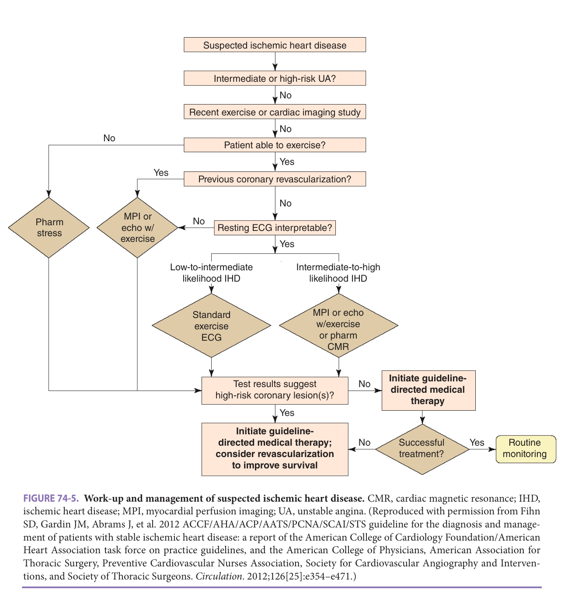

Study summary of Chapter 74 - Coronary Heart Disease and Dyslipidemia; the book and the full chapter are the reference.

# Chapter 74 Study: Coronary Heart Disease and Dyslipidemia

## What the exams asked

- Choose a functional test for predictable exertional angina with a normal resting ECG. Exercise capacity determines whether exercise or pharmacologic stress is feasible — [June 2023 Basic Q123, exercise ECG](?chapter=74#exam-p1137-mcq-fa33b286f3d03d33e2242529) and [the alternative when exercise is inadequate](?chapter=74#exam-p1138-mcq-fa33b286f3d03d33e2242529).
- Choose stress imaging after prior revascularization or when a paced rhythm obscures ischemic ST changes — [May 2024 Q3, test selection](?chapter=74#exam-p1138-mcq-a4e3d6ba430e0534aff9d3e6) and [Figure 74-5, the decision tree](?chapter=74#exam-p1139-mcq-a4e3d6ba430e0534aff9d3e6).
- Distinguish aspirin for primary prevention from aspirin plus clopidogrel after NSTEMI, and identify the age-related prasugrel warning — [May 2024 Q88](?chapter=74#exam-p1140-mcq-50a8d3094541c315ba9859cf).
- Combine two complementary antiplatelet agents with procedural anticoagulation for an 85-year-old undergoing PCI for MI — [September 2024 Basic Q101](?chapter=74#exam-p1140-mcq-92fb4b43790e0815a2591e91).
- Choose discharge therapy after NSTEMI and stenting when EF is 45%, pulse is below 60 and blood pressure is controlled — [2020 Q55, chapter-level link](?chapter=74#asked-chapter).

## Stable chest pressure and the choice of test

Ask what the patient was doing when the pressure began, what relieved it and whether that pattern has recently changed. A reproducible threshold followed by prompt relief with rest supports stable exertional angina. A falling threshold, pain at rest or persistent symptoms requires more urgent evaluation. Dyspnea, epigastric discomfort, fatigue and confusion can be ischemic equivalents. A normal ECG obtained after the pain resolves does not exclude coronary disease (pp1135–1137).

**Estimate probability before testing.** A negative result in someone very likely to have obstructive disease can leave a high residual probability. The chapter illustrates this with an older woman whose estimated probability exceeds 60% after a negative test when it was 80% beforehand. When the probability is low, assess other causes of the symptoms. Functional testing is most informative at intermediate probability. If the probability of severe disease is high, angiography is worth considering when the person would be a candidate for revascularization (pp1137–1138, Table 74-1).

**Can the patient exercise enough to stress the heart?** The independent man in June 2023 Basic Q123 develops pressure after three flights of stairs. Exercise ECG can reproduce symptoms, measure workload and blood-pressure response, and detect exercise-induced ST depression. Modifying the protocol can help a deconditioned patient achieve an adequate workload. If arthritis or disability precludes exercise, use pharmacologic stress. Dipyridamole perfusion imaging also received credit, although the vignette describes an exerciser with an interpretable resting ECG (pp1137–1138).

**Can the resting ECG be interpreted, and has the patient had revascularization?** With baseline ST depression, LV hypertrophy with strain, left bundle branch block or a paced rhythm, an exercise tracing alone may misclassify ischemia. Add imaging to look for a regional perfusion or wall-motion abnormality. Figure 74-5 directs an exerciser with previous revascularization to exercise perfusion imaging or stress echocardiography. This is why exercise echo fits the patient three years after PCI in May 2024 Q3. A history of bypass also favors imaging if new symptoms justify investigation. Routine retesting without a change in symptoms adds little. The chapter advises against routine repeat tests within two years of PCI or five years of CABG (pp1138–1139).

Anatomic and functional tests answer different questions. CT angiography displays luminal narrowing. A functional study asks whether flow meets demand during stress. In the older PROMISE participants described in the chapter, functional testing stratified later cardiovascular death or MI more effectively than a positive CT stenosis criterion. In an older patient with no symptoms, a baseline ECG may reveal a silent prior MI, but routine imaging or stress testing solely to find subclinical disease is generally discouraged (pp1137–1138).

## Antiplatelet therapy and anticoagulation

**A first event versus a recurrent event.** Aspirin has a clear role after established coronary disease. In healthy older ASPREE participants, daily aspirin increased major hemorrhage without extending disability-free survival. In ASCEND participants with diabetes, aspirin reduced first vascular events, but major bleeding occurred in 4.1% with aspirin versus 3.2% with placebo. ARRIVE found more gastrointestinal bleeding and no significant improvement in the composite cardiovascular outcome. May 2024 Q88 uses diabetes as a distractor because it raises ischemic risk without abolishing bleeding risk (pp1139–1140).

> Current practice (not the book): The USPSTF recommends against initiating low-dose aspirin for primary prevention of cardiovascular disease in adults aged 60 or older. Secondary prevention after established atherosclerotic disease is a different indication. [USPSTF aspirin recommendation, 2022](https://pubmed.ncbi.nlm.nih.gov/35471505/).

**After NSTEMI, platelet inhibition has a different balance.** Aspirin and clopidogrel inhibit different steps in platelet activation. CURE found a roughly 20% relative reduction in cardiovascular death, MI or stroke with clopidogrel added to aspirin. Following PCI, consider the competing risks of recurrent thrombosis and major bleeding when choosing the P2Y12 inhibitor. Hazzard describes a prasugrel boxed warning for **age ≥75, prior stroke or low BMI** because bleeding risk is increased. Ticagrelor has a different risk profile and still requires a bleeding-risk assessment.
> Current practice (not the book): The US label contraindicates prior stroke/TIA and generally advises against use at age ≥75, with possible consideration for diabetes or prior MI. Low body weight (<60 kg) is a separate bleeding-risk factor. [Prasugrel prescribing information, boxed warning and §4.2](https://dailymed.nlm.nih.gov/dailymed/drugInfo.cfm?setid=f51e64e0-f556-65d0-a876-fb709aaeefea).

**During PCI, identify the job of each drug.** Aspirin plus a P2Y12 inhibitor addresses platelet-rich thrombus and stent thrombosis. A parenteral anticoagulant addresses fibrin formation during the acute event and procedure. In September 2024 Basic Q101, both aspirin–unfractionated heparin–ticagrelor and aspirin–enoxaparin–clopidogrel provide this coverage. Combining enoxaparin with fondaparinux leaves out a P2Y12 inhibitor. Check renal clearance when choosing enoxaparin. Unfractionated heparin can also cause excessive anticoagulation, so monitor its effect. Assess access-site and other bleeding throughout treatment (p1140, Harrison 21e ch. 275, pp2060–2061).

The decision about continuing anticoagulation after the acute event is separate. In APPRAISE-2, adding full-dose apixaban after MI increased major bleeding without a significant reduction in recurrent ischemic events. In COMPASS, a much lower rivaroxaban dose plus aspirin reduced events in stable atherosclerotic disease at the expense of more major bleeding. Check for an independent indication such as atrial fibrillation or venous thrombosis and weigh the bleeding risk (p1140).

## After infarction: ventricular function, heart rate and secondary prevention

At discharge after MI, verify antiplatelet therapy, a tolerated statin, ventricular function, resting heart rate, blood pressure and renal function. The woman in 2020 Q55 already takes aspirin, clopidogrel and atorvastatin. Her EF is 45%, resting pulse is 58–59 and blood pressure is controlled. Ramipril addresses ventricular dysfunction and hypertension without slowing her heart rate further. An additional vasodilator could lower pressure unnecessarily. Check potassium, creatinine and standing symptoms after starting an ACE inhibitor. The clinical discussion on pp1140–1141, 1143 and 1147 is parallel eighth-edition teaching for this historical question.

Beta blockers reduce myocardial oxygen demand and slow the heart, prolonging diastolic perfusion. They can treat angina and selected patients after MI or with ventricular dysfunction. In the chapter's contemporary registry data, the strongest association with benefit was in the first year after an infarction. Reassess tolerability and ongoing indications, particularly if hypotension, symptomatic bradycardia or conduction disease limits treatment. If cough limits an ACE inhibitor, an ARB is a potential substitute (pp1140–1141, 1143, 1147).

> Current practice (not the book): In REDUCE-AMI, long-term beta blockade after revascularized MI with LVEF ≥50% did not reduce the composite of death or recurrent MI. Assess other indications such as angina, arrhythmia or heart failure before continuing or withdrawing therapy. [REDUCE-AMI trial, 2024](https://pubmed.ncbi.nlm.nih.gov/38587241/).

**LDL lowering after established disease.** Moderate-intensity statins reduce major vascular events in patients aged 75 or older with clinical atherosclerotic disease. Continuing a tolerated high-intensity statin is reasonable. Early intensive lipid lowering after an infarction reduces recurrent events, and older patients with high baseline risk may gain a substantial absolute benefit. For persistently elevated LDL despite statin therapy, ezetimibe reduces intestinal cholesterol absorption. In IMPROVE-IT the older post-ACS subgroup gained a particularly large absolute benefit. PCSK9 inhibition can lower LDL further in selected high-risk patients. Trial evidence in multimorbid older adults is more limited (pp1141–1143).

**Starting a statin before any clinical event.** The risk calculator's development cohort ended at age 79. Its estimate omits functional trajectory and can be dominated by chronological age. For primary prevention in adults at least 75 with LDL 70–189 mg/dL, weigh a moderate-intensity statin against frailty, comorbidity, life expectancy and the person's priorities. Figure 74-6 shows uncertainty in randomized primary-prevention evidence in the oldest group. The estimated **at least 2.5 years** to prevent one major event per 100 treated came from trials in adults aged 50–75. Applying that interval mechanically to an 85-year-old would overstate the evidence. When muscle symptoms occur, assess their relation to treatment and discuss a tolerable regimen. In the STOMP study, myalgia was more frequent on high-dose atorvastatin, but strength and exercise performance were preserved (pp1141–1142).

> Current practice (not the book): STAREE enrolled community-dwelling adults aged at least 70 without clinical cardiovascular disease, diabetes or dementia. Atorvastatin 40 mg reduced major cardiovascular events over a median 5.9 years. The trial did not show a significant improvement in disability-free survival. [STAREE trial, 2026](https://pubmed.ncbi.nlm.nih.gov/42670961/).

## From silent plaque to acute coronary syndrome

Subclinical coronary disease is common well before the first recognized event. Age-related arterial stiffening raises systolic pressure, while impaired filling and high end-diastolic pressure can compromise diastolic coronary flow. Individual plaques often become more fibrotic and calcified, yet the total number of lesions increases. Plaque disruption can activate platelets and coagulation, abruptly reducing blood supply (pp1133–1136).

LDL, total cholesterol and triglycerides generally rise through middle and early old age. A later fall in cholesterol can accompany malnutrition, inflammation or frailty, and healthier survivors also influence comparisons across age groups. A low current LDL therefore does not erase a history of coronary disease. ApoB-containing particles and lipoprotein(a) provide additional information about atherogenic burden, while LDL remains a major treatment target (pp1134–1135).

A rise or fall in troponin above the upper reference limit signifies acute myocardial injury. Diagnosing MI also requires evidence of ischemia. In type 1 MI a coronary plaque event leads to thrombosis. In type 2 MI anemia, sepsis, tachyarrhythmia, hypoxia or another stressor disrupts the oxygen supply–demand balance. Treat the precipitating illness and assess underlying coronary risk. Antithrombotic and invasive strategies appropriate for acute plaque thrombosis may add harm when the primary problem is bleeding or severe illness (pp1136, 1138–1140).

## Revascularization, frailty and recovery

**Stable angina.** An angiographic stenosis alone does not establish who benefits from intervention. Start with symptom control, secondary prevention and practical assistance with medication use. In ISCHEMIA, an initial invasive approach did not improve the composite cardiovascular outcome or survival compared with initial medical treatment in the selected stable population with EF at least 35%. Patients with frequent angina had more symptom relief with revascularization. Left-main disease, multivessel disease with poor ventricular function, and persistent disabling angina are different decisions. Anatomy, myocardial viability, goals and procedural risk enter the choice between PCI and CABG (pp1138, 1144–1145).

**Acute MI.** In STEMI, open the culprit artery promptly. Timely primary PCI is preferred when available. If timely PCI is impossible, fibrinolysis may help an eligible patient in the treatment window, but intracranial bleeding risk increases with age. For NSTEMI assess ventricular function and recurrent ischemic risk. The chapter's trials favor early angiography in many high-risk older adults. Consider renal reserve, bleeding, frailty and the outcomes the patient wants when choosing an invasive or ischemia-driven strategy (pp1143–1147).

> Current practice (not the book): In SENIOR-RITA, among patients aged 75 or older with NSTEMI, routine invasive treatment did not significantly reduce the composite of cardiovascular death or nonfatal MI compared with conservative treatment. Nonfatal MI and later revascularization were less frequent with the invasive strategy. [SENIOR-RITA trial, 2024](https://pubmed.ncbi.nlm.nih.gov/39225274/).

For an older patient undergoing PCI, radial access can reduce access-site bleeding. Contemporary drug-eluting stents offer advantages over bare-metal stents, including fewer repeat interventions in older trial participants. Creatinine alone can conceal impaired clearance in someone with low muscle mass. Estimate clearance in ACS patients aged at least 75 and reassess it during admission and after discharge. Check hearing, cognition, mobility, nutrition, medication burden and caregiving support when discussing expected recovery. Cardiac rehabilitation, smoking cessation and sustainable activity support secondary prevention. When symptom control and remaining at home are the patient's priorities, palliative care can accompany other cardiac treatment (pp1143, 1146–1148).

## Israeli context — שיקום לב לאחר אוטם

לאחר אוטם שריר הלב, צנתור טיפולי או ניתוח מעקפים, שיקום לב נכלל בסל הבריאות. רופא המשפחה או הקרדיולוג יכולים להפנות למכון מוכר. ההערכה במכון כוללת בדיקה רפואית ותפקודית ומבחן מאמץ, ועל פיהם הצוות מתאים תוכנית אימון. למטופלים הזכאים שלושת החודשים הראשונים ניתנים ללא תשלום. המשך במימון חלקי עד שנה תלוי בהנחיות המשרד. [משרד הבריאות, שיקום לב, 24.11.2026, הסעיפים ״תהליך שיקום לב״, ״הפניה לשיקום לב״ ו״זכאות לשיקום לב״](https://me.health.gov.il/rehabilitation/exercise-rights/rehabilitation-in-various-situations/cardiac-rehabilitation/).

אם קיים קושי להגיע למכון, אפשר לברר התאמה לשיקום מרחוק. התוכנית מתנהלת באמצעות מכון שיקום לב וכוללת פעילות אירובית ואימוני התנגדות בהתאמה אישית, משוב אחת לשבועיים ומעקב אחר יעדים כגון לחץ דם, סוכר ושומני הדם. [משרד הבריאות, שיקום לב, הסעיף ״שיקום לב מרחוק״](https://me.health.gov.il/rehabilitation/exercise-rights/rehabilitation-in-various-situations/cardiac-rehabilitation/).

## Summary

**Disease & presentation**
- Coronary disease spans subclinical atherosclerosis, stable ischemia and acute coronary syndromes; ischemia reflects oxygen supply inadequate for myocardial demand (p1133).
- Typical angina remains the most common presentation regardless of age; dyspnea, fatigue or epigastric discomfort can delay recognition (p1133).
- More than **80%** of US coronary deaths occur after **65**. High baseline risk makes appropriate treatment consequential (p1133).

**Assessment**
- New, progressive or refractory symptoms need expedited, sometimes inpatient evaluation. Assess symptoms and risk factors rather than dismissing complaints because of age (p1137).
- Functional testing remains useful; modified exercise or pharmacologic stress protocols can accommodate limitations (p1133).
- After MI, assess ventricular function and coronary severity. For NSTEMI, invasive assessment versus an ischemia-driven approach depends on risk and clinical context (p1143).

**Management & drugs**
- Aspirin has strong secondary-prevention evidence; the chapter favors **81 mg daily** in older adults. Higher doses increase bleeding without clear additional efficacy (p1139–1140).
- Primary prevention is different: ASPREE did not improve disability-free survival in healthy older adults and increased major hemorrhage (p1140).
- In adults at least **75** with LDL-C **70–189 mg/dL**, moderate-intensity statin therapy may be reasonable; frailty, functional decline and limited life expectancy can limit benefit (p1141).
- ACE inhibitors are considered with coronary disease plus ventricular dysfunction, diabetes or hypertension; ARBs can substitute for ACE-inhibitor intolerance. Monitor creatinine and potassium (p1143).
- HOPE studied ramipril **10 mg daily** in coronary disease or high-risk patients; this is the trial regimen, not a universal starting dose (p1143).
- Calculate creatinine clearance in ACS patients at least **75**, and reassess as renal function changes; polypharmacy and altered drug responses increase harm (p1147).

**Exam traps**
- Do not transfer aspirin's secondary-prevention benefit directly to healthy older adults (p1139–1140).
- The chapter does not recommend oral anticoagulation solely for acute or chronic coronary disease without another indication: reduced ischemic events can be offset by bleeding (p1140).

> Current practice (not the book): For selected patients with chronic coronary disease, high recurrent ischemic risk and low-to-moderate bleeding risk who do not need full-dose anticoagulation or DAPT, low-dose rivaroxaban 2.5 mg twice daily with low-dose aspirin is an option. This vascular dose does not replace therapeutic anticoagulation for AF. [AHA/ACC chronic coronary disease guideline, 2023](https://www.ahajournals.org/doi/10.1161/CIR.0000000000001168).
- Primary-prevention statin evidence is limited in older adults; risk calculators derived only through age **79** perform suboptimally in older populations (p1141).

## Exam-cited book images

Book images cited by past exams. Tap an image to zoom.

## Figure 74-5 — book image

[May 2024 Q3](?chapter=bank&q=mcq-a4e3d6ba430e0534aff9d3e6)

## Exam questions

Five past-exam questions cover stress testing, antithrombotic treatment and discharge therapy after infarction.

- [May 2024 Q3](?chapter=bank&q=mcq-a4e3d6ba430e0534aff9d3e6)
- [May 2024 Q88](?chapter=bank&q=mcq-50a8d3094541c315ba9859cf)

- [2020 Q55](?chapter=bank&q=mcq-13e618f70748ac4d528540ae)
- [June 2023 Basic Q123](?chapter=bank&q=mcq-fa33b286f3d03d33e2242529)
- [September 2024 Basic Q101](?chapter=bank&q=mcq-92fb4b43790e0815a2591e91)
