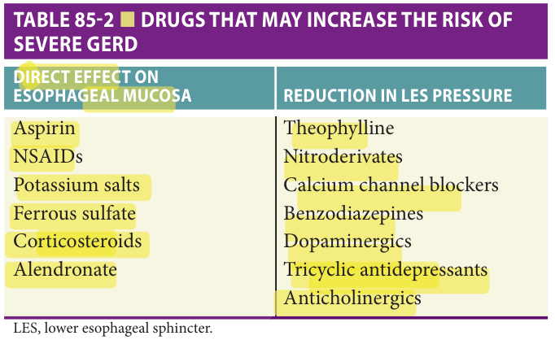

Study summary of Chapter 85; the book and the full chapter are the reference.

# Chapter 85 Study: Upper Gastrointestinal Disorders

## Summary

**Presentation & diagnosis**
- GERD and ulcers may present with anemia, anorexia, vomiting or weight loss rather than typical pain; mild symptoms can accompany severe esophagitis. Figure 85-2 includes **dysphagia** among nonspecific presentations of reflux esophagitis in older adults (pp1315–1318).
- The chapter advises great caution with empiric PPI diagnosis in older adults and generally favors endoscopic evaluation rather than relying on symptom response (p1315, p1317).
- Peptic ulcer risk reflects H. pylori, mucosa-damaging drugs and impaired mucosal defenses; review NSAIDs and antithrombotic exposure (p1315).

**Acid suppression & H. pylori**
- PPIs heal erosive esophagitis more effectively than H2 blockers. Studied daily regimens include omeprazole **20 mg** and pantoprazole **40 mg** (p1319).
- Reassess the indication for ongoing acid suppression; the chapter explicitly includes deprescribing when warranted (p1315). The book reports associations between PPI use and hip, wrist or spine fractures, and a meta-analysis reporting about **twice the risk of C. difficile infection** (pp1322–1323).
- H. pylori tests can be falsely negative during antisecretory or antibiotic treatment and with gastric atrophy; biopsy location matters (p1327).
- Confirm eradication, generally at least **1 month** after treatment, using breath/stool testing or endoscopy when clinically indicated (p1327).
- The chapter describes PPI-based antibiotic combinations and notes greater eradication with **14** versus **7 days**, while acknowledging no studies specifically evaluating the clinical usefulness of two-week triple therapy in older patients at the time of publication (p1328).

**Upper GI bleeding**
- UGIB originates proximal to the ligament of Treitz; it may cause hematemesis, melena, hematochezia or occult blood loss/anemia (p1331).
- Assess hemodynamics immediately and resuscitate as needed; review previous bleeding, ulcerogenic drugs, anticoagulants, blood count and coagulation studies (p1332–1333).
- The book's transfusion threshold is hemoglobin at most **8 g/dL**; it also advises transfusion above that level with volume depletion or severe comorbidity (p1333).
- Pre-endoscopy omeprazole/pantoprazole **80 mg IV bolus**, then **8 mg/hour**, may reduce endoscopic treatment requirements but does not improve final clinical outcomes (p1333).
- After endoscopic hemostasis of high-risk ulcer stigmata, the chapter describes **72 hours** of IV PPI; cited meta-analysis found oral and IV therapy similarly effective (p1333).

### Reflux despite acid suppression

For May 2024 Q73, trace each drug to its mechanism. Amlodipine is a calcium-channel blocker and can lower sphincter pressure, so gastric contents can still reflux during PPI treatment. Table 85-2 places nitrates, theophylline, benzodiazepines, dopaminergic agents, tricyclic antidepressants and anticholinergics in this same column. Aspirin, NSAIDs, potassium salts, ferrous sulfate, corticosteroids and alendronate appear in the direct mucosal-injury column. Ibuprofen, prednisone and aspirin can therefore matter clinically even though the question asks specifically about sphincter pressure (p1316).

An older person with dysphagia, anemia or unintentional weight loss needs investigation even if heartburn is mild. Endoscopy assesses erosions, a stricture, Barrett esophagus or another mucosal lesion. A contrast study can delineate a ring, narrowing or impaired movement, and videofluoroscopy can help localize swallowing dysfunction. A response to empiric acid suppression cannot identify which lesion is present (p1317–1318).

### Ulcer treatment and bleeding decisions

The book describes PPI-based clarithromycin triple therapy, including regimens as short as **7 days**, and reports improved clearance with longer treatment (p1328). Treatment history and susceptibility matter when applying these older trial results.

> Current practice (not the book): In North America, when susceptibility is unknown, the ACG recommends 14 days of optimized bismuth quadruple therapy for treatment-naive patients. Clarithromycin-containing therapy requires demonstrated susceptibility. Confirm clearance at least four weeks after antibiotics, withholding the PPI for two weeks before testing. - [American College of Gastroenterology, 2024](https://doi.org/10.14309/ajg.0000000000002968).

The book's higher hemoglobin threshold belongs to its discussion of stabilization. Active blood loss, perfusion and comorbid disease guide immediate assessment alongside the measured value (p1332–1333).

> Current practice (not the book): For hospitalized patients with overt upper gastrointestinal bleeding, the ACG suggests a restrictive red-cell transfusion threshold of 7 g/dL. - [American College of Gastroenterology, 2021](https://pubmed.ncbi.nlm.nih.gov/33929377/).

### When reflux is severe but heartburn is modest

Think of the esophagus as a tube that must both prevent reflux and clear material that reaches it. A short, weak lower esophageal sphincter and a hiatus hernia compromise the barrier. Effective peristalsis, upright posture and saliva help clear and buffer refluxate. A person with impaired mobility, reduced saliva or poor esophageal clearance has less protection even if gastric acid output is unremarkable. Bile-containing reflux and weaker mucosal repair can add to injury. Severe mucosal disease in later life therefore does not require unusually high acid production. Review anatomy, function, posture and medicines together (p1315–1316).

Figures 85-1 and 85-2 describe different directions of association in a series of **840 people with endoscopically identified reflux esophagitis**. Typical symptoms such as heartburn and acid regurgitation became less prominent with age, while dysphagia, anorexia, anemia and weight loss became more common. These are observations in patients with established disease. A new loss of weight or swallowing difficulty cannot safely be diagnosed as reflux simply because both occurred in the study. Ask whether solids, liquids or both cause difficulty, whether intake has changed and whether anemia or bleeding accompanies the complaint (p1317–1318).

A persistent symptom during high-dose PPI therapy does not answer the May 2024 Q73 mechanism question. Suppressing gastric acid changes the acidity of what refluxes; it does not directly restore sphincter pressure or prevent every episode of reflux. Amlodipine can allow more reflux by lowering that pressure. The patient's simultaneous NSAID, aspirin and steroid exposures matter because mucosal injury can compound the symptoms and raise concern about a different lesion. Review any continued indication for each drug and how tablets are taken. A pill that remains in contact with mucosa can injure it by a mechanism independent of reflux (p1316–1318).

### What each investigation contributes

Endoscopy identifies erosions, ulcers and narrowing, permits biopsy, and can show Barrett esophagus or a concurrent gastric or duodenal lesion. Absence of erosions does not exclude reflux symptoms. A contrast examination can demonstrate a hiatus hernia, ring or stricture and can provide information on bolus passage. When the history points to oropharyngeal dysfunction, videofluoroscopic assessment may reveal a swallowing problem that acid suppression cannot treat. The decision to investigate should include whether alarm symptoms are present, the person's fitness for the procedure and what a result would change (p1317–1318).

Figure 85-3 grades erosion by extent. In Los Angeles grade A, a break is **no longer than 5 mm** and does not extend between the tops of two mucosal folds. Grade B has a break **longer than 5 mm** without such bridging. In grade C the breaks extend between fold tops but involve **less than 75%** of the circumference; grade D involves **at least 75%**. The first boundary concerns length and the second concerns circumference. A patient able to eat despite mild heartburn can still have extensive erosive disease, and the original endoscopic grade matters when planning whether maintenance treatment is warranted (p1318, p1321–1322).

The chapter treats a therapeutic PPI trial cautiously in older people because relief cannot distinguish esophagitis from other acid-responsive conditions and failure to improve does not identify the reason. Persistent symptoms after mucosal healing raise the possibilities of continued reflux, nonerosive reflux, altered motility or a different diagnosis. Check the drug and administration history, the initial endoscopic findings and whether the dominant symptom is actually dysphagia. In someone with a large hernia, aspiration or severe refractory stricture, anatomy may matter more to the next decision than empiric escalation of acid suppression (p1317–1318, p1321–1324).

### Selecting and reviewing acid suppression

Keep four aims separate: relieve distress, heal mucosal injury, prevent a relapse and prevent a complication. Antacids or alginates may relieve mild symptoms without supplying the healing rates of a PPI in erosive disease. H2-receptor antagonists can be effective but generally heal fewer erosions. Trial comparisons summarized in the chapter evaluated omeprazole **20 mg daily**, lansoprazole **30 mg daily**, pantoprazole **40 mg daily** and rabeprazole **20 mg daily**. In a later network comparison, esomeprazole **40 mg** had higher healing rates than several standard-dose comparators at four weeks, with fewer differences at eight weeks. Do not convert a group difference in one endpoint into a claim that all older patients require the highest dose (p1318–1320).

Figure 85-9 separates healing therapy from maintenance and shows standard, reduced and higher doses. Table 85-4 identifies relapse factors such as a long history, severe baseline erosions, a large hiatus hernia and persistent symptoms even after healing. The chapter gives a **70% to 90% annual relapse rate** after stopping an effective antisecretory regimen, an estimate about recurrence in reflux disease rather than a reason to continue treatment without an indication. A symptomatic patient with uncomplicated nonerosive disease and a patient with prior severe esophagitis, stricture or Barrett esophagus may reasonably reach different maintenance decisions (p1319, p1321–1322).

Review the original indication, response, current risks and patient goals when renewing a long-term PPI. Observational studies cited in the chapter associate use with fractures and enteric infection, and the text discusses possible effects on mineral or vitamin absorption. Association does not quantify an individual patient's excess risk or establish that the drug caused a subsequent fracture. Conversely, the risk of recurrent ulcer bleeding during necessary antiplatelet or NSAID exposure can be substantial. In the earlier exam vignettes, prolonged esomeprazole exposure is the relevant association with *C. difficile*, and fracture risk is the recognized skeletal concern; malignant transformation of Barrett esophagus is not presented as an established PPI consequence (p1322–1324).

Role of surgery depends on the problem and the patient's reserve. The chapter discusses referral for medical treatment failure, complications that cannot be controlled endoscopically, and substantial dysphagia or aspiration in association with a large hernia. A difficult symptom needs diagnostic clarification before an operation becomes the answer. Distinguish relief of reflux from evaluation of dysplasia in Barrett esophagus, which requires a decision specific to the mucosal finding. Comorbidity and the expertise of the treating center enter the balance for an older surgical candidate (p1324).

### Peptic ulcer disease: identify the lesion and its cause

An ulcer is a deeper defect than a superficial gastric erosion. In an older person, pain can be vague, mild or absent until bleeding, obstruction or perforation brings the patient to attention. The chapter reports that among patients over **60 years**, only about one third described typical epigastric pain in the cited observations. Ask about early satiety, reduced intake, vomiting, melena and fatigue or dyspnea from blood loss. A long medication list and another illness that seems to account for fatigue can delay recognition. An NSAID or antithrombotic increases concern even if the patient reports no prior dyspepsia (p1325–1327).

H. pylori and mucosal injury from NSAIDs or aspirin are major causes and can coexist. Prostaglandins contribute to mucosal defenses; inhibiting cyclooxygenase can undermine those defenses, while aspirin's platelet effect contributes to the consequences of bleeding. Enteric coating or the absence of prior pain does not establish a protected gastric mucosa. Establish which agent is used, dose and frequency, use of nonprescription analgesics, prior ulcer or bleed, and whether anti-inflammatory treatment remains necessary. A patient with a prior bleeding ulcer who must continue an NSAID has a different need for protection from someone with no ongoing exposure (p1325–1327, p1329–1331).

Endoscopy localizes and characterizes the lesion, permits histology and helps identify H. pylori. Gastric ulcers may require biopsy to distinguish benign ulceration from malignancy. A radiographic study cannot replace tissue evaluation where cancer is a concern. If there has been recent bleeding or acid suppression, an initial negative H. pylori result can be falsely reassuring. Review which tests were performed, when antibiotics or a PPI were last taken and which gastric regions were sampled. The chance of missing patchy infection can increase in atrophic mucosa or when sampling is limited to one region (p1326–1328).

### H. pylori: establish active infection and document clearance

Table 85-5 compares tests by the question each answers. Histology provides information on inflammation and atrophy as well as the organism. The rapid urease test is quick but can miss infection after PPI, antibiotic or bismuth exposure and during acute bleeding. Culture can allow antibiotic susceptibility testing, although laboratory availability and technical requirements limit routine use. A positive antibody result does not distinguish remote exposure from persistent active infection and is unsuitable as proof of cure. Breath testing and fecal antigen testing can address active infection without requiring another endoscopy when there is no separate reason for direct examination (p1327–1328).

The historical regimens in the book combine a PPI twice daily with clarithromycin **500 mg twice daily** and either amoxicillin **1 g twice daily** or a nitroimidazole **500 mg twice daily** for at least **7 days**. It reviews short-course trials and notes better eradication with longer treatment. Older participants in these studies were selected under particular resistance patterns; their results do not predict local effectiveness when clarithromycin resistance is common. The current ACG note above specifies the contemporary empiric alternative. Confirm eradication after the relevant medication-free interval rather than treating improvement in pain or restoration of appetite as microbiological proof (p1327–1329).

When drug-associated ulcers are suspected, withdrawing the causative agent if possible and providing an effective healing regimen address different parts of the problem. Review aspirin's indication separately from an analgesic NSAID. Eradicating H. pylori can reduce recurrent ulcer risk in appropriate patients but does not remove the continuing hazard of ulcerogenic drugs. The prevention figures incorporate previous complicated ulcers and concomitant antiplatelet or NSAID exposure. An apparently straightforward deprescribing decision can be unsafe if it removes gastroprotection while the patient continues a medicine that previously contributed to bleeding (p1329–1331, p1334).

What if the ulcer persists after initial therapy? First distinguish inadequate treatment from an incorrect causal label. Confirm the patient took the intended dose, excluded nonprescription NSAIDs and completed any prescribed eradication regimen. Consider whether a negative H. pylori result was obtained during bleeding or while acid suppression or antibiotics reduced sensitivity. For an uncomplicated ulcer classified as neither NSAID-related nor H. pylori-related, the book describes a standard-dose PPI for at least **4 weeks for a duodenal ulcer** and **8 weeks for a gastric ulcer**. Persistent or atypical disease warrants further assessment, including a possible hypersecretory state or ongoing damaging medication, rather than unexamined continuation of the same treatment (p1327–1328, p1330).

When reading eradication trials, distinguish the chance of cure among all participants starting a regimen from the chance among people who completed it as planned. Table 85-6 reports both intention-to-treat and per-protocol results, alongside treatment withdrawals and adverse effects. The difference matters in an older person facing multiple daily medicines, nausea or difficulty following an eradication schedule. A regimen with appealing efficacy among completers may be a poor choice if interactions or intolerance are likely to interrupt treatment. Assess the feasibility of the course at prescribing, and determine success with a properly timed test for active infection (p1328–1329).

### Acute hemorrhage: stabilize the patient, then define the lesion

The anatomic definition of upper GI bleeding is a source proximal to the ligament of Treitz. Hematemesis, blood or coffee-ground material in gastric contents and melena suggest this region, whereas hematochezia can occur with brisk upper-tract hemorrhage. Pallor, dyspnea, angina, presyncope, falls or decompensated cardiac disease may be more prominent in an older person than a complaint of bleeding. Assess perfusion, vital signs and mental status, establish venous access, and consider the effects of ongoing losses and comorbid disease. The decision to resuscitate should not wait for a hemoglobin concentration to fall to its eventual nadir (p1331–1333).

Peptic ulcers are frequent sources, but Table 85-7 includes erosive lesions, varices, tumors and tears. Portal hypertension makes varices possible but does not prove the site. A patient with cirrhosis who also takes an NSAID can bleed from an ulcer. Initial history should include prior endoscopy, liver disease, prior bleeding, all antithrombotic and anti-inflammatory drugs and any recent change in dose or kidney function. A test identifying an anticoagulant effect helps explain a tendency to bleed; it does not replace finding the lesion. Support circulation and arrange timely endoscopy in light of stability and suspected source (p1331–1333).

Endoscopy provides diagnosis, predicts risk and permits treatment. In the Forrest system, Ia means spurting and Ib oozing hemorrhage, IIa a visible vessel without active bleeding, IIb an adherent clot, IIc a flat pigmented area and III a clean base. Active bleeding and a nonbleeding visible vessel carry important risk and are candidates for endoscopic hemostasis. A clean ulcer base has a different risk from a visible vessel despite the absence of active bleeding in both. The purpose of the pre-endoscopy high-dose PPI regimen is distinct from treatment after successful hemostasis of high-risk stigmata. Acid suppression does not replace endoscopic control of a lesion that continues to bleed (p1333–1334).

Assess suspected variceal hemorrhage on its own pathway. The chapter describes early use of a vasoactive agent such as somatostatin, octreotide or terlipressin when variceal bleeding is suspected. Endoscopic band ligation and management of underlying portal hypertension address a different mechanism from clipping an ulcer vessel. In a patient at high risk of liver failure or recurrent hemorrhage, a portosystemic shunt may be considered in an appropriate specialist setting. For recurrent variceal hemorrhage, beta-blockers and repeat ligation have roles, but hypotension, fatigue and orthostatic effects may constrain beta-blockade in a frail older person (p1333–1335).

### Predicting recurrence and preventing the next bleed

The Glasgow-Blatchford assessment uses pre-endoscopic information such as blood urea, hemoglobin, pressure, pulse, melena, syncope and relevant liver or cardiac disease to estimate the likelihood of needing intervention. The book identifies a score of **0** as low risk. Rockall adds endoscopic diagnosis and stigmata to its clinical assessment and focuses on recurrence and mortality. The multidimensional prognostic index addresses a different question: functional status, nutrition, cognition, disease burden, medication burden and social circumstances can influence the eventual outcome even after a bleeding lesion is controlled. A favorable endoscopic appearance does not eliminate the need to assess what help the patient will require after discharge (p1334–1335).

For secondary prevention, ask why aspirin was prescribed. The book advises early resumption after bleeding stops when established cardiovascular disease makes it important, ideally in **1–3 days** and within **7 days**, alongside long-term PPI protection. It generally argues against restarting aspirin used solely for primary prevention in most such patients. Continued NSAID use should be reconsidered; where unavoidable the chapter describes a selective COX-2 inhibitor at the lowest effective dose with daily PPI. Confirm H. pylori clearance and review co-prescribed antithrombotics. Preventing another bleed and preventing a vascular event are decisions to be made together (p1334).

> Current practice (not the book): For cardiac aspirin used for secondary prevention during acute gastrointestinal bleeding, ACG/CAG suggest continuing it. If interrupted, resume on the day that hemostasis is confirmed endoscopically. - [ACG/CAG antithrombotic guideline, 2022](https://gi.org/wp-content/uploads/2022/03/ACG-CAG-Guideline.pdf).

### Unexplained iron or vitamin B12 deficiency

Autoimmune atrophic gastritis can remain clinically quiet for years. The pathological process affects the corpus and fundus, replacing functioning gastric mucosa with atrophic or metaplastic tissue. Parietal-cell injury reduces acid secretion; antibodies to intrinsic factor compromise vitamin B12 absorption. Refractory iron deficiency can also bring the patient to attention. A person with early satiety or reflux-like symptoms may be producing little acid, making indefinite empiric acid suppression a poor substitute for explaining the symptoms. Gastrin and pepsinogen measurements can support assessment, but the chapter bases the diagnosis on appropriately directed endoscopic biopsies and emphasizes excluding associated neoplasia (p1335).

## Exam traps
- Cirrhosis does not prove variceal bleeding: more than **50%** of UGIB in cirrhosis is nonvariceal in the cited text (p1332).
- Autoimmune atrophic gastritis can cause achlorhydria and pernicious anemia; diagnosis rests on corpus/fundus histology (p1335).

## Exam-cited book images

Book images cited by past exams. Tap an image to zoom.

## Table 85-2 — book image

[2024-May Q73](?chapter=bank&q=mcq-b9c4a66523aee26652ec01e3)

## Past exam questions

- [2024-May Q73](?chapter=bank&q=mcq-b9c4a66523aee26652ec01e3) — Printed page 1316.

[Earlier sittings, chapter-level mapping](?chapter=85#asked-chapter) — 2021-Dec Q9, 2021-Dec Q38, 2021-Dec Q76.

## Recall drill

**1. Which drug class in the refractory-heartburn question reduces LES pressure?**

Answer
Calcium-channel blockers, represented by amlodipine. A PPI suppresses acid production but does not restore sphincter tone (p1316).

**2. Where do aspirin, ibuprofen and prednisone appear in the drug table?**

Answer
In the direct mucosal-injury group. The question asks about reduced sphincter pressure (p1316).

**3. Which other drugs can promote reflux by reducing LES pressure?**

Answer
Examples include nitrates, theophylline, benzodiazepines, dopaminergic agents, tricyclic antidepressants and anticholinergics (p1316).

**4. Which symptoms can overshadow heartburn in older people with esophagitis?**

Answer
Dysphagia, loss of appetite, anemia and weight loss. Symptom intensity can underestimate mucosal injury (p1317–1318).

**5. What can endoscopy show that a symptomatic response to a PPI cannot?**

Answer
The severity of mucosal injury and structural complications such as a peptic stricture or Barrett esophagus (p1317).

**6. When does a barium examination add information?**

Answer
When a ring, structural narrowing, impaired motility or a swallowing disorder is suspected. Videofluoroscopy can characterize swallowing (p1317).

**7. What practical advice reduces pill contact with the esophageal mucosa?**

Answer
Swallow potentially injurious medicines with a full glass of water while upright, and review whether the drug is needed (p1318).

**8. Which agents were most effective at healing erosive esophagitis in the trials summarized?**

Answer
PPIs outperformed H2 antagonists. Studied daily doses include omeprazole <strong>20 mg</strong> and pantoprazole <strong>40 mg</strong> (p1319).

**9. Which factors can conceal H. pylori during testing?**

Answer
Recent antibiotics or acid suppression and gastric atrophy can lower test sensitivity. Consider which part of the stomach was biopsied (p1327).

**10. Why choose a breath or fecal antigen test over antibody testing to check eradication?**

Answer
The former assess ongoing infection. Antibody testing has poorer accuracy for this purpose. The book advises waiting at least a month after therapy (p1327).

**11. How may upper GI bleeding present without obvious hematemesis?**

Answer
Melena, hematochezia with acute bleeding, or occult blood loss presenting as anemia (p1331).

**12. What is assessed immediately when bleeding is suspected?**

Answer
Hemodynamic status and need for resuscitation, followed by bleeding history, drug exposures, blood count and coagulation studies (p1332–1333).

**13. Does a history of cirrhosis establish variceal bleeding?**

Answer
No. In the chapter, more than half of upper GI bleeds in cirrhosis arise from nonvariceal sources (p1332).

**14. What benefit does the book attribute to high-dose IV PPI before endoscopy?**

Answer
It may reduce the need for endoscopic hemostasis, without a demonstrated improvement in final clinical outcomes (p1333).

**15. What links autoimmune atrophic gastritis to pernicious anemia?**

Answer
Loss of corpus/fundus parietal-cell function reduces acid and intrinsic-factor production. Histology of the involved mucosa supports the diagnosis (p1335).

