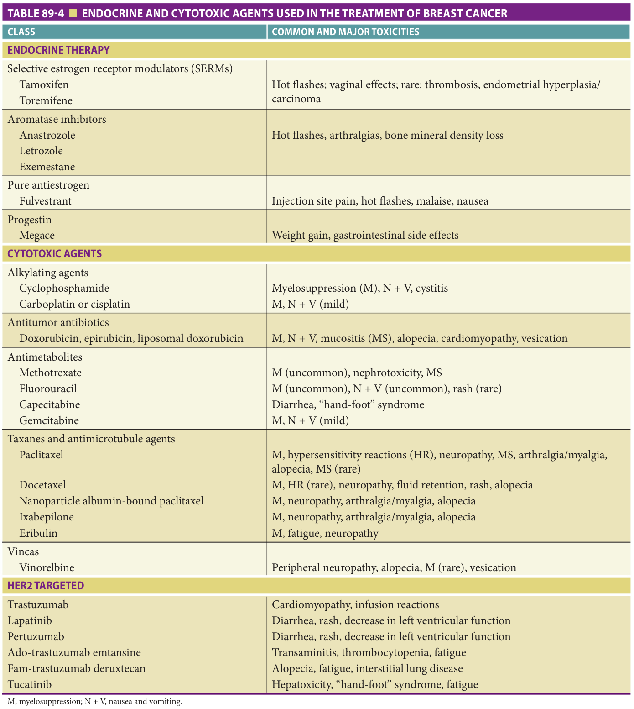

Study summary of Chapter 89 - Breast Disease; the book and the full chapter are the reference.

# Chapter 89 Study: Breast Disease

## What the exams asked

- **Bladder toxicity.** A 77-year-old receiving treatment for metastatic disease develops cystitis. Which drug explains it, and what adverse effects would suggest letrozole, megestrol or methotrexate? [June 2025 Q67](?chapter=89#exam-p1404-mcq-6b33c388396f05e09b68141c)
- **Cardiac toxicity.** Which breast cancer treatment can cause cardiomyopathy in an 82-year-old starting therapy? [June 2026 Basic Q145](?chapter=89#exam-p1404-mcq-550fdfd2885a7718c788d9b9)
- **Breast cancer risk.** Which increases risk among late menarche, multiple births, alcohol use and underweight? [September 2024 Q41](?chapter=89#exam-p1396-mcq-e761fdbaf9a3e692c91a5d37)
- **Routine mammography after 75.** How would you explain to an asymptomatic 84-year-old what screening can and cannot be expected to achieve? [2020 Q7, chapter-level reference](?chapter=89#asked-chapter)

## Treatment toxicities that distinguish the drugs

**Cystitis during cyclophosphamide treatment.** Cyclophosphamide is an alkylating agent. Exposure of the bladder lining to its metabolites can produce dysuria and hematuria, alongside separate risks of marrow suppression and nausea. In the 77-year-old with metastatic breast cancer, cystitis identifies the drug more specifically than fatigue or nausea would. Methotrexate can cause mucositis, renal injury and occasionally marrow suppression, which can lower the platelet count (p. 1404, Table 89-4).

**A fall in left ventricular function during trastuzumab treatment.** Trastuzumab targets HER2 and can cause cardiomyopathy or an infusion reaction. Check left ventricular function before treatment and at intervals during therapy. Paclitaxel more characteristically causes peripheral neuropathy, hypersensitivity reactions and marrow suppression. The characteristic hand-foot toxicity among the cytotoxic agents in this table belongs to capecitabine (p. 1404, Table 89-4). [Herceptin prescribing information, sections 2.1 and 5.1](https://dailymed.nlm.nih.gov/dailymed/drugInfo.cfm?setid=492dbdb2-077e-4064-bff3-372d6af0a7a2).

**Read the endocrine rows by drug class.** Letrozole, anastrozole and exemestane reduce estrogen synthesis. Hot flashes, arthralgia and bone mineral density loss matter particularly in someone who falls or has osteoporosis. Tamoxifen blocks estrogen action in breast tissue and carries thrombotic and endometrial risks. Megestrol can cause weight gain and gastrointestinal symptoms. These patterns separate endocrine treatment from the marrow and bladder toxicity of cyclophosphamide (pp. 1402–1404, Table 89-4).

## Who is at risk, and who benefits from screening?

**Alcohol increases risk.** The chapter names moderate-to-excessive intake. Early menarche and late menopause extend cumulative exposure to ovarian hormones. A first birth after 30 and obesity after menopause also increase risk. Multiple births are generally associated with lower long-term risk, although risk can rise temporarily after childbirth. A first-degree family history, prior atypical hyperplasia, dense breast tissue and exposure to substantial radiation can change the patient's baseline risk (pp. 1395–1396). [NCI, reproductive history and breast cancer risk](https://www.cancer.gov/about-cancer/causes-prevention/risk/hormones/reproductive-history-fact-sheet).

**Cancer remains common in later life.** Invasive ductal carcinoma is the commonest histology. Compared with younger women, older patients more often have well- or moderately differentiated, hormone-sensitive tumors. Later stage at presentation, undertreatment and competing illness can still make outcomes poor. A more favorable average receptor profile cannot answer an individual patient's question about survival (pp. 1395–1396).

**Counsel the 84-year-old about the outcome she cares about.** Randomized trials have not shown that population screening after age 75 reduces breast cancer deaths. Detecting a cancer is an immediate possibility, but a survival benefit may take years, and some screen-detected lesions would never have produced symptoms. Assess health apart from breast cancer, the patient's preferences and whether she would pursue diagnosis and treatment. The chapter suggests considering annual or biennial screening if estimated life expectancy is at least ten years and discussing the limited likely benefit when it is five to ten years. The USPSTF found the evidence insufficient at age 75 and older both in the guidance available in 2020 and in its 2024 update (pp. 1397–1398, Table 89-1). [2016 USPSTF recommendation](https://www.uspreventiveservicestaskforce.org/uspstf/recommendation/breast-cancer-screening-january-2016) · [2024 USPSTF recommendation](https://www.uspreventiveservicestaskforce.org/uspstf/recommendation/breast-cancer-screening).

**A new lump changes the question.** A new postmenopausal mass, peau d’orange, persistent skin change or suspicious axillary node calls for diagnostic assessment regardless of the routine screening interval. Mammography may miss a palpable cancer. Core biopsy can show invasion and provides tissue for receptor testing. Reassess a benign or inconclusive result that does not explain a suspicious lesion and obtain further tissue as indicated (pp. 1397–1398, Figure 89-3).

## Israeli context

בישראל, אישה בת 50 עד 74 בסיכון ממוצע זכאית לממוגרפיית סקר אחת לשנתיים במסגרת סל הבריאות דרך קופת החולים. בדוח התוכנית הלאומית מתואר גם מסלול שנתי מגיל 40 לנשים בסיכון מוגבר, כגון אישה שאמה או אחותה חלתה בסרטן השד. נשאיות של שינוי פתוגני בגן BRCA ותסמונות תורשתיות אחרות הוחרגו מהגדרת המסלול הזה. [משרד הבריאות, בדיקות תקופתיות בגיל השלישי, ממוגרפיה, 23.9.2026](https://me.health.gov.il/older-adult/services-rights/benefits-and-eligibilities/checkups/) · [המרכז הלאומי לבקרת מחלות, פרסום 437, עמ׳ 5, 10–11](https://www.gov.il/BlobFolder/reports/breast-cancer-2015-2021/he/files_publications_units_ICDC_breast_cancer-2015-2021.pdf#page=10).

בגיל 84 אפשר להסביר מהי קבוצת הגיל שאליה מופנה הסקר השגרתי, ולברר בנפרד את התועלת האפשרית לאישה שמבקשת להמשיך להיבדק. אם היא מתארת גוש חדש או ממצא חריג בשד, יש לפנות לבירור גם כאשר טרם הגיע מועד בדיקת הסקר. משרד הבריאות מציין במפורש את הצורך לפנות לרופא במקרה של ממצא חריג. [משרד הבריאות, בדיקות תקופתיות בגיל השלישי, ממוגרפיה, ״מתי בודקים״ ו״מי מממן״](https://me.health.gov.il/older-adult/services-rights/benefits-and-eligibilities/checkups/).

הדוח הישראלי מדגים את החשיבות של מעקב אחר ההפניה אחרי ממצא חשוד. בשנים 2020–2021, בקרב בנות 50 עד 74 שנכללו במדד, רק 42.1% התחילו בירור בתוך שבועיים, לעומת יעד של 90%. הממצא מתאר את הזמן עד תחילת הבירור באותן שנים. [המרכז הלאומי לבקרת מחלות, פרסום 437, מדד 6א, עמ׳ 27–28](https://www.gov.il/BlobFolder/reports/breast-cancer-2015-2021/he/files_publications_units_ICDC_breast_cancer-2015-2021.pdf#page=27).

## From biopsy to a local treatment decision

**Establish biology and extent separately.** ER and PR identify patients likely to respond to endocrine therapy. HER2 status determines eligibility for HER2-targeted treatment. Tumor size, nodal involvement and distant metastases determine anatomic stage. In asymptomatic stage I or II disease, extensive metastatic imaging usually adds little. Stage III or inflammatory disease, or bone pain, weight loss or other concerning symptoms, warrants a search for distant spread (p. 1399).

**In situ disease has two different implications.** DCIS remains within the ducts. Local treatment addresses the risk of subsequent invasive or recurrent disease. Breast conservation with irradiation is appropriate for many small lesions. Tamoxifen can reduce ipsilateral and contralateral events in hormone-sensitive DCIS, with no demonstrated survival advantage. Classic LCIS often appears incidentally and signals increased invasive cancer risk in either breast. Surveillance and discussion of risk-reducing treatment are usual (p. 1399).

**Breast conservation and axillary staging answer different questions.** A lumpectomy aims for clear margins while preserving the breast. Separate-quadrant lesions, diffuse suspicious calcifications or persistent involved margins may make this unsuitable. Neoadjuvant treatment sometimes enables conservation. Sentinel nodes provide prognostic information while limiting arm morbidity. The chapter allows omission of axillary assessment in selected women aged 70 or older with a clinically node-negative, ER-positive tumor no larger than 2 cm who will take endocrine therapy. Discuss reconstruction with older women who choose mastectomy (p. 1400).

**Omitting radiation buys fewer treatments at a cost in local control.** In selected older women with a small hormone receptor-positive, node-negative tumor taking adjuvant endocrine therapy, the chapter reports about 10 in-breast recurrences per 100 at ten years without radiation and about two to three with it, with similar overall survival. Larger tumors or involved nodes increase recurrence risk. After mastectomy, a tumor larger than 5 cm or at least four involved nodes is a usual indication for radiation in the chapter (p. 1400).

## Matching systemic treatment to the patient

**Estimate benefit and tolerance separately.** Stage, receptor profile and selected genomic assays help estimate the risk of recurrence and the possible benefit of adjuvant treatment. A geriatric assessment examines function, falls, cognition, mood, nutrition, comorbidities, medications and support. A patient with the same stage as her neighbor may need transport, a medication organizer or rehabilitation to complete treatment. G8 and VES-13 are brief screens. CARG-BC estimates chemotherapy toxicity in older adults with early breast cancer using regimen, tumor, laboratory and functional factors. ePrognosis estimates competing mortality (pp. 1401–1403, Tables 89-2 and 89-3).

**Aim for durable local control when cure is possible.** For fit patients with localized disease, surgery addresses the primary tumor and adjuvant systemic therapy addresses possible occult spread. Offer endocrine treatment for hormone-sensitive invasive disease when appropriate. In a frail patient with prohibitive operative risk, primary endocrine therapy can shrink a receptor-positive tumor, but local control may wane. Reassess response and discuss further local therapy if health and goals allow (pp. 1400–1403).

**Metastatic disease needs a systemic plan and a symptom plan.** For hormone receptor-positive, HER2-negative disease without a rapidly progressive or life-threatening presentation, start with an endocrine-based approach. HER2-positive disease also requires a HER2-directed treatment assessment. An aromatase inhibitor and a CDK4/6 inhibitor are one option, with drug-specific monitoring for cytopenias or diarrhea. A visceral crisis can require a faster response. Endocrine-resistant or triple-negative disease may require cytotoxic treatment. Sequential single agents can reduce toxicity in the palliative setting. A patient who declines chemotherapy may still choose endocrine treatment (pp. 1403–1404).

**Treat painful bone lesions and protect the skeleton.** Palliative radiation can relieve focal metastatic pain. Bisphosphonates or denosumab inhibit osteoclasts and reduce skeletal-related events such as fractures. Those interventions have different aims and can both be considered while systemic therapy is discussed (pp. 1403–1404).

## Survivorship, prevention and access

**Match follow-up to symptoms and life expectancy.** Table 89-5 schedules history and examination every three to six months in the first three years, every six to twelve months in years three to five and yearly thereafter. Mammography of remaining breast tissue looks for local disease or a new primary. Individualize continuation when life expectancy is limited. Symptoms direct further tests. Routine distant imaging, tumor markers and laboratory panels have not improved survival in asymptomatic survivors (p. 1405).

**Prevention is a separate decision from adjuvant treatment.** Risk-reducing endocrine drugs can lower incidence, but prevention trials did not show longer survival. Consider baseline risk, thrombotic or skeletal adverse effects, and time to benefit. The chapter reserves preventive medication for selected high-risk older people with an estimated life expectancy of at least ten years. A known inherited predisposition calls for individualized counseling (p. 1405).

**Breast cancer in men.** A persistent mass in a man warrants assessment. Disease is uncommon and often recognized later. Ask about family history and hereditary risk, including BRCA2. Stage and receptor testing guide treatment. Tamoxifen is the preferred adjuvant endocrine agent for men with hormone-sensitive disease. An aromatase inhibitor with gonadal suppression is a possible alternative when tamoxifen is contraindicated (pp. 1405–1406). [ASCO, Management of Male Breast Cancer, recommendations 1.1–1.2](https://doi.org/10.1200/JCO.19.03120).

**Bring care within reach.** For a person who cannot reliably get to the cancer center or communicate in the consultation language, involve navigation, social work and language services early. Consider palliative care at diagnosis of metastatic disease and early in symptomatic patients with potentially curable disease. Symptom relief, family support and discussion of goals can accompany active anticancer therapy (p. 1406).

## Summary

**Disease & initial assessment**
- Breast cancer incidence increases with age; US lifetime diagnosis risk is **12.8%** in the chapter's cited data (p1395).
- Older patients can benefit from endocrine therapy and chemotherapy as much as younger patients, but chemotherapy toxicity may be greater (p1395).
- Use geriatric assessment and estimated life expectancy apart from breast cancer to guide treatment choices (p1395).
- A new palpable breast mass after menopause needs prompt investigation and biopsy; mammography can characterize the mass and identify other lesions (p1397).
- After diagnosis, perform receptor testing and staging to define local and distant extent; stage and receptor status drive treatment (p1399).

**Local treatment**
- Breast conservation removes the tumor with clear margins, assesses axillary nodes when indicated and often includes radiotherapy; survival is comparable to more extensive surgery (p1400).
- Separate-quadrant tumors, diffuse suspicious calcifications, prior chest radiotherapy or persistently positive margins may preclude conservation (p1400).
- Large tumor-to-breast ratio, illustrated by a mass above **5 cm**, can compromise cosmesis; neoadjuvant treatment may make conservation possible in selected patients (p1400).
- After mastectomy, radiotherapy is generally recommended for tumors above **5 cm** or at least **4** positive nodes; the chapter also considers it reasonable with nodal involvement (p1400).

**Systemic treatment & supportive care**
- Endocrine-refractory or triple-negative disease generally leads to chemotherapy; life-threatening or rapidly progressive visceral disease may also require it initially (p1403).
- Do not withhold chemotherapy solely because of age; consider tumor extent, symptoms, expected benefit and toxicity (p1403).
- Prevention with estrogen-directed drugs can reduce breast-cancer occurrence, but the cited prevention trials did not show a survival advantage (p1405).
- The authors reserve preventive drug consideration for a few high-risk older patients with at least **10 years** estimated life expectancy (p1405).

**Exam traps**
- More favorable competing-risk estimates do not make breast cancer harmless; higher-risk tumors remain lethal for many older patients (p1395).
- Incorporate transport, family support, cost and access into treatment plans. Initiate palliative care early for almost all symptomatic patients (p1406).

## Exam-cited book images

Book images cited by past exams. Tap an image to zoom.

## Table 89-4 — book image

[2025-Jun Q67](?chapter=bank&q=mcq-6b33c388396f05e09b68141c)

[2026-Jun Basic Q145](?chapter=bank&q=mcq-550fdfd2885a7718c788d9b9)

## Exam questions

Four past-exam questions are linked to this chapter.

- [2024-Sep Q41](?chapter=bank&q=mcq-e761fdbaf9a3e692c91a5d37)
- [2025-Jun Q67](?chapter=bank&q=mcq-6b33c388396f05e09b68141c)
- [2020 Q7](?chapter=bank&q=mcq-754300e4e14e133ec8506c3d)
- [2026-Jun Basic Q145](?chapter=bank&q=mcq-550fdfd2885a7718c788d9b9)
