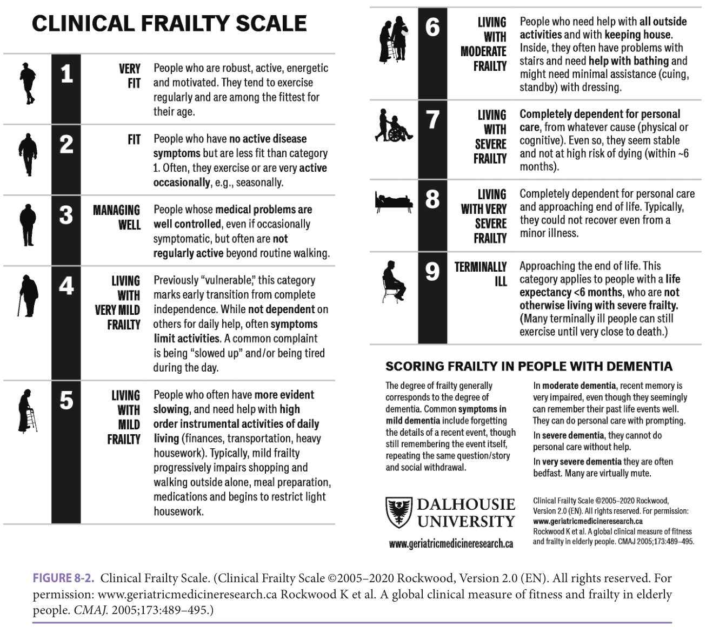

Study summary of Chapter 8 - Principles of Geriatric Assessment; the book and the full chapter are the reference.

# Chapter 8 Study: Principles of Geriatric Assessment

## What the exams asked

- Grade the function of a centenarian who uses a walker, can transfer independently and needs help bathing, dressing and leaving home. [June 2026 Q38 · Clinical Frailty Scale](?chapter=8#exam-p124-mcq-9f480bcc831187d54db7aa64) · [Earlier seven-level scale in Table 42-3](?chapter=42#exam-p621-mcq-9f480bcc831187d54db7aa64).
- Distinguish an office hearing screen from diagnostic audiometry, and distinguish a mammography modeling threshold from an individual screening decision. [September 2024 Q92 · hearing](?chapter=8#exam-p119-mcq-e8ffe5e4732e7d63293662ad) · [Mammography](?chapter=11#exam-p161-mcq-e8ffe5e4732e7d63293662ad) · [Colorectal tests](?chapter=11#ch11-q92-colorectal) · [Diabetes](?chapter=99#exam-mcq-e8ffe5e4732e7d63293662ad).
- Recognize the chair stand from crossed arms and a chair. [June 2023 Q50 · related chair-rise passage](?chapter=8#ch8-chair-stand). The examination cites the mobility-assessment video and supplies photograph 6.
- Decide what to assess after staging lung cancer in an older patient who fell and moved in with family. [June 2022 Q27 · chapter head](?chapter=8#asked-chapter) · [Current-edition oncology example](?chapter=8#ch8-oncology). The examination cites GRS Oncology.

## Frailty and the level of help a person needs

**Ask for the usual day before assigning a Clinical Frailty Scale score.** Someone who lives alone can still depend on another person for shopping, bathing or dressing. Conversely, a walker can make a transfer independent. Ask separately about outside activities, housekeeping, bathing and dressing. Age alone cannot assign the score. The current nine-level scale appears in Figure 8-2. The older seven-level scale summarized in Table 42-3 also describes level 6 as requiring help with both instrumental and basic activities. [Figure 8-2, p. 124](?chapter=8#exam-p124-mcq-9f480bcc831187d54db7aa64) · [Table 42-3, p. 621](?chapter=42#exam-p621-mcq-9f480bcc831187d54db7aa64).

- **Levels 1–4.** At 1, the person is robust and exercises regularly. At 2, the person is fit and may be active only occasionally. At 3, medical problems are controlled but regular activity may be limited to ordinary walking. At 4, symptoms slow or restrict activities while daily independence is preserved.
- **Levels 5–6.** At 5, help is needed with higher-order tasks such as finances, transportation or heavy housework. At 6, assistance extends to outside activities and housekeeping, commonly bathing and sometimes parts of dressing. The centenarian needs someone to go out with him and help wash and put on shoes. These details distinguish 6 from a slower independent person or someone needing instrumental help alone.
- **Levels 7–9.** At 7, the person depends on others for personal care but can be relatively stable. At 8, complete dependence accompanies approaching the end of life, with little capacity to recover from even a minor illness. Level 9 describes an expected survival under six months in someone **not otherwise living with severe frailty** (Figure 8-2, p124). Terminal illness and extreme functional dependence answer different questions. [Hazzard 8e, pp. 123–124](?chapter=8#exam-p124-mcq-9f480bcc831187d54db7aa64).

**How other instruments differ.** Reduced physiologic reserve increases vulnerability to falls, fractures, hospitalization and disability. The physical phenotype assesses weight loss, weakness, exhaustion, slow walking and low activity. Accumulated-deficit approaches consider a person's burden of health deficits. The VES-13 asks about age, perceived health, physical tasks and functional difficulties. Choose the measure to suit the decision. With early weakness or slower gait, investigate disease and address strength, activity and nutrition while the patient can still participate. [Tables 8-5 and 8-6, pp. 125–126](?chapter=8#p125).

## Hearing, vision and decisions about screening

**An office hearing screen can precede formal audiometry.** Ask whether hearing has become difficult. A positive answer warrants referral for audiologic evaluation. A whisper test or a handheld tone-emitting otoscope is another way to screen. In the whisper test, stand behind the patient, occlude the opposite ear and ask the patient to repeat the whispered material. Repeating fewer than half correctly is an abnormal result in this protocol. Addressing hearing loss matters because it affects conversation, social participation and the assessment of cognition. The chapter describes insufficient evidence for a universal asymptomatic screening recommendation. [Hearing assessment, p. 119](?chapter=8#exam-p119-mcq-e8ffe5e4732e7d63293662ad).

**Why the other parts of the screening question differ.** The book describes fasting glucose or A1C screening after age 65. For an older woman considering mammography, model-based cost-effectiveness at a life expectancy of at least 9.5 years is distinct from a recommendation for an individual. Discuss expected survival, burdens of a false positive and preferences around ten years. Colonoscopy is one colorectal screening method alongside stool testing and flexible sigmoidoscopy. A positive stool blood test requires diagnostic follow-up. [Breast and colorectal screening, p. 161](?chapter=11#exam-p161-mcq-e8ffe5e4732e7d63293662ad) · [Diabetes screening, p. 1561](?chapter=99#exam-mcq-e8ffe5e4732e7d63293662ad).

**Vision.** Measure corrected visual acuity with the patient's glasses. In the chapter's Snellen procedure, a patient standing 20 feet away fails if unable to read all the letters on the 20/40 line. An abnormal office result directs further assessment. Ask about the impact on reading, medicines, mobility and falls. [Hazzard 8e, pp. 118–119](?chapter=8#p119).

## Chair rise, walking and falls

**Look at what the patient actually does.** In the June 2023 photograph, arms are crossed in front of the chest and the chair is immediately behind the standing patient. A chair stand tests the ability to lift the body using the legs. Arms crossed prevent pushing off. A static balance test uses increasingly challenging foot positions. A gait-speed test times walking a measured distance. Timed Up and Go requires getting up, walking three metres, turning, returning and sitting. The chapter's text recommends further assessment when this sequence takes longer than 12 seconds. Table 8-3 on the same page reports test performance using a different cutpoint, **over 15 seconds**. [Related passage, p. 121](?chapter=8#ch8-chair-stand).

**From a fall to an intervention.** Ask whether a fall caused injury, whether two or more falls occurred within the year and whether gait or balance causes fear of falling. With a positive history assess gait, strength, standing blood pressure, vision, medicines, feet, footwear and the home. Chair stands, standing balance and gait speed together make up the Short Physical Performance Battery. Slowness identifies a need to examine the limiting step. It does not reveal the cause by itself. [Hazzard 8e, pp. 120–121, Table 8-3](?chapter=8#p121).

## From tumor staging to a geriatric care plan

**Tumor stage and ability to undergo treatment answer different questions.** The older man in June 2022 Q27 had fallen, been hospitalized and left his own home. Establish his previous and present function, cognition, mood, nutritional status, medication burden and support. Ask what outcomes he would accept. Findings can change the treatment choice or identify barriers that the team can address. Symptom treatment and family support can proceed alongside anticancer treatment. The chapter gives chemotherapy as an example of specialty adaptation. [Hazzard 8e, pp. 128–131](?chapter=8#ch8-oncology)

> Current practice (not the book): ASCO recommends geriatric assessment to identify vulnerabilities in older adults receiving systemic cancer therapy. [ASCO 2023 guideline](https://doi.org/10.1200/JCO.23.00933).

**How to use comprehensive geriatric assessment.** Select a patient whose needs can respond to an intervention. During the team discussion, identify problems that need action. Involve the patient and, where appropriate, a caregiver to set goals. Prioritize actions by expected benefit and urgency. A suspected delirium-provoking drug merits immediate review. Assign someone to carry out each recommendation and someone to monitor it. When progress stalls, ask which steps were feasible, reassess illness and motivation, revise the plan and follow the result. [Hazzard 8e, pp. 128–130](?chapter=8#ch8-plan).

**What the trials measured.** In geriatric inpatient units more patients were living at home and fewer entered nursing homes at three to twelve months. In eight randomized trials of joint hip-fracture care, fewer patients left hospital needing a higher care level than before the fracture. The lower inpatient mortality trend was statistically inconclusive. One posthospital trial reduced readmissions without a demonstrable improvement in functional decline, acute-care visits or depression at 24 weeks. Outpatient studies had inconsistent results. Preventive home visits that included an examination showed benefit for function in some groups. [Hazzard 8e, pp. 130–131](?chapter=8#ch8-hip-fracture).

## Function, mood and cognition at the visit

**Separate what a person can do from what another person does for them.** Ask who helps, with which part of the task and why. Bathing, dressing, toileting, continence, grooming, feeding and transferring are basic activities. Shopping, transportation, telephone use, meals, housework, laundry, managing medicines and finances are instrumental. Occupational, recreational and social roles are advanced activities. Giving up a valued role or finding a task increasingly difficult can precede outright dependence. Whenever possible combine a history from the patient and family with observed performance, especially during recovery from acute illness. [Hazzard 8e, pp. 118 and 123](?chapter=8#ch8-function).

**Cognition and mood give different clues to the same loss of function.** The chapter distinguishes uncertain benefit from universal cognitive screening from a clear reason to assess when a patient or informant describes change. A brief test changes the likelihood of dementia. Abnormal results warrant assessment of memory, language, executive and visuospatial function together with everyday function. Fluctuation and inattention in hospital invite assessment for delirium and comparison with baseline. For mood, ask about low mood and loss of pleasure over two weeks. Follow a positive PHQ-2 with a fuller assessment. Caregiver observations can help when the person cannot reliably describe mood. [Hazzard 8e, pp. 121–123](?chapter=8#ch8-cognitive).

**Nutrition, bladder and medications.** Compare current weight with a measured baseline. More than 4% loss in the preceding year prompts evaluation in the office. Look for barriers to obtaining or preparing food. In hospital, observe how much of a meal is eaten because inflammation and acute illness can lower albumin. Ask directly about urinary leakage. The 3IQ distinguishes stress, urge and mixed patterns in women through the circumstances of leakage. Reconcile prescription and nonprescription products. A symptom appearing after a new medicine should prompt evaluation of the drug before treating the symptom with another prescription. [Hazzard 8e, pp. 119–121](?chapter=8#ch8-bladder).

## Support, environment and goals

**Match the assessment to the setting.** Ask who is available now and during an illness, which tasks are covered, whether help is paid and whether the arrangement can last. Food insecurity or medication costs can look like self-neglect or poor adherence. A home visit can reveal hazards and whether shops, transport or other services are accessible. Nursing-home assessment emphasizes personal care and nutrition. Hospital assessment should compare function with pre-illness baseline and recheck it as recovery proceeds. [Hazzard 8e, pp. 118 and 124–126](?chapter=8#p124).

**Make the next visit actionable.** Ask about spiritual or personal priorities and a concrete goal such as bathing safely or returning to an activity. Discuss preferences for future care while the person can participate and revisit them as prognosis changes. Previsit information from patients and families and trained staff screening can free clinician time for follow-up. Video visits require equipment and adequate hearing, vision and cognition, sometimes with caregiver help. Arrange an in-person visit when a physical examination or subtle gait findings will determine management. [Hazzard 8e, pp. 126–128](?chapter=8#p127).

## Israeli context — הערכה גריאטרית בקהילה

**מתי ואיך מפנים.** נפילות חוזרות, ירידה חדשה בתפקוד שאין לה הסבר, ריבוי תרופות ואשפוזים חוזרים הם מצבים שבהם כדאי לשקול הערכה כוללנית. אפשר לקבל הפניה מרופאת המשפחה או מרופא המשפחה. השירות כלול בסל ובאחריות קופת החולים. לקראת הביקור מביאים סיכום רפואי ורשימת תרופות, תוצאות בדיקות עדכניות וסיכום הערכה קודמת אם יש. רצוי לצרף בן משפחה שמכיר את התפקוד ביום־יום. [משרד הבריאות, ״ייעוץ רפואי גריאטרי״, 18.12.2023, הסעיפים ״הערכה גריאטרית מקיפה״, ״איך להתכונן״ ו״המלצות״](https://me.health.gov.il/older-adult/keep-me-healthy/common-conditions/geriatric-consultation/).

**מה אמור לחזור לרופא המפנה.** הצוות בודק תפקוד, קוגניציה, מצב רוח, מצב חברתי וצרכים רפואיים וסיעודיים. לפי הצורך משלבים אנשי מקצוע נוספים או בודקים את סביבת הבית. הגריאטר מסכם את הממצאים ואת ההמלצות, משתף את המטופל ומשפחתו ומתאם עם הרופא הראשוני. המעקב כולל בירור אילו המלצות יושמו בפועל. [חוזר מנהל רפואה 12/2007, סעיפים 3.2, 4.3, 6–8.2](https://www.gov.il/BlobFolder/policy/mr12-2007/he/files_circulars_mr_mr12_2007.pdf) · [משרד הבריאות, ״מה כוללת ההערכה״ ו״המלצות ההערכה הגריאטרית המקיפה״](https://me.health.gov.il/older-adult/keep-me-healthy/common-conditions/geriatric-consultation/).

## Summary

**Scope of assessment**
- Extend disease-focused assessment to cognition, mood, function, frailty, social support, finances, environment, spirituality and care preferences (p117).
- Instruments support rather than replace clinical judgment. Individual clinician assessment and interdisciplinary comprehensive geriatric assessment (CGA) are related but distinct (p117).
- Tailor assessment to the setting: home visits reveal environmental risks; nursing-home assessment emphasizes nutrition and self-care rather than shopping or meal preparation (p118).

**High-yield screening**
- Weight loss above **4%** in the previous year prompts evaluation; obtain baseline height and weight and weigh patients at subsequent visits (p120).
- Observe walking and chair rise. Timed Up and Go uses a **3-m** walk; over **12 seconds** warrants further evaluation in the prose; Table 8-3 reports a **>15-second** test cutpoint (p121).
- Cognitive screens can alter the probability of dementia but do not diagnose it; normal results do not completely exclude it (p121).
- Ask about depressed mood and anhedonia over **2 weeks**; follow a positive brief screen with fuller assessment (p123).
- The chapter reports PHQ-9 above **10** with **88%** sensitivity and **88%** specificity; the chapter says caregivers can complete the Cornell scale in dementia and reports **93%** sensitivity and **97%** specificity at a Cornell score of at least **6** (p123).

  > Current practice (not the book): In the original Cornell instrument, the clinician rates symptoms using information from the patient and an informant. [Alexopoulos et al., 1988](https://pubmed.ncbi.nlm.nih.gov/3337862/).

**Function & support**
- Distinguish basic self-care, instrumental independent-living tasks and advanced activities; new functional change should prompt diagnostic evaluation (p123).
- Combine reported function with observed performance when useful. Function reflects disease in the context of environment and support (p123).
- Establish who helps with specific tasks, whether help is paid and who could assist during illness. Financial strain can present as nonadherence, weight loss or apparent neglect (p124).

**Management & exam traps**
- CGA includes physical health, function, psychological health and socioenvironmental factors (p128).
- Its essential sequence is targeting appropriate patients, assessment with recommendations, then implementation and adherence; assessment alone does not ensure benefit (p128).
- A positive screen is a starting point for clinical evaluation, not a substitute diagnosis or an automatic drug indication (p117, p121).

## Exam-cited book images

Book images cited by past exams. Tap an image to zoom.

## Figure 8-2 — book image

[June 2026 Q38](?chapter=bank&q=mcq-9f480bcc831187d54db7aa64)

## Exam questions

Two past-exam questions cite printed pages in Chapter 8.

- [September 2024 Q92](?chapter=bank&q=mcq-e8ffe5e4732e7d63293662ad)
- [June 2026 Q38](?chapter=bank&q=mcq-9f480bcc831187d54db7aa64)
