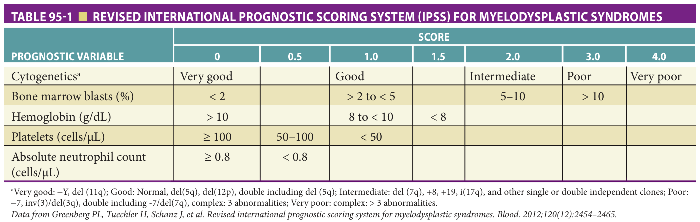

Study summary of Chapter 95; the book is the reference.

# Chapter 95 Study: Hematologic Malignancies and Plasma Cell Disorders

**Full chapter available: [Read Chapter 95](?chapter=95).**

Exam topics link to the marked chapter and the corresponding questions.

## What the exams asked

- Which findings predict survival in MDS, and which absolute neutrophil count adds points to IPSS-R? [June 2026 Q99](?chapter=95#exam-p1485-mcq-c0958b48b6b8fb43106b759b) · [May 2024 Q12](?chapter=95#exam-p1485-mcq-834756aabc08598d8f45a7f5).
- Which test can detect light-chain myeloma when electrophoresis shows no spike? [June 2025 Basic Q133](?chapter=95#exam-p1501-mcq-39946414e0773be4fb99f910).
- How does an incidental IgG monoclonal protein meet the criteria for MGUS? [June 2023 Q18](?chapter=95#exam-p1502-mcq-bd9893fe8c4027b4668a863e).
- Which immune complication causes anemia in CLL, and what do you do with incidental asymptomatic lymphocytosis? [May 2024 Q85](?chapter=95#exam-p1492-mcq-d7ef5d7a467c8ade6436f4f5) · [2020 Q43](?chapter=95#asked-chapter) · [Read the CLL blood-film findings](?chapter=95#ch95-cll-film).
- Which translocation is characteristic of Burkitt lymphoma? [June 2023 Basic Q124](?chapter=95#exam-p1494-mcq-356253b1a4c51ce96b4853a6).
- Which therapy reduces skeletal complications after a myeloma-related vertebral fracture? [December 2021 Q23](?chapter=95#asked-chapter) · [Read about preventing skeletal events](?chapter=95#ch95-bone-protection).

## MDS prognosis and treatment

**Two patients with similar marrow findings may have different outcomes.** MDS causes ineffective blood production and can progress to AML. Marrow blasts and cytogenetic abnormalities help estimate the risk posed by the clone. The Clinical Frailty Scale adds information about overall survival. Among older adults treated nonintensively for MDS or AML, needing help with basic activities of daily living was independently associated with shorter survival. Splenic enlargement is the exception in June 2026 Q99. Separate these patient-level predictors from the variables that actually earn points in the marrow score (pp. 1483–1485, Tables 95-1 and 95-3).

**Original IPSS and revised IPSS-R.** The original score uses cytogenetic risk, marrow blast percentage and the number of cytopenic lineages. The revision weights cytogenetics and blast burden differently and scores hemoglobin, platelets and absolute neutrophils separately. An absolute neutrophil count below **800 per microliter** contributes half a point. This is 0.8 billion per liter. The printed book table omits the thousands multiplier on the neutrophil unit. Age can inform survival estimates, but age over 75, B symptoms and an LDH cutoff are not core scoring variables (pp. 1484–1485, Tables 95-1 and 95-2). [Original IPSS-R scoring table](https://doi.org/10.1182/blood-2012-03-420489).

**From falling counts to treatment.** Progressive macrocytosis followed by a second cytopenia suggests MDS. Check the smear, reticulocytes, B12, folate and iron studies, and consider copper deficiency and medicines. Marrow examination and cytogenetics establish the diagnosis. Lower-risk disease often needs transfusion support. Low serum erythropoietin and a low transfusion burden predict greater benefit from erythropoiesis-stimulating treatment. Isolated del(5q) with transfusion dependence points to lenalidomide. Higher-risk patients may benefit from a hypomethylating agent despite early myelosuppression. Frailty, goals and competing illness affect whether prolonged treatment or transplantation is feasible (pp. 1484–1486).

## An M-protein, or no M-spike

**Negative electrophoresis with anemia and hypercalcemia.** Routine serum electrophoresis can miss a clone that produces free light chains without a large intact immunoglobulin. Measure serum free kappa and lambda and examine the ratio. Reduced renal clearance can increase both concentrations. A marked excess of one chain favors a clone. Serum immunofixation is more sensitive than routine electrophoresis and helps characterize a monoclonal protein. The total grams of urinary protein alone cannot identify it. A low total serum protein in June 2025 Basic Q133 does not end the work-up (pp. 1501, 1504).

**A monoclonal protein without symptoms.** Non-IgM MGUS requires serum M-protein below **30 g/L**, fewer than **10%** clonal marrow plasma cells, and no attributable organ damage or amyloidosis. A small peak alone cannot classify the disorder. June 2023 Q18 supplies only the serum threshold among the choices. Ask whether anemia, renal impairment, hypercalcemia or lytic lesions are caused by the clone. Stable diabetic nephropathy can coexist with MGUS. For non-IgM MGUS, progression occurs at about 1% per year on average. IgM MGUS more often precedes Waldenström macroglobulinemia or amyloidosis (pp. 1502–1503, Table 95-14).

**When observation changes.** Table 95-14 prints **10%–60%** clonal marrow plasma cells for smoldering myeloma with no attributable end-organ damage, and **>60%** for myeloma when CRAB criteria are absent. Hazzard describes close surveillance of smoldering disease and early-treatment trials (pp1502–1504).
> Current practice (not the book): IMWG uses **≥60%** clonal marrow plasma cells as a myeloma-defining event. Additional SLiM biomarkers are the involved/uninvolved free light-chain ratio ≥100 with involved light chain ≥100 mg/L, or >1 MRI focal lesion of ≥5 mm. In 2025 FDA approved subcutaneous daratumumab with hyaluronidase for adults with high-risk smoldering myeloma. [IMWG diagnostic criteria](https://www.myeloma.org/international-myeloma-working-group-imwg-criteria-diagnosis-multiple-myeloma) · [FDA approval, 2025](https://www.fda.gov/drugs/cancer-approvals/fda-approves-daratumumab-and-hyaluronidase-fihj-high-risk-smoldering-multiple-myeloma).

**Fracture prevention during treatment.** A vertebral fracture and lytic lesions justify a bone-modifying agent even with normal serum calcium. Intravenous pamidronate is the option in December 2021 Q23. Assess renal function and dental risks. Hazzard lists zoledronic acid and pamidronate and describes denosumab use when renal impairment contraindicates a bisphosphonate. Calcium and vitamin D alone cannot prevent skeletal complications (p1505).
> Current practice (not the book): ASCO also supports denosumab to prevent skeletal events in myeloma and notes its renal safety advantage in selected patients. The oncology regimen differs from the Prolia regimen named in the distractor. [ASCO bone-modifying agents guideline](https://doi.org/10.1200/JCO.2017.76.6402).

## CLL at presentation and during follow-up

**Start with the cells and the patient.** An otherwise well older patient may have marked lymphocytosis with normal hemoglobin and platelets. The smear in 2020 Q43 shows small mature lymphocytes and a smudge cell. Confirm the characteristic clonal B-cell population by peripheral-blood flow cytometry and arrange follow-up. The low neutrophil percentage in that vignette corresponds to an adequate absolute neutrophil count. A high count of mature lymphocytes alone rarely causes leukostasis. Follow the trajectory of the count, symptoms, lymph nodes, spleen and other blood cell lines when deciding whether treatment is indicated (pp. 1490–1491).

**Why an established CLL patient becomes anemic.** Marrow infiltration can reduce production, while CLL-associated immune dysregulation may cause red-cell destruction. Order reticulocytes and a direct antiglobulin test. A compensatory reticulocyte response plus biochemical evidence of hemolysis supports destruction. IgG, complement or both on the red cells supports an immune mechanism. In May 2024 Q85, Coombs-positive hemolytic anemia is the characteristic association. Before attributing new anemia to progressive CLL, also consider bleeding, nutritional deficiency and other causes (p1492).

**Treatment and infection risk.** When CLL is active, consider TP53 status, comorbidities and fitness in selecting a targeted regimen. Examples in the chapter include BTK inhibitors and venetoclax with an anti-CD20 antibody. BTK inhibitors can increase bleeding and atrial fibrillation risk. Review antiplatelet and anticoagulant indications. Recurrent infection is a major complication of CLL, and vaccination early in the disease course gives the immune system a better opportunity to respond (pp. 1491–1492).

## Lymphoma genetics, diagnosis and treatment

**What the translocation tells you.** In Burkitt lymphoma, t(8;14) places MYC on chromosome 8 under immunoglobulin heavy-chain regulatory control on chromosome 14. In CML the characteristic fusion is BCR::ABL1. The exam credits the Burkitt pairing, also shown in Table 95-9 (p1494).
> Current practice (not the book): The ICC classifies BCR::ABL1-positive B-cell ALL. Some myelomas acquire secondary MYC rearrangements, which explains the ambiguity in a question asking about any association. [International Consensus Classification, Table 27](https://doi.org/10.1182/blood.2022015850) · [MYC rearrangements in myeloma](https://doi.org/10.3324/haematol.2019.217927).

**Tissue and tempo.** A rapidly enlarging mass, fever, drenching sweats or unexplained weight loss suggests aggressive disease. Indolent lymphoma may present as incidental persistent adenopathy. Obtain enough tissue to assess architecture, immunophenotype and relevant genetic changes. Fine-needle aspiration may suggest lymphoma but **is not adequate for identifying lymphoma subtype** (p1494). PET-CT helps stage FDG-avid lymphomas and can direct biopsy of a site suspicious for transformation. Interpret prognostic scores alongside function, comorbidity and the patient's priorities (pp. 1492–1497).

**What treatment is trying to achieve.** DLBCL is potentially curable. The book describes anthracycline-based chemoimmunotherapy for fit patients and attenuated R-mini-CHOP for selected very old adults. Assess cardiac function, infection risk and supports before treatment. In follicular lymphoma, localized disease may be controlled with radiation, while an asymptomatic patient with low-burden advanced disease may initially be observed. New rapid growth warrants assessment for transformation. Hodgkin lymphoma is also potentially curable, but bleomycin lung toxicity and comorbidity can limit treatment in older adults (pp. 1497–1501).

## Acute and chronic myeloid leukemia

**AML is an urgent marrow-failure syndrome.** Suspect it in new cytopenias, circulating blasts, infection or bleeding. Marrow morphology, immunophenotype, cytogenetics and molecular findings guide classification and treatment. Check baseline cognition, function and comorbidities before selecting intensive induction or a less intensive regimen such as azacitidine with venetoclax. Discuss infection and cytopenia risks with either path. Acute promyelocytic leukemia is a special emergency because disseminated coagulopathy can cause early fatal bleeding: begin all-trans retinoic acid on suspicion while pursuing confirmation (pp. 1486–1489).

**CML is a different kinase-driven disorder.** Persistent granulocytosis with left shift, basophilia or splenomegaly prompts testing for the Philadelphia chromosome or BCR::ABL1. A tyrosine kinase inhibitor can control chronic-phase disease for years. Review cardiac, vascular and other comorbidities when choosing an agent. Daily adherence and serial molecular measurements distinguish a durable response from loss of control (pp. 1489–1490).

## Active myeloma and related disorders

**Match treatment to reserve and organ function.** Active myeloma usually requires systemic therapy. Assess the marrow clone, cytogenetics, renal function, bone disease and capacity to tolerate combination treatment. The book’s revised staging system combines albumin, beta-2 microglobulin, LDH and high-risk cytogenetics. Lenalidomide dosing depends on renal function, and thrombosis and cytopenias are important toxicities. Weekly subcutaneous bortezomib is better tolerated than the older twice-weekly intravenous schedule. Review neuropathy and antiviral prophylaxis. A fit older adult may be eligible for autologous transplantation, while frailty may favor fewer agents or lower doses. New weakness with back pain raises concern for spinal cord compression (pp. 1504–1506).

**A focal mass and a systemic protein disorder need different investigations.** Biopsy a suspected solitary plasmacytoma and examine marrow and imaging for disease elsewhere. Local radiation can be curative, with follow-up for progression to myeloma. In AL amyloidosis a small clone produces pathogenic light chains. Proteinuria, cardiomyopathy, neuropathy, macroglossia or periorbital purpura can provide clues. Confirm amyloid in tissue and type the deposit because a coincidental monoclonal protein can accompany a different amyloid. Cardiac involvement strongly affects prognosis, and treatment targets the plasma-cell clone (p1506).

## Israeli context

**מהפניה לבירור המטולוגי.** באיכילוב רופא המשפחה או מחלקת האשפוז יכולים להפנות מטופל חדש למרפאה ההמטולוגית. לאחר תשאול ובדיקה גופנית הצוות בוחר בדיקות לפי השאלה הקלינית. במעבדה הצמודה אפשר לבצע משטח דם ואפיון תאים ב־FACS לצורך אבחון לוקמיה, וכן בדיקות של חלבוני הנסיוב לאבחון מיאלומה ולמעקב אחריה. [איכילוב, ״יחידות ומרפאות המטולוגיה״, הסעיף ״על הטיפול והצוות״](https://www.tasmc.org.il/unit-index-page/internalmed/hematology/ambulatory/).

**לימפומה ומיאלומה בגיל המבוגר.** באיכילוב פועלת מרפאה משותפת להמטולוגיה ולגריאטריה המיועדת למטופלים מבוגרים עם לימפומה או מיאלומה. ההערכה מתייחסת למחלות הרקע, לתרופות הקבועות, לתפקוד ולקוגניציה, וכן לקשיים חברתיים וכלכליים. המידע מסייע לצוות לבחור טיפול המתאים למטופל ולתכנן תמיכה במהלך הטיפול. [איכילוב, ״יחידות ומרפאות המטולוגיה״, הסעיף ״המטולוגיה לגיל המבוגר״](https://www.tasmc.org.il/unit-index-page/internalmed/hematology/ambulatory/).

## Summary

### Definition & diagnosis

- MDS: clonal ineffective hematopoiesis with cytopenias; it may remain indolent or progress to marrow failure/AML. Older patients' outcomes reflect both disease biology and fitness. (p. 1483)

- Suspect MDS with progressive macrocytic anemia/cytopenias; exclude mimics and confirm with marrow biopsy plus cytogenetics. (p. 1484)

- CLL: peripheral-blood flow cytometry establishes the characteristic clonal population; marrow studies are usually unnecessary for diagnosis. (p. 1490)
- Lymphoma requires tissue for classification; fine-needle aspiration is inadequate for subtype determination. (p. 1494)
- Non-IgM MGUS: monoclonal protein **<30 g/L**, marrow plasma cells **<10%**, without related end-organ damage; assess calcium, renal function, anemia and bone lesions. (p. 1503)

### Management

- MDS treatment is risk-adapted; supportive care is central for lower-risk/frail patients. Erythropoietin response is likelier with lower-risk disease, low transfusion burden and serum erythropoietin **<500 mU/mL**. (p. 1485)

- CLL leukocytosis alone does not require therapy; symptoms/progressive cytopenias, molecular risk and fitness guide treatment. (p. 1491)
- MGUS is monitored, and smoldering myeloma warrants closer surveillance and assessment of whether its progression risk supports early treatment. (p. 1503)

### Drugs & cautions
- Azacitidine/decitabine: myelosuppression may worsen for months before response; azacitidine has survival evidence, whereas decitabine lacks definitive randomized survival benefit. (p. 1485)
- BTK inhibitors for CLL: bleeding/anticoagulant caution and cardiovascular toxicity, including atrial fibrillation. (p. 1491)
- Myeloma trial: dexamethasone **40 mg orally weekly** with lenalidomide had better overall survival than the high-dose schedule despite lower response; high-dose toxicity included thrombosis and infections. (p. 1504)
- Lenalidomide needs renal dose adjustment; bortezomib does not. Weekly subcutaneous bortezomib is better tolerated than the older twice-weekly intravenous schedule; neuropathy and zoster matter. (p. 1505)

### Exam traps
- Anemia or renal dysfunction from another established cause does not itself fulfill myeloma-related organ damage. (p. 1503)
- Bone scans are generally negative in myeloma because lesions are purely lytic. (p. 1504)

## Recall

**3. Which patients with MDS are more likely to benefit from erythropoietin?**

Answer
Those with lower-risk scores, serum erythropoietin <strong>&lt;500 mU/mL</strong>, low transfusion requirements and a shorter interval from diagnosis to treatment. (p. 1485)

**5. What is the lenalidomide-responsive cytogenetic MDS subset, and what cautions matter?**

Answer
Transfusion-dependent disease with deletion of the long arm of chromosome <strong>5</strong> as the sole abnormality; watch myelosuppression and adjust dosing for renal impairment. (p. 1486)

**7. What is critical for successful oral TKI treatment of CML?**

Answer
Daily adherence and careful response monitoring; PCR provides sensitive monitoring, and comorbid cardiac/thrombotic risks inform drug selection. (p. 1490)

**10. What BTK-inhibitor risks matter in an anticoagulated patient with CLL?**

Answer
Increased bleeding risk, plus cardiovascular toxicities such as atrial fibrillation, heart failure and hypertension. (p. 1491)

**11. How should new anemia in CLL be evaluated for hemolysis?**

Answer
Reticulocyte count and direct Coombs testing help distinguish hemolysis from decreased marrow production. (p. 1492)

**13. What are the protein and marrow thresholds for non-IgM MGUS?**

Answer
Serum monoclonal protein <strong>&lt;30 g/L</strong> and marrow plasma cells <strong>&lt;10%</strong>, without related end-organ damage or amyloidosis. (p. 1503)

**15. How do renal dosing requirements differ for lenalidomide and bortezomib?**

Answer
Lenalidomide requires dose adjustment for renal insufficiency; bortezomib does not. (p. 1505)

## Past-paper questions on this chapter

- [2023-Jun Q18 — mcq-bd9893fe8c4027b4668a863e](?chapter=bank&q=mcq-bd9893fe8c4027b4668a863e)
- [2024-May Q12 — mcq-834756aabc08598d8f45a7f5](?chapter=bank&q=mcq-834756aabc08598d8f45a7f5)
- [2024-May Q85 — mcq-d7ef5d7a467c8ade6436f4f5](?chapter=bank&q=mcq-d7ef5d7a467c8ade6436f4f5)
- [2026-Jun Q99 — mcq-c0958b48b6b8fb43106b759b](?chapter=bank&q=mcq-c0958b48b6b8fb43106b759b)

## Table 95-1 — book image

[2024-May Q12](?chapter=bank&q=mcq-834756aabc08598d8f45a7f5)
