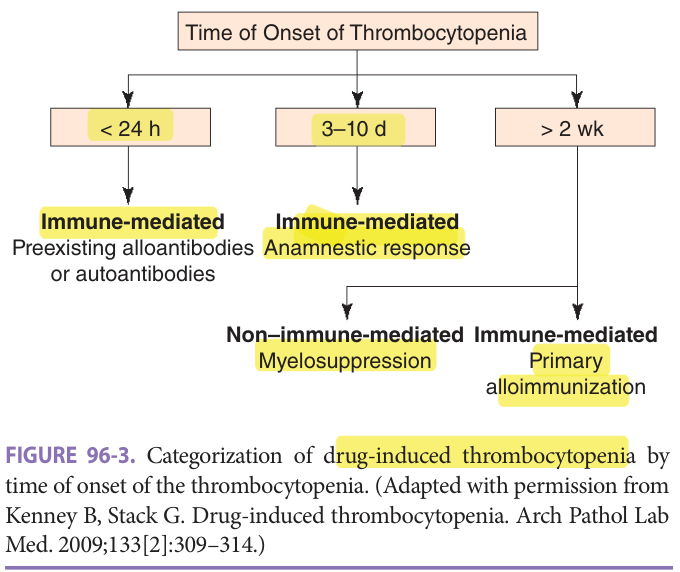

Study summary of Chapter 96; the book and the full chapter are the reference.

# Chapter 96 Study: Coagulation Disorders

## Summary

**Hemostasis & risk**
- Hemostasis progresses from platelet plug formation through coagulation, endogenous anticoagulant regulation and fibrinolysis (p1509–1510).
- Aging increases both bleeding and venous thrombosis risk. Acquired disorders and platelet number/function abnormalities are important causes of bleeding (p1509–1510).
- Annual VTE incidence is approximately **2–3 per 1000** overall and **7 per 1000** after **70** (p1515).

**Prolonged PT or aPTT (Table 96-2)**
- PT tests the extrinsic and common pathways and is the most sensitive test for factor VII deficiency; aPTT tests the intrinsic and common pathways and detects deficiencies of, or inhibitors to, factors II, V, VIII, IX, X, XI and XII (p1512).
- **Normal PT, prolonged aPTT**: lupus anticoagulant; factor VIII, IX, XI or XII deficiency; von Willebrand disease; heparin exposure. Subcutaneous heparin prophylaxis is the most common cause in hospitalized patients. Factor XI deficiency (hemophilia C) has a more variable bleeding history, often following surgical procedures. The lupus anticoagulant causes thrombosis rather than bleeding (p1512–1513).
- **Prolonged PT, normal aPTT**: VKA use, dietary vitamin K deficiency, factor VII deficiency, early liver disease, early DIC, high-dose heparin. **Both prolonged**: supratherapeutic anticoagulation, concomitant heparin and VKA, end-stage liver disease, DIC, systemic fibrinolysis, rodenticide poisoning (Table 96-2, p1513).
- Acquired hemophilia A (autoantibodies against factor VIII) is predominantly a disease of older adults, median age **64–78**; up to **50%** have no identifiable cause. Acute subcutaneous, gastrointestinal or muscle bleeding without trauma or a prior bleeding history should prompt evaluation; mortality exceeds **20%** if diagnosis is delayed (p1512).

**Thrombocytopenia (Table 96-3, Figure 96-3)**
- Causes in older adults: decreased production (B12 or folate deficiency, myelodysplastic syndrome, marrow failure or infiltration, medications, alcohol, infection), increased destruction (immune thrombocytopenia, SLE, antiphospholipid syndrome, HIT, drug-induced thrombocytopenia, infection, DIC, mechanical prosthetic valve, TTP), sequestration or other (chronic liver disease, hypersplenism, spurious, dilutional) (Table 96-3, p1513).
- ITP is isolated thrombocytopenia below **100 × 10^9/L**; incidence **2 to 5 per 100,000**, increasing with age. Petechiae, purpura and epistaxis usually appear below **30 × 10^9/L** (p1514).
- Drug-induced thrombocytopenia is the most common cause of thrombocytopenia in older adults and is usually evident within the first week of the causative drug. Figure 96-3 sorts it by onset: **<24 h**, immune-mediated by preexisting antibodies; **3–10 days**, immune-mediated anamnestic response; **>2 weeks**, nonimmune myelosuppression or immune-mediated primary alloimmunization. Table 96-4 lists trimethoprim/sulfamethoxazole among definite or probable causes (p1514).
- HIT: antibodies to platelet factor 4 increase platelet activation and consumption and raise the risk of both arterial and venous thrombosis; use validated tools such as the 4T score with serologic or functional testing (p1514–1515).

**Thrombosis risk (p1516)**
- Virchow triad: endothelial injury, impaired flow (stasis) and hypercoagulability. Factor V Leiden is the most common inherited thrombophilia, prevalence **5%** in unselected White populations, with a **three- to fivefold** VTE risk; prothrombin G20210A gives about a **threefold** risk (p1516).
- Acquired thrombophilias in older adults include antiphospholipid syndrome, HIT, hormone replacement therapy, myeloproliferative neoplasms and malignancy. Antiphospholipid syndrome needs persistent antiphospholipid antibodies with arterial or venous thrombosis or pregnancy complications; antibodies can also cause thrombocytopenia. Repeat an initial positive test after at least **12 weeks**; routine screening is not recommended (p1516).
- Malignancy carries a **four- to sevenfold** VTE risk, up to **20%** of all VTEs. Some anticancer therapies are prothrombotic (eg, lenalidomide, cisplatin, L-asparaginase). Polycythemia vera and essential thrombocythemia, especially with JAK2 V617F, are associated with arterial, venous and splanchnic thrombosis (p1516).

**Diagnosis**
- Clinical findings alone do not establish DVT: combine pretest probability, laboratory testing and imaging. Wells is the best-validated and most-used DVT prediction model (p1517).
- D-dimer also rises with age, infection, inflammation, cancer and surgery; false positives reduce specificity in older adults (p1517).
- PE may present nonspecifically with dyspnea, tachypnea, tachycardia or chest pain. Symptoms help estimate probability but cannot confirm the diagnosis (p1518).
- CTPA is the primary imaging test for suspected PE unless contraindicated, including severe renal insufficiency or contrast allergy (p1519).

**Management & drugs**
- For newly diagnosed primary ITP within **3 months**, platelets below **30 × 10^9/L** and no or minor mucocutaneous bleeding: prednisone **0.5–2.0 mg/kg/day** or dexamethasone **40 mg/day for 4 days** (p1514).
- With corticosteroids, monitor particularly for hypertension/hyperglycemia and insomnia, depression, gastric irritation, myopathy or osteoporosis (p1514).
- Anticoagulants reduce VTE recurrence and mortality; choose treatment and duration by balancing recurrence against bleeding risk (p1515).
- Warfarin requires parenteral anticoagulant overlap for at least **5 days** and until INR is above **2.0** for at least **24 hours**; therapeutic INR is **2.0–3.0** (p1520).
- Warfarin requires close INR monitoring because older adults may be more sensitive and have more food/drug interactions. DOACs are effective in carefully selected older adults (p1509, p1520).

### Working from the presentation to the test

- After excessive bleeding at an operation, ask about dental extraction, previous operations and spontaneous bruising. An isolated prolonged aPTT with a normal PT and platelet count changes the differential. In factor XI deficiency the history can be quiet until a hemostatic challenge. Vitamin K deficiency more often prolongs PT, while advanced DIC can prolong both tests (p1512–1513).
- A sudden low platelet count after starting trimethoprim/sulfamethoxazole fits drug-induced thrombocytopenia. A fall at **3–10 days** points to an anamnestic immune response in Figure 96-3. This differs from platelet activation in HIT, where a falling count can herald an arterial or venous clot (p1514–1515).
- Recurrent ischemic events with otherwise unexplained thrombocytopenia warrant considering antiphospholipid syndrome. Look for persistent antibodies in the appropriate clinical setting. Thrombocytopenia may accompany the syndrome even though thrombosis is its characteristic vascular complication (p1516).
- For suspected PE in an outpatient aged **50 years** or older with a suitable pretest probability, the book describes an age-adjusted D-dimer cutoff of **age × 10 µg/L** for assays with a conventional **500 µg/L** cutoff. A positive value is nonspecific. V/Q scanning can help when severe renal insufficiency or contrast allergy limits CTPA (p1519).
- Before and during anticoagulation, review kidney and liver function, platelet count, concomitant NSAIDs or antiplatelet drugs, and the patient's ability to take treatment reliably. Correctable risks include uncontrolled hypertension and unnecessary dual antithrombotic exposure (p1521–1522).

### A platelet plug, a fibrin mesh and the tests that sample them

Figure 96-1 starts with exposed subendothelium. Collagen and other exposed structures activate platelets. Platelet glycoprotein Ib-alpha binds von Willebrand factor and mediates adhesion. Glycoprotein IIb/IIIa binds fibrinogen and helps platelets aggregate. In the second panel, monocytes and other cells are incorporated and fibrin strands reinforce the plug. This sequence explains why petechiae and nose or gum bleeding suggest a platelet or vessel problem, while a palpable soft-tissue hematoma or prolonged bleeding at surgery raises suspicion for a coagulation defect. Neither presentation by itself establishes the diagnosis (p1509–1511).

Figure 96-2 can be read two ways. For interpreting PT and aPTT, trace the extrinsic tissue factor–VIIa route or the intrinsic XII–XI–IX route to factor X. With activated factor V, Xa supports conversion of prothrombin to thrombin. Thrombin generates fibrin from fibrinogen, and XIIIa stabilizes the mesh by crosslinking it. For understanding what happens in the vessel, follow Table 96-1. Initiation at tissue-factor-bearing surfaces produces the first small amount of thrombin. During amplification that thrombin activates platelets and factors V, VIII and XI. Propagation on the activated platelet brings tenase and prothrombinase together, producing the burst of thrombin needed for a stable plug. During termination, antithrombin, tissue factor pathway inhibitor and proteins C and S restrict clotting to the injured area. Plasmin subsequently breaks down fibrin. D-dimer is a product of breakdown of crosslinked fibrin, which explains why it signals turnover but does not locate a clot (p1509–1512, p1517).

Aging affects several parts of this system simultaneously. In healthy subjects fibrinogen rises by approximately **10 mg/dL per decade** and von Willebrand factor by about **10% to 20% per decade**. More plasminogen activator inhibitor limits fibrinolysis, while higher plasmin-antiplasmin complexes and D-dimer also provide evidence of increased fibrin turnover. The net clinical question still depends on the patient. An older adult taking several antiplatelet agents may bleed despite having risk factors for venous thrombosis (p1510–1511, p1515).

### Bleeding after a challenge or bleeding without one

Construct a timeline before interpreting a long clotting time. Ask about operations and tooth extractions, whether bleeding was immediate or prolonged, past transfusion or iron deficiency, heavy menses or postpartum bleeding, and relatives with a similar history. An inherited defect may first become clinically apparent late in life if the patient has rarely faced a hemostatic challenge. A patient who previously tolerated surgery but now has extensive spontaneous bruising needs a different investigation. Record prescribed medicines, herbal and over-the-counter agents explicitly. A recent change in diet also matters when considering vitamin K deficiency (p1511–1512).

June 2023 Q46 illustrates the first pattern. After prostate surgery the patient has prolonged urinary bleeding. Previous dental extraction had also caused bleeding, but spontaneous events were absent. PT and platelet count are normal and aPTT is prolonged. Locate that combination in Table 96-2 before choosing among diagnoses. Factor XI deficiency can give this variable, procedure-associated presentation. A vitamin K antagonist or isolated factor VII deficiency better explains a long PT. A lupus anticoagulant can lengthen aPTT, but the history would more typically point to thrombosis. In a hospital patient also review heparin exposure before pursuing a rare deficiency. The test pattern narrows the possibilities; the history ranks them (p1512–1513).

By contrast, spontaneous new subcutaneous, gastrointestinal or muscular bleeding in an older person without a personal or family history can signal an acquired factor VIII inhibitor. The disorder can accompany another illness or appear without an identifiable cause. Delayed recognition can be fatal. Check hemoglobin, platelet count, PT and aPTT first, then pursue factor or inhibitor testing with hematology when indicated. A normal platelet count does not guarantee normal platelet function. Aspirin, clopidogrel, ticagrelor, dipyridamole and cilostazol may impair hemostasis; nonsteroidals and some other commonly prescribed drugs also affect platelets. Kidney and liver disease can impair function even in the absence of an absolute platelet deficiency (p1511–1512, p1515).

### A falling count: establish that it is real, then explain the mechanism

Read Table 96-3 by asking where platelets went. An additional cytopenia, a history of heavy alcohol intake or clues to folate or B12 deficiency point toward impaired production. Myelodysplasia and marrow infiltration deserve attention in an older adult. Infection can suppress production or accelerate immune clearance. A mechanical valve, disseminated intravascular coagulation and thrombotic microangiopathy belong on the consumption side. Hypersplenism and liver disease may sequester platelets; recent massive transfusion or fluid resuscitation can dilute them. When a low laboratory value is unexpected, inspect the smear for clumps. EDTA-dependent clumping in the specimen can yield a false low count; repeat sampling in citrate can resolve the discrepancy (p1513–1515).

Primary ITP is a diagnosis of exclusion. The count may be very low in a patient with surprisingly little bleeding. Review the CBC, reticulocytes, metabolic profile and peripheral smear, and assess for secondary causes, including HIV and hepatitis C. The smear may show occasional large platelets. A marrow examination is more relevant when other unexplained cytopenias accompany the low platelet count. An isolated low count plus mucocutaneous bleeding fits ITP but must be reconciled with the medication history and timing. The chapter's initial steroid regimens above apply to newly diagnosed primary ITP with no or minor mucocutaneous bleeding, not a universal emergency regimen for a major hemorrhage (p1513–1515).

June 2026 Q12 combines a drug listed in Table 96-4 with a timing clue in Figure 96-3. Trimethoprim/sulfamethoxazole can cause immune platelet loss. After several days of exposure, an abrupt count decline and petechiae fit the anamnestic response branch. Preexisting antibodies are the explanation the figure gives for onset in **under 24 hours**. Marrow suppression and primary alloimmunization fall in the **over 2 weeks** branch. The table also implicates drugs as diverse as vancomycin, piperacillin, quinine, phenytoin, furosemide and several glycoprotein IIb/IIIa inhibitors. Presence on the list supports an exposure history; it does not establish causation for every patient receiving that agent (p1514).

Heparin is the important exception to the intuition that a fall in platelets is primarily a bleeding event. Antibodies involving platelet factor 4 activate and consume platelets while driving thrombosis. In a recently operated, septic patient, there may be plausible alternative explanations for thrombocytopenia. A new DVT occurring with the decline shifts concern toward HIT, the distinction made in the older exam. Assess the timing and extent of the fall, thrombosis and alternative causes with a clinical prediction tool and interpret antibody or functional tests in that context (p1514–1515).

### Separate an arterial thrombotic syndrome from common causes of DVT

Table 96-3 places antiphospholipid syndrome among causes of increased platelet destruction. In June 2026 Basic Q107, recurrent ischemic strokes plus otherwise unexplained persistent thrombocytopenia point toward that syndrome. The low count matters because thrombosis and thrombocytopenia can coexist. Palpitations would instead raise the possibility of an arrhythmia and embolism. History alone cannot establish antiphospholipid syndrome: combine a qualifying clinical history with persistent laboratory findings, repeating initially positive antibody testing at the interval above. A transient positive test is insufficient (p1513, p1516).

June 2025 Q99 asks for the exception among DVT risks. Recent hospitalization, impaired mobility, surgery, nephrotic syndrome, malignancy and myeloproliferative disease all provide recognizable pathways to thrombosis. Review hormone treatment and cancer therapy too. Escitalopram does not appear among the chapter's established DVT risks. It belongs to a drug class discussed for potential inhibition of platelet function. An adverse effect on hemostasis is different from a tendency to form venous thrombi. Similarly, an inherited variant may increase relative risk substantially without being the most likely precipitant in an older patient recently admitted after hip fracture (p1515–1516).

### Suspected DVT: use the Wells score before ordering the next test

Table 96-5 awards one point apiece for active cancer, paralysis or immobilization of the leg, specified bed rest or recent surgery, deep venous tenderness, whole-leg swelling, calf asymmetry, asymmetric pitting edema, nonvaricose collaterals and previous DVT. The calf criterion is a difference **over 3 cm** measured **10 cm below** the tibial tuberosity. The table's history criterion specifies bed rest longer than three days or major surgery within four weeks. Subtract **2 points** if another diagnosis is at least as likely. A total **below 2** is unlikely; **2 or more** is likely. The competing-diagnosis item is a judgment, so an obvious competing explanation can change the testing sequence even with a swollen leg (p1517).

Figure 96-4 begins the unlikely pathway with D-dimer. If negative, stop the DVT workup in this pathway; if positive, obtain compression ultrasound. On the likely pathway begin with ultrasound. Failure of a deep vein to compress supports thrombosis. A negative initial ultrasound in a likely case requires attention to how much of the leg was imaged. The figure's footnote calls for D-dimer; if positive, repeat compression ultrasound in **1 week**, especially after an initial study confined to the proximal veins. The attraction of a highly sensitive D-dimer assay lies in its negative result at low probability. An elevated result in an older postoperative patient does not distinguish a new clot from inflammation or recovery (p1517–1518).

### Suspected PE: the probability cutoff and the imaging question differ

In Table 96-6, signs of DVT and the judgment that PE is the most likely diagnosis each earn **3 points**. A pulse over **100/min**, immobilization or surgery in the previous four weeks, and previous VTE each earn **1.5**. Hemoptysis and active cancer each earn **1**. In this two-level model a score **over 4** makes PE likely; exactly four remains in the unlikely group. A recent hip operation, tachycardia and hemoptysis should raise suspicion even if the person is normotensive. The Wells model estimates the probability of PE. PESI and simplified PESI instead estimate short-term mortality in someone with PE and help inform whether outpatient treatment is feasible (p1518–1519).

A chest radiograph helps identify pneumonia or pneumothorax. It is often normal in acute PE. A pleural-based wedge may suggest infarction, and focal oligemia can mark decreased perfusion, but neither is required. CTPA can assess right ventricular dilation and detect alternative causes of symptoms. When contrast cannot be given, interpret the V/Q result alongside the chest film and pretest probability. In the evidence cited, a high clinical probability paired with a high-probability scan gave a **96%** likelihood of PE; low clinical and low scan probability together gave **4%**. A normal perfusion scan essentially excluded PE, whereas a nondiagnostic scan requires another step (p1519).

Persistent symptoms change the differential after treatment. In **20%–50%** of people with DVT, post-thrombotic syndrome develops over the following **1–2 years**. Residual obstruction and damaged venous valves can lead to heaviness, edema, induration, hyperpigmentation and sometimes ulceration. Chronic dyspnea or fatigue after PE can indicate chronic thromboembolic pulmonary hypertension, which the chapter reports in **0.4%–6.2%** of patients. These are follow-up complications with different mechanisms, not in themselves proof of a new acute embolus (p1517).

### Anticoagulants: distinguish immediate treatment, the oral regimen and reversal

UFH has a role when renal impairment or bleeding risk favors an agent that can be stopped and rapidly reversed. The chapter's typical intravenous regimen begins with **80 U/kg** followed by **18 U/kg/h**, with aPTT or anti-Xa checked every **6 hours** until stable. Its cited anti-Xa target is **0.35–0.7 U/mL**. A less common subcutaneous regimen in selected patients is **333 U/kg** followed by **250 U/kg every 12 hours**. LMWH has more predictable activity at a weight-based dose and can support outpatient management in selected patients. For uncomplicated DVT, confirm the person can obtain and use the medicine and has adequate support before relying on home treatment (p1519–1520).

Table 96-7 gives the following acute VTE regimens. Apixaban starts at **10 mg twice daily for 7 days**, then **5 mg twice daily**. Rivaroxaban starts at **15 mg twice daily for 21 days**, then **20 mg daily**. Both provide immediate treatment without a heparin lead-in. The table lists **150 mg twice daily** for dabigatran, a direct thrombin inhibitor, after **5 days** of parenteral anticoagulation. Edoxaban, like apixaban and rivaroxaban, inhibits Xa, but it also follows a heparin lead-in. The book gives **60 mg daily**, reduced to **30 mg daily** at creatinine clearance **15–50 mL/min**; avoid below **15**. Its renal column says to avoid rivaroxaban and dabigatran below **30 mL/min** and gives no renal adjustment for the apixaban treatment regimen (p1520).

> Current practice (not the book): U.S. rivaroxaban labeling gives the DVT/PE regimen with food at creatinine clearance of 15 mL/min or higher. Patients below 30 mL/min were excluded from treatment trials and need close observation for bleeding. For adult DVT/PE, dabigatran labeling requires clearance above 30 mL/min and 5–10 days of parenteral treatment. Edoxaban labeling also reduces the VTE dose at body weight ≤60 kg or with certain P-glycoprotein inhibitors. - [FDA rivaroxaban label, 2026](https://www.accessdata.fda.gov/drugsatfda_docs/label/2026/215859s007lbl.pdf), [FDA dabigatran label, 2026](https://www.accessdata.fda.gov/drugsatfda_docs/label/2026/022512Orig1s049lbl.pdf), [FDA edoxaban label, 2023](https://www.accessdata.fda.gov/drugsatfda_docs/label/2023/206316s019lbl.pdf).

Systemic thrombolysis may be warranted when acute PE compromises circulation. The book defines this as systolic pressure **below 90 mm Hg** or a drop of **at least 40 mm Hg** from baseline. Right ventricular dysfunction without that compromise is a different setting. In PEITHO, less hemodynamic deterioration came at a cost of major bleeding and hemorrhagic stroke, without a mortality benefit. Likewise, adding catheter-directed treatment to anticoagulation for proximal DVT did not lower overall post-thrombotic syndrome in ATTRACT and increased early major bleeding. Distinguish preventing circulatory collapse today from trying to prevent a possible chronic complication (p1520–1521).

A transient provocation such as surgery or trauma usually supports a **3-month** course in the chapter. After unprovoked VTE, recurrence approached **20% at 2 years** and **30% at 8 years** in that cohort. For extended therapy revisit the benefit and bleeding risk periodically, especially as renal function, other prescriptions or independence change. Table 96-8 gives HAS-BLED components: uncontrolled hypertension, liver or kidney dysfunction, stroke, bleeding, labile INR, age and drugs or alcohol. Two points are possible if both organs are affected or both exposure categories apply. Its hypertension cutoff is systolic pressure **over 160 mm Hg**, and its labile-INR criterion is time in range **under 60%**. Use Table 96-9 to turn a score into action: reassess an unnecessary antiplatelet, replace an NSAID when possible, address blood pressure and falls, review prior GI bleeding, and arrange follow-up when INR control or adherence is poor (p1521–1522).

For urgent reversal, protamine reverses UFH and only partly reverses LMWH. Vitamin K reverses warfarin over about **24 hours**, whereas four-factor prothrombin complex concentrate supplies factors promptly when immediate reversal is needed. Idarucizumab binds dabigatran and was introduced for uncontrolled or life-threatening bleeding or urgent procedures. The chapter describes andexanet alfa as an approved factor Xa decoy for life-threatening or uncontrolled bleeding with rivaroxaban or apixaban and notes uncertainty about clinical benefit (p1522).

> Current practice (not the book): The FDA concluded that serious risks outweighed the benefits of Andexxa, and U.S. commercial sales ended in December 2025. - [FDA safety communication, 2025](https://www.fda.gov/safety/medical-product-safety-information/update-safety-andexxa-astrazeneca-fda-safety-communication).

### Prevention in a hospitalized medical patient

Table 96-10 gives **3 points** each for active malignancy, prior VTE, immobilization for at least three days or known thrombophilia. Recent surgery or trauma adds **2**. Age at least 70, cardiac or respiratory failure, acute ischemic stroke or infarction, acute infection or rheumatic disease, BMI over 30 and active hormone treatment each add **1**. A total of **4 or more** marks high VTE risk. The older Padua question turns on the combination of active cancer, recent surgery and age; age alone contributes relatively little. This score addresses prophylaxis in a medical inpatient, not diagnosis of a swollen leg (p1522).

Consider bleeding risk independently. Active peptic ulceration, platelets below **50 k/µL** or age over **85** may weigh against pharmacologic prophylaxis in the chapter. Intermittent pneumatic compression or graduated stockings can be used when bleeding risk precludes medication, and mechanical measures can accompany drug prophylaxis in selected high-risk surgical settings. Choice of a regimen still depends on the indication: the chapter lists low-dose UFH, LMWH, fondaparinux and certain oral agents for specific prophylactic settings rather than assigning a single preventive drug to every positive Padua score (p1522).

## Exam traps

- Distinguish the cutoff equalities: Wells DVT is likely at exactly two points; Wells PE remains unlikely at exactly four (p1517, p1519).
- A late presentation after dental work supports factor XI deficiency; spontaneous large hematomas with no prior history raise suspicion for an acquired inhibitor (p1512–1513).
- In drug-induced thrombocytopenia the delayed branch includes both nonimmune marrow suppression and primary alloimmunization (p1514).
- The Padua score stratifies prophylaxis need in hospitalized medical patients. It cannot confirm acute VTE or quantify bleeding risk (p1522).

- Uncomplicated DVT can generally be treated at home, but comorbid illness, bleeding risk or inadequate financial/home support may warrant admission (p1519).
- More sensitive CT detection of subsegmental PE has not been accompanied by a corresponding mortality decline; detection does not alone establish clinical significance (p1519).

## Exam-cited book images

Book images cited by past exams. Tap an image to zoom.

## Figure 96-3 — book image

[2026-Jun Q12](?chapter=bank&q=mcq-3906ed2ba944bc31f884ba0c)

## Table 96-2 — book image

[2023-Jun Q46](?chapter=bank&q=mcq-b80e76fc9d76538fb9789ac7)

## Past exam questions

- [2026-Jun Q12](?chapter=bank&q=mcq-3906ed2ba944bc31f884ba0c) — Printed page 1514.
- [2026-Jun-Basic Q107](?chapter=bank&q=mcq-08ad58cb588514eb5cb52bcb) — Printed page 1513.
- [2025-Jun Q99](?chapter=bank&q=mcq-531c47b20663cad65778d880) — Printed page 1516.
- [2023-Jun Q46](?chapter=bank&q=mcq-b80e76fc9d76538fb9789ac7) — Printed page 1513.

[Earlier sittings, chapter-level mapping](?chapter=96#asked-chapter) — 2022-Jun Q6, 2021-Dec Q25, 2021-Dec Q62.

## Recall drill

**1. Which laboratory pattern suggests an intrinsic-pathway problem?**

Answer
A prolonged aPTT with normal PT. Consider heparin exposure, factor deficiency or a circulating inhibitor, then use the bleeding history to narrow the possibilities. (p1512–1513)

**2. Which factor deficiency can first present with excessive surgical or dental bleeding?**

Answer
Factor XI deficiency can cause a variable bleeding history with few spontaneous events. (p1512–1513)

**3. What isolated PT abnormality can arise with inadequate nutrition?**

Answer
Vitamin K deficiency can prolong PT before the aPTT becomes abnormal. (p1512–1513)

**4. Why can a lupus anticoagulant confound the interpretation of a prolonged aPTT?**

Answer
It prolongs a laboratory clotting time while clinically being associated with thrombosis. (p1512–1513)

**5. What warrants evaluating for acquired factor VIII inhibition?**

Answer
New spontaneous skin, muscle or GI bleeding in an older adult without a prior bleeding history, particularly with a prolonged aPTT. (p1512)

**6. How does drug-induced thrombocytopenia within hours differ from a fall several days later?**

Answer
Preexisting antibodies can produce a fall within 24 hours. An anamnestic immune response typically occurs at 3–10 days in Figure 96-3. (p1514)

**7. Which complication should be sought when platelets fall during heparin therapy?**

Answer
Arterial or venous thrombosis. Use the clinical 4T score and appropriate laboratory testing to assess HIT. (p1514–1515)

**8. When does the book discuss initial corticosteroids for primary ITP?**

Answer
For newly diagnosed primary ITP, platelets below 30 × 10⁹/L and no or minor mucocutaneous bleeding. Monitor glucose, blood pressure and other steroid toxicity. (p1514)

**9. What do recurrent strokes with thrombocytopenia suggest?**

Answer
Consider antiphospholipid syndrome. An initial positive antibody test should be repeated at least 12 weeks later to establish persistence. (p1516)

**10. Which conditions in a thrombosis history imply an acquired hypercoagulable state?**

Answer
Examples include malignancy, nephrotic syndrome, antiphospholipid syndrome, HIT and myeloproliferative neoplasms. (p1515–1516)

**11. How can age complicate D-dimer interpretation?**

Answer
Aging, acute inflammation, surgery and malignancy can elevate D-dimer without an acute VTE, reducing specificity. (p1517)

**12. What age-adjusted D-dimer threshold does the book describe for suspected PE?**

Answer
Age in years × 10 µg/L in outpatients aged 50 or over when the assay uses a conventional cutoff of 500 µg/L, interpreted with clinical probability. (p1519)

**13. When might V/Q scanning help evaluate suspected PE?**

Answer
When contrast allergy or severe renal insufficiency makes CTPA unsuitable. A normal chest radiograph makes the scan easier to interpret. (p1519)

**14. What overlap is required when warfarin starts for acute VTE?**

Answer
Continue parenteral anticoagulation for at least 5 days and until the INR has been above 2.0 for at least 24 hours. (p1520)

**15. What medication changes may reduce bleeding during anticoagulation?**

Answer
Review the need for antiplatelet therapy and NSAIDs. Remove unnecessary antiplatelet treatment and consider an alternative analgesic where appropriate. (p1522)

