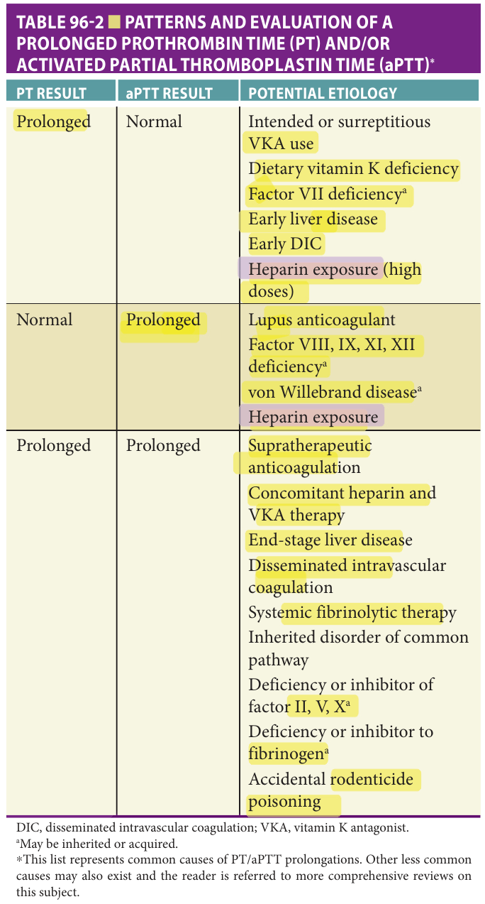

Study summary of Chapter 96; the book and the full chapter are the reference.

# Chapter 96 Study: Coagulation Disorders

## Summary

**Hemostasis & risk**
- Hemostasis progresses from platelet plug formation through coagulation, endogenous anticoagulant regulation and fibrinolysis (p1509–1510).
- Aging increases both bleeding and venous thrombosis risk. Acquired disorders and platelet number/function abnormalities are important causes of bleeding (p1509–1510).
- Annual VTE incidence is approximately **2–3 per 1000** overall and **7 per 1000** after **70** (p1515).

**Prolonged PT or aPTT (Table 96-2)**
- PT tests the extrinsic and common pathways and is the most sensitive test for factor VII deficiency; aPTT tests the intrinsic and common pathways and detects deficiencies of, or inhibitors to, factors II, V, VIII, IX, X, XI and XII (p1512).
- **Normal PT, prolonged aPTT**: lupus anticoagulant; factor VIII, IX, XI or XII deficiency; von Willebrand disease; heparin exposure. Subcutaneous heparin prophylaxis is the most common cause in hospitalized patients. Factor XI deficiency (hemophilia C) has a more variable bleeding history, often following surgical procedures. The lupus anticoagulant causes thrombosis rather than bleeding (p1512–1513).
- **Prolonged PT, normal aPTT**: VKA use, dietary vitamin K deficiency, factor VII deficiency, early liver disease, early DIC, high-dose heparin. **Both prolonged**: supratherapeutic anticoagulation, concomitant heparin and VKA, end-stage liver disease, DIC, systemic fibrinolysis, rodenticide poisoning (Table 96-2, p1513).
- Acquired hemophilia A (autoantibodies against factor VIII) is predominantly a disease of older adults, median age **64–78**; up to **50%** have no identifiable cause. Acute subcutaneous, gastrointestinal or muscle bleeding without trauma or a prior bleeding history should prompt evaluation; mortality exceeds **20%** if diagnosis is delayed (p1512).

**Thrombocytopenia (Table 96-3, Figure 96-3)**
- Causes in older adults: decreased production (B12 or folate deficiency, myelodysplastic syndrome, marrow failure or infiltration, medications, alcohol, infection), increased destruction (immune thrombocytopenia, SLE, antiphospholipid syndrome, HIT, drug-induced thrombocytopenia, infection, DIC, mechanical prosthetic valve, TTP), sequestration or other (chronic liver disease, hypersplenism, spurious, dilutional) (Table 96-3, p1513).
- ITP is isolated thrombocytopenia below **100 × 10^9/L**; incidence **2 to 5 per 100,000**, increasing with age. Petechiae, purpura and epistaxis usually appear below **30 × 10^9/L** (p1514).
- Drug-induced thrombocytopenia is the most common cause of thrombocytopenia in older adults and is usually evident within the first week of the causative drug. Figure 96-3 sorts it by onset: **<24 h**, immune-mediated by preexisting antibodies; **3–10 days**, immune-mediated anamnestic response; **>2 weeks**, nonimmune myelosuppression or immune-mediated primary alloimmunization. Table 96-4 lists trimethoprim/sulfamethoxazole among definite or probable causes (p1514).
- HIT: antibodies to platelet factor 4 increase platelet activation and consumption and raise the risk of both arterial and venous thrombosis; use validated tools such as the 4T score with serologic or functional testing (p1514–1515).

**Thrombosis risk (p1516)**
- Virchow triad: endothelial injury, impaired flow (stasis) and hypercoagulability. Factor V Leiden is the most common inherited thrombophilia, prevalence **5%** in unselected White populations, with a **three- to fivefold** VTE risk; prothrombin G20210A gives about a **threefold** risk (p1516).
- Acquired thrombophilias in older adults include antiphospholipid syndrome, HIT, hormone replacement therapy, myeloproliferative neoplasms and malignancy. Antiphospholipid syndrome needs persistent antiphospholipid antibodies with arterial or venous thrombosis or pregnancy complications; antibodies can also cause thrombocytopenia. Repeat an initial positive test after at least **12 weeks**; routine screening is not recommended (p1516).
- Malignancy carries a **four- to sevenfold** VTE risk, up to **20%** of all VTEs. Some anticancer therapies are prothrombotic (eg, lenalidomide, cisplatin, L-asparaginase). Polycythemia vera and essential thrombocythemia, especially with JAK2 V617F, are associated with arterial, venous and splanchnic thrombosis (p1516).

**Diagnosis**
- Clinical findings alone do not establish DVT: combine pretest probability, laboratory testing and imaging. Wells is the best-validated and most-used DVT prediction model (p1517).
- D-dimer also rises with age, infection, inflammation, cancer and surgery; false positives reduce specificity in older adults (p1517).
- PE may present nonspecifically with dyspnea, tachypnea, tachycardia or chest pain. Symptoms help estimate probability but cannot confirm the diagnosis (p1518).
- CTPA is the primary imaging test for suspected PE unless contraindicated, including severe renal insufficiency or contrast allergy (p1519).

**Management & drugs**
- For newly diagnosed primary ITP within **3 months**, platelets below **30 × 10^9/L** and no or minor mucocutaneous bleeding: prednisone **0.5–2.0 mg/kg/day** or dexamethasone **40 mg/day for 4 days** (p1514).
- With corticosteroids, monitor particularly for hypertension/hyperglycemia and insomnia, depression, gastric irritation, myopathy or osteoporosis (p1514).
- Anticoagulants reduce VTE recurrence and mortality; choose treatment and duration by balancing recurrence against bleeding risk (p1515).
- Warfarin requires parenteral anticoagulant overlap for at least **5 days** and until INR is above **2.0** for at least **24 hours**; therapeutic INR is **2.0–3.0** (p1520).
- Warfarin requires close INR monitoring because older adults may be more sensitive and have more food/drug interactions. DOACs are effective in carefully selected older adults (p1509, p1520).

### Working from the presentation to the test

- After excessive bleeding at an operation, ask about dental extraction, previous operations and spontaneous bruising. An isolated prolonged aPTT with a normal PT and platelet count changes the differential. In factor XI deficiency the history can be quiet until a hemostatic challenge. Vitamin K deficiency more often prolongs PT, while advanced DIC can prolong both tests (p1512–1513).
- A sudden low platelet count after starting trimethoprim/sulfamethoxazole fits drug-induced thrombocytopenia. A fall at **3–10 days** points to an anamnestic immune response in Figure 96-3. This differs from platelet activation in HIT, where a falling count can herald an arterial or venous clot (p1514–1515).
- Recurrent ischemic events with otherwise unexplained thrombocytopenia warrant considering antiphospholipid syndrome. Look for persistent antibodies in the appropriate clinical setting. Thrombocytopenia may accompany the syndrome even though thrombosis is its characteristic vascular complication (p1516).
- For suspected PE in an outpatient aged **50 years** or older with a suitable pretest probability, the book describes an age-adjusted D-dimer cutoff of **age × 10 µg/L** for assays with a conventional **500 µg/L** cutoff. A positive value is nonspecific. V/Q scanning can help when severe renal insufficiency or contrast allergy limits CTPA (p1519).
- Before and during anticoagulation, review kidney and liver function, platelet count, concomitant NSAIDs or antiplatelet drugs, and the patient's ability to take treatment reliably. Correctable risks include uncontrolled hypertension and unnecessary dual antithrombotic exposure (p1521–1522).

## Exam traps

- Uncomplicated DVT can generally be treated at home, but comorbid illness, bleeding risk or inadequate financial/home support may warrant admission (p1519).
- More sensitive CT detection of subsegmental PE has not been accompanied by a corresponding mortality decline; detection does not alone establish clinical significance (p1519).

## Exam-cited book images

Book images cited by past exams. Tap an image to zoom.

## Figure 96-3 — book image

[2026-Jun Q12](?chapter=bank&q=mcq-3906ed2ba944bc31f884ba0c)

## Table 96-2 — book image

[2023-Jun Q46](?chapter=bank&q=mcq-b80e76fc9d76538fb9789ac7)

## Past exam questions

- [2026-Jun Q12](?chapter=bank&q=mcq-3906ed2ba944bc31f884ba0c) — Printed page 1514.
- [2026-Jun-Basic Q107](?chapter=bank&q=mcq-08ad58cb588514eb5cb52bcb) — Printed page 1513.
- [2025-Jun Q99](?chapter=bank&q=mcq-531c47b20663cad65778d880) — Printed page 1516.
- [2023-Jun Q46](?chapter=bank&q=mcq-b80e76fc9d76538fb9789ac7) — Printed page 1513.

[Earlier sittings, chapter-level mapping](?chapter=96#asked-chapter) — 2022-Jun Q6, 2021-Dec Q25, 2021-Dec Q62.

## Recall drill

**1. Which laboratory pattern suggests an intrinsic-pathway problem?**

Answer
A prolonged aPTT with normal PT. Consider heparin exposure, factor deficiency or a circulating inhibitor, then use the bleeding history to narrow the possibilities. (p1512–1513)

**2. Which factor deficiency can first present with excessive surgical or dental bleeding?**

Answer
Factor XI deficiency can cause a variable bleeding history with few spontaneous events. (p1512–1513)

**3. What isolated PT abnormality can arise with inadequate nutrition?**

Answer
Vitamin K deficiency can prolong PT before the aPTT becomes abnormal. (p1512–1513)

**4. Why can a lupus anticoagulant confound the interpretation of a prolonged aPTT?**

Answer
It prolongs a laboratory clotting time while clinically being associated with thrombosis. (p1512–1513)

**5. What warrants evaluating for acquired factor VIII inhibition?**

Answer
New spontaneous skin, muscle or GI bleeding in an older adult without a prior bleeding history, particularly with a prolonged aPTT. (p1512)

**6. How does drug-induced thrombocytopenia within hours differ from a fall several days later?**

Answer
Preexisting antibodies can produce a fall within 24 hours. An anamnestic immune response typically occurs at 3–10 days in Figure 96-3. (p1514)

**7. Which complication should be sought when platelets fall during heparin therapy?**

Answer
Arterial or venous thrombosis. Use the clinical 4T score and appropriate laboratory testing to assess HIT. (p1514–1515)

**8. When does the book discuss initial corticosteroids for primary ITP?**

Answer
For newly diagnosed primary ITP, platelets below 30 × 10⁹/L and no or minor mucocutaneous bleeding. Monitor glucose, blood pressure and other steroid toxicity. (p1514)

**9. What do recurrent strokes with thrombocytopenia suggest?**

Answer
Consider antiphospholipid syndrome. An initial positive antibody test should be repeated at least 12 weeks later to establish persistence. (p1516)

**10. Which conditions in a thrombosis history imply an acquired hypercoagulable state?**

Answer
Examples include malignancy, nephrotic syndrome, antiphospholipid syndrome, HIT and myeloproliferative neoplasms. (p1515–1516)

**11. How can age complicate D-dimer interpretation?**

Answer
Aging, acute inflammation, surgery and malignancy can elevate D-dimer without an acute VTE, reducing specificity. (p1517)

**12. What age-adjusted D-dimer threshold does the book describe for suspected PE?**

Answer
Age in years × 10 µg/L in outpatients aged 50 or over when the assay uses a conventional cutoff of 500 µg/L, interpreted with clinical probability. (p1519)

**13. When might V/Q scanning help evaluate suspected PE?**

Answer
When contrast allergy or severe renal insufficiency makes CTPA unsuitable. A normal chest radiograph makes the scan easier to interpret. (p1519)

**14. What overlap is required when warfarin starts for acute VTE?**

Answer
Continue parenteral anticoagulation for at least 5 days and until the INR has been above 2.0 for at least 24 hours. (p1520)

**15. What medication changes may reduce bleeding during anticoagulation?**

Answer
Review the need for antiplatelet therapy and NSAIDs. Remove unnecessary antiplatelet treatment and consider an alternative analgesic where appropriate. (p1522)

