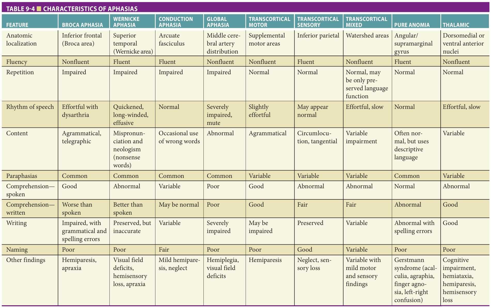

Study summary of Chapter 9; the book and the full chapter are the reference.

# Chapter 9 Study: Mental Status and Neurologic Examination

## Summary

**Normal aging versus disease**
- Combine a detailed history with a comprehensive examination; obtain collateral history from a reliable informant when cognition or affect may compromise the account (p133–135).
- Slower processing and retrieval can accompany aging, while new learning remains possible. Delayed word recall helps distinguish cognitive impairment from normal aging (p134).
- Distal vibration loss, reduced Achilles reflexes and restricted upward gaze may occur with aging; mild muscle wasting without focal signs need not signify disease (p133–134).
- An extensor plantar response is not normal aging: it indicates upper motor neuron pathology (p133–134).

**Mental status assessment**
- Assess observation, cognition, function and neuropsychiatric status together; patient denial or lack of awareness makes collateral information valuable (p135).
- Altered alertness accompanies cognitive deficits and an underlying medical illness that is almost always treatable; investigate it rather than attributing it to age (p133).
- Test language through spontaneous speech, comprehension, repetition, naming, reading and writing (p133).
- Animal fluency: approximately **18** animals in **1 minute** is normal; fewer than **14** is abnormal. The test is sensitive but lacks specificity (p141).
- Aphasias (Table 9-4, p138). Repetition separates the transcortical aphasias, in which it is normal, from Broca, Wernicke, conduction and global aphasia, in which it is impaired. **Transcortical motor**: nonfluent, slightly effortful, normal repetition, good spoken comprehension; supplemental motor areas. **Transcortical sensory**: fluent, normal repetition, abnormal comprehension; inferior parietal. **Transcortical mixed**: nonfluent, normal repetition, abnormal comprehension; watershed areas. **Broca**: nonfluent, impaired repetition, good comprehension; inferior frontal. **Wernicke**: fluent, impaired repetition, abnormal comprehension; superior temporal. **Conduction**: fluent, impaired repetition, variable comprehension; arcuate fasciculus.
- Attention and memory: a normal forward digit span is **seven** digits, fewer than **five** abnormal; a normal backward span is **five**, fewer than **three** abnormal. With a 10-word list, delayed recall of fewer than **five** words is abnormal; cues help retrieval deficits but not storage deficits such as amnesia (p139, p141).
- Informant tools: the AD8 asks eight questions about change; endorsement of **two** or more items suggests cognitive dysfunction and should trigger formal evaluation (p141).
- Hallucinations are nondelusional when the patient recognizes them as unreal. They occur with ocular and structural brain disorders and in Charles Bonnet syndrome; well-formed visual hallucinations (children, furry animals) are a prominent early sign of dementia with Lewy bodies, less well-formed ones occur in moderate to severe Alzheimer disease (p141).
- Insight: Alzheimer disease patients have impaired insight into their deficits; patients with vascular dementia and dementia with Lewy bodies often show more appropriate concern (p142).

**Neurologic examination**
- Examine cranial nerves, strength, coordination, sensation, tendon and pathologic reflexes, and neurovascular status; inspect the head and neck as well (p142).
- Test smell with familiar odors such as coffee or vanilla, each nostril separately; avoid complex perfumes or noxious ammonia (p142).
- Facial nerve (p143): with a central lesion the eyelid is usually not severely affected and the upper forehead is spared, while the nasolabial fold flattens. In a peripheral lesion such as Bell palsy the patient cannot close the eye or wrinkle the forehead.
- Trigeminal nerve: the corneal reflex runs through the ophthalmic division; stimulating one cornea should close both eyes. An isolated abducens palsy may signal raised intracranial pressure, since the sixth nerve has the longest intracranial course (p143).
- Strength grades: **0** no contraction, **1** contraction without limb movement, **2** movement with gravity eliminated, **3** movement against gravity, **4** against partial resistance, **5** normal. Distal weakness suggests neuropathy, proximal weakness muscle disease. The Hoover test detects functional weakness: weak voluntary hip extension but normal involuntary extension when the opposite hip flexes against resistance (p146).
- Romberg sign tests the dorsal columns: sway with eyes closed; a proprioceptive deficit is corrected with the eyes open. Ankle reflexes may be absent in normal aging, but knee reflexes persist. One or two steps of retropulsion are normal (p147).
- Pathologic and primitive reflexes (p147): Babinski sign, upper motor neuron lesion; **grasp reflex**, advanced brain disease and lesions restricted to the medial frontal lobes; sucking reflex, frontal lobe and diffuse brain dysfunction; palmomental reflex, seen in normal older individuals and may be regarded as pathologic when unilateral or nonfatiguing; glabellar reflex (Myerson sign), continued blinking in Parkinson disease and other basal ganglia disorders.
- Review gait and station alongside strength, joint disease, sensation and coordination. Medication adverse effects and interactions are significant contributors to falls (p134).

**Clinical use & exam traps**
- History and examination should generate the diagnostic hypotheses that guide laboratory, imaging and specialized studies (p133).
- Do not confuse slow processing with inability to learn, or a diminished ankle reflex with a pathologic plantar response (p134).
- Subtle age-associated memory changes do not impair normal social functioning or daily activities; more substantial cognitive decline requires evaluation (p148).

### Localizing common examination findings

- Ask a patient with halting spontaneous speech to repeat a sentence and follow spoken instructions. Preserved repetition and comprehension with limited initiation fit transcortical motor aphasia. Broca aphasia also reduces fluency but impairs repetition. With fluent speech, compare comprehension and repetition separately to distinguish Wernicke, conduction and transcortical sensory patterns (Table 9-4, p138).
- Have the patient raise the eyebrows, close the eyes tightly and smile. Flattening of the nasolabial fold with forehead sparing suggests a central lesion. Weakness involving forehead and eye closure on the same side supports a peripheral facial palsy. A new facial asymmetry has more localizing value when the upper and lower face are examined separately (p143).
- When a visually impaired patient sees unfamiliar people or animals, ask whether the patient believes they are real. Preserved recognition of the experience as unreal is compatible with Charles Bonnet syndrome. Formed images can also occur early in dementia with Lewy bodies, so assess cognition, insight and other neurologic features alongside the visual history (p141–142).
- Examine how an abnormal task went wrong. A clock with numbers confined to one side suggests neglect, while an excessively small clock face can reflect poor planning. Compare delayed free recall with recognition to distinguish a retrieval or executive problem from failure to store the material (p139–141).
- Test the significance of reflexes in context. An extensor plantar response points to corticospinal disease. A grasp response can occur in advanced diffuse disease or a focal medial frontal lesion. The level of the knee reflex and the side of any other motor signs help distinguish generalized age changes from a localizing deficit (p133–134, p147).

### Localize the complaint before interpreting a score

A patient reports that their “memory is going.” Ask for the event that led them to say this: a missed appointment, trouble naming someone familiar, losing the thread of a conversation, or getting lost in a familiar place. Each describes a different operation. Establish the previous level of ability, what the patient still does independently, when the change began, and whether it is steadily progressive or comes and goes. Ask a reliable informant for observations of the same functions. A difference between the accounts can itself give information about insight; it does not automatically make either history useless (p133–135).

Establish whether the patient can hear, see and understand the task. A person who did not hear a list could not have encoded it, and one who cannot see a line drawing cannot demonstrate impaired object naming on the basis of that drawing. Slower responses commonly accompany aging, particularly on tasks with a speed component. Give enough time to show what has been retained. New inability to learn, an abrupt change in level of alertness or a focal deficit calls for a different explanation. Table 9-1 is useful precisely because it describes a pattern of possible age changes rather than an excuse to dismiss any isolated finding in an older patient (p133–135, p140).

Examination begins during the interview. Watch whether the patient can sit, rise, orient to a voice, sustain eye contact and spontaneously use both sides of the body. Dressing or grooming only one side can suggest neglect. A quiet face and flexed posture can accompany parkinsonism; a withdrawn or disheveled appearance has several possible explanations, including depression, delirium and a neurodegenerative condition. Compare observed behavior with the patient's usual presentation and with the history of change at home. Table 9-2 organizes these observations with assessment of function, cognition and neuropsychiatric symptoms (p135–136).

### Arousal, attention, encoding and retrieval

A wrong answer about the date in someone fully engaged is a different finding from failure to remain awake long enough to hear the question. Describe the state of arousal before giving a cognitive score. Ask whether stimulation briefly restores contact, whether attention fluctuates during the examination, and whether a conversation can be sustained. Delirium can cause an altered sensorium, disturbed sleep–wake cycle and perceptual changes; dementia can impair cognition in a clear sensorium. A patient with established dementia may also develop a new confusional illness, so baseline function and time course matter (p137, p148–149).

Digit span forward tests immediate attention. Present the digits at about **one per second** and observe both the length achieved and how the patient fails. Losing the task and answering something unrelated differs from consistently reversing a pair of digits. Asking for months backwards or another continuous task adds a sustained-attention demand. Serial subtraction depends in part on education and arithmetic ability, so an error there is not specific to inattention. Backward digit span additionally requires the patient to hold and manipulate the sequence rather than merely repeat it (p139, p141).

For memory, first make sure the patient actually learned the material. Repeating **three words** immediately and asking for them **3 minutes** later is quick, but a high-functioning patient may exploit recall of the beginning and end of a very short list. On a **10-word** list the chapter considers delayed recall of fewer than **five** abnormal. Next offer a category cue or recognition choices. Improvement suggests that information was stored but could not readily be retrieved. Failure even with prompting makes a storage deficit more plausible, provided initial attention and learning were adequate (p139).

This sequence gives a way to explain the result without equating poor recall with one disease. The chapter associates amnestic storage failure with hippocampal–thalamic circuitry and a retrieval pattern with frontal–basal ganglia circuitry. Add the history of remote personal events, recent functional changes and the rest of the examination. A person with executive dysfunction may do poorly on free recall but recognize the targets and show difficulty switching rules or organizing a task. A screen based on the number of missing words alone loses this distinction (p139, p141).

### Listening to speech and testing a language network

Before naming an aphasia, separate articulation from the ability to formulate a message. Dysarthria can make every word hard to understand while word choice, grammar and comprehension remain appropriate. Ask the patient to describe what happened and listen to fluency, effort, pauses, grammatical structure and substitutions. Follow with a spoken instruction, a naming item, a phrase to repeat and, when feasible, reading and writing. A fluent stream of words is not proof that the patient understood the question, and a poorly articulated response is not proof that conceptual knowledge has been lost (p138–140).

Table 9-4 becomes easier to use if clustered by repetition. When repetition is impaired in a nonfluent patient, good comprehension favors Broca aphasia; severe deficits in both production and comprehension point toward a more global disturbance. With fluent output and impaired repetition, poor comprehension fits Wernicke aphasia while relatively better comprehension raises conduction aphasia. Preserved repetition shifts attention to the transcortical patterns. Ask the patient to carry out a command *and* repeat a sentence; rote repetition by itself does not demonstrate that the content was understood (p138–139).

In the watershed-stroke question, the patient understands an instruction and repeats even long sentences accurately but cannot initiate fluent speech. The behavioral profile fits transcortical motor aphasia. In transcortical sensory aphasia the patient can also repeat, but comprehension is abnormal and speech is fluent. In mixed transcortical aphasia repetition may stand out as an island of preserved function amid impaired comprehension and nonfluency. The location mentioned in a stem supports localization, but the combination of bedside findings distinguishes these syndromes more reliably than choosing an answer from the vascular label alone (p138).

Find out why the patient failed to name a displayed object. If it can be identified by touch or described by its use but not recognized visually, loss of visual recognition becomes relevant. If common items can be named but less familiar ones cannot, increase the difficulty gradually. Writing adds another way into the network: an aphasic writing error differs from a progressively shrinking script in parkinsonism or poor pen control from limb weakness. Acalculia, agraphia, finger agnosia and confusion of right and left are the constellation described in Gerstmann syndrome (p139–140).

### Executive, spatial and neuropsychiatric findings

A clock drawing combines comprehension, knowledge of the clock, planning, spatial distribution of the numbers and motor execution. Record the error as well as whether the drawing passed. A clock too small for its contents shows a planning difficulty. Numbers placed only on one side suggest neglect. Copying a figure can reveal distortion, repeated elements or drawing directly over the model. Examine primary vision first and look for corroborating neglect in grooming, confrontation testing or spontaneous use of space (p136, p140, p142).

Verbal generation tasks challenge search and organization, as well as language. In the animal-naming task, repeated examples, long pauses and inability to change subcategories can be informative even before counting the total. Reduced output is sensitive to cognitive dysfunction but has many possible causes. Test set shifting, abstraction or sequential motor programming when the report concerns poor planning or perseveration. Ask someone familiar with the patient whether these difficulties are new and whether they now interfere with finances, judgment or other usual activities. A positive AD8 prompts more formal evaluation (p140–141).

A visual hallucination is a perception without the corresponding stimulus. Ask what the person saw, whether it had a definite shape, what they believe caused it and how they responded. The patient with retinal disease who sees people or animals at home but knows they are unreal illustrates Charles Bonnet syndrome. The content of a well-formed image alone does not make the diagnosis: dementia with Lewy bodies can also cause recurrent formed visual hallucinations, usually in a broader syndrome that may include fluctuating cognition and parkinsonian findings. New drowsiness or inattention changes the differential again (p141–142, p148–149).

### From the pupils to the lower cranial nerves

Check vision in each eye, examine the fields and compare responses to stimulation on each side and on both sides together. Pupillary size, symmetry, direct and consensual light responses and accommodation convey different information. Tables 9-5 through 9-7 organize pupillary patterns, nystagmus and eye-movement deficits. Small sluggish pupils and restricted elevation can occur with age. New anisocoria, double vision, nystagmus or a discrete extraocular movement deficit deserves localization. An isolated abduction deficit is important even without other obvious weakness because a sixth nerve palsy can occur with raised intracranial pressure (p142–144).

Distinguish the sensory input to the corneal reflex from its motor output. The ophthalmic division of the trigeminal nerve carries the stimulus from the cornea. The expected response is closure of both eyelids. Afferent loss on one side may therefore abolish the response when that cornea is stimulated, while stimulation of the intact side can still provoke blinking. Facial weakness can impair closure of an affected eyelid despite intact corneal sensation. Separate these observations before concluding that failure to blink represents a lesion of the same nerve in every patient (p143).

Facial asymmetry is assessed during spontaneous expression as well as commanded movement. Ask the patient to raise the forehead, squeeze the eyes shut and show the teeth; compare the upper and lower face on each side. In the exam vignette showing peripheral facial weakness, difficulty closing the eye accompanies the lower facial droop. Central weakness commonly flattens the opposite nasolabial fold while sparing the forehead. Table 9-8 lists several causes of peripheral facial palsy, so the anatomical pattern does not, on its own, establish idiopathic Bell palsy as the cause (p143–144).

When hearing appears impaired, check for asymmetry and distinguish a conductive deficit from sensorineural loss. In a Weber test, vibration can be louder on the affected side with conductive loss, a potentially counterintuitive result. Compare air and bone conduction as well, and interpret the pattern with the history. Next assess voice, swallowing, palatal movement, shoulder shrug, head rotation and tongue movements. Slurred speech or poor oral intake can reflect a lower cranial nerve or motor problem even when comprehension and word selection are intact (p144–145).

### Motor, sensory, coordination and gait examination

Begin the motor assessment by looking for asymmetry, wasting, abnormal resting position and involuntary movement. Test comparable muscles on the two sides, and compare proximal against distal weakness. Observe whether the limb moves with gravity eliminated, against gravity or against additional resistance. In the mapped stroke question, a hand moving against gravity but not resistance earns **3/5**; a leg with no contraction earns **0/5**. A visible or palpable contraction with no limb movement instead earns **1/5**. The examiner needs to check for that contraction before equating an immobile limb with a completely inactive muscle (p145–146).

Tone is the resistance the examiner feels when moving a relaxed limb. Describe whether the resistance is constant, catches during movement, is interrupted in a cogwheel pattern or varies because the patient actively opposes testing. Distracting the patient with a movement of the opposite hand can make rigidity easier to discern. Table 9-3 also distinguishes an action tremor from a tremor present at rest, brief positive muscle jerks from the lapses of sustained posture in asterixis, and bradykinesia from weakness. Observation at rest and during a goal-directed task is more informative than the word “shaking” (p137, p145–146).

For primary sensation, map the abnormality. A distal symmetric stocking pattern suggests a different level from a deficit confined to a dermatome. To assess vibration, the chapter uses a **128-Hz** tuning fork; distal vibration perception can diminish with age and loss may extend proximally. Test joint position with the patient's eyes closed. A deficit that can be compensated by vision can become apparent in stance when the eyes close. Only after establishing primary sensation can an inability to identify an object by touch support a cortical sensory deficit (p134, p146–148).

Use finger-to-nose, heel-to-shin and rapid alternating movements to separate slowness from loss of accuracy. An overshoot or undershoot is dysmetria. Irregular rapid alternating movements suggest dysdiadochokinesia; an action tremor that worsens as the finger approaches its target can support a cerebellar localization. Major unilateral incoordination is different from mild age-associated slowing. Interpret the maneuver in light of weakness, joint restriction and sensory loss, each of which can interfere with performance without primary cerebellar disease (Table 9-11, p146–147).

Look first at ordinary walking, then at turns, arm swing, posture and balance. A shuffling pattern with reduced arm swing and rest tremor suggests parkinsonism; hemiparetic weakness, sensory ataxia and a cerebellar wide-based gait produce different accompanying findings. Table 9-12 ties gait appearances to the rest of the examination. Assess positional blood pressure, pulses and relevant vascular findings alongside neurologic signs. A gait diagnosis that ignores new drug exposure, orthostasis or painful joints can miss the cause of the fall that brought the patient in (p134, p147–148).

Finally, combine cortical and motor clues. In Table 9-13, prominent early loss of memory and limited insight, early behavioral disinhibition with relative sparing of posterior functions, and fluctuating cognition with formed hallucinations and extrapyramidal signs suggest different dementia syndromes. Table 9-14 reminds the examiner to review medications when the sensorium has changed acutely. A focal sign localizes a lesion; a time course and level of arousal place it in a clinical syndrome. Both are needed before moving from the examination to a proposed explanation (p148–149).

## Exam traps

- A patient with nonfluent speech who can repeat a sentence may have transcortical motor aphasia. Test repetition before labeling it Broca aphasia (p138).
- A unilateral facial droop with forehead sparing points toward a central lesion. Test brow movement and eye closure as well as the smile (p143).
- A grasp reflex can localize to a medial frontal lesion as well as occur in advanced diffuse disease (p147).

## Exam-cited book images

Book images cited by past exams. Tap an image to zoom.

## Table 9-4 — book image

[2026-Jun Q41](?chapter=bank&q=mcq-6885558109e8e77f5cee7a87)

## Past exam questions

- [2026-Jun Q41](?chapter=bank&q=mcq-6885558109e8e77f5cee7a87) — Printed page 138.
- [2025-Jun Q16](?chapter=bank&q=mcq-c9d51b9f2f9b51f0a157938b) — Printed page 147.
- [2025-Jun Q34](?chapter=bank&q=mcq-b636980ea067e5dc8b2d57c5) — Printed page 141.
- [2025-Jun Q62](?chapter=bank&q=mcq-57c893ac288cd17663b1e3c3) — Related bank item. Its bibliography does not give a printed Hazzard page for this chapter.
- [2024-May Q4](?chapter=bank&q=mcq-2424f3d42a504ae0a13087cd) — Printed page 143.
- [2024-Sep Q37](?chapter=bank&q=mcq-ff32d387904a513e1d0cd5a1) — Related bank item. Its bibliography does not give a printed Hazzard page for this chapter.

## Recall drill

**1. Why can a reliable informant change the interpretation of memory complaints?**

Answer
Collateral history establishes change from baseline and functional impact when the patient underestimates or cannot describe deficits. (p133–135)

**2. Which aspects of language should be assessed before naming an aphasia?**

Answer
Listen to spontaneous fluency, then assess comprehension, repetition, naming, reading and writing. (p133, p138)

**3. What points to transcortical motor aphasia in a patient with nonfluent speech?**

Answer
Repetition and spoken comprehension are retained despite difficulty generating spontaneous language. (p138)

**4. How does conduction aphasia differ from transcortical sensory aphasia?**

Answer
Both can be fluent. Repetition is impaired in conduction aphasia and retained in transcortical sensory aphasia, whose comprehension is abnormal. (p138)

**5. How can cueing help distinguish retrieval from storage failure?**

Answer
Improvement with cues or recognition supports a retrieval problem. Poor recall despite cues favors impaired storage. (p139, p141)

**6. What does one-sided crowding of a clock drawing suggest?**

Answer
Unilateral neglect. Making the entire clock too small for the numbers can instead reflect impaired planning. (p140)

**7. How is animal fluency interpreted in this chapter?**

Answer
About eighteen animals in a minute is normal and fewer than fourteen is abnormal. The result is sensitive but nonspecific. (p141)

**8. Which informant screen asks about change in everyday thinking?**

Answer
The AD8. Two or more endorsed items suggest cognitive dysfunction and should prompt further assessment. (p141)

**9. An older person with impaired vision sees figures recognized as unreal. Which syndrome fits?**

Answer
Charles Bonnet syndrome. Ask about insight, visual loss, cognition and associated neurologic features. (p141–142)

**10. What bedside movements distinguish central and peripheral facial weakness?**

Answer
Compare brow wrinkling, eye closure and smiling. A peripheral palsy weakens the forehead and eye closure, whereas a central lesion usually spares the forehead. (p143)

**11. How should the examiner test olfaction?**

Answer
Present a recognizable, nonirritating odor such as coffee or vanilla separately to each nostril. (p142)

**12. How do sensory and cerebellar imbalance differ on Romberg testing?**

Answer
With impaired proprioception the patient can use vision to compensate. Sway worsening when the eyes close supports sensory imbalance. (p147)

**13. What does a positive Hoover test show?**

Answer
Voluntary hip extension appears weak, but involuntary extension is present when the opposite hip flexes against resistance, supporting functional weakness. (p146)

**14. Where does an elicited grasp reflex localize?**

Answer
It can accompany a medial frontal lesion or occur in advanced brain disease. It is not equivalent to an extensor plantar response. (p147)

**15. Which reflex changes can be attributed to age more readily than a Babinski sign?**

Answer
The Achilles reflex may diminish or disappear while knee reflexes persist. An extensor plantar response indicates upper motor neuron pathology. (p133–134, p147)

